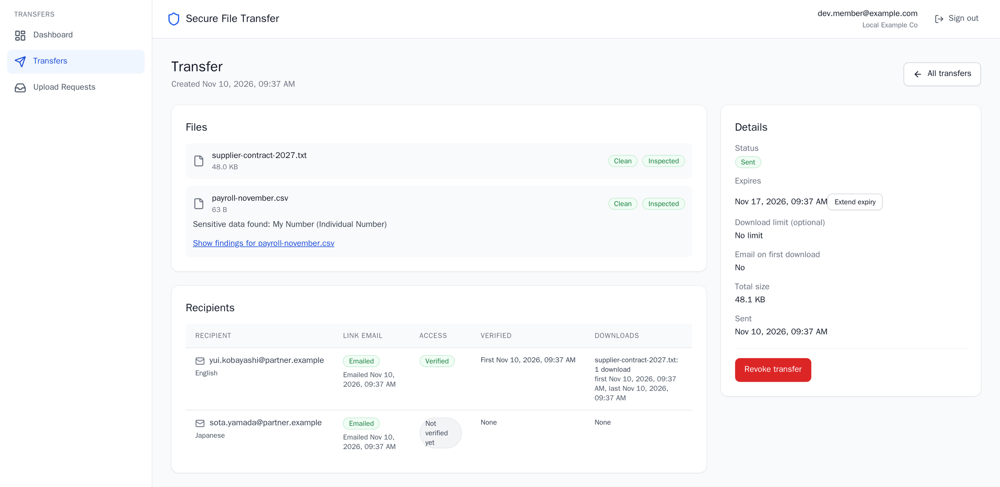
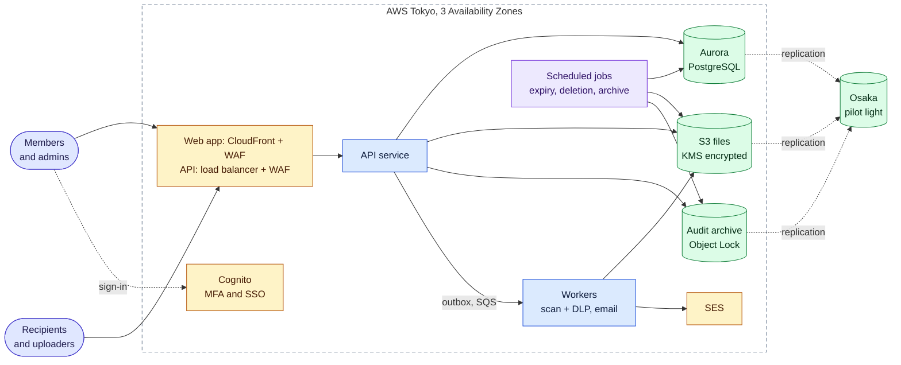

<h1 align="center">Secure File Transfer</h1>

<p align="center">
  <strong>Share confidential files with people outside your company, and collect files from them,<br>
  without losing control once you press send.</strong>
</p>

<p align="center">
  <a href="https://github.com/codewithmuh/secure-file-transfer/releases/latest"></a>
  <a href="https://github.com/codewithmuh/secure-file-transfer/actions/workflows/ci.yml"></a>
  <a href="#license"></a>
</p>

<p align="center">
  <a href="#what-it-does">Features</a> ·
  <a href="#how-it-works">How it works</a> ·
  <a href="#security-by-design">Security</a> ·
  <a href="#reliability-and-operations">Reliability</a> ·
  <a href="#quick-start">Quick start</a> ·
  <a href="docs/README.md">Documentation</a>
</p>

Companies exchange confidential files with outsiders every day: contracts with a customer, payroll with an
accountant, drawings with a supplier. Email attachments are capped in size, can't be recalled, and leave no record of
who opened what. Secure File Transfer replaces the attachment with a link that expires. The recipient proves they
control the invited address before they see anything. Every file is scanned for malware and checked against the
company's data loss prevention rules before it can leave. Every action is in the audit log, and an admin can revoke
access at any moment.

> [!NOTE]
> **A reference service, built to the standard of a real B2B SaaS team.** It was built the way such a team ships a
> product: requirements, system design, a threat model, decision records, tests, SLOs, runbooks and drills. It is not a
> production business: it has no customers, no support and no uptime commitment, so don't use it to move real
> confidential data. Companies that want to run it can [license it](#license).

<p align="center">
  
</p>

## What it does

| Capability | What it does |
|---|---|
| **Send** | Up to 50 files to up to 50 recipients, each file up to 5 GB and 20 GB a transfer. The link expires after 1 hour to 30 days, with an optional download limit. An interrupted upload resumes where it stopped. |
| **Request** | Send an upload link so someone outside the company can deliver files to you. Received files are kept for the tenant's retention period, then deleted. |
| **Verify** | Recipients and uploaders prove they control the invited address with a one-time code before they see a file name. A forwarded link, or a forwarded download address, grants nothing. |
| **Scan** | Every file is scanned for malware before it can be downloaded: ClamAV up to 2 GB, GuardDuty Malware Protection above. An infected file can never be downloaded, by anyone. |
| **Prevent data loss** | Files and messages are inspected for My Numbers, payment cards, bank accounts, credentials, private keys and the company's own keywords, in English and Japanese. The company's rules allow a transfer, ask the sender to confirm, send it to an approver, or block it. |
| **Revoke and expire** | Links stop working when they expire or are revoked. Files are then deleted from every copy, backups and the disaster-recovery region included. |
| **Audit** | Every security-relevant action is recorded with who, what, when and from where. Admins search the log and export it as CSV or JSON. |
| **Administer** | Admins manage members and roles, tenant policy, recipient domain rules, DLP rules and approvers, and API keys, and read DLP reports. |
| **Sign in** | Members sign in with MFA (TOTP or a passkey), or through the company's own identity provider over OIDC or SAML. Sensitive changes ask them to sign in again. |
| **Automate** | Scoped API keys use the same versioned REST API as the web app, described in [OpenAPI 3.1](docs/api/openapi.yaml). |

The web app and every email are in English and Japanese. The [PRD](docs/prd.md) has the full scope, the non-goals and
every target.

## How it works



One API service and its workers, built from one codebase, with PostgreSQL as the single system of record. A transfer,
from send to download:

1. **Upload.** A member creates a transfer. The browser uploads parts straight to S3 through short-lived URLs signed
   for each part's exact size, and the API completes the upload only after re-checking the transfer.
2. **Scan and inspect.** A scan worker streams each file to ClamAV and to the DLP inspector in one pass. Both run in
   pods with no credentials; the inspector also has no network.
3. **Decide.** Once every file is shareable, the tenant's DLP rules decide: send, ask the sender to confirm, wait for
   an approver, or hold.
4. **Notify.** The notification worker emails each recipient their own link. The service keeps only a hash of it.
5. **Verify.** The recipient opens the link and enters the code sent to the invited address.
6. **Download.** The API streams the file from S3 under a grant bound to that verified session. It counts the
   download once and writes the audit record before the first byte.

[docs/architecture.md](docs/architecture.md) has the containers, the deployment, every flow and the failure handling.

## Security by design

- **Encryption and keys.** TLS 1.2 or later on every hop that carries customer data. Files, the database, queues and
  backups are encrypted with KMS keys, one per data class. File names, messages and DLP finding details are sealed
  again with per-tenant data keys. [Encryption and keys](docs/security/encryption-and-keys.md)
- **Tenant isolation.** Every row carries its tenant and every query runs in an explicit scope, with PostgreSQL
  row-level security behind it. An isolation suite tries every endpoint with another tenant's IDs and tokens on every
  pull request. [ADR-0003](docs/adr/0003-multi-tenancy-shared-schema.md),
  [ADR-0020](docs/adr/0020-row-level-security.md)
- **Authentication and authorization.** Member sign-in through Cognito with mandatory MFA, or the tenant's SSO.
  Server-side sessions, step-up for sensitive changes, and an authorization matrix tested for every role and every
  operation. Operators can't read file contents; break-glass access is time-boxed, approved, audited and alerted.
  [Authentication and authorization](docs/security/authn-authz.md)
- **No bearer download links.** Downloads stream through the API under a grant bound to the verified session, so a
  forwarded URL is useless and a revocation stops a running download.
  [ADR-0018](docs/adr/0018-stream-downloads-through-api.md)
- **Malware scanning.** No file is downloadable before its scan. The API's role can read only objects whose scan tag
  allows it, and S3 denies an infected object to everyone.
  [ADR-0019](docs/adr/0019-malware-scanning-clamav-guardduty.md)
- **Data loss prevention.** Inspection runs in sandboxed pods, a fresh process per file. A finding records the
  detector, counts and a masked preview, never the value. [ADR-0022](docs/adr/0022-dlp-inspection-engine.md),
  [DLP detectors](docs/design/dlp-detectors.md)
- **Audit.** Each record is written in the same transaction as the change it describes, a download fails closed
  without its record, and records are archived under S3 Object Lock in both regions for 365 days.
  [Architecture 5.2](docs/architecture.md#52-audit-trail)
- **Abuse limits.** Rate limits per IP, account and tenant on sign-in, verification, links, uploads and downloads,
  with WAF in front. Twenty wrong codes lock a recipient out.
  [Abuse and rate limits](docs/security/abuse-and-rate-limits.md)
- **Network and supply chain.** A private cluster; egress only through VPC endpoints or an allowlisting proxy; DNS
  Firewall. Images are signed with cosign and admitted by digest and signature.
  [ADR-0021](docs/adr/0021-network-design-and-egress.md), [ADR-0007](docs/adr/0007-container-registry-ecr.md)

The [threat model](docs/threat-model.md) walks every trust boundary with STRIDE and names the test, check or drill
that proves each group of mitigations. To report a vulnerability, see [SECURITY.md](SECURITY.md).

## Reliability and operations

Prod runs in Tokyo across three Availability Zones. Osaka is a pilot light: the database, the files and the audit
archive replicate there continuously, and compute starts only when an operator decides to fail over. Every release
promotes the same signed image digests from dev to staging to prod through Argo CD.

| Objective | Target |
|---|---|
| Availability of the API and downloads | 99.9 % over a rolling 28 days |
| API latency | p95 ≤ 300 ms, p99 ≤ 1 s |
| Time to shareable | p95 ≤ 2 minutes when the largest file is up to 100 MB; ≤ 15 minutes up to 20 GB |
| Malware scan and DLP inspection | p95 ≤ 60 s and p99 ≤ 3 minutes for files up to 100 MB |
| Losing an Availability Zone | Automatic recovery: RTO ≤ 5 minutes, no data lost |
| Losing the Tokyo region | Fail over to Osaka: RTO ≤ 1 hour; RPO ≤ 5 minutes of metadata and ≤ 15 minutes of uploads for 99.99 % of files |
| Data corruption | Restore to any point in the last 14 days: RTO ≤ 2 hours |
| A bad release | Rolled back in ≤ 10 minutes |

These are targets from the [PRD](docs/prd.md#6-non-functional-requirements) and the [SLOs](docs/operations/slos.md),
not measurements: nothing has run against real traffic yet.

- **Observability.** OpenTelemetry traces, Prometheus metrics and Loki logs, with Grafana dashboards defined as code.
  [Observability](docs/operations/observability.md), [metrics](docs/operations/metrics.md)
- **Alerting.** Multi-window burn-rate alerts on each SLO, CloudWatch alarms outside the cluster with a heartbeat
  that pages when the cluster goes silent, and EventBridge alerts on security events such as a KMS key policy change
  or a privileged sign-in.
- **Runbooks.** Every alert links to its [runbook](docs/runbooks/README.md), and a test fails the build if one is
  missing.
- **Drills.** Failover, failback, Availability Zone loss, point-in-time restore and teardown each have a runbook and
  a script that dry-runs by default, times every step and writes the drill log.
  [Disaster recovery](docs/operations/disaster-recovery.md)

## Engineered like a product team

Planning came first. Phases 1 to 5 each produced their documents through their own issue and pull request before
feature work began, and operations arrived with the features they watch. The [documentation hub](docs/README.md) maps
every document by reader.

| Phase | Documents |
|---|---|
| 1. Requirements | [PRD](docs/prd.md): users, use cases, non-goals and 26 measurable non-functional requirements |
| 2. System design | [Architecture](docs/architecture.md), [data model](docs/design/data-model.md), [API contract](docs/api/README.md), [capacity and cost](docs/design/capacity-and-cost.md) |
| 3. Security design | [Threat model](docs/threat-model.md), [authentication and authorization](docs/security/authn-authz.md), [encryption and keys](docs/security/encryption-and-keys.md), [abuse and rate limits](docs/security/abuse-and-rate-limits.md) |
| 4. Decisions | [22 architecture decision records](docs/adr/), each with the options considered and the trade-offs |
| 5. Delivery | [Delivery plan](docs/delivery-plan.md): milestones in thin vertical slices, and a definition of done |
| 6. Operations | [SLOs](docs/operations/slos.md), [disaster recovery](docs/operations/disaster-recovery.md), [performance](docs/operations/performance.md), [runbooks](docs/runbooks/README.md) |

Every change starts as an issue and lands through a reviewed pull request with green CI. The isolation suite, the
authorization matrix and the API contract checks run on every pull request.

## Quick start

You need Docker (Compose v2.20 or later, with about 3 GB of memory), [uv](https://docs.astral.sh/uv/) and
[pre-commit](https://pre-commit.com/), or the Dev Container.

```bash
make setup   # check the prerequisites, install dependencies and the git hooks
make up      # the API, the workers, the web app and local stand-ins for every AWS service
make seed    # a tenant with an admin, a member and a DLP approver
make smoke   # optional: one round trip to every service
```

Open **http://localhost:3000** (always `localhost`, never `127.0.0.1`) and sign in:

| Who | Sign in with |
|---|---|
| Member | `dev.member@example.com` / `local-only-member-password` |
| Admin | `dev.admin@example.com` / `local-only-admin-password` |
| Approver | `dev.approver@example.com` / `local-only-approver-password` |
| Recipient or uploader | No account: the link and the code arrive in Mailpit, at http://localhost:8025 |

These credentials are fake and work only against the local stack. `make check` runs CI's checks, and `make e2e` and
`make web-e2e` run the end-to-end journeys against the seeded stack.
[Local development](docs/local-development.md#how-to-test-locally) walks through every flow and lists how the local
stand-ins differ from AWS.

## Project status

The product and its infrastructure are built. Milestones M0 to M7 and M8's follow-ups are merged; what remains is the
AWS run.

**Built and checked** in CI on every pull request:

- Every functional requirement of the PRD, Must and Should. The local stack runs them end to end, with stand-ins for
  the AWS services. The journeys for sending, receiving and the three DLP outcomes run in CI through the API, and
  through the browser in English and Japanese.
- Terraform for dev, staging and prod with the Osaka pilot light: fmt, validate, tflint, Trivy and `terraform test`.
- The Helm chart and Argo CD applications for every cluster: rendered, validated, and checked against the admission
  policies and the runtime contract.
- SLOs, alert rules with unit tests, CloudWatch alarms, dashboards, runbooks and the drill scripts' dry runs.

**Pending the AWS run:** applying the environments; Cognito, SES, GuardDuty, KMS and WAF against real AWS; the
synthetic probe live; the load test at 1× and 2× design load; the failover, failback, Availability Zone and restore
drills with measured RTO and RPO; the operating period; and the timed teardown. Each will be recorded in `docs/` as it
runs.

## Tech stack

| Area | Choice |
|---|---|
| API and workers | Python 3.13, FastAPI, SQLAlchemy 2.0, Alembic: one codebase and one image |
| Web app | React 18, TypeScript, Vite, Tailwind CSS, TanStack Query |
| Data | Aurora PostgreSQL with a global database in Osaka, S3 with cross-region replication, SQS fed by a transactional outbox, ElastiCache Serverless for Valkey |
| Security services | KMS, Secrets Manager, Cognito, WAF, GuardDuty Malware Protection, ClamAV |
| Email | Amazon SES in Tokyo and Osaka |
| Platform | EKS with Karpenter, Argo CD, Kyverno, an Envoy egress proxy |
| Infrastructure and CI | Terraform, GitHub Actions with OIDC, ECR with cosign signatures |
| Observability | OpenTelemetry, Prometheus, Alertmanager, Loki, Tempo, Grafana, CloudWatch |
| Testing | pytest, Vitest, Playwright with axe, k6, promtool, `terraform test` |

[Architecture section 9](docs/architecture.md#9-technology-decisions) links each choice to its ADR.

## Repository layout

```
services/api/   the API service and every worker: one codebase, one image
web/            the web app, served from S3 and CloudFront
infra/          Terraform for every AWS account, environment and Region
deploy/         Helm charts, Argo CD applications, alert rules and dashboards
ops/            failover, failback, restore, drill and teardown scripts
loadtest/       the k6 load test and the DLP inspection benchmark
local/          the local stack's configuration, seed and smoke checks
docs/           requirements, design, security, decisions, operations and runbooks
compose.yaml    the local stack
Makefile        every command: run `make` to list them
```

## Contributing

Issue first, one branch per issue or small batch, then a pull request with a Conventional Commit title. It merges
after a code review and green CI. release-please turns the merged commits into versioned releases and a changelog.
[CONTRIBUTING.md](CONTRIBUTING.md) has the workflow, the standards and the contribution licensing terms.

## Security

Report a vulnerability privately, as [SECURITY.md](SECURITY.md) describes; please don't open a public issue. No
secrets live in git: gitleaks runs in pre-commit and in CI, and runtime secrets live in AWS Secrets Manager.

## License

Source-available under the [PolyForm Noncommercial License 1.0.0](LICENSE) © 2026 Muhammad Rashid
([CodeWithMuh](https://codewithmuh.com)). It is not open source.

- **Free** to read, run and change for learning, personal projects, research, teaching and non-profit use.
- **Commercial use needs a licence**: running it for a company or its customers, hosting it as a service, or using the
  code in a product or in paid client work.

[COMMERCIAL-LICENSE.md](COMMERCIAL-LICENSE.md) explains what is allowed and how to get a commercial licence. Contact:
[contact@codewithmuh.com](mailto:contact@codewithmuh.com) ·
[LinkedIn](https://www.linkedin.com/in/muhammad-rashid-daha) · [YouTube](https://youtube.com/@codewithmuh).
