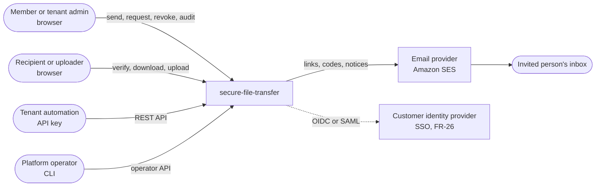
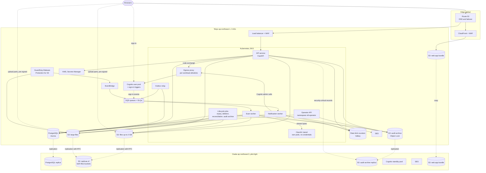
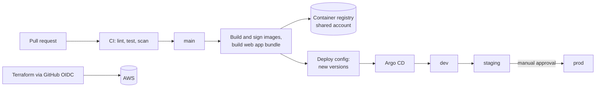
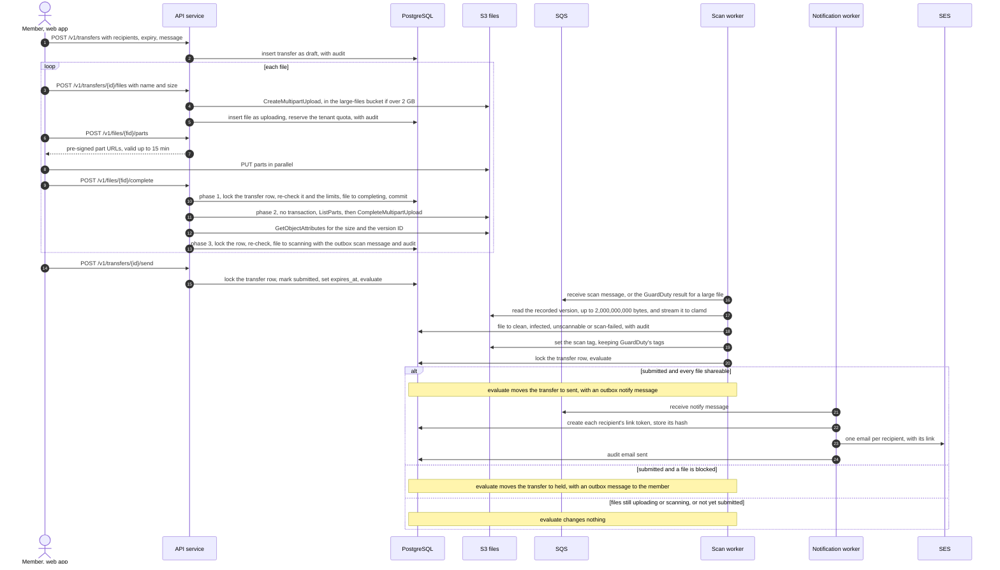
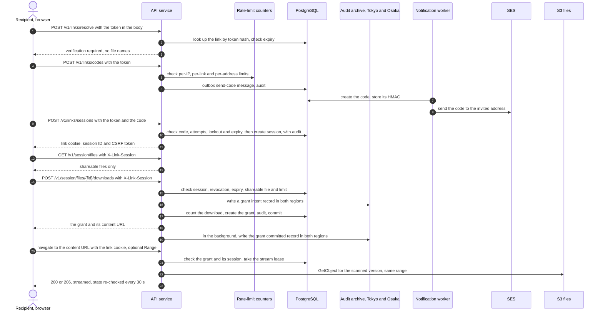
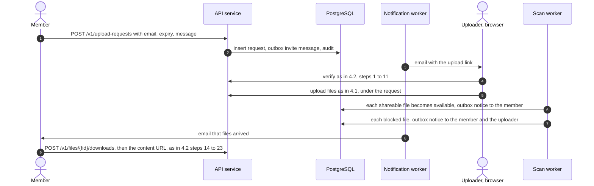
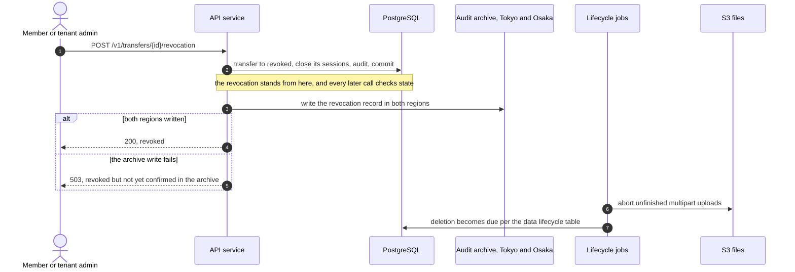
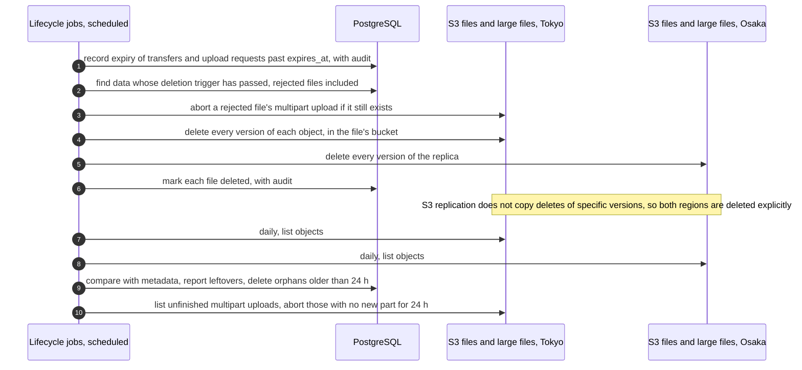

# Architecture

> Keep this page current: update it in the same pull request that changes the architecture.

| | |
|---|---|
| Requirements | [PRD](prd.md) |
| Decisions | [ADRs](adr/) |
| Security design | [Threat model][THREAT], [encryption and keys][KEYS], [authentication and authorization][AUTH], [abuse and rate limits][ABUSE] |
| Tracking | [#12](https://github.com/codewithmuh/secure-file-transfer/issues/12), part of phase 2 ([#16](https://github.com/codewithmuh/secure-file-transfer/issues/16)); aligned with phase 3 in [#26](https://github.com/codewithmuh/secure-file-transfer/issues/26) |

Every technology choice on this page is recorded in an ADR (section 9).
API paths in the diagrams are illustrative; the contract is [openapi.yaml](api/openapi.yaml) and its
[README](api/README.md).

## 1. Context

The service sends every link, code and notice by email, so the email provider is on the critical path: if recipients
can't receive a code, they can't download (FR-14).

## 2. Containers

The backend is **one codebase**: the API service and every worker are built from the same image with different entry
points, so they share the data model and the service layer (ADR-0002). PostgreSQL is the single system of record. File
bytes reach a recipient's browser through the API service, streamed under a download grant (section 4.2). Files over
2 GB live in their own bucket pair, chosen at upload start from the declared size, because GuardDuty Malware Protection
covers a whole bucket and ClamAV can't scan them.

| Container | Responsibility | Scales by | When it fails |
|---|---|---|---|
| Web app (S3 + CloudFront) | React app for members, admins, recipients and uploaders (FR-30) | CDN | CloudFront fails over to the Osaka copy of the bundle. The API is unaffected. |
| API service | Every HTTP call: the sign-in callback and member sessions, policy checks, upload start and completion, verification and link sessions, download grants and the download stream, revocation, audit writes | Pods across 3 AZs, at least 3; autoscaled on request rate, CPU and active download streams (50 per pod, at most 100) | The load balancer stops sending traffic to failed pods. Uploads resume from their completed parts (NFR-3); a cut download stream resumes under the same grant, uncounted (4.2). |
| Outbox relay | Publishes rows from the outbox table to SQS (section 5.3), including deferred scans, which it sends with a delay | 2 replicas; rows are claimed with `FOR UPDATE SKIP LOCKED` | Messages wait safely in PostgreSQL. An alert fires when the oldest unpublished row is over 2 minutes old. |
| Scan worker | Streams files up to 2,000,000,000 bytes from S3 to clamd and records the result; for larger files records GuardDuty's result from its EventBridge event, confirmed by GuardDuty's tag on the object; sets the `scan` tag that the API's read permission requires, whichever engine scanned the file, keeping GuardDuty's own tags (FR-16 to FR-19). Takes scan leases in the counter store for the per-tenant caps. Runs in its own node pool, whose volumes use the files key. | Queue age; two pools split at 100 MB, so large files don't delay small ones | Files stay in `scanning`, never downloadable. Retries with backoff; the last retry marks the file `scan-failed`, and the dead-letter queue raises an alert. |
| ClamAV (clamd) | Scans the bytes a scan worker streams to it (INSTREAM), with 4 GiB of scratch for temporary extraction (ADR-0019). Its own Deployment, one pod beside each scan worker: no service account token, no AWS identity, ingress only from the scan workers and egress only to the signature mirror. | With the scan workers | The worker's scan times out and is retried, as for any scan failure; a crashed pod is replaced. |
| Notification worker | Derives each link token and creates each code, stores only the token's hash and the code's HMAC, and sends them through SES's endpoint (NFR-7). Applies the per-address caps across tenants in the counter store. Creates invited members in the user pool, through its egress proxy listener. Writes the sign-in triggers' events to the audit log. Outbox messages carry IDs, never secrets. | Queue depth | Retries with backoff. Codes not sent within NFR-7 raise an alert, and so does a sign-in event waiting over 30 s. |
| Lifecycle jobs | Expiry, deletion from both files bucket pairs in both regions, daily reconciliation, audit archiving (section 4.5, 5.2). The only workload that deletes objects. | Scheduled jobs | Work waits for the next run. An alert fires on lag (NFR-8, NFR-15). |
| Operator API | Tenant provisioning and the other operator calls (FR-34). Its own Deployment in the `sft-operator` namespace with its own IAM and database roles, on no load balancer; operators reach it only by port-forward ([AUTH] 8.2). It never returns file names, messages or contents. | Not on the request path | Operators wait; tenants are unaffected. Break-glass doesn't need it (3.4). |
| Egress proxy | Envoy as an HTTPS `CONNECT` proxy on the `system` nodes, the only way out of the VPC that doesn't go through a VPC endpoint: one listener and allowlist per workload (3.1, ADR-0021) | 2 replicas in different AZs | If both fail, code exchanges, Cognito admin calls and Argo CD syncs stop; sends, downloads and Osaka writes use endpoints and continue (section 6). |
| Cognito user pool and sign-in triggers | Member sign-in with mandatory MFA, and tenant SSO federated through it (FR-25, FR-26). A pre-authentication trigger counts failed sign-ins in the counter store, and both triggers send attempts and successes through an SQS queue to the audit log ([AUTH] 2.4). The API keeps its own session; Cognito is used only at sign-in. | Managed | No new sign-ins; existing member sessions keep working. The trigger denies sign-in when it can't reach the counter store or the queue. After a regional failover, the Osaka standby pool takes over (section 7). |
| PostgreSQL | Tenants, users, transfers, upload requests, files, sessions, download grants, audit events, outbox | Instance size; read replica for audit search | Fails over to another AZ automatically. For a region, the Osaka replica is promoted (section 7). |
| S3: files and large files | File contents under keys that start with `tenants/{tenant_id}/` and use file IDs, never file names. Files over 2 GB go to a second bucket pair with the same settings and key layout, chosen at upload start from the declared size. | Managed | Regional service. Both pairs replicate to Osaka with a 15-minute commitment for 99.99 % of objects (NFR-10). |
| GuardDuty Malware Protection for S3 | Scans every new object in the large-files bucket and publishes each result to EventBridge, which delivers it to the scan worker's queue through its own delivery role (3.4) | Managed | No result: the file stays in `scanning`, and reconciliation moves it to `scan-failed` at its scan deadline, as for a worker that dies (4.1). |
| S3: audit archive | Immutable copy of every audit record (NFR-15). Security-critical records (5.2) are written straight to both regions. | Managed | The archive job retries; records are safe in PostgreSQL meanwhile. If Osaka can't be reached, see section 6. |
| SQS | Work queues with dead-letter queues | Managed | Regional service. The outbox keeps every message until it is published; after a regional failover, unprocessed messages are published again (5.3, section 7). |
| Rate-limit counters | Counters shared by all API pods and the sign-in triggers (NFR-14), the sign-in state between redirect and callback, the scan worker's scan leases and the notification worker's per-address caps across tenants; no other workload reaches it. ElastiCache Serverless for Valkey, one cache per environment and region (ADR-0014), behind WAF rate rules for coarse per-IP floods. The state that decides access (code attempts, lockouts, download counts, grant byte use, storage quotas) stays in PostgreSQL ([ABUSE] 4). | Managed | Link verification and sign-in fail closed; every other call falls back to a per-pod limiter, with an alert (section 6). |
| SES | Outgoing email in Tokyo; a verified, production-approved setup in Osaka for failover | Managed | The notification worker retries; failover sends from Osaka (PRD section 10). |
| KMS, Secrets Manager | Eight customer managed keys per environment, one per data class, plus the registry key in the shared account ([KEYS] 4.1); the HMAC keyrings `link-hmac`, `code-hmac`, `email-hmac` and `csrf-hmac`, and other runtime secrets | Managed | Regional services. Multi-Region keys have replicas in Osaka, and secrets are replicated there. |

## 3. Deployment

### 3.1 Prod in Tokyo

- One VPC across 3 Availability Zones ([ADR-0021](adr/0021-network-design-and-egress.md)): public subnets for the load
  balancer and NAT gateways, private subnets for Kubernetes nodes, dedicated /26 subnets for the VPC endpoints, and
  isolated subnets with no route out for PostgreSQL and the counter store. The load balancer reaches the API pods over
  HTTPS ([KEYS] 2.2). Every cluster has a small `system` node group for Karpenter and the components it depends on,
  because Karpenter can't run on nodes it manages; Kyverno and the egress proxy run there too, and Karpenter launches
  every other node. The scan workers and clamd run in their own node pool, whose volumes use the files key, which also
  keeps hostile files off the API's nodes. The cluster's API endpoint is private only: people and CI reach it by Systems
  Manager port forwarding to a `system` node.
- **VPC endpoints** keep traffic to AWS services off the internet: the S3 gateway endpoint, and interface endpoints for
  SQS, KMS, Secrets Manager, ECR (API and Docker), STS, SES's API, EC2, EKS Auth, and S3 in Osaka. Sending email,
  writing security-critical records to Osaka and running the nodes therefore need neither NAT nor the proxy.
  **Endpoint policies** admit only our own: the interface endpoints only principals in our organization
  (`aws:PrincipalOrgID`) and, where the service supports it, resources in our accounts; the S3 endpoints only our
  buckets and, for the gateway endpoint, the AWS-owned bucket that serves ECR image layers; the ECR endpoints and the
  S3 gateway endpoint also the AWS-owned EKS and Bottlerocket registry accounts for ap-northeast-1 and
  ap-northeast-3, which serve the EKS add-ons and node images. Kyverno admits those registries only for the named
  add-ons (VPC CNI, kube-proxy, CoreDNS, Pod Identity agent, EBS CSI driver, the pause image), by registry and
  repository; every other image is ours, mirrored and signed (ADR-0007).
- **Egress goes through an allowlisting proxy, never to NAT directly.** Envoy runs as an HTTPS `CONNECT` proxy on the
  `system` nodes, with one listener and allowlist per workload: the API (our managed login domain and Cognito's API,
  for code exchanges and signing keys), the notification worker (Cognito's admin API), Argo CD (GitHub), the signature
  mirror (ClamAV's database) and the platform controllers (AWS APIs with no endpoint here). Default-deny network
  policies allow each pod only CoreDNS, its own proxy listener, the endpoint subnets on 443 and the data-store ports it
  needs; pods that use S3 may also reach 443 outside the VPC, which the node security groups narrow to S3's prefix
  list (the gateway endpoint). No pod but the proxy reaches the NAT gateways; only `system` nodes have a route to
  them. Route 53 Resolver DNS Firewall answers only allowed names and fails closed. What remains: the proxy can't see
  inside TLS, so an allowed shared name (Cognito's API, GitHub) still reaches another account there, and host
  processes on the `system` nodes, such as the Systems Manager agent, bypass it ([THREAT] T-53, R-15).
- Each workload gets its own IAM role with only what it needs:
  - **API:** create, sign, list, complete and abort multipart uploads in both files buckets; read any object's size
    and version with `s3:GetObjectAttributes`; read bytes with `s3:GetObject` only from objects tagged `scan=clean` or
    `scan=unscannable_allowed`. It has no `s3:DeleteObject*` and can't set tags. A rejected file is removed by the
    deletion job (4.1).
  - **Scan worker:** `s3:GetObject` on untagged objects in the files bucket, which it streams to clamd, and
    `s3:GetObjectTagging` and `s3:PutObjectTagging` on both files bucket pairs. A tag write reads the object's tags
    and writes them back with the `scan` tag added, so GuardDuty's own tags survive. It never reads a large file's
    bytes: it records GuardDuty's result from the EventBridge event once GuardDuty's tag on the object confirms it.
  - **clamd:** no IAM role, no service account token and no database access.
  - **GuardDuty Malware Protection:** its own role reads objects in the large-files bucket and decrypts them with the
    files key through S3, for that bucket only.
  - **S3 replication:** its own role, with `s3:GetObjectVersionTagging` and `s3:ReplicateTags`, so the `scan` tag
    reaches the Osaka replicas.
  - **Lifecycle jobs:** the only role with `s3:DeleteObjectVersion` on the files buckets.
  - **Recovery:** `sft-{env}-recovery`, with the `sft_recovery` database role, used only by the restore and failover
    jobs to re-apply security-critical records across tenants ([data model](design/data-model.md) 4.2).
  - **Operator API, notification worker and sign-in triggers:** their own roles. Of all workloads, only the API, the
    sign-in triggers, the scan worker (scan leases) and the notification worker (per-address caps) reach the counter
    store; the triggers reach nothing else but the queue that carries sign-in events.
  - Infected objects are denied to every principal by their tag (FR-17).

### 3.2 Osaka pilot light

Running all the time, so a failover only has to add compute (section 7):

- **Data:** the PostgreSQL replica, S3 replica buckets for both files bucket pairs and the audit archive, replicas of
  the KMS keys and secrets.
- **Network:** the VPC, subnets, NAT gateways, VPC endpoints (the same set, with S3 in Tokyo as the cross-region
  one), DNS Firewall, load balancer and WAF, from the same Terraform module as Tokyo.
- **Services:** SQS queues and dead-letter queues (idle), the rate-limit store at its smallest size, a
  production-approved SES setup (SES is available in Osaka), a copy of the web app bundle, and the container images.
- **Sign-in:** a standby Cognito user pool from the same Terraform, with no users, every tenant's SSO provider under
  the same name, and its own app client secret, which lives only in Osaka ([AUTH] 2.6). Staging and prod only.
- **Scanning:** the GuardDuty Malware Protection plan for the Osaka large-files bucket is defined but turned on by the
  failover runbook, so replicas aren't scanned and billed twice; staging confirms how a plan treats replicated
  objects.
- **Control:** a Kubernetes control plane and one `system` node that always runs, with Argo CD, Kyverno, Karpenter,
  CoreDNS and the egress proxy, so Argo CD and Kyverno stay installed and in sync with Git (ADR-0004). Osaka's values
  in Git keep every application workload at zero and the observability stack off. A failover scales `system` to two
  nodes; Karpenter adds the main and scan nodes, and Argo CD syncs what Git holds. Each region has its own Terraform
  state bucket and lock, Osaka's in Osaka, so a failover needs no backend switch (ADR-0005). The first drill measures
  this against the RTO.

### 3.3 Environments and delivery

| Environment | Shape | Notes |
|---|---|---|
| dev | Tokyo only, smallest sizes; no standby user pool | Torn down when idle |
| staging | Prod's shape at smaller sizes, including the Osaka pilot light | Where release rehearsals and drills run first |
| prod | Section 3.1 and 3.2 | Destroyed after the operating period, except the retained stack (3.4, NFR-19) |

The same image digests and the same web app bundle move from dev to staging to prod (NFR-18). Terraform owns AWS
resources; Argo CD owns what runs in Kubernetes; the delivery pipeline promotes the web app bundle (a versioned copy
that CloudFront points to). A rollback reverts the version change in the deploy config, for both (ADR-0005).

- **Promotion gate.** A promotion is a pull request that changes the next environment's deploy config. Its required
  `promotion-gate` job runs on the pull request's own head commit and passes only if the previous environment is
  healthy on that digest: Argo CD's health, from the GitHub deployment statuses that Argo CD notifications post, and
  the synthetic probe's CloudWatch metric. The build workflow ignores changes under `deploy/` and bot commits, so a
  promotion never triggers a build.
- **Migrations and rollback.** Migrations are expand-only. A PreSync job runs `alembic upgrade head` only when the
  image's head revision is newer than the database's. When the database is ahead, as after a rollback, the job checks
  that the image's revision is in the compatibility list recorded with the database head, and skips; nothing ever
  runs a down-migration.
- **Operators never change Argo CD Applications.** Argo CD runs with Identity Center sign-in and read-only roles for
  `ReadOnly` and `Operator`; every sync comes from Git ([AUTH] 8.1).

### 3.4 Accounts, stacks and teardown

**Accounts (open question 4).** One AWS account per environment (dev, staging, prod) under AWS Organizations, with
Rashid's personal account as the management account, which holds no workloads. A shared account holds the container
registry, the web bundle artifacts, the organization's log archive and the public DNS zone `sft.<domain>`, into which
each environment writes its own records through a narrow cross-account role; no environment has a zone of its own, so no
delegation can point at a torn-down zone. People reach AWS only through IAM Identity Center with MFA; deploys run from
GitHub Actions through OIDC roles. Service control policies keep workloads to Tokyo, Osaka and the exempt services of
NFR-21, and deny changing a KMS key policy, disabling a key or scheduling its deletion to everyone except the Terraform
deploy roles (the retained stack's included), the bootstrap `Admin` role and the key-admin role `sft-{env}-keyadmin`
that only break-glass may assume ([KEYS] 4.4). Another SCP denies changes to IAM roles, trust policies, policies and
OIDC providers to everyone but the deploy roles, break-glass included; the roles under `/sft-bootstrap/`, the deploy
roles among them, only `Admin` may change, so no deploy role can widen its own trust. `Admin` is time-boxed and alerting
like break-glass. [ADR-0006](adr/0006-aws-account-per-environment.md) records this.

| Stack | Holds | Lives |
|---|---|---|
| Bootstrap, per environment | The Terraform state bucket and lock in each region, with its `tfstate` key, and the `sft-{env}-keyadmin` role that every key policy names, created once with `prevent_destroy` | Until its environment is destroyed |
| Environment | Everything in 3.1 and 3.2 with its keys; in prod, without the audit archive and the audit key | Torn down when idle (dev, staging) or after the operating period (prod) |
| Shared registry, in the shared account | ECR repositories for every environment and the registry key (`alias/sft/shared/registry`). A repository's encryption can't change after creation, so it can't use an environment's key, which goes away with that environment. | From the bootstrap until the last environment is destroyed |
| Retained, prod only | The audit archive buckets in both regions and the audit key, plus what guards them without the environment: its own state bucket under the audit key, its own deploy role, a trail, EventBridge rules in both regions with an alert topic and their delivery role, and the NFR-19 budget alarm, created by the teardown apply or filtered on the `retention = audit-archive` tag so it never fires while prod runs. `prevent_destroy`, and CI fails any plan that would delete them. | In the prod account, which stays open until the archive's retention ends ([KEYS] 8.4) |

- **EventBridge rules** (GuardDuty scan results and SES tenant pauses into queues, security alerts into alarm topics)
  deliver through their own execution role, `sft-{env}-events-delivery`, whose trust policy pins the source account
  and the rule ARNs. The key policies then name that one role instead of trusting any EventBridge rule ([KEYS] 4.4).
- **Operators** ([AUTH] 8). The operator API runs as its own Deployment in the `sft-operator` namespace, which runs
  nothing else. The `Operator` permission set may port-forward only there, and can't exec, attach, port-forward or
  patch workloads in application namespaces, or change an Argo CD Application. Restarts and changes go through Git
  and Argo CD. Break-glass is
  time-boxed and alerted, and its record is the Identity Center assignment plus CloudTrail, so it works when the API
  or the database is down.

**Prod teardown, in order** ([KEYS] 8.4):

1. Apply the retained stack with the environment's principals removed from the audit key policy and the bucket
   policies (KMS refuses a key policy that names a role that no longer exists), and turn the audit key's rotation off,
   since no new records will be written.
2. Destroy the environment, then its bootstrap stack. The shared registry stack goes with the last environment. The
   organization's log archive stays under its 90-day Object Lock and bills a few cents until that ends (NFR-19).
3. Check the next bill (NFR-19).

dev and staging keep their archive in the environment stack, with a 1-day governance-mode lock and 7-day key deletion,
so they tear down completely.

## 4. Key flows

### 4.1 Send a transfer (UC-1)

- File bytes go straight from the browser to S3 in parts. The API never handles them, but it decides every state
  change. It issues part URLs only for the parts the declared size needs, each signed with its exact `Content-Length`.
  The declared size sets the file's `storage_class` at upload start, and it never changes: files over 2 GB go to the
  large-files bucket pair, which GuardDuty Malware Protection covers (section 2). Completion rejects any size
  mismatch, so no file crosses the 2 GB boundary.
- **Completion runs in three phases, and no lock is held across S3** ([ABUSE] 6.3, [data model](design/data-model.md)
  3.1), so a revoked transfer never gets a scannable file (NFR-6):
  1. *Short transaction, row lock.* Lock the transfer or upload request row and re-check it: not revoked, expired or
     cancelled; the file still `uploading`; the files and the total within FR-1, FR-2 and FR-11, counting files
     already `completing`. If a check fails, the file is rejected (below). Otherwise it becomes `completing` and the
     transaction commits. No part is assembled.
  2. *No transaction.* List the parts in S3 (never trusting the client's list), call `CompleteMultipartUpload`, then
     read the size and version ID with `GetObjectAttributes`.
  3. *Short transaction, row lock.* Lock the row again and re-check it. If the transfer or request is still open, the
     file still `completing` and the size the declared size, the file moves to `scanning` with the outbox scan message
     and its audit record. If parts were missing, it goes back to `uploading` and the client sends them. Otherwise the
     file is rejected.

  Parallel completions hold the row lock only in phases 1 and 3, so they don't queue behind each other's S3 calls,
  and a revocation that lands during phase 2 wins at phase 3. A retry that finds the file `completing` runs phases 2
  and 3 again, which are safe to repeat; reconciliation does the same for a file left `completing` for 15 minutes.
- **Rejecting a file** marks it `rejected`, sets `delete_after = now()` and releases its quota, with no S3 call. The
  API never deletes: the deletion job aborts the multipart upload if it still exists and removes any object in both
  regions (4.5).
- Resuming an upload: the web app asks the API which parts S3 already has, and sends only the missing ones (NFR-3).
- **Scanning is a hybrid** ([ABUSE] 6.4, ADR-0019). The scan worker streams files up to 2,000,000,000 bytes to clamd,
  which runs in its own pods with no credentials, reading the object version recorded at completion; downloads serve
  that same version, so the bytes scanned are the bytes served. GuardDuty Malware Protection scans every object in the
  large-files bucket and publishes its result to EventBridge, which delivers it to the scan worker's queue; the worker
  records it once GuardDuty's tag on the object confirms it. Either way the worker sets the `scan` tag that the API's
  read permission requires, writing the object's tags back with GuardDuty's kept. Each tenant runs at most 4
  small-file ClamAV scans at once, and one large-file scan fewer than the large pool has pods (at least one); the large
  pool keeps at least 3 pods while any large file waits. A scan over its cap is written to the outbox as a new
  message, which the relay sends with a 30-second delay. It is never put back by changing its visibility, which would
  push healthy files to the dead-letter queue.
- **One evaluation, under a lock.** The send call, every scan result, and every file removal or rejection lock the
  transfer row and run the same evaluation ([data model](design/data-model.md) 3.2). For a submitted or held transfer:
  held if any file is blocked; otherwise no change while any file is still uploading or scanning; sent once every file
  is shareable; and back to draft, with a notice to the member, if no files remain. Whichever happens last triggers the
  notification, and two scans finishing together can't both miss it (FR-5).
- A scan that keeps failing ends in `scan-failed`, not stuck in `scanning`: the last retry records that state before
  the message goes to the dead-letter queue, and the transfer is held (FR-19). If a worker dies without recording a
  result, for example out of memory on a zip bomb, reconciliation moves the file to `scan-failed` once its scan
  deadline passes.
- Every message to a worker goes through the outbox (section 5.3), so a crash between the database write and the queue
  send loses nothing.
- Secrets never travel through the outbox or SQS: the notification worker derives each link token with the
  `link-hmac` key, stores only its hash, and emails it ([KEYS] 6.2).

### 4.2 Verify and download (UC-1, FR-14, FR-15)

- The emailed link carries the token in the URL fragment (`/t#token`), which browsers never send to servers; the web
  app posts it in the request body. Tokens therefore never appear in load balancer, CDN or WAF logs, or in `Referer`
  headers. The web app removes the fragment from the URL (`history.replaceState`) before anything else runs, and pages
  that read the token load no third-party script: the WAF JavaScript SDK isn't used there, and the CSP stays
  `script-src 'self'`.
- Link tokens are stored only as hashes and codes only as HMACs. A token alone returns nothing about the transfer
  (FR-14). Every call compares `expires_at` with the current time, so a link stops working the moment it expires, not
  when the next job runs (FR-21).
- **Several link sessions per browser** ([AUTH] 4.3). The `__Host-sft_link` cookie holds up to 10 link sessions, one
  per recipient or upload request, so verifying a second link never ends the first. Every `/session` call names its
  session in `X-Link-Session`. Both session cookies are `SameSite=Strict`.
- **CSRF tokens are derived, not stored** ([AUTH] 3.4): one per session, `HMAC-SHA-256` of the raw session token with
  the `csrf-hmac` key, returned by `GET /me`, `GET /session` and session creation, and sent back in `X-CSRF-Token`.
- **Downloads stream through the API** (open question 8, [ABUSE] 5). It is the only option that meets FR-4, FR-6,
  FR-14 and NFR-6 together in every browser of NFR-22; CDN signed cookies and pre-signed URLs were rejected
  ([ABUSE] 5.1). The cost is about $243 a month of load balancer capacity at design load, and pods carry file bytes.
- **Intent first, then count, then commit record** ([data model](design/data-model.md) 2.3). The API generates the
  grant ID and writes a `download.grant_intent` record to both regions' archive; only then does it count the
  download, create the grant and commit the audit record in one transaction. The limit is one conditional update
  (`count = count + 1 WHERE count < limit`), so parallel requests can't exceed it (FR-4). A `503` from the grant call
  means nothing was counted (NFR-10, NFR-15). After the commit, a `download.grant_committed` record goes to both
  archives in the background, retried until both confirm. A failover or restore re-applies only grants that have a
  committed record or a database row; an intent with neither was refused or rolled back and gave no access. The
  residual window: a grant committed in Tokyo whose committed record and row haven't reached Osaka when Tokyo is lost
  (normally under a second) is lost, so that recipient could download once more than the limit allows.
- **A grant** covers one file, belongs to the session that created it, and allows 3 × the file size in bytes,
  20 content requests, 24 hours and one active stream ([ABUSE] 5.4). Range requests under the same grant resume a
  download without counting it again, and `resume_grant_id` gets the grant back after a page reload (FR-6).
- **The content GET is a navigation**, so the browser's download manager saves and resumes it. A navigation can't send
  `X-Link-Session`, so the content operations are exempt from it: the grant ID in the path names the grant, and the
  link cookie must hold that grant's session. Without the cookie the answer is `401`, with another session's cookie
  `404`, so a forwarded content URL grants nothing (FR-14). Every other `/session` call keeps the header.
- **Revocation** closes the transfer's sessions in the same transaction, so new grant and content requests fail at once
  with `410`. A running stream re-checks every 30 s, so it stops within 60 s of the revocation (NFR-6).
- **Pods** accept at most 100 streams each and scale on active streams. A deploy gives streams up to 120 s to finish
  (section 8); a cut stream resumes with Range under the same grant.

### 4.3 Request files (UC-2)

Each received file follows its own retention clock from its upload (FR-13). Revoking or expiring the request stops new
uploads but keeps received files. The member's grant belongs to the member session, and its content URL needs that
session's cookie. An uploader's files count against the requesting tenant's daily upload volume and storage quota
([ABUSE] 6.1).

### 4.4 Revoke (UC-3)

- **The revocation commits first**, so it takes effect at once: new downloads and uploads fail, and running streams
  stop within 60 s (4.2). Then the record goes to the audit archive in both regions before the `200`, so a failover
  can re-apply every confirmed revocation from Osaka's archive (NFR-10). The failover and restore gaps that remain are
  tracked in [#42](https://github.com/codewithmuh/secure-file-transfer/issues/42).
- **A `503` means "done, not yet confirmed"**, never "failed". The revocation stands. A retry finds it already made,
  writes the missing archive record and returns `200`, and the archive job copies the record within a minute anyway
  (5.2). The web app shows the transfer as revoked and retries the confirmation; it never tells the member the
  revocation failed. Every other security-critical change in 5.2 but download grants, which archive their intent
  first (4.2), works the same way (API contract section 5).
- Parts already sent with a valid part URL are never assembled into a file, because completion is server-side and
  re-checks the transfer under its row lock (4.1). The reconciliation job removes any object no file refers to (PRD
  data lifecycle table).

### 4.5 Expiry and deletion (FR-21, NFR-8)

Every step covers both files bucket pairs: listing, reconciliation and the multipart cleanup run against all four
buckets. The lifecycle jobs are the only workload that deletes objects (3.1). Lifecycle rules on every files bucket
expire noncurrent object versions after 7 days and abort multipart uploads still unfinished after 7 days, as safety
nets behind the job. The job records expiry for deletion; the API already refuses an expired link (4.2). A rejected
file is due at once (`delete_after = now()`, 4.1); the job skips files still `completing` or `scanning`.

### 4.6 Coverage of the PRD

| PRD | Where |
|---|---|
| UC-1, FR-1 to FR-6 | 4.1, 4.2 |
| FR-7 to FR-9: recipient status, first-download notice, expiry extension | Status is read from audit events; the first download adds an outbox notice (4.2); an extension is a checked update of `expires_at` |
| UC-2, FR-10 to FR-13 | 4.3 |
| UC-3, FR-20 | 4.4 |
| UC-4, FR-27 to FR-29 | 5.2 (audit search and export read PostgreSQL) |
| UC-5, FR-22 to FR-26 | API service and PostgreSQL; invitations go through the outbox; deactivations are security-critical records (5.2); sign-in through Cognito with tenant SSO ([AUTH] 2) |
| UC-6, FR-34 | Operator API in its own namespace (3.4); section 7 for disaster recovery |
| FR-35 break-glass access | 3.4 and [AUTH] 8.3 |
| FR-14, FR-15 verification | 4.2, [AUTH] 4 |
| FR-16 to FR-19 scanning | 4.1, [ABUSE] 6.4 |
| FR-21 lifecycle | 4.5 |

## 5. Cross-cutting patterns

### 5.1 Tenant scoping

Every tenant-owned row carries `tenant_id`, and every query runs with an explicit scope: a tenant, a single resource
reached through a verified link, or a named system job (ADR-0002). PostgreSQL row-level security is a second layer
behind it ([AUTH] 7.2). Object keys start with `tenants/{tenant_id}/` in both bucket pairs, which keeps per-tenant
deletion simple and leaves room for a dedicated key for one tenant later (open question 3, [KEYS] 5). File names and
email addresses never appear in object keys or logs. The tenant isolation suite (NFR-12) tests the data-access layer
and every endpoint.

S3 objects carry no per-tenant KMS encryption context: with S3 Bucket Keys, KMS checks the bucket, not the object, so
KMS doesn't separate tenants' files. For file contents the protection is the scoped lookup that yields the object key,
row-level security behind it, IAM prefix and tag conditions, and the isolation suite. File names and messages are also
encrypted in PostgreSQL with a data key per tenant, unwrapped for the caller's tenant only ([KEYS] 3.2), so a row read
across tenants fails to decrypt.

### 5.2 Audit trail

1. The API writes the audit record in the same database transaction as the change it describes, so a change can't
   happen without its record. The application's database role can insert audit rows but not update or delete them.
2. For downloads, the audit record is committed before the grant is returned (4.2).
3. The archive job copies new audit rows to the Object Lock bucket at least every minute (NFR-15), and the bucket
   replicates to Osaka. **Security-critical records** are also written straight to both regions, and the call that
   makes one answers `2xx` only once both regions have it, `503` otherwise:
   - revocations of transfers and of upload requests;
   - API key revocations;
   - user deactivations and demotions, with the keys they revoke, and forced sign-outs (`signOutUser`);
   - lockouts and unlocks;
   - sign-in resets (`resetUserSignIn`, `recoverTenantAdmin`);
   - download grants: an intent record before the grant is counted, a committed record after it (4.2).

   Every change but a grant writes its record right after it commits (4.4). Records within the database replication
   lag, normally seconds, can still be lost with the Tokyo region before they reach the archive (PRD NFR-15,
   [THREAT] R-05).
4. Every API key call is audited on its own. Cognito sign-ins reach the audit log through the sign-in triggers: the
   pre-authentication trigger reports every attempt and the post-authentication trigger every success, through an SQS
   queue to the notification worker, so failed sign-ins are recorded within 60 s ([AUTH] 2.4).
5. Audit search and export (FR-28, FR-29) read PostgreSQL. The table is partitioned by month; a daily job deletes rows
   older than 365 days and drops partitions once they are empty. Archived objects carry a 365-day Object Lock
   retention, and each archive bucket's own lifecycle rule, in Tokyo and Osaka, deletes them a day after it ends
   (NFR-9).

### 5.3 Transactional outbox

Work for the workers is written to an outbox table in the same transaction as the change that causes it. The outbox
relay publishes rows to SQS and marks them sent. Delivery is at least once, so every consumer is idempotent: it records
the message ID it processed and skips duplicates. The trace context travels in the message, so one trace covers the
API call, the queue and the worker. Messages carry IDs, never link tokens or codes.

After a regional failover, every outbox message from the last 24 hours that has no processed-message record is
published again. That recovers work that was sitting in Tokyo's queues when the region failed (section 7); consumers
skip anything already done.

### 5.4 Idempotent API requests

Every `POST` that creates something accepts an `Idempotency-Key` header (API contract section 5). The key is scoped
to the caller (member, API key or link session) and stored for 24 hours with a **fingerprint of the method, the path
with its resource IDs filled in, and the body**, plus the response status and the ID of what was created. A retry with
the same key, method, path and body gets the same status, with the response rebuilt from the resource as it is now.
The same key with any of them different is rejected with `409 idempotency_conflict`, so a key reused with the same
body on another transfer is refused, not answered with the first transfer's response.

**A response that holds a secret is never stored.** Response bodies are never kept, and API key creation, whose
response holds the key in plain text, takes no `Idempotency-Key` at all; if that response is lost, the key is revoked
by its prefix and created again. Calls that grant access (download grants, code requests, sessions) never replay a
response: they are checked and audited every time.

### 5.5 Observability

The API and workers use OpenTelemetry for traces and Prometheus-format metrics. JSON logs carry `request_id`,
`trace_id` and `tenant_id`, never file names, message text or plain email addresses. Business signals that the SLOs
depend on (scan latency, time to shareable, queue age, outbox age, replication lag) are metrics with alerts, and every
alert links to a runbook (NFR-17).

CloudFront and WAF logs go to S3 buckets in Tokyo, not CloudWatch Logs, because a CloudFront-scoped WAF can only log to
CloudWatch in us-east-1 (NFR-21); the log delivery for the CloudFront WAF is configured in us-east-1 and writes to
Tokyo. us-east-1 holds only what must live there, and none of it holds file contents (NFR-21): CloudFront, its WAF and
its ACM certificate; CloudWatch metrics and alarms on CloudFront and on the Route 53 health checks, which AWS publishes
only there, with the SNS topic those alarms notify; that log delivery; and the KMS key that signs the DNS zone
(DNSSEC). Load balancer access logs use SSE-S3, the one exception
to KMS encryption in NFR-13 ([KEYS] 3.1).

### 5.6 Operational data retention

Data this design adds beyond the PRD's data lifecycle table; the data model
([#13](https://github.com/codewithmuh/secure-file-transfer/issues/13)) carries it:

| Data | Kept for |
|---|---|
| Outbox rows after they are sent | 7 days (re-publishing after a failover looks back 24 hours) |
| Processed-message records | 14 days, as long as a message can stay in a dead-letter queue |
| SQS messages | 4 days in a work queue, 14 days in a dead-letter queue |
| Idempotency records (status and resource ID) | 24 hours |

## 6. Failure handling

| Failure | How we notice | What happens | PRD target |
|---|---|---|---|
| Scan engine down or slow | Scan queue age, scan errors | Files stay in `scanning` and can't be downloaded. Retries with backoff; the last retry marks the file `scan-failed`, which holds its transfer, and the message goes to the dead-letter queue with an alert. | FR-19, NFR-5 |
| Email provider failing or throttling | Send errors, bounce and complaint events | Retries with backoff. If a code can't be sent within NFR-7, an alert fires and the web app offers to send a new code. | NFR-7 |
| Outbox relay stopped | Outbox age | Messages wait in PostgreSQL; nothing is lost. | NFR-5 |
| API pod or node lost | Probes, load balancer health checks | Traffic moves to healthy pods. Uploads resume from their parts; cut download streams resume under the same grant, uncounted. | NFR-1, NFR-3 |
| One AZ lost | AWS health events, error rate | PostgreSQL fails over to another AZ, typically within a minute; pods are rescheduled in the other two AZs. | NFR-11: ≤ 5 min |
| Tokyo region lost | Route 53 health checks, alarms | An operator decides and runs the regional failover (section 7). | NFR-11: ≤ 1 h |
| Audit archive behind | Archive lag | Records are safe in PostgreSQL; the job catches up. | NFR-15 |
| Osaka archive unreachable: S3 in Osaka, or the cross-region S3 endpoint to it, while Tokyo is healthy | Errors and latency on the cross-region write | New download grants fail closed: `503`, nothing counted. Streams under existing grants continue. The other security-critical changes (5.2) commit first and stand; their `503` means "done, archive record not yet confirmed" (4.4), and a retry or the archive job completes the record when Osaka returns. Sign-in, sending and uploads don't wait on Osaka. A degraded mode for grants is a disaster-recovery gap tracked in [#42](https://github.com/codewithmuh/secure-file-transfer/issues/42) ([THREAT] T-81, R-11). | NFR-10, NFR-15 |
| Egress proxy down: both replicas | Proxy health, sign-in errors, Argo CD sync alerts | No new member sign-ins (code exchanges and Cognito admin calls fail) and Argo CD stops syncing. Sending, downloads, uploads and the Osaka writes use VPC endpoints and continue; existing sessions keep working. | NFR-1 |
| Rate-limit counters unavailable | Errors from the store; `RateLimitStoreUnavailable` pages | Link steps answer `503` and the sign-in routes too; the pre-authentication trigger denies sign-in. Every other call falls back to a per-pod limiter at each limit divided by 3, the minimum pod count. Download counts and grants live in PostgreSQL and are unaffected; existing sessions keep working ([ABUSE] 4.5). | NFR-14 |
| Cognito unavailable in Tokyo | Sign-in errors, trigger alarms | No new member sign-ins; existing sessions, recipients, uploaders and API keys keep working. If the whole region is lost, the Osaka standby pool takes over (section 7). | NFR-1, NFR-11 |
| File replication lagging | Replication latency metrics | An alert fires; Tokyo is unaffected. | NFR-10 |
| Bad deploy | Error-rate and latency burn alerts | Revert the version change in the deploy config; Argo CD syncs the previous version. The web app bundle rolls back the same way. | NFR-18: ≤ 10 min |
| Bad migration or data corruption | Errors, reconciliation report | Point-in-time restore to a new database, set the audit archive generation to one more than the highest in the archive (data model 2.5), re-import archived audit rows newer than the restore point, then re-apply security-critical changes from the audit archive with the `sft_recovery` role. Migrations are expand-only, so a bad one is fixed forward or by this restore, never by a down-migration (3.3). | NFR-11: ≤ 2 h |

## 7. Disaster recovery outline

Losing the Tokyo region, in the order the runbook (phase 6) will follow. The minutes are a budget to check in the first
drill, not measurements.

| Step | Budget |
|---|---|
| Confirm the regional failure and decide to fail over | 10 min |
| Fence Tokyo through Git: set Tokyo's Argo CD applications to zero replicas in the desired state, so a returning Tokyo cluster converges to no workloads. The same commit takes Osaka out of pilot-light mode. This doesn't need Tokyo to answer. | 2 min |
| Promote the Osaka PostgreSQL replica to primary, and set the audit archive generation to one more than the highest in the archive, so reused transaction IDs never overwrite or hide an archived record (data model 2.5) | 5 min |
| Scale the Osaka `system` node group from its one node to two; Karpenter adds the main and scan nodes, and Argo CD deploys the current versions with every worker scaled to zero. Turn on the GuardDuty plan for the Osaka large-files bucket and the Osaka heartbeat alarm, which is off during the pilot light. | 20 min |
| Sign-in: the Osaka API signs members in through the standby user pool, where SSO members sign in as usual. Create every active member without SSO in that pool and record each new identity; their re-enrolment emails go out once the workers scale up ([AUTH] 2.6). | Alongside the next two steps |
| Re-apply security-critical changes from the Osaka audit archive with the `sft_recovery` role: every record of 5.2, and only the grants that have a committed record or a database row (4.2) | 5 min |
| Re-publish unprocessed outbox messages from the last 24 hours, then scale the workers up | 5 min |
| Switch DNS and the CDN origin to Osaka | 5 min |
| Verify with the synthetic probe, including a real email from Osaka, and a sign-in through the standby pool | 5 min |
| **Total** | **57 min**, a budget inside the 1-hour RTO, unmeasured until the first drill |

Workers stay at zero until the security-critical changes are back, so no worker acts on a revocation the replica
hadn't received. Files uploaded in the last minutes before the failure may not have reached Osaka; the service shows
them as unavailable (NFR-10). This outline is not yet a proven recovery: the gaps that matter only in a failover, a
restore or failback (the archive cursor after a failover, backups in Osaka, intake-queue events lost with Tokyo,
failback replication, grant byte counters within the replication lag, scans in flight) are tracked in
[#42](https://github.com/codewithmuh/secure-file-transfer/issues/42), with the phase 6 runbooks and drills.

**Fencing assumes Tokyo may come back** ([THREAT] T-78). Failover is always an operator's decision, so health checks
never move API traffic on their own. Git is the desired state for both clusters, so Tokyo is fenced without being
reachable; what remains is the short window in which returning Tokyo pods run before Argo CD applies the zero scale,
against a database that is no longer the primary, while DNS points at Osaka. The detached Tokyo database is never
reattached as a writer: its rows are reconciled into Osaka, not trusted. After failback, members without SSO use their
original Tokyo sign-in again.

## 8. Runtime contract (every service)

| Concern | How |
|---|---|
| Ports | The API on its public port; the probes and `/metrics` only on a second, internal port that no load balancer listener routes, so a routing mistake can't expose them |
| Liveness | `GET /healthz`: the process is up; never checks dependencies |
| Readiness | `GET /readyz`: 503 until started and during shutdown. The load balancer's target health check uses it on a port that the public listener doesn't route to. There is no public health endpoint: Route 53's two health checks probe a fixed response that each region's load balancer answers itself, so Osaka's passes during the pilot light (ADR-0021). |
| Metrics | `GET /metrics` in Prometheus format, not exposed through the public load balancer |
| Logs | One JSON line per event on stdout, with `request_id` and `trace_id` |
| Shutdown | On SIGTERM: fail readiness, drain in-flight requests (≤ 20 s), exit 0. The server stops accepting the moment SIGTERM arrives, so a `preStop` sleep hook holds SIGTERM back until the pod has left its Service endpoints and the load balancer has stopped sending it new requests. The API's download streams get up to 120 s, then close, and the browser resumes them under the same grant. API pods have a 150 s termination grace period, and the target group's deregistration delay exceeds the stream drain ([ABUSE] 5.7). |
| Config | Environment variables only; secrets from AWS Secrets Manager. Pods set `enableServiceLinks: false`: otherwise Kubernetes injects `<SERVICE>_PORT=tcp://…` and similar variables for every Service in the namespace, and a Service named `public` or `internal` would set `PUBLIC_PORT` or `INTERNAL_PORT` and stop the pods at startup |
| Security | Non-root user, read-only filesystem, no capabilities, minimal base image |

## 9. Technology decisions

Every significant choice has an ADR in [adr/](adr/). Planning phase 4 ([#34](https://github.com/codewithmuh/secure-file-transfer/issues/34)) recorded the ones below.

| Area | Decision | Main alternative | ADR |
|---|---|---|---|
| API framework | FastAPI, SQLAlchemy 2.0, Alembic | Django + Django Ninja | [ADR-0002](adr/0002-api-framework.md) |
| Multi-tenancy | Shared schema with `tenant_id` on every row | Schema or database per tenant | [ADR-0003](adr/0003-multi-tenancy-shared-schema.md) |
| Compute | EKS with Karpenter and Argo CD | ECS on Fargate | [ADR-0004](adr/0004-compute-eks-karpenter-argo-cd.md) |
| Infrastructure and delivery | Terraform, GitHub Actions with OIDC, Argo CD | — | [ADR-0005](adr/0005-terraform-github-actions-argo-cd.md) |
| AWS accounts | One account per environment under AWS Organizations | One account for all | [ADR-0006](adr/0006-aws-account-per-environment.md) |
| Container registry | ECR in the shared account, signed and pinned by digest | GHCR | [ADR-0007](adr/0007-container-registry-ecr.md) |
| Web app hosting | S3 + CloudFront | — | [ADR-0008](adr/0008-web-app-s3-cloudfront.md) |
| Observability | OpenTelemetry with self-hosted Prometheus, Grafana, Loki and Tempo | AWS managed Prometheus and Grafana | [ADR-0009](adr/0009-observability-opentelemetry-self-hosted.md) |
| Languages | Python only in v1; the Go sample is removed | A Go service | [ADR-0010](adr/0010-no-go-in-v1.md) |
| Database | Aurora PostgreSQL with a global database in Osaka | RDS PostgreSQL Multi-AZ with a cross-region replica | [ADR-0011](adr/0011-database-aurora-global.md) |
| Object storage | S3 with versioning and replication with RTC; a second bucket pair for files over 2 GB | — | [ADR-0012](adr/0012-object-storage-s3.md) |
| Queues | SQS with dead-letter queues, fed by the outbox | EventBridge; a PostgreSQL-based queue | [ADR-0013](adr/0013-queues-sqs-outbox.md) |
| Rate-limit counters | ElastiCache Serverless for Valkey plus WAF rate rules | PostgreSQL counters; WAF only | [ADR-0014](adr/0014-rate-limit-counters.md) |
| Email | SES in Tokyo and Osaka | A third-party email API | [ADR-0015](adr/0015-email-ses.md) |
| Member sign-in (open question 1) | Amazon Cognito with mandatory MFA and tenant SSO | Built in; SSO only | [ADR-0016](adr/0016-member-sign-in-cognito.md) |
| Keys (open question 3) | Shared KMS keys per data class plus per-tenant data keys | A KMS key per tenant | [ADR-0017](adr/0017-kms-keys-per-data-class.md) |
| Download mechanism (open question 8) | Streamed through the API under session-bound grants | CloudFront signed cookies | [ADR-0018](adr/0018-stream-downloads-through-api.md) |
| Malware scanning (open question 2) | ClamAV up to 2 GB, GuardDuty Malware Protection above | GuardDuty for everything | [ADR-0019](adr/0019-malware-scanning-clamav-guardduty.md) |
| Second isolation layer | PostgreSQL row-level security | Application scoping only | [ADR-0020](adr/0020-row-level-security.md) |
| Network and egress | VPC endpoints with organization-scoped policies; an allowlisting egress proxy and DNS Firewall; private cluster endpoint | AWS Network Firewall | [ADR-0021](adr/0021-network-design-and-egress.md) |

## 10. PRD open questions this design depends on

All are decided (PRD section 12).

| Open question | Decision | Where it lands here |
|---|---|---|
| 1. Member sign-in | Cognito with mandatory MFA, tenant SSO federated through it ([AUTH] 2) | Containers (2), sign-in triggers (3.1, 5.2), standby pool (3.2, 7) |
| 2. Scan engine for 5 GB files | ClamAV up to 2 GB, GuardDuty Malware Protection above ([ABUSE] 6.4) | Large-files bucket pair (2), IAM roles (3.1), scanning (4.1), deletion (4.5) |
| 3. KMS keys per tenant | Shared keys per data class, per-tenant data keys for names and messages ([KEYS] 5) | Tenant scoping (5.1) |
| 4. AWS accounts per environment | One per environment plus a shared account | Accounts and stacks (3.4) |
| 5. Domain | A subdomain delegated to Route 53 | The web app and the API share a registrable domain, so `SameSite=Strict` cookies reach both (4.2) |
| 8. Download mechanism | Stream through the API ([ABUSE] 5) | 4.2, API pod sizing (2), the stream drain (8) |

[THREAT]: threat-model.md
[KEYS]: security/encryption-and-keys.md
[AUTH]: security/authn-authz.md
[ABUSE]: security/abuse-and-rate-limits.md
