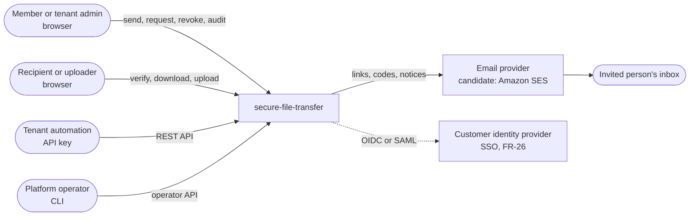
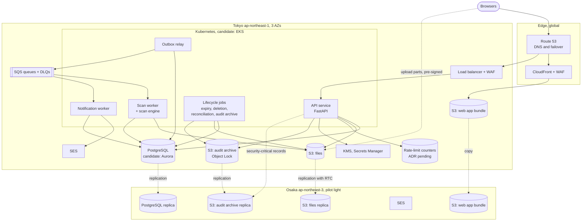
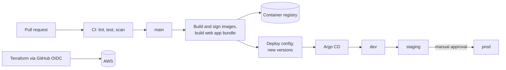
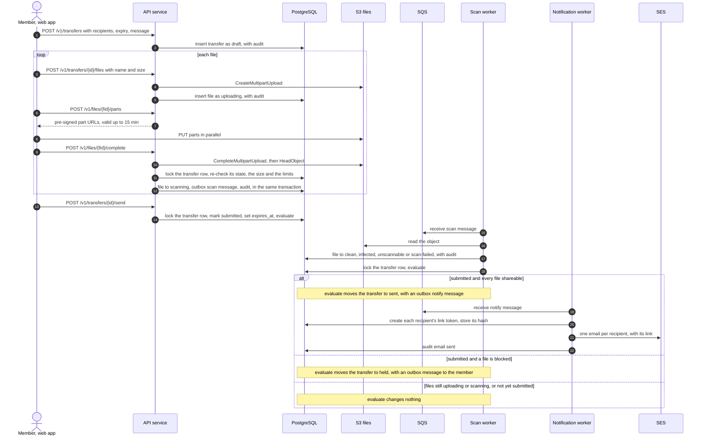
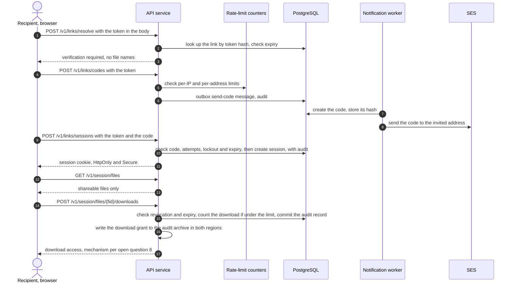
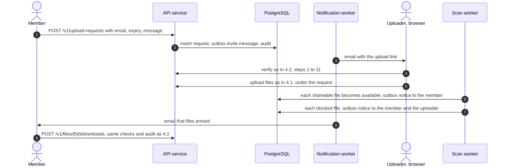
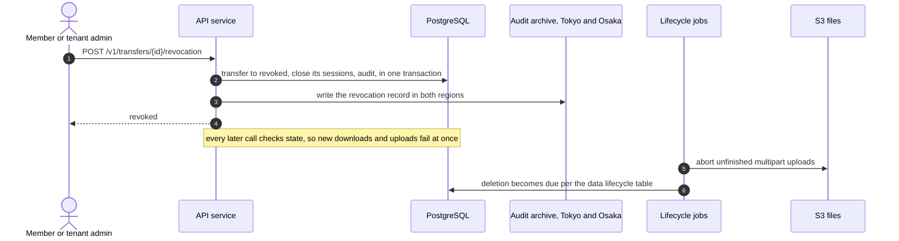
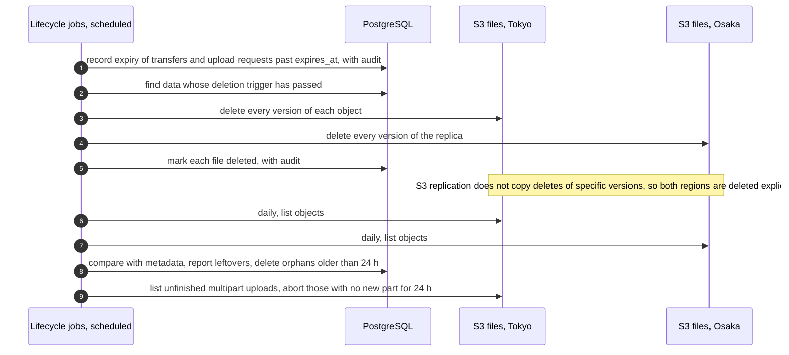

# Architecture

> Keep this page current: update it in the same pull request that changes the architecture.

| | |
|---|---|
| Requirements | [PRD](prd.md) |
| Decisions | [ADRs](adr/) |
| Tracking | [#12](https://github.com/codewithmuh/secure-file-transfer/issues/12), part of phase 2 ([#16](https://github.com/codewithmuh/secure-file-transfer/issues/16)) |

Technologies marked **candidate** are the current proposal. An ADR in phase 4 confirms or replaces each one (section 9).
API paths in the diagrams are illustrative; the contract is defined in [#14](https://github.com/codewithmuh/secure-file-transfer/issues/14).

## 1. Context

The service sends every link, code and notice by email, so the email provider is on the critical path: if recipients
can't receive a code, they can't download (FR-14).

## 2. Containers

The backend is **one codebase**: the API service and every worker are built from the same image with different entry
points, so they share the data model and the service layer (ADR-0002). PostgreSQL is the single system of record.
How file bytes reach a recipient's browser depends on open question 8 (section 4.2).

| Container | Responsibility | Scales by | When it fails |
|---|---|---|---|
| Web app (S3 + CloudFront) | React app for members, admins, recipients and uploaders (FR-30) | CDN | CloudFront fails over to the Osaka copy of the bundle. The API is unaffected. |
| API service | Every HTTP call: sign-in, policy checks, upload start and completion, verification, download access, revocation, audit writes | Pods across 3 AZs, at least 3; autoscaled on request rate and CPU | The load balancer stops sending traffic to failed pods. Uploads resume from their completed parts (NFR-3). |
| Outbox relay | Publishes rows from the outbox table to SQS (section 5.3) | 2 replicas; rows are claimed with `FOR UPDATE SKIP LOCKED` | Messages wait safely in PostgreSQL. An alert fires when the oldest unpublished row is over 2 minutes old. |
| Scan worker | Scans each uploaded file and records the result (FR-16 to FR-19) | Queue depth | Files stay in `scanning`, never downloadable. Retries with backoff; the last retry marks the file `scan-failed`, and the dead-letter queue raises an alert. |
| Notification worker | Creates each link token and code, stores only its hash, and sends it through SES (NFR-7). Outbox messages carry IDs, never secrets. | Queue depth | Retries with backoff. Codes not sent within NFR-7 raise an alert. |
| Lifecycle jobs | Expiry, deletion in both regions, daily reconciliation, audit archiving (section 4.5, 5.2) | Scheduled jobs | Work waits for the next run. An alert fires on lag (NFR-8, NFR-15). |
| PostgreSQL | Tenants, users, transfers, upload requests, files, sessions, audit events, outbox | Instance size; read replica for audit search | Fails over to another AZ automatically. For a region, the Osaka replica is promoted (section 7). |
| S3: files | File contents, keyed by tenant and file ID, never by file name | Managed | Regional service. Replicates to Osaka with a 15-minute commitment for 99.99 % of objects (NFR-10). |
| S3: audit archive | Immutable copy of every audit record (NFR-15). Security-critical records (revocations, lockouts, deactivations, download grants) are written straight to both regions. | Managed | The archive job retries; records are safe in PostgreSQL meanwhile. |
| SQS | Work queues with dead-letter queues | Managed | Regional service. The outbox keeps every message until it is published; after a regional failover, unprocessed messages are published again (5.3, section 7). |
| Rate-limit counters | Counters shared by all API replicas (NFR-14) | Depends on the ADR | Sign-in and verification fail closed; phase 3 decides the rest. |
| SES | Outgoing email in Tokyo; a verified, production-approved setup in Osaka for failover | Managed | The notification worker retries; failover sends from Osaka (PRD section 10). |
| KMS, Secrets Manager | Encryption keys for files, database, backups and logs; runtime secrets | Managed | Regional services. Multi-region keys and secret replicas exist in Osaka. |

## 3. Deployment

### 3.1 Prod in Tokyo

- One VPC across 3 Availability Zones: public subnets for the load balancer and NAT gateways, private subnets for
  Kubernetes nodes, isolated subnets for PostgreSQL.
- VPC endpoints for S3, SQS, KMS, Secrets Manager, ECR and STS keep most traffic to AWS services off the internet and
  the NAT gateways. SES API calls and writes to Osaka still go through NAT.
- Each workload gets its own IAM role with only what it needs. The API can start and complete uploads and issue
  download access; the scan worker can read files and set their tags; only the lifecycle jobs can delete.

### 3.2 Osaka pilot light

Running all the time, so a failover only has to add compute (section 7):

- **Data:** the PostgreSQL replica, S3 replica buckets for files and the audit archive, replicas of the KMS keys and
  secrets.
- **Network:** the VPC, subnets, NAT gateways, VPC endpoints, load balancer and WAF.
- **Services:** SQS queues and dead-letter queues (idle), the rate-limit store at its smallest size, a
  production-approved SES setup (SES is available in Osaka), a copy of the web app bundle, and the container images.
- **Control:** a Kubernetes control plane with no worker nodes and Argo CD installed, so Argo CD starts syncing from Git
  as soon as nodes join. Terraform state lives in an S3 bucket replicated to Osaka. The compute ADR confirms this
  against the RTO.

### 3.3 Environments and delivery

| Environment | Shape | Notes |
|---|---|---|
| dev | Tokyo only, smallest sizes | Torn down when idle |
| staging | Prod's shape at smaller sizes, including the Osaka pilot light | Where release rehearsals and drills run first |
| prod | Section 3.1 and 3.2 | Destroyed after the operating period, except the audit archive and its KMS key (NFR-19) |

The same image digests and the same web app bundle move from dev to staging to prod (NFR-18). Terraform owns AWS
resources; Argo CD owns what runs in Kubernetes; the delivery pipeline promotes the web app bundle (a versioned copy
that CloudFront points to). A rollback reverts the version change in the deploy config, for both.

## 4. Key flows

### 4.1 Send a transfer (UC-1)

- File bytes go straight from the browser to S3 in parts. The API never handles them, but it decides every state
  change. It issues part URLs only for the parts the declared size needs, each signed with its exact `Content-Length`.
  After completing the upload it checks the object's real size against the declared size and the limits (FR-2), and
  re-checks the transfer under a row lock, so a revocation that lands meanwhile wins (NFR-6). If either check fails,
  the object is deleted and the file is rejected.
- Resuming an upload: the web app asks the API which parts S3 already has, and sends only the missing ones (NFR-3).
- **One evaluation, under a lock.** The send call, every scan result, and every file removal or rejection lock the
  transfer row and run the same evaluation ([data model](design/data-model.md) 3.2). For a submitted or held transfer:
  held if any file is blocked; otherwise no change while any file is still uploading or scanning; sent once every file
  is shareable; and back to draft, with a notice to the member, if no files remain. Whichever happens last triggers the
  notification, and two scans finishing together can't both miss it (FR-5).
- A scan that keeps failing ends in `scan-failed`, not stuck in `scanning`: the last retry records that state before
  the message goes to the dead-letter queue, and the transfer is held (FR-19). If a worker dies without recording a
  result, for example out of memory on a zip bomb, reconciliation moves the file to `scan-failed` once its scan
  deadline passes.
- Every message to a worker goes through the outbox (section 5.3), so a crash between the database write and the queue
  send loses nothing.
- Secrets never travel through the outbox or SQS: the notification worker creates each link token, stores only its
  hash, and emails it.

### 4.2 Verify and download (UC-1, FR-14, FR-15)

- The emailed link carries the token in the URL fragment (`/t#token`), which browsers never send to servers; the web
  app posts it in the request body. Tokens therefore never appear in load balancer, CDN or WAF logs, or in `Referer`
  headers.
- Link tokens and codes are stored only as hashes. A token alone returns nothing about the transfer (FR-14). Every call
  compares `expires_at` with the current time, so a link stops working the moment it expires, not when the next job
  runs (FR-21).
- The download limit is enforced by one conditional update (`count = count + 1 WHERE count < limit`) in the same
  transaction as the audit record, so parallel requests can't exceed it (FR-4). The audit record is committed, and the
  grant written to both regions' archive, before any download access is returned (NFR-10, NFR-15).
- **Download mechanism (open question 8, decided in phase 3).** The two leading candidates:

| Candidate | How it meets FR-6, FR-14 and NFR-6 | Cost |
|---|---|---|
| Stream through the API | Each request carries the session cookie; HTTP Range requests resume a download within the same session; the stream re-checks state at least every 30 s, so revocation stops it within 60 s; counting happens on the server. | File bytes pass through Kubernetes, so pods need bandwidth headroom, and a deploy cuts long downloads (they resume). |
| CDN signed cookies bound to the session | CloudFront serves the S3 object with caching off; the API issues signed cookies for that file's path, valid ≤ 60 s, which the web app refreshes while the session lasts; a browser retry with Range uses the refreshed cookie. | Counting downloads and enforcing the limit is harder, because the server sees cookie refreshes, not bytes. CloudFront checks the cookie only when a request starts, so meeting NFR-6 needs the web app to download in Range chunks of 60 s or less. |

### 4.3 Request files (UC-2)

Each received file follows its own retention clock from its upload (FR-13). Revoking or expiring the request stops new
uploads but keeps received files.

### 4.4 Revoke (UC-3)

- The API answers "revoked" only after the record is in the audit archive in both regions. This is the candidate way
  to meet NFR-10's rule that a revocation is never lost in a failover; phase 3 confirms it.
- Parts already sent with a valid part URL are never assembled into a file, because completion is server-side. The
  reconciliation job removes any object no file refers to (PRD data lifecycle table).

### 4.5 Expiry and deletion (FR-21, NFR-8)

Lifecycle rules on both buckets expire noncurrent object versions after 7 days and abort multipart uploads still
unfinished after 7 days, as safety nets behind the job. The job records expiry for deletion; the API already refuses an
expired link (4.2).

### 4.6 Coverage of the PRD

| PRD | Where |
|---|---|
| UC-1, FR-1 to FR-6 | 4.1, 4.2 |
| FR-7 to FR-9: recipient status, first-download notice, expiry extension | Status is read from audit events; the first download adds an outbox notice (4.2); an extension is a checked update of `expires_at` |
| UC-2, FR-10 to FR-13 | 4.3 |
| UC-3, FR-20 | 4.4 |
| UC-4, FR-27 to FR-29 | 5.2 (audit search and export read PostgreSQL) |
| UC-5, FR-22 to FR-26 | API service and PostgreSQL; invitations go through the outbox; deactivations are security-critical records (5.2) |
| UC-6, FR-34 | Operator API; section 7 for disaster recovery |
| FR-35 break-glass access | Phase 3 (security design) |
| FR-14, FR-15 verification | 4.2 |
| FR-16 to FR-19 scanning | 4.1 |
| FR-21 lifecycle | 4.5 |

## 5. Cross-cutting patterns

### 5.1 Tenant scoping

Every tenant-owned row carries `tenant_id`, and every query runs with an explicit scope: a tenant, a single resource
reached through a verified link, or a named system job (ADR-0002). Object keys start with the tenant ID, which keeps
per-tenant keys (open question 3) and per-tenant deletion simple. File names and email addresses never appear in
object keys or logs. The tenant isolation suite (NFR-12) tests the data-access layer and every endpoint.

### 5.2 Audit trail

1. The API writes the audit record in the same database transaction as the change it describes, so a change can't
   happen without its record. The application's database role can insert audit rows but not update or delete them.
2. For downloads, the audit record is committed before download access is returned.
3. The archive job copies new audit rows to the Object Lock bucket at least every minute (NFR-15), and the bucket
   replicates to Osaka. Security-critical records (revocations, lockouts, deactivations, download grants) are also
   written straight to both regions (4.2, 4.4).
4. Audit search and export (FR-28, FR-29) read PostgreSQL. The table is partitioned by month; a daily job deletes rows
   older than 365 days and drops partitions once they are empty. Archived objects carry a 365-day Object Lock
   retention, and a lifecycle rule deletes them when it ends (NFR-9).

### 5.3 Transactional outbox

Work for the workers is written to an outbox table in the same transaction as the change that causes it. The outbox
relay publishes rows to SQS and marks them sent. Delivery is at least once, so every consumer is idempotent: it records
the message ID it processed and skips duplicates. The trace context travels in the message, so one trace covers the
API call, the queue and the worker. Messages carry IDs, never link tokens or codes.

After a regional failover, every outbox message from the last 24 hours that has no processed-message record is
published again. That recovers work that was sitting in Tokyo's queues when the region failed (section 7); consumers
skip anything already done.

### 5.4 Idempotent API requests

Every `POST` that creates something accepts an `Idempotency-Key` header, except API key creation, whose response holds
the key in plain text. The key is scoped to the caller (member, API key or link session) and stored for 24 hours with
a fingerprint of the request body, the response status and the ID of what was created, never the response body. A
retry with the same key and body gets the same status, with the response rebuilt from the resource; the same key with
a different body is rejected with 409. Calls that grant access (download access, code requests, sessions) never replay
a response: they are checked and audited every time.

### 5.5 Observability

The API and workers use OpenTelemetry for traces and Prometheus-format metrics. JSON logs carry `request_id`,
`trace_id` and `tenant_id`, never file names, message text or plain email addresses. Business signals that the SLOs
depend on (scan latency, time to shareable, queue age, outbox age, replication lag) are metrics with alerts, and every
alert links to a runbook (NFR-17).

CloudFront and WAF logs go to S3 buckets in Tokyo, not CloudWatch Logs, because a CloudFront-scoped WAF can only log to
CloudWatch in us-east-1 (NFR-21).

### 5.6 Operational data retention

Data this design adds beyond the PRD's data lifecycle table; the data model
([#13](https://github.com/codewithmuh/secure-file-transfer/issues/13)) carries it:

| Data | Kept for |
|---|---|
| Outbox rows after they are sent | 7 days (re-publishing after a failover looks back 24 hours) |
| Processed-message records | 14 days, as long as a message can stay in a dead-letter queue |
| SQS messages | 4 days in a work queue, 14 days in a dead-letter queue |
| Idempotency records (status and resource ID) | 24 hours |

## 6. Failure handling

| Failure | How we notice | What happens | PRD target |
|---|---|---|---|
| Scan engine down or slow | Scan queue age, scan errors | Files stay in `scanning` and can't be downloaded. Retries with backoff; the last retry marks the file `scan-failed`, which holds its transfer, and the message goes to the dead-letter queue with an alert. | FR-19, NFR-5 |
| Email provider failing or throttling | Send errors, bounce and complaint events | Retries with backoff. If a code can't be sent within NFR-7, an alert fires and the web app offers to send a new code. | NFR-7 |
| Outbox relay stopped | Outbox age | Messages wait in PostgreSQL; nothing is lost. | NFR-5 |
| API pod or node lost | Probes, load balancer health checks | Traffic moves to healthy pods. Uploads and downloads resume. | NFR-1, NFR-3 |
| One AZ lost | AWS health events, error rate | PostgreSQL fails over to another AZ, typically within a minute; pods are rescheduled in the other two AZs. | NFR-11: ≤ 5 min |
| Tokyo region lost | Route 53 health checks, alarms | An operator decides and runs the regional failover (section 7). | NFR-11: ≤ 1 h |
| Audit archive behind | Archive lag | Records are safe in PostgreSQL; the job catches up. Revocation returns an error, and can be retried, if the two-region write fails. | NFR-15 |
| Rate-limit counters unavailable | Errors from the store | Sign-in and verification fail closed; phase 3 decides for other calls. | NFR-14 |
| File replication lagging | Replication latency metrics | An alert fires; Tokyo is unaffected. | NFR-10 |
| Bad deploy | Error-rate and latency burn alerts | Revert the version change in the deploy config; Argo CD syncs the previous version. The web app bundle rolls back the same way. | NFR-18: ≤ 10 min |
| Bad migration or data corruption | Errors, reconciliation report | Point-in-time restore to a new database, start a new audit archive generation (data model 2.5), then re-apply security-critical changes from the audit archive. | NFR-11: ≤ 2 h |

## 7. Disaster recovery outline

Losing the Tokyo region, in the order the runbook (phase 6) will follow. The minutes are a budget to check in the first
drill, not measurements.

| Step | Budget |
|---|---|
| Confirm the regional failure and decide to fail over | 10 min |
| Promote the Osaka PostgreSQL replica to primary, and start a new audit archive generation (data model 2.5) | 5 min |
| Add worker nodes in Osaka; Argo CD deploys the current versions with every worker scaled to zero | 20 min |
| Re-apply security-critical changes from the Osaka audit archive | 5 min |
| Re-publish unprocessed outbox messages from the last 24 hours, then scale the workers up | 5 min |
| Switch DNS and the CDN origin to Osaka | 5 min |
| Verify with the synthetic probe, including a real email from Osaka | 5 min |
| **Total** | **55 min**, inside the 1-hour RTO |

Workers stay at zero until the security-critical changes are back, so no worker acts on a revocation the replica
hadn't received. Files uploaded in the last minutes before the failure may not have reached Osaka; the service shows
them as unavailable (NFR-10).

## 8. Runtime contract (every service)

| Concern | How |
|---|---|
| Liveness | `GET /healthz`: the process is up; never checks dependencies |
| Readiness | `GET /readyz`: 503 until started and during shutdown |
| Metrics | `GET /metrics` in Prometheus format, not exposed through the public load balancer |
| Logs | One JSON line per event on stdout, with `request_id` and `trace_id` |
| Shutdown | On SIGTERM: fail readiness, drain in-flight requests (≤ 20 s), exit 0 |
| Config | Environment variables only; secrets from AWS Secrets Manager |
| Security | Non-root user, read-only filesystem, no capabilities, minimal base image |

## 9. Technology candidates and pending decisions

| Area | Candidate | Main alternative | Decided by |
|---|---|---|---|
| API framework | FastAPI, SQLAlchemy 2.0, Alembic | Django + Django Ninja | [ADR-0002](adr/0002-api-framework.md), accepted |
| Multi-tenancy | Shared schema with `tenant_id` on every row | Schema or database per tenant | [ADR-0003](adr/0003-multi-tenancy-shared-schema.md), accepted |
| Compute | EKS with Argo CD | ECS on Fargate | ADR pending |
| Database | Aurora PostgreSQL with a global database in Osaka | RDS PostgreSQL Multi-AZ with a cross-region replica | ADR pending |
| Object storage | S3 with versioning and replication with RTC to Osaka | — | ADR pending |
| Queues | SQS with dead-letter queues, fed by the outbox | EventBridge; a PostgreSQL-based queue | ADR pending |
| Malware scanning | ClamAV in the scan worker | GuardDuty Malware Protection for S3 | ADR pending (open question 2) |
| Rate-limit counters | Redis-compatible cache | PostgreSQL counters; WAF rate rules for per-IP limits | ADR pending |
| Download mechanism | Section 4.2 | — | Phase 3 (open question 8) |
| Member sign-in | Managed identity provider with MFA | Built in; tenant SSO only | Phase 3 (open question 1) |
| Email | SES in Tokyo and Osaka | — | ADR pending |
| Web app hosting | S3 + CloudFront | — | ADR pending |
| Container registry | ECR, replicated to Osaka | GHCR (what the template publishes to) | ADR pending |
| Observability | OpenTelemetry with Prometheus, Grafana, Loki and Tempo | AWS managed Prometheus and Grafana | ADR pending |
| Infrastructure and delivery | Terraform, GitHub Actions with OIDC, Argo CD | — | ADR pending |
| AWS accounts | One account per environment | One account for all | ADR pending (open question 4) |

## 10. PRD open questions this design depends on

| Open question | Where it matters |
|---|---|
| 1. Member sign-in | API caller resolution, section 4 |
| 2. Scan engine for 5 GB files | Scan worker, 4.1, NFR-5 |
| 3. KMS keys per tenant | Object keys (5.1), IAM roles (3.1) |
| 4. AWS accounts per environment | Deployment (3) |
| 8. Download mechanism | 4.2, API pod sizing, CDN setup |
