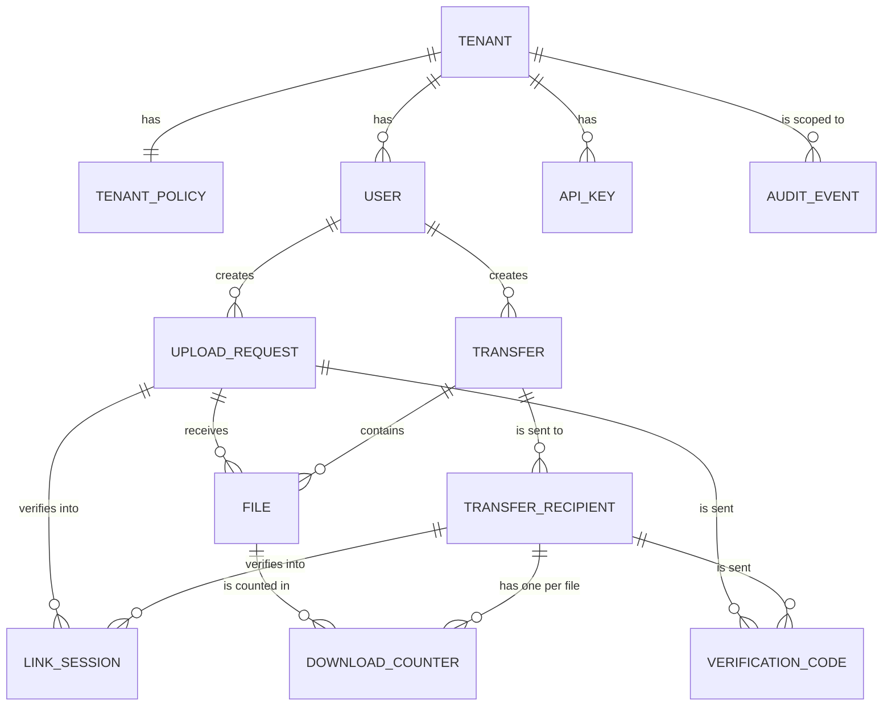
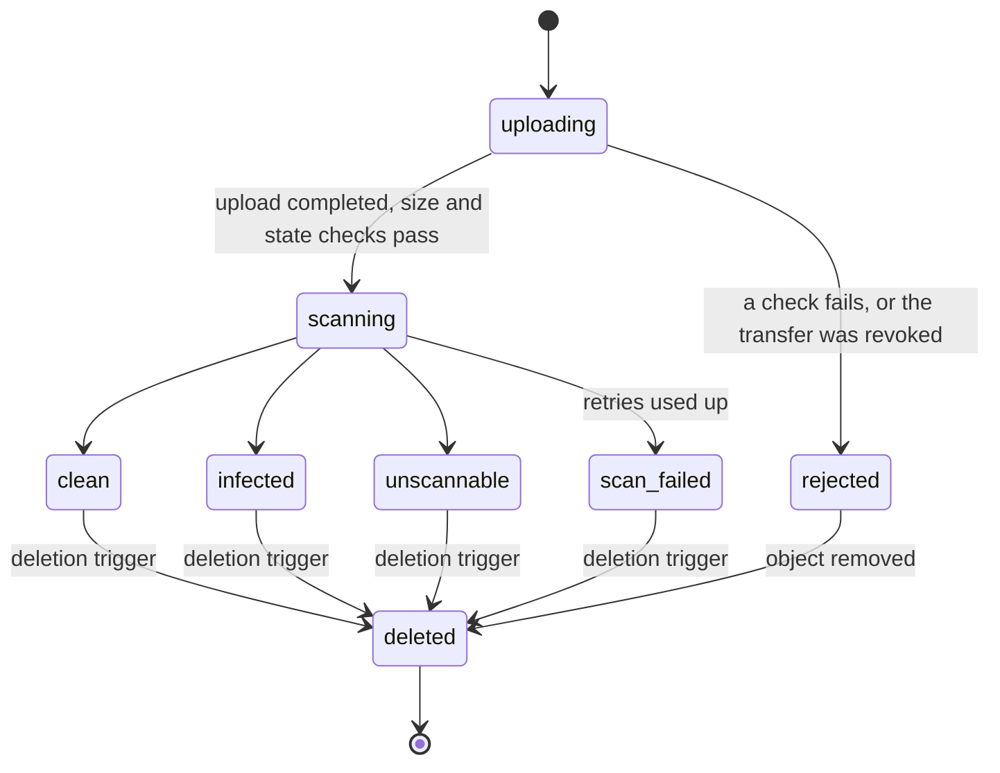
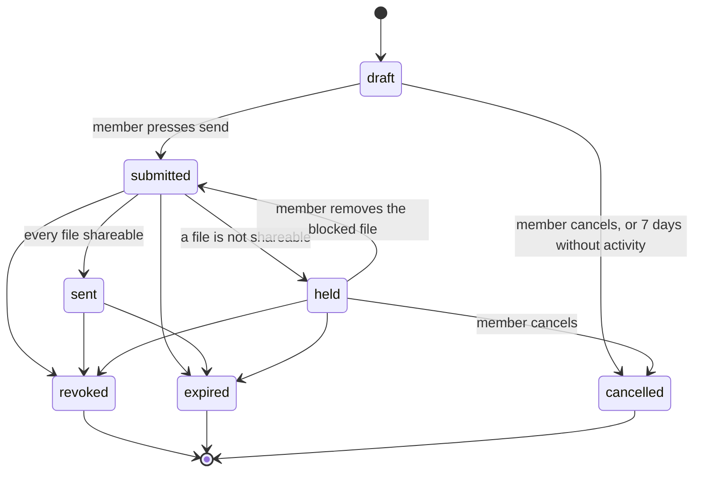
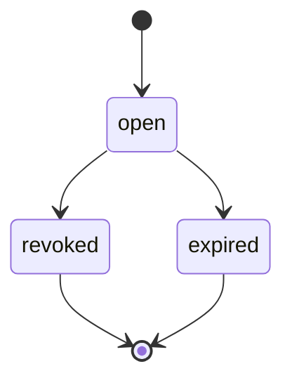
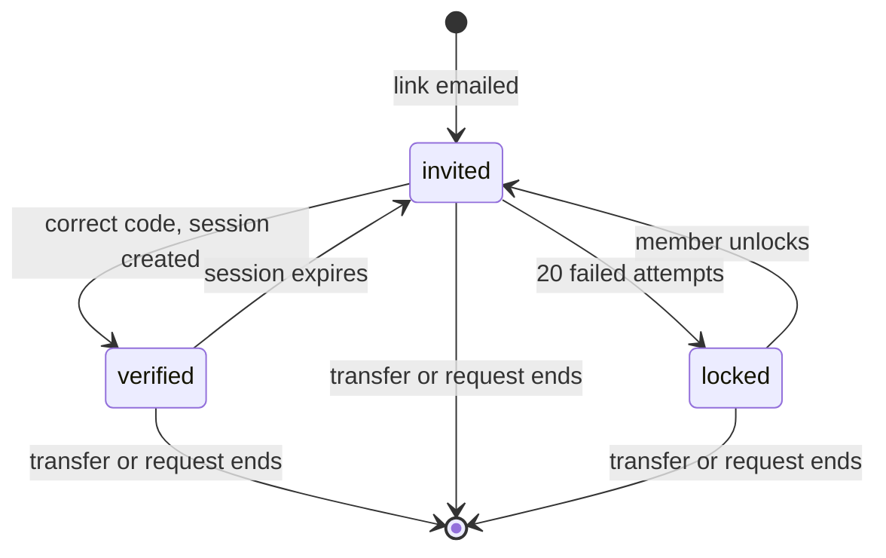

# Data model and multi-tenancy

| | |
|---|---|
| Requirements | [PRD](../prd.md), especially FR-1 to FR-35, NFR-8, NFR-9, NFR-12, NFR-15 |
| Architecture | [architecture.md](../architecture.md) |
| Tracking | [#13](https://github.com/codewithmuh/secure-file-transfer/issues/13), part of phase 2 ([#16](https://github.com/codewithmuh/secure-file-transfer/issues/16)) |

PostgreSQL is the single system of record (architecture section 2). This page defines its tables, the states rows move
through, how tenants are kept apart, and how the PRD's data lifecycle maps onto columns and jobs. Column lists show the
columns that carry meaning; every table also has `created_at`, and mutable tables have `updated_at`.

## 1. Conventions

- **IDs** are UUIDv7, generated by the application. They sort by creation time, which keeps indexes compact, and they
  reveal nothing guessable about other rows.
- **Times** are `timestamptz`, stored in UTC.
- **States** are PostgreSQL enums, changed only by the service layer, inside a transaction that also writes the audit
  event (architecture 5.2).
- **Secrets are never stored in plain text.** Link tokens and API keys carry at least 128 bits of randomness, so a
  SHA-256 hash is enough. One-time codes have only 6 digits, so they are stored as HMAC-SHA-256 with a key from AWS
  Secrets Manager; a copy of the database alone can't be used to brute-force them.
- **Email addresses** are stored as entered, because we have to send mail to them, plus `email_normalized` (lowercase)
  for lookups. Logs and rate-limit keys use an HMAC of the normalized address, never the address itself.
- **File names** live only in the `files` table. They never appear in object keys, logs or queue messages.

## 2. Entities

`AUDIT_EVENT` refers to its actor and target by ID only, with no foreign keys, so audit records outlive the rows they
describe (section 6).

### 2.1 Tenants and people

| Table | Key columns | Notes |
|---|---|---|
| `tenants` | `id`, `name`, `status` (active, suspended) | Created by a platform operator (FR-34). |
| `tenant_policies` | `tenant_id` (PK), `max_expiry`, `unscannable_policy` (block, allow_with_warning), `received_file_retention_days` (1–90, default 30), `allowed_domains`, `blocked_domains`, `default_locale` (en, ja) | One row per tenant (FR-23, FR-24, FR-33). |
| `users` | `id`, `tenant_id`, `email`, `email_normalized`, `role` (admin, member), `status` (invited, active, deactivated), `idp_subject` | Unique on `(tenant_id, email_normalized)`. How members sign in depends on open question 1; `idp_subject` links a user to the identity provider (FR-22, FR-25, FR-26). |
| `api_keys` | `id`, `tenant_id`, `created_by`, `name`, `key_prefix`, `key_hash`, `scopes`, `expires_at`, `revoked_at`, `last_used_at` | The full key is shown once, at creation. `key_prefix` lets a tenant admin recognise a key without seeing it (FR-32). |

### 2.2 Transfers and upload requests

| Table | Key columns | Notes |
|---|---|---|
| `transfers` | `id`, `tenant_id`, `created_by`, `state`, `message`, `expires_at`, `download_limit` (null or 1–100), `notify_on_first_download`, `submitted_at`, `sent_at`, `revoked_at`, `revoked_by`, `last_event_at`, `purge_after` | States in section 3.2. `expires_at` is the authority for expiry; the API compares it with the current time on every call (architecture 4.2). |
| `transfer_recipients` | `id`, `tenant_id`, `transfer_id`, `email`, `email_normalized`, `locale`, `link_token_hash`, `link_issued_at`, `failed_attempts`, `locked_at`, `unlocked_at`, `unlocked_by` | One row per recipient per transfer. `link_token_hash` is unique. A lockout after 20 failed attempts lasts until the member unlocks it (NFR-14). |
| `upload_requests` | `id`, `tenant_id`, `created_by`, `state`, `uploader_email`, `email_normalized`, `locale`, `message`, `expires_at`, `link_token_hash`, `link_issued_at`, `failed_attempts`, `locked_at`, `unlocked_at`, `unlocked_by`, `revoked_at`, `revoked_by`, `last_event_at`, `purge_after` | One uploader per request (FR-10). States in section 3.3. |

### 2.3 Files

| Table | Key columns | Notes |
|---|---|---|
| `files` | `id`, `tenant_id`, `transfer_id` or `upload_request_id` (exactly one, enforced by a check constraint), `display_name`, `content_type`, `declared_size`, `actual_size`, `sha256`, `storage_key`, `s3_upload_id`, `state`, `scan_attempts`, `scan_engine`, `scan_detail`, `scanned_at`, `retention_until`, `delete_after`, `deleted_at` | `storage_key` is `tenants/{tenant_id}/files/{file_id}` and is unique. `retention_until` is set at upload for received files, from the tenant policy in force then (FR-13). States in section 3.1. |
| `download_counters` | `tenant_id`, `recipient_id`, `file_id`, `count` | Primary key `(recipient_id, file_id)`. Incremented with `count = count + 1 WHERE count < limit` in the same transaction as the audit event, so parallel requests can't exceed the limit (FR-4). |

### 2.4 Verification and sessions

| Table | Key columns | Notes |
|---|---|---|
| `verification_codes` | `id`, `tenant_id`, `subject_type` (recipient, uploader), `subject_id`, `code_hmac`, `expires_at` (≤ 10 min), `attempts` (≤ 5), `consumed_at` | Created by the notification worker, which emails the code (architecture 4.2). |
| `link_sessions` | `id`, `tenant_id`, `session_hash`, `subject_type`, `subject_id`, `expires_at` (≤ 24 h), `revoked_at` | A verified browser session for one recipient or uploader (FR-15). Revoking a transfer or request sets `revoked_at` on its sessions in the same transaction. |
| `member_sessions` | Depends on open question 1 | Web app sessions for members and admins. If a managed identity provider is chosen, this holds our session for its tokens. |

### 2.5 Audit and plumbing

| Table | Key columns | Notes |
|---|---|---|
| `audit_events` | `id`, `tenant_id` (null for platform events), `occurred_at`, `actor_type` (member, admin, recipient, uploader, api_key, operator, system), `actor_id`, `action`, `target_type`, `target_id`, `source_ip`, `user_agent`, `request_id`, `security_critical`, `details` (JSON) | Partitioned by month on `occurred_at`. The application role can only insert. `details` holds IDs and enums, never file names or message text (FR-27, NFR-15). |
| `audit_archive_cursor` | `partition`, `last_archived_id`, `archived_at` | Where the archive job has got to (architecture 5.2). |
| `outbox` | `id`, `tenant_id`, `topic`, `payload` (IDs only), `trace_context`, `published_at` | Unpublished rows are found through a partial index on `published_at IS NULL` (architecture 5.3). |
| `processed_messages` | `consumer`, `message_id`, `processed_at` | Primary key `(consumer, message_id)`; makes every consumer idempotent. |
| `idempotency_keys` | `tenant_id`, `caller_type`, `caller_id`, `key`, `request_fingerprint`, `response_status`, `response_body`, `expires_at` | Primary key `(caller_type, caller_id, key)` (architecture 5.4). |

Rate-limit counters are not in PostgreSQL unless their ADR chooses it (architecture section 9).

## 3. State machines

PostgreSQL enum values use underscores, so the PRD's `scan-failed` is `scan_failed` here.

### 3.1 File

A file is **shareable** when it is `clean`, or `unscannable` and the tenant policy is `allow_with_warning` (FR-16,
FR-18). Only shareable files can be downloaded. `infected` files can never be downloaded by anyone (FR-17).

### 3.2 Transfer

`submitted → sent` and `submitted → held` happen only in the locked evaluation that both the send call and every scan
result run (architecture 4.1). `expired` is recorded by the lifecycle job, but the API already treats the transfer as
expired from `expires_at` onwards.

### 3.3 Upload request

Closing a request stops new uploads only. Each received file keeps its own `retention_until` (FR-13).

### 3.4 Recipient or uploader access

These states are derived from `link_issued_at`, `locked_at`, `unlocked_at` and the active `link_sessions`, not stored as
an enum.

## 4. Multi-tenancy model

### 4.1 Options

| Option | Isolation | Cost and operations | Fit |
|---|---|---|---|
| **Shared schema, `tenant_id` on every row** (chosen) | Enforced by the data-access layer, composite foreign keys and tests; row-level security can be added as a second layer | One schema, one migration path, one connection pool; cheap per tenant | Fits 500 tenants of similar size and one maintainer |
| Schema per tenant | Stronger: queries can't cross a schema boundary by accident | 500 schemas to migrate on every release; connection pooling per schema; slow migrations | Worth it only if tenants need custom schemas or very strong isolation guarantees |
| Database per tenant | Strongest; per-tenant backup and restore | 500 databases, or a fleet of clusters; very high cost and toil | Only for a few very large or regulated tenants |

### 4.2 How isolation is enforced (NFR-12)

1. **Scoped data access.** Every query runs with an explicit scope: a tenant (from a member session or API key), a
   single resource (from a verified link session), or a named system job (ADR-0002). The data-access layer adds the
   `tenant_id` condition; there is no unscoped query method.
2. **Composite foreign keys.** Every tenant-owned table has a unique key `(tenant_id, id)`, and children reference
   their parent by both columns, for example `files (tenant_id, transfer_id) → transfers (tenant_id, id)`. The database
   itself refuses a file that points at another tenant's transfer.
3. **Row-level security as a second layer** (decided in phase 3). The service would set `app.tenant_id` per transaction,
   and policies would compare it with each row's `tenant_id`. System jobs would use a separate database role.
4. **Tests.** The isolation suite runs on every pull request. For every endpoint and every data-access function it
   creates two tenants and tries each operation with the other tenant's IDs, tokens and keys; anything but "not found"
   fails the build.
5. **Storage.** Object keys start with `tenants/{tenant_id}/`, so per-tenant KMS keys (open question 3) and IAM
   conditions can be added without moving data.

## 5. Indexes for the main queries

| Query | Index |
|---|---|
| A member's transfers, newest first | `transfers (tenant_id, created_by, created_at DESC)` |
| An admin's view of all transfers, by state | `transfers (tenant_id, state, created_at DESC)` |
| Resolve a link | unique `transfer_recipients (link_token_hash)`, unique `upload_requests (link_token_hash)` |
| Files of a transfer or request | `files (tenant_id, transfer_id)`, `files (tenant_id, upload_request_id)` |
| Expiry job | partial `transfers (expires_at) WHERE state IN ('submitted', 'sent', 'held')`, same for `upload_requests` |
| Deletion job | partial `files (delete_after) WHERE deleted_at IS NULL` |
| Reconciliation | unique `files (storage_key)` |
| Audit search by time, target or actor | per partition: `(tenant_id, occurred_at DESC)`, `(tenant_id, target_type, target_id)`, `(tenant_id, actor_id, occurred_at DESC)` |
| Unpublished outbox rows | partial `outbox (created_at) WHERE published_at IS NULL` |
| Users by email | unique `users (tenant_id, email_normalized)` |

## 6. Lifecycle and retention

How the PRD's data lifecycle table and the architecture's operational retention become columns and jobs:

| Data | Trigger, as a column | Job |
|---|---|---|
| Files of a transfer | `files.delete_after` set when the transfer is revoked, expires or is cancelled, or the file is removed | Deletion job: deletes every object version in Tokyo and Osaka, then sets `deleted_at` (architecture 4.5) |
| Received files | `files.retention_until`, copied to `delete_after` when it passes, or set when the member deletes the file | Same deletion job |
| Unfinished uploads and orphans | `files.state = uploading` with no new part for 24 hours; objects no row refers to | Reconciliation job |
| Metadata of transfers and requests | `purge_after = last_event_at + 365 days`; `last_event_at` moves with every audit event about the item | Purge job deletes the transfer or request and its child rows. Audit events stay, because they have no foreign keys. |
| Audit events | `occurred_at + 365 days` | Daily job deletes expired rows; empty monthly partitions are dropped |
| Verification codes, link sessions | `expires_at` | Daily job deletes rows expired more than 1 day ago |
| Outbox rows | `published_at + 7 days` | Daily job |
| Processed messages | `processed_at + 14 days` | Daily job |
| Idempotency keys | `expires_at` (24 hours) | Daily job |

Database backups keep 14 days of point-in-time recovery, so deleted rows age out of backups within 14 days. File
contents are never in database backups.

## 7. Migrations

Alembic migrations follow **expand, then contract**: a release only adds columns, tables or indexes in a way the
running version ignores; the code switches over; a later release removes what is no longer used. Indexes on large
tables are built with `CREATE INDEX CONCURRENTLY`. New monthly audit partitions are created a month ahead by the
lifecycle job. This keeps every deploy free of downtime (NFR-18).

## 8. Size at the design load

From the PRD design load (section 6.1). The capacity estimate ([#15](https://github.com/codewithmuh/secure-file-transfer/issues/15))
turns these into database sizing.

| Table | New rows per day | Rows kept | Notes |
|---|---|---|---|
| `transfers` + `upload_requests` | 10,000 | about 3.7 million | Kept 365 days after their last event |
| `transfer_recipients` | about 20,000 | about 7.3 million | About 2 recipients per transfer |
| `files` | 30,000 | about 11 million | Rows outlive file contents, for the audit trail |
| `audit_events` | about 300,000 | about 110 million | About 25 events per transfer, plus sign-ins |
| `outbox` | about 100,000 | about 0.7 million | Kept 7 days |

That comes to roughly 100–150 GB including indexes at steady state, most of it audit events.

## 9. Requirements coverage

| PRD | Tables |
|---|---|
| FR-1 to FR-9 (transfers) | `transfers`, `transfer_recipients`, `files`, `download_counters`, `audit_events` |
| FR-10 to FR-13 (upload requests) | `upload_requests`, `files` (`retention_until`), `tenant_policies` |
| FR-14, FR-15 (verification) | `verification_codes`, `link_sessions`, the `link_token_hash` columns |
| FR-16 to FR-19 (scanning) | `files` (state, scan columns), `tenant_policies.unscannable_policy` |
| FR-20, FR-21 (control and lifecycle) | `revoked_at`, `expires_at`, `delete_after`, `purge_after` (section 6) |
| FR-22 to FR-26 (tenant administration and sign-in) | `users`, `tenant_policies`, `member_sessions` |
| FR-27 to FR-29 (audit) | `audit_events` |
| FR-32 (API keys) | `api_keys` |
| FR-33 (languages) | `tenant_policies.default_locale`, `transfer_recipients.locale`, `upload_requests.locale` |
| FR-34 (tenant provisioning) | `tenants`, `tenant_policies`, first row in `users` |
| FR-35 (break-glass access) | `audit_events` for now; any grant table comes with the phase 3 design |

## 10. Open items

- **Member sessions and sign-in** wait for open question 1.
- **Row-level security** as a second layer is decided in phase 3.
- **Per-tenant encryption** of `display_name` and `message` with tenant keys depends on open question 3.
- **Download counting under resume** may need a `download_grants` table, depending on open question 8.
