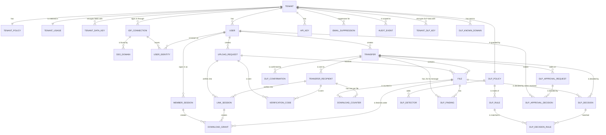
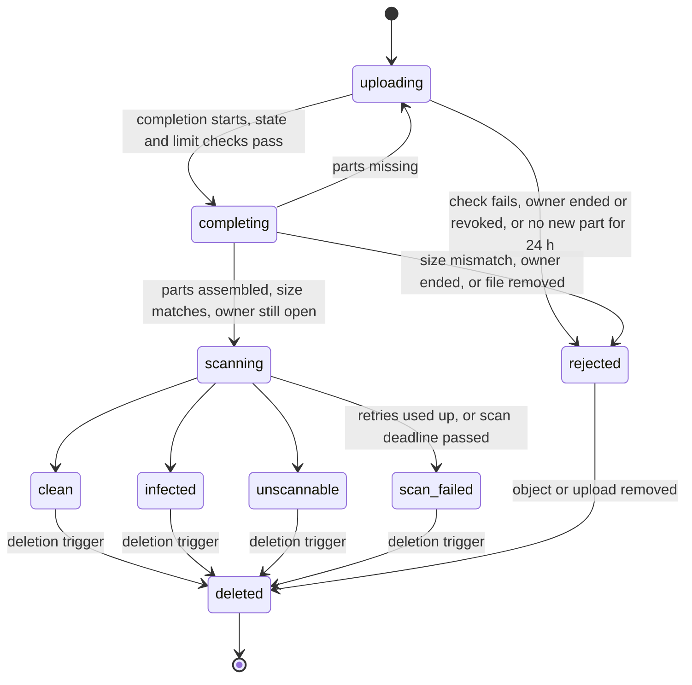
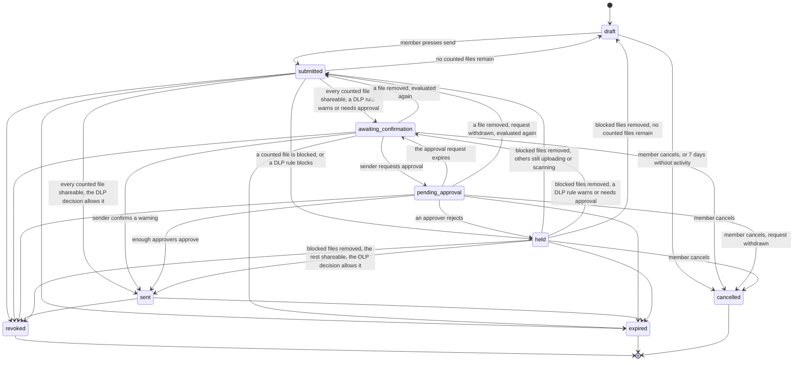
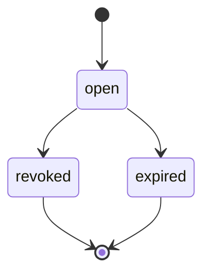
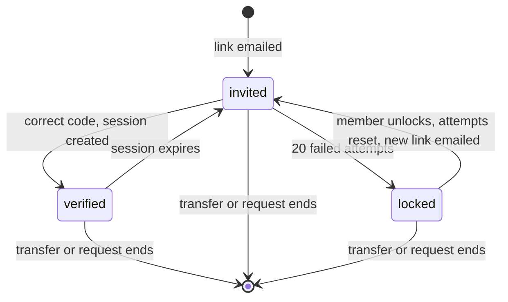
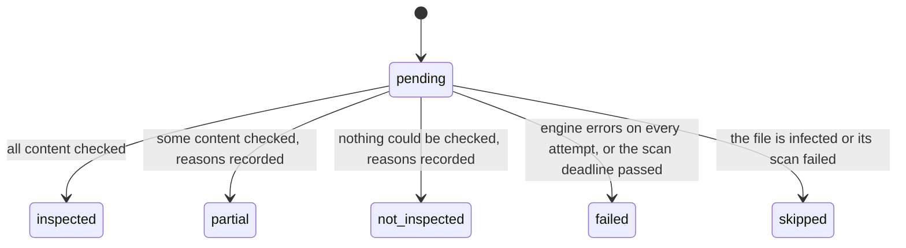
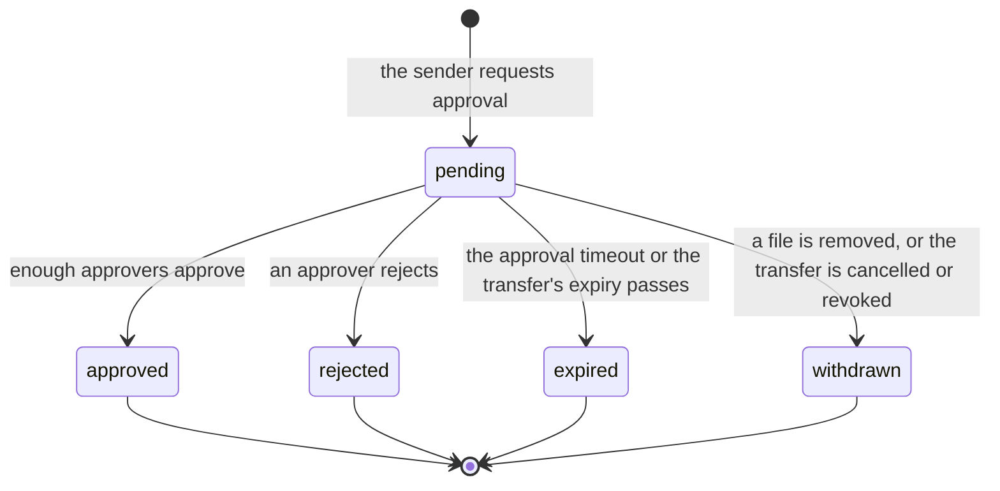

# Data model and multi-tenancy

| | |
|---|---|
| Requirements | [PRD](../prd.md), especially FR-1 to FR-56, NFR-8, NFR-9, NFR-12, NFR-14, NFR-15, NFR-26 |
| Architecture | [architecture.md](../architecture.md) |
| Security design | [Authentication and authorization](../security/authn-authz.md), [encryption and keys](../security/encryption-and-keys.md), [abuse and rate limits](../security/abuse-and-rate-limits.md), [threat model](../threat-model.md) |
| Decisions | [ADR-0003](../adr/0003-multi-tenancy-shared-schema.md) (tenancy model), [ADR-0022](../adr/0022-dlp-inspection-engine.md) (DLP inspection) |
| Tracking | [#13](https://github.com/codewithmuh/secure-file-transfer/issues/13), part of phase 2 ([#16](https://github.com/codewithmuh/secure-file-transfer/issues/16)); aligned with phase 3 in [#26](https://github.com/codewithmuh/secure-file-transfer/issues/26) and with the phase 4 reviews in [#41](https://github.com/codewithmuh/secure-file-transfer/issues/41); data loss prevention in [#64](https://github.com/codewithmuh/secure-file-transfer/issues/64) |

PostgreSQL is the single system of record (architecture section 2). This page defines its tables, the states rows move
through, how tenants are kept apart, and how the PRD's data lifecycle maps onto columns and jobs. Column lists show the
columns that carry meaning; every table also has `created_at`, and mutable tables have `updated_at`.

## 1. Conventions

- **IDs** are UUIDv7, generated by the application. They sort by creation time, which keeps indexes compact. They reveal
  when a row was created, which is acceptable: nobody can see an ID without access to the row, and no secret (link
  token, session, API key) can be derived from an ID alone.
- **Times** are `timestamptz`, stored in UTC.
- **States** are `text` columns with a `CHECK` constraint listing the allowed values. Unlike PostgreSQL enums, a value
  can be removed again, which keeps expand-then-contract migrations possible (section 7). States change only in the
  service layer, inside a transaction that also writes the audit event (architecture 5.2); the database refuses to
  commit the change otherwise (2.5, fail-closed audit).
- **Counters that enforce a limit change in one conditional statement**, never read-check-write: download counts and
  grant budgets (2.3), code attempts and recipient lockouts (2.4), and storage reservations (2.5).
- **Secrets are never stored in plain text.** Session, invitation and operator tokens and API keys are random, and link
  tokens are derived with a secret key (2.2). Each is at least as hard to guess as 128 random bits, so a SHA-256 hash is
  enough. One-time codes have only 6 digits, so they are stored as HMAC-SHA-256 with a key from AWS Secrets Manager; a
  copy of the database alone can't be used to brute-force them.
- **Every HMAC-keyed value records its key version** in a sibling column: `hmac_key_id` (`verification_codes`,
  `email_suppressions`), or `link_key_id` for link tokens. The keys are versioned keyrings in Secrets Manager
  (`code-hmac`, `email-hmac`, `link-hmac`), so a key can rotate with overlap (encryption and keys 6.5).
- **Email addresses** are stored as entered, because we have to send mail to them, plus `email_normalized` (lowercase)
  for lookups. Logs, rate-limit keys and the suppression list use an HMAC of the normalized address, never the address
  itself.
- **File names and messages are stored only encrypted**, in `files.display_name_ct`, `transfers.message_ct` and
  `upload_requests.message_ct`, under the tenant's data key (2.1). They never appear in object keys, logs or queue
  messages, and SQL can't search or sort them. DLP justifications and approvers' comments are free text too, and are
  stored the same way; DLP keyword lists, patterns and finding details use the tenant's DLP data key (2.7).
- **No column ever holds a value a DLP detector matched** (FR-53, NFR-26): findings keep detectors, counts, location
  hints and masked previews only.

## 2. Entities



Every arrow is a composite foreign key that includes `tenant_id` (section 4.2), with these exceptions:

- `AUDIT_EVENT` refers to its actor and target by ID only, with no foreign keys, so audit records outlive the rows they
  describe (section 6).
- `USER_IDENTITY` refers to its connection by ID alone, because the platform's own sign-in pools belong to no tenant
  (2.1).
- `member_sessions.identity_id` names the identity a session signed in through by ID only, so a sign-in reset can
  delete identities while the sessions it revoked remain until the daily cleanup (2.4).

The platform tables `operator_sessions` and `break_glass_grants` have no tenant and no foreign keys (2.6), so they
aren't drawn.

### 2.1 Tenants and people

| Table | Key columns | Notes |
|---|---|---|
| `tenants` | `id`, `name`, `status` (active, suspended), `recovery_contact`, `sso_required`, `sso_mfa_confirmed_by`, `sso_mfa_confirmed_at` | Created by a platform operator (FR-34), with a second contact besides the first admin, through which operator-assisted recovery confirms a request (`recoverTenantAdmin`, authentication and authorization 2.5). A tenant that uses SSO has an `idp_connections` row and its proven domains in `sso_domains` (FR-26). `sso_required` lets its members sign in only through the identity provider, except its fallback admins. `sso_mfa_confirmed_by` and `sso_mfa_confirmed_at` record the tenant admin's confirmation that their identity provider enforces MFA, which is also audited. Suspending a tenant ends every session of the tenant (2.4). |
| `tenant_policies` | `tenant_id` (PK), `max_expiry`, `unscannable_policy` (block, allow_with_warning), `received_file_retention_days` (1–90, default 30), `allowed_domains`, `blocked_domains`, `default_locale` (en, ja) | One row per tenant (FR-23, FR-24, FR-33). |
| `users` | `id`, `tenant_id`, `email`, `email_normalized`, `role` (admin, member), `status` (invited, active, deactivated), `sso_fallback`, `dlp_approver`, `invitation_token_hash`, `invitation_expires_at` | Unique on `(tenant_id, email_normalized)` (FR-22, FR-25). `dlp_approver` marks a member or admin a tenant admin named as a DLP approver (FR-43, 2.7). `invitation_token_hash` (unique) is the SHA-256 of the one-time invitation link that binds an SSO identity to this user: 256 random bits, valid 7 days, replaced by a new invitation and cleared when it is used (authentication and authorization 2.5). `sso_fallback` marks the at most two admins of an SSO tenant who keep a local sign-in. Deactivating a user clears `dlp_approver` and `sso_fallback`, so a deactivated user is never an approver or a fallback admin. |
| `idp_connections` | `id`, `tenant_id` (empty for the platform's own pools), `kind` (local, oidc, saml), `provider_name`, `issuer`, `status` (active, inactive) | One row for each of the platform's own user pools for local members (FR-25): Tokyo, and the Osaka standby in staging and prod (authentication and authorization 2.3). One row for each tenant's SSO provider (FR-26), written by the operator API (`configureTenantSso`). The provider exists in both pools under the same name, so one row and one identity serve either pool. `provider_name` is unique: the pool's ID, or the name the operator CLI gives a tenant's provider. `issuer` is recorded for checks and display, but it is not unique and never used to find a connection, because issuer strings repeat across tenants (a copied SAML entity ID, a shared multi-tenant issuer). |
| `sso_domains` | `domain` (PK, lowercase), `tenant_id`, `idp_connection_id`, `verified_at` | Email domains a tenant has proven with a DNS TXT record (authentication and authorization 2.5). The primary key means a domain belongs to one tenant at most. "Continue with SSO" finds the tenant's connection through it. |
| `user_identities` | `id`, `tenant_id`, `user_id`, `idp_connection_id`, `subject`, `expires_at` | Unique on `(idp_connection_id, subject)`: a subject is only unique within the connection it came through. Sign-in finds the connection from how the sign-in arrived (the pool that issued the token, and for SSO the provider it names), then the identity. Through a tenant's connection it accepts only an identity whose user is in that tenant, so one tenant's identity provider can never sign anyone in to another tenant (FR-26, NFR-12). Rows are written in two places only: by the notification worker, from the `sub` Cognito returns when it creates a local member, and by the invitation flow, which binds an SSO subject to the invited user (authentication and authorization 2.4). An email claim never finds or binds a user. A member can hold one local identity per pool, so one in Tokyo and one in Osaka after a failover. A sign-in reset deletes the member's local identities in the API transaction. `expires_at` is set only on the temporary local sign-in that operator-assisted recovery gives an SSO tenant's admin, for 72 hours. |
| `api_keys` | `id`, `tenant_id`, `created_by`, `name`, `key_prefix`, `key_hash`, `scopes`, `expires_at`, `revoked_at`, `last_used_at` | The full key is shown once, at creation. `key_prefix` is the environment's prefix (`sft_dev_`, `sft_stg_`, `sft_prd_`) plus the first 8 characters of the secret, so a tenant admin can recognise a key without seeing it (authentication and authorization 5.1). Deactivating or demoting the owner revokes their keys in the same transaction. `last_used_at` is updated at most once an hour, not on every call (FR-32). |
| `tenant_data_keys` | `tenant_id`, `key_version`, `wrapped_key`, `created_at`, `retired_at` | Primary key `(tenant_id, key_version)`. The tenant's 256-bit data key for field encryption, as KMS returned it wrapped under the fields key with the encryption context `purpose` and `tenant_id` (encryption and keys 3.2). Each year a new version takes over new writes, and `retired_at` is set on the one it replaces, which from then on only decrypts. A version is deleted once no row uses it (section 6). |

**Field encryption** (encryption and keys 3.2). `files.display_name_ct`, `transfers.message_ct` and
`upload_requests.message_ct` hold AES-256-GCM ciphertext under the tenant's data key. The stored value carries a format
version, the key version, the nonce, and the ciphertext with its tag; the additional authenticated data binds
`tenant_id`, table, column, row ID and key version. There are no plaintext columns for names or messages.

- **Each of those tables has `data_key_version`**, a composite foreign key `(tenant_id, data_key_version) →
  tenant_data_keys (tenant_id, key_version)`, empty when there is no message. It repeats the version inside the value,
  so that the database itself refuses to delete a key version that a row still uses, and so that re-encrypting after
  a suspected exposure can find a version's rows.
- **The service decrypts with the data key of the tenant in the caller's scope**, never the tenant written on the row.
  A row from another tenant fails authentication instead of decrypting: the third isolation layer (4.2).
- Only the API unwraps data keys. The notification worker and the operator API never need names or messages, and
  `sft_operator` has no column grant on the ciphertext columns (4.2).

### 2.2 Transfers and upload requests

| Table | Key columns | Notes |
|---|---|---|
| `transfers` | `id`, `tenant_id`, `created_by`, `state`, `hold_reason` (file_blocked, dlp_blocked, approval_rejected; set only while `held`), `dlp_decision_id`, `message_ct`, `data_key_version`, `expires_in` (an interval, 1 hour to 30 days), `expires_at` (empty while a draft), `download_limit` (null for no limit, or 1–100), `notify_on_first_download`, `last_activity_at`, `submitted_at`, `sent_at`, `ended_at`, `revoked_by`, `purge_after` | States in section 3.2. `dlp_decision_id` is the transfer's current DLP decision (2.7). `expires_at` is the authority for expiry; the API compares it with the current time on every call (architecture 4.2). `ended_at` is set when the transfer is revoked, expires or is cancelled. `message_ct` is the encrypted message (2.1). |
| `transfer_recipients` | `id`, `tenant_id`, `transfer_id`, `email`, `email_normalized`, `locale`, `link_token_hash`, `link_key_id`, `link_issued_at`, `delivery_state`, `notified_at`, `first_verified_at`, `last_verified_at`, `failed_attempts`, `locked_at`, `unlocked_by` | One row per recipient per transfer. Unique on `(tenant_id, transfer_id, email_normalized)`, so a request that lists the same address twice is rejected. `link_token_hash` is unique. `delivery_state` and `notified_at` follow the link email (below); `first_verified_at` and `last_verified_at` are set when a link session is created (2.4). Together they are the recipient's status (FR-7). |
| `upload_requests` | `id`, `tenant_id`, `created_by`, `state`, `uploader_email`, `email_normalized`, `locale`, `message_ct`, `data_key_version`, `expires_at`, `link_token_hash`, `link_key_id`, `link_issued_at`, `delivery_state`, `notified_at`, `failed_attempts`, `locked_at`, `unlocked_by`, `ended_at`, `revoked_by`, `purge_after` | One uploader per request (FR-10). States in section 3.3. |

**Expiry starts at send.** A draft stores the member's choice as `expires_in` (FR-3; the API field of the same name),
and its `expires_at` stays empty. The send call sets `submitted_at = now()` and `expires_at = now() + expires_in` under
the row lock, so the time a transfer spends as a draft, with its files uploading and scanning, isn't taken from the
recipients. Scanning that is still running after the send does count, and NFR-5 keeps it to minutes. If the tenant's
`max_expiry` has dropped below the duration since the draft was made, the send is refused with `expiry_out_of_range`
and the draft is unchanged; the member chooses a new expiry and sends again. If the transfer later goes back to `draft`
because its last counted file was removed or rejected (3.2), `submitted_at` and `expires_at` are cleared again, and the
next send starts the expiry afresh. Upload requests are open from creation, so their `expires_at` is set then.

**Draft activity.** `last_activity_at` is set when the transfer is created and moved forward by every edit of the draft
and by adding, completing or removing one of its files. It changes only while the transfer is a draft. These file
calls lock the transfer row anyway, to check its state and limits (architecture 4.1), so this adds no contention, and
a sent transfer's row is never touched. The 7-day draft rule reads it (section 6).

**Link tokens are derived, so a retry sends the same link.** A token is
`HMAC-SHA-256(K_link, "link/v1/" + subject_id + "/" + link_issued_at)`, where `subject_id` is the recipient's or the
upload request's ID and `link_issued_at` is written as microseconds since the Unix epoch. `K_link` is the versioned
keyring `link-hmac` in AWS Secrets Manager, read only by the notification worker, and the row records the version it
used in `link_key_id`. In one short transaction, the notification worker sets `link_issued_at`, `link_key_id` and
`link_token_hash` (the SHA-256 of the token) if `link_issued_at` is still empty; it commits, then sends the email. A
retried notify message finds `link_issued_at` set, rebuilds the same token and sends the same link, so a link that has
already been delivered keeps working whichever attempt delivered it. The API never needs the key: it finds a link by
the SHA-256 of the presented token.

- A new link is issued only on purpose, by clearing `link_issued_at`, `link_token_hash` and `link_key_id`: the worker
  then derives a new token from a new `link_issued_at`, and the old link stops working. Clearing the hash alone would
  rebuild the same token. That happens on an unlock (2.4) and when `K_link` may have leaked (encryption and keys 6.5).
- The token is as hard to guess as the 256-bit key, which meets NFR-14's 128 bits, and the stored SHA-256 hash is
  enough. A copy of the database alone can't produce a token; with `K_link` as well it could produce every live link,
  so if the key may have leaked, every live link is issued again.
- A key version stays loaded for at least 14 days after a newer one takes over, the longest a notify message can wait
  in a dead-letter queue (architecture 5.6), so every retry can rebuild its link.

**Email delivery state.** `delivery_state` follows the latest link email of a recipient or an uploader (FR-7):

| Value | Meaning |
|---|---|
| `pending` | No email is due yet: the transfer hasn't been sent. |
| `queued` | An email is due and hasn't been handed to SES yet, whatever the reason: an outbox backlog, SES throttling, a paused tenant, or the per-address cap across tenants. One neutral value covers every delay, so the status never tells one tenant what other tenants send to that address (abuse and rate limits 7.2, NFR-12). |
| `sent` | SES accepted the email; `notified_at` is set. |
| `bounced` | SES reported a bounce. |
| `suppressed` | The address was on the suppression list (2.5) when the worker came to send, so nothing was sent. |

The transaction that moves a transfer to `sent` sets its recipients to `queued`. Creating an upload request does the
same for its uploader, and an unlock does it for the subject it unlocks (2.4). `createTransfer` and
`createUploadRequest` already refuse an address that is suppressed at that moment (`422 recipient_undeliverable`).

**As built (#178, revision 0012).** The recipient's link and status columns are on `transfer_recipients`, with
`link_token_hash` unique and the three link columns set together or not at all. The evaluation's `transfer.sent`
message names the transfer; the notification worker answers it with one `recipient.link_due` message per recipient
(IDs only), written in the transaction that records the first, so each email is one message, retried on its own, and
an unlock or a cap deferral writes the same kind of message. For each, the worker checks the suppression list
(`suppressed`, no email), then the cross-tenant cap (the email waits behind a delayed message, `queued`), then issues
the link once (`recipient.link_issued`), sends, and records `sent`, `notified_at` and `email.sent` after the send. A
link whose key has left the keyring (more than its 14 days after a rotation) is issued again; a link another attempt
stored first is the one sent, never a token whose hash isn't stored. An email the provider refuses for good leaves the
recipient `bounced` (`email.rejected`). The cap is read before the send and spent only after a successful one. A
notice to several people records each email as it goes, so a redelivery sends only the unsent ones. `sft_notify`
reads only the columns that needs, never a ciphertext column, and may write outbox messages.

### 2.3 Files, download counts and grants

| Table | Key columns | Notes |
|---|---|---|
| `files` | `id`, `tenant_id`, `transfer_id` or `upload_request_id`, `display_name_ct`, `data_key_version`, `content_type`, `declared_size`, `actual_size`, `sha256`, `storage_class` (standard, large), `storage_key`, `s3_upload_id`, `s3_version_id`, `state`, `last_part_at`, `completion_started_at`, `removed_at`, `scan_attempts`, `scan_deadline`, `scan_engine` (clamav, guardduty), `scan_detail`, `scanned_at`, `unscannable_allowed`, `inspection_state`, `inspection_reasons`, `inspection_engine_version`, `inspection_policy_version`, `dlp_blocked`, `retention_until`, `delete_after`, `deleted_at` | Exactly one of `transfer_id` and `upload_request_id` is set, each through its own composite foreign key, enforced by a check constraint. `storage_key` is `tenants/{tenant_id}/files/{file_id}` and is unique. `display_name_ct` is the encrypted file name (2.1). States in section 3.1; the inspection columns in 3.5. `dlp_blocked` is set only on a received file a DLP rule blocked (FR-51). |
| `download_counters` | `tenant_id`, `recipient_id`, `file_id`, `download_limit`, `count`, `first_downloaded_at`, `last_downloaded_at` | Primary key `(recipient_id, file_id)`. All rows for a transfer are created in the transaction that moves it to `sent`, with the transfer's limit copied in, so a row always exists before the first download. The two times are the recipient's download status (FR-7). |
| `download_grants` | `id`, `tenant_id`, `file_id`, `s3_version_id`, `recipient_id` and `link_session_id`, or `user_id` and `member_session_id`, `byte_budget`, `bytes_served`, `request_count`, `expires_at`, `active_stream_id`, `active_stream_until`, `archived_at` | One counted download of one file by one session (abuse and rate limits 5.4). A check constraint requires exactly one of the two pairs, each through composite foreign keys; the keys to the session cascade on delete. `id` is the API's `grant_id`. |

**Two bucket pairs.** Files over 2 GB live in a second files bucket pair with the same key layout, and GuardDuty
Malware Protection scans them, because ClamAV can't (ADR-0012, ADR-0019). `storage_class` is chosen when the upload
starts, from the declared size (`large` above 2 GB), and never changes. The API, the scan worker, the deletion job and
reconciliation all pick the bucket from it, and `scan_engine` records which engine scanned the file. The completion
check rejects any file whose real size differs from the declared one (abuse and rate limits 6.3), so a size that
would cross the 2 GB boundary is rejected too, and no file stays in the wrong bucket. `s3_version_id` is the version
recorded at completion: the scan worker scans that version and downloads serve only that version, so the bytes served
are the bytes scanned (abuse and rate limits 5.6, 6.4).

A download is counted with one statement, in the transaction that creates its grant and writes its audit event
(FR-4):

```sql
UPDATE download_counters
   SET count = count + 1,
       first_downloaded_at = coalesce(first_downloaded_at, now()),
       last_downloaded_at = now()
 WHERE recipient_id = $1 AND file_id = $2
   AND (download_limit IS NULL OR count < download_limit)
RETURNING count;
```

No row returned means the limit is reached. Parallel requests serialise on the row, so they can't exceed the limit.

**Download grants** (abuse and rate limits 5). Downloads stream through the API. `createSessionDownload` (a recipient)
or `createReceivedFileDownload` (a member, for a received file) creates a grant in this order (architecture 4.2):

1. Check the session, the transfer's or request's state and expiry, that the file is shareable, and the limit.
2. Generate the grant ID and write a grant **intent** record (`download.grant_intent`: grant ID, file, session,
   recipient or member) to the audit archive in both regions. If either write fails, the call answers `503` and
   counts nothing.
3. In one transaction: count the download with the statement above (recipients only; received files have no limit),
   insert the grant, and write `download.granted`. A `503` before this commit means nothing was counted.
4. After the commit, the API writes a **committed** record (`download.grant_committed`) to both archives in the
   background, retried until both confirm, and then sets `archived_at`. Reconciliation retries any grant whose
   `archived_at` is still empty a minute after creation. The archive job's copy of `download.granted` is a second
   path for the same fact.

**What a failover or restore re-applies** (architecture 7). The recovery job (`sft_recovery`, 4.2) re-applies a
grant, and its count, only if the grant has a committed record in the archive or a row in the database it is
restoring into. An intent with neither is ignored: that grant was refused (a parallel request took the last download)
or rolled back, so it gave no access, and counting it would take a download the recipient never had. The residual
window: a grant committed in Tokyo whose committed record hasn't reached Osaka yet, and whose row the replica hasn't
received, is lost if Tokyo is lost at that moment. Both writes normally finish within a second of the commit. A grant
lost this way can let that recipient download the file once more than the limit allows; its intent record shows
which grant it was.

A grant allows `byte_budget` (3 × `actual_size`) and at most 20 content requests until `expires_at`: 24 hours after
creation, never past its session's or the transfer's expiry. The content operations (`getSessionDownloadContent`,
`getReceivedFileDownloadContent`) are authorised by the grant ID plus a session cookie that holds the grant's session
(authentication and authorization 4.3). Each content request is admitted with one statement, which also makes it the
grant's only active stream:

```sql
UPDATE download_grants
   SET request_count = request_count + 1,
       active_stream_id = $2,
       active_stream_until = now() + interval '60 seconds'
 WHERE id = $1 AND expires_at > now()
   AND request_count < 20 AND bytes_served < byte_budget
RETURNING bytes_served, byte_budget;
```

No row returned means the grant is used up or has expired. The stream sends at most the budget left. Every 30 seconds,
and once more when it ends, it re-checks the transfer, the session and the file, and records what it sent:

```sql
UPDATE download_grants
   SET bytes_served = bytes_served + $3,
       active_stream_until = CASE WHEN active_stream_id = $2
                                  THEN now() + interval '60 seconds'
                                  ELSE active_stream_until END
 WHERE id = $1
RETURNING active_stream_id = $2 AS holds_lease;
```

- **Bytes are added by grant ID alone**, so a stream that has been taken over still records the bytes it already
  sent; only the lease columns depend on `active_stream_id`. If a newer request has taken the grant over,
  `holds_lease` is false and the old stream stops, so two streams overlap for at most 30 seconds.
- **The re-check enforces revocation.** A revoked or expired transfer or request, an ended session or a file that is
  no longer shareable stops the stream, so a running download stops within 60 seconds of a revocation (NFR-6).
- **A running stream counts as activity** for its session, a link session or a member session alike: the re-check
  moves the session's `last_seen_at` forward (at most once a minute, 2.4), so a long download doesn't end its session
  for idleness. The session's absolute expiry still applies.

`createSessionDownload` with `resume_grant_id`, in the grant's own session, returns the same grant, uncounted, while
it has time, bytes and requests left (FR-6). A grant is a security-critical record like the count (section 2.5
lists them).

For received files, `retention_until` and `delete_after` are both set at upload, from the tenant policy in force then
(FR-13). A member deleting a file earlier moves `delete_after` forward.

### 2.4 Verification and sessions

`verification_codes` and `link_sessions` belong to either a recipient or an uploader. Like `files`, each has two
nullable composite foreign keys, `(tenant_id, recipient_id)` and `(tenant_id, upload_request_id)`, with a check
constraint that exactly one is set. That keeps database-enforced isolation and lets purges cascade to them.

| Table | Key columns | Notes |
|---|---|---|
| `verification_codes` | `id`, `tenant_id`, `recipient_id` or `upload_request_id`, `code_hmac`, `hmac_key_id`, `expires_at` (≤ 10 min), `attempts`, `superseded_at`, `consumed_at` | Created by the notification worker, which emails the code (architecture 4.2). `code_hmac` is `HMAC-SHA-256(K_code, "code/v1/" + id + "/" + code)` under the `code-hmac` keyring, and `hmac_key_id` names the key version (encryption and keys 6.2). Creating a code sets `superseded_at` on every older live code for the same subject, so only the newest code can ever match. |
| `link_sessions` | `id`, `tenant_id`, `recipient_id` or `upload_request_id`, `session_hash`, `expires_at` (≤ 24 h), `last_seen_at`, `revoked_at` | A verified browser session (FR-15). It also ends after 1 hour without activity: `last_seen_at` is written at most once a minute, and a running download stream counts as activity. A browser can hold up to 10, one per subject, in one cookie (authentication and authorization 4.3). Revoking a transfer or request sets `revoked_at` on its sessions in the same transaction. There is no CSRF column: CSRF tokens are derived from the session token (authentication and authorization 3.4). |
| `member_sessions` | `id`, `tenant_id`, `user_id`, `identity_id`, `session_hash`, `auth_time`, `auth_method` (passkey, password_totp, local, sso), `last_seen_at`, `expires_at` (12 h from sign-in), `revoked_at`, `revoked_reason`, `created_ip`, `user_agent` | Web app sessions for members and admins, kept in PostgreSQL so revocation is transactional and survives a failover (authentication and authorization 3.2). `session_hash` is unique. A request is refused once the session is revoked or expired, `last_seen_at` is 30 minutes old (it is written at most once a minute, and a running download stream counts as activity, as for link sessions, 2.3), or the user or tenant is inactive. The role is read from `users` on every request, never copied here. `auth_method` comes from the ID token's `amr` claim, and a local admin acts with the admin role only in a `passkey` session (authentication and authorization 3.3). A user has at most 10 live sessions; an 11th ends the oldest. A role change, a deactivation and the tenant's suspension revoke the sessions they affect in the same transaction, with `revoked_reason` saying which; `sft_operator` may only revoke them, in the suspended tenant's scope. There is no CSRF column. |

Sign-in and step-up always create a new member session. A role change, deactivation, sign-in reset, forced sign-out
(`signOutUser`) or the tenant's suspension sets `revoked_at` and `revoked_reason` on every affected session, in the
transaction that writes the audit event (authentication and authorization 3.3, 3.6).

Checking a code (NFR-14), all in one transaction:

1. Lock the subject and check the lockout: `SELECT id FROM transfer_recipients WHERE id = $1 AND locked_at IS NULL
   FOR UPDATE` (the same for `upload_requests`). No row means the subject is locked, and no code is checked. The row
   lock queues parallel attempts for one subject, so none of them can be compared after the 20th failure.
2. Take an attempt atomically: `UPDATE verification_codes SET attempts = attempts + 1 WHERE id = $1 AND attempts < 5
   AND superseded_at IS NULL AND consumed_at IS NULL AND expires_at > now() RETURNING code_hmac, hmac_key_id`. No row
   means the code can't be used any more.
3. Compute the HMAC with the key version in `hmac_key_id` and compare in constant time.
4. On a match, set `consumed_at`, create the link session, set a recipient's `first_verified_at` (if empty) and
   `last_verified_at`, and write the audit event.
5. On a mismatch, `UPDATE transfer_recipients SET failed_attempts = failed_attempts + 1, locked_at = CASE WHEN
   failed_attempts + 1 >= 20 THEN now() ELSE locked_at END WHERE id = $1 RETURNING failed_attempts, locked_at` (the same
   for `upload_requests`), and write the audit event for the failed attempt. If this attempt locked the subject, the
   transaction also writes a lockout event marked `security_critical` and an outbox lockout notice to the member and
   the tenant admins (NFR-14).

Every outcome is audited (FR-27): a match, a mismatch, a code that can't be used any more, and a refusal because the
subject is locked. After a lockout commits, the API writes the lockout record straight to the audit archive in both
regions before it answers (architecture 5.2).

**Unlocking always issues a new link** (authentication and authorization 4.4). When the member or a tenant admin
unlocks a recipient or uploader (`unlockRecipient`, `unlockUploader`), one transaction resets `failed_attempts` to 0,
clears `locked_at`, clears `link_token_hash`, `link_issued_at` and `link_key_id`, sets `delivery_state` to `queued`
and `notified_at` to empty, and writes the security-critical audit event and an outbox message. The notification
worker then derives a new token from a new `link_issued_at` (2.2) and emails it. The old link stops working
(`404 link_not_found`), so whoever caused the lockout with a leaked link is cut off, and one typo after an unlock
doesn't lock the subject again.

**As built (#179, revision 0013).** `verification_codes` and `link_sessions` have the recipient key only; the
upload-request key and the exactly-one-owner check arrive with upload requests (M5). The credential lookups are
`lookup_link_token` (a recipient by `link_token_hash`) and `lookup_link_sessions` (up to 10 sessions by their
hashes, each with whether it is live: not revoked, not expired, seen in the last hour). The link steps run in the
tenant scope the token's lookup found, naming the recipient in every query; the `/session` calls run in the
session's resource scope, which reaches its recipient's row, transfer, files, download counters, its own sessions
and the transfer's sender (`users.reach`). A refusal because the subject is locked also writes the lockout's archive
record if it is still missing; once the API has seen it confirmed in both regions it writes nothing more. A code made
under a `code-hmac` key the API no longer holds can't be checked: it answers `422 code_expired` (ask for a new code,
encryption and keys 6.5), audited as `unknown_key`, and adds nothing to `failed_attempts`.

### 2.5 Audit and plumbing

| Table | Key columns | Notes |
|---|---|---|
| `audit_events` | `id`, `tenant_id` (null for platform events), `tx_id`, `occurred_at`, `actor_type` (member, admin, recipient, uploader, api_key, operator, system), `actor_id`, `action`, `target_type`, `target_id`, `outcome` (success, failure), `source_ip`, `user_agent`, `request_id`, `trace_id`, `security_critical`, `details` (JSON) | Partitioned by UTC month on `occurred_at`; primary key `(id, occurred_at)`, because a partitioned table's keys must include the partition key. The database sets `tx_id` (`pg_current_xact_id()`) and `occurred_at` (`now()`, the transaction's start, which also serves as `created_at`), so code can't backdate an event. The tenant comes from the transaction's scope, and the request and trace IDs from the log context. The application roles can only insert, and their grant leaves out `tx_id` and `occurred_at`; only `sft_recovery`, re-importing archived events, sets them. Events are inserted in tenant or resource scope (a recipient's download) or platform scope, and read by `sft_api` in tenant scope only, so a link session can't read the log. `action` is a dotted code (`transfer.revoked`), `target_type` a code (`transfer`), and actor and target are IDs. `details` holds IDs, enums, numbers, flags and times only, never free text, so no file name, message, address, token or code can reach it (FR-27, NFR-15). `user_agent` is cut to 512 characters. |
| `audit_archive_cursor` | `generation`, `archived_up_to_tx`, `archived_at` | One row: the current archive generation, and how far the archive job has got in it. |
| `outbox` | `id`, `tenant_id`, `topic`, `payload` (IDs only), `trace_context`, `delay_seconds`, `published_at`, `attempts`, `next_attempt_at`, `last_error` | Unpublished rows are found through a partial index on `published_at IS NULL` (architecture 5.3). `payload` maps names to UUIDs or lists of UUIDs and nothing else, so no token, code, address or file name can reach a queue (threat model T-49). `delay_seconds` (0 to 900) asks the relay to send with an SQS delay, as the scan worker does when it re-sends a scan over its tenant's cap (abuse and rate limits 6.4); it counts from `created_at`, so the relay sends what is left of it and a late relay doesn't delay the message twice. A send SQS refuses adds one to `attempts`, records SQS's error code in `last_error` and moves `next_attempt_at` on (2 s doubling to 5 minutes), so one refused row can't hold up the rows behind it. The API, the operator API, the scan worker and the lifecycle jobs insert in their tenant's scope; only `sft_relay` reads and marks rows, in system scope (ADR-0013). |
| `processed_messages` | `consumer`, `message_id`, `tenant_id`, `processed_at` | Primary key `(consumer, message_id)`; makes every consumer idempotent. A consumer records the message in the transaction that does its work, in the message's tenant scope, first: a second copy handled at the same time waits on the first one's row and is skipped once it commits. `message_id` is text, because intake queues use their source's event ID. The consumers may only insert, with `ON CONFLICT DO NOTHING` and no conflict target, and learn of a duplicate from the row count, so none of them can read another consumer's records. That includes a **deferral**: when a consumer puts work off by writing a new outbox row with `delay_seconds` (a scan over its tenant's cap), the same transaction records the received message, so a redelivered copy doesn't defer the work a second time. For **SES events** (consumer `ses-events`), `message_id` is the SHA-256 of `mail.messageId`, `eventType`, the HMAC of the recipient address and the event's timestamp, not the SQS message ID, because SES can publish one event more than once and a bounce can name several recipients. |
| `idempotency_keys` | `tenant_id`, `caller_type`, `caller_id`, `key`, `request_fingerprint`, `response_status`, `resource_type`, `resource_id`, `expires_at` | Primary key `(caller_type, caller_id, key)` (architecture 5.4). `request_fingerprint` is the SHA-256 of the method, the path with its resource IDs, and the body. Written in the same transaction as the resource it created. It keeps the status and a reference to the resource, never the response body, so no secret, file name or message is stored here. A retry gets the response rebuilt from the resource as it is now. Calls whose response holds a secret, such as API key creation, take no idempotency key. `caller_id` is a member's user (so a key survives a new sign-in), an API key or a link session. While a request runs, its transaction holds an advisory lock on the key, so a second request with it gets `409 idempotency_in_progress` instead of waiting. An expired row is overwritten by the next use of its key. `sft_api` reads and writes rows in the tenant's scope; the daily job (`sft_jobs`) finds the tenants with expired rows in system scope and deletes them in each tenant's. Not audited: the change it records is. |
| `email_suppressions` | `id`, `tenant_id`, `email_hmac`, `hmac_key_id`, `reason` (hard_bounce, complaint), `bounce_count`, `expires_at`, `ses_released_at` | Decides what we send (abuse and rate limits 7.4). SES's tenant-level suppression lists are the backstop; the account-level list is off, because it would block an address for every tenant (ADR-0015). Every entry belongs to the tenant whose email bounced or drew the complaint; no entry applies to every tenant. An entry suppresses while `expires_at` is empty or in the future. **A hard bounce** suppresses the address for that tenant for 90 days (`expires_at`, `bounce_count = 1`); after that one email may go out again, and if it hard-bounces too, `bounce_count` becomes 2 and `expires_at` is cleared, so the address stays suppressed until a tenant admin clears it. **A complaint** suppresses the address for that tenant with no expiry, until a tenant admin clears it. **Clearing** (`clearEmailSuppression`, which takes the address in the request body) sets `expires_at` to now and is audited with the admin's name. **An ended entry**, expired or cleared, stays as a marker for 365 days, so a second bounce is recognised, then the daily job deletes it. The first time the notification worker sends to an address whose entry has ended, it removes the address from the tenant's SES list first (it holds the address only then) and sets `ses_released_at`. `email_hmac` is the address's pseudonym under the `email-hmac` keyring, never the address. A lookup computes the pseudonym under every key version that still has rows and re-keys a match under an old version to the active one, and a version leaves the keyring only when no row uses it (encryption and keys 6.5). Unique on `(tenant_id, email_hmac)`. |
| `tenant_usage` | `tenant_id` (PK), `bytes_reserved` | The storage quota (abuse and rate limits 6.1). Declaring a file reserves its declared size with one conditional update, `bytes_reserved + size <= quota`. The reservation is released once, when the file becomes `rejected` or, if it never was, when it is deleted, in the transaction that records it. The quota (2 TB) comes from deploy configuration and is the same for every tenant; v1 has no per-tenant overrides (section 10). |

**Fail-closed audit** (NFR-15, architecture 5.2). A change to an audited table can't commit without an audit event in
the same transaction, and the database enforces it, not only the code that should remember it. Each audited table has
`audit_required`, a constraint trigger that is `DEFERRABLE INITIALLY DEFERRED`: at commit, for every row a workload
role inserted, updated or deleted, it checks that `audit_events` has a row with this transaction's `tx_id`; if none
does, the commit fails and the change rolls back with it. An event in a savepoint that was rolled back doesn't count.
The table owner (migrations) and the master user are exempt, as they are from row-level security. Each tenant-owned
table's migration either attaches the trigger, for chosen commands and columns (`tenants`: insert, and updates of
`status`), or lists the table as not audited with its reason (`NOT_AUDITED` in `sft.data.audit_required`); the CI
catalog test fails for a table that does neither. The check proves that an audit event was written, not that it
describes the change: one event satisfies every audited row of its transaction. Changes the trigger doesn't watch, and
refused requests that change nothing and roll back, are left to the service code and its tests.

**Security-critical records** (NFR-10, architecture 5.2) are written by the API, or the operator API, straight to
the audit archive in both regions before it answers `2xx`, and a failed write answers `503`: revocations of transfers
and upload requests, API key revocations, user deactivations and demotions (with the keys they revoke), forced
sign-outs, lockouts and unlocks, sign-in resets (`resetUserSignIn`, `recoverTenantAdmin`), and download grants. All
but grants commit first and take effect at once, so their `503` means "done, record not confirmed yet", and a retry
writes the record if it is still missing. A grant is the other way round (2.3): its intent record comes first, so its
`503` means nothing was counted. Their audit events carry `security_critical`, and the failover and restore runbooks
re-apply them from the archive through `sft_recovery` (4.2).

**As built (#177).** The API writes each record to the archive bucket of each region with a conditional write
(`If-None-Match: *`), keyed by its event's ID, so a retry rewrites nothing:
`security-critical/v1/<tenant ID or platform>/<yyyy>/<mm>/<dd>/<event ID>.json`, dated by `occurred_at` in UTC. A
record holds the event's IDs, enums, times and `details`, never the source IP or user agent. It needs no generation,
because an event ID never repeats after a restore, unlike a transaction ID; when the archive job arrives it writes
under `g<generation>/` with the same tenant and date parts, and readers drop duplicates by `id`. A retry of a change
already made reads its newest security-critical event and writes that record again; a call that doesn't make the change
itself (an `updateUser` that keeps the role `member`) completes an earlier record only as best effort, so an archive
outage never fails it. Each API process remembers the records it has seen confirmed in both regions and doesn't write
them again. Dev has no Osaka, so its records
go to Tokyo's archive alone. The every-minute archive job, its cursor and its generations aren't built yet: no
milestone places them before M7.

**Archiving without gaps.** IDs and `occurred_at` follow insert time, not commit time, so a row from a slow transaction
can commit after a row with a later ID. A cursor on either would skip it for good. The archive job therefore works by
transaction ID: it reads `pg_snapshot_xmin(pg_current_snapshot())`, the oldest transaction still running, and archives
every row with `archived_up_to_tx <= tx_id < xmin`, in `(tx_id, id)` order. No transaction below `xmin` can still
commit, so nothing is skipped; then the cursor moves to `xmin`.

- **Long transactions would stall it**, because the cursor can't pass a transaction that is still open. So every
  transaction that writes stays short. The workload roles set `statement_timeout`, `idle_in_transaction_session_timeout`
  and `transaction_timeout` (PostgreSQL 17 or later), which ends any transaction open for more than 30 seconds; a
  single statement, or a wait inside a transaction, gets 10 seconds. The bootstrap job sets them on the roles. Jobs
  delete and purge in small batches, one transaction each (section 6). No code holds a transaction open across an S3
  or SES call. Upload completion, for example, runs in three phases with its S3 calls between two short transactions
  (3.1). The outbox relay is the one transaction that spans a call to AWS: it holds its claimed rows' locks while it
  sends them to SQS (ADR-0013), and stops waiting after a 6-second send budget, per-row re-sends included; a row
  with no answer by then is tried again later. Its queue URLs are looked up at startup. So it stays inside the
  10-second idle limit. Migrations are the one exception (section 7). An alert fires when the
  oldest unarchived audit row is more than 2 minutes old (NFR-15).
- **Restores and failovers reuse transaction IDs.** A point-in-time restore, or a regional failover that loses the
  replica's unreplicated tail, takes the database back in time: transaction IDs used after that point are given out
  again, and the cursor row goes back too. So archive object keys start with the cursor's `generation`. The restore
  and failover runbooks set it to one more than the highest generation in the archive before the service writes
  again. Records archived before stay under the old generation and new ones go under the new one, so a reused ID never
  overwrites or hides an archived record. Rows between the restored cursor and the restore point are archived a second
  time; readers drop duplicates by `id`. An AZ failover loses nothing and keeps the generation.

Rate-limit counters, stream and scan leases, and sign-in state between redirect and callback live in the Valkey counter
store, not in PostgreSQL (abuse and rate limits 4). PostgreSQL keeps the state that decides access: code attempts and
lockouts, download counts, grant budgets and storage reservations.

### 2.6 Platform tables

Two tables have no tenant and no row-level security. Only `sft_operator`, the operator API's role, is granted them
(authentication and authorization 7.3).

| Table | Key columns | Notes |
|---|---|---|
| `operator_sessions` | `id`, `token_hash`, `signature_hash`, `aws_account_id`, `operator_name`, `expires_at` (15 min), `revoked_at` | Created by `createOperatorToken` from a signed STS `GetCallerIdentity` request (authentication and authorization 8.2). `token_hash` and `signature_hash` are both unique: the SHA-256 of the operator token, and of the request's signature, so a signature seen before is refused. `operator_name` is the operator's Identity Center user name (the role session name), recorded on every operator audit event. |
| `break_glass_grants` | `id`, `requester`, `approver`, `incident_id`, `reason`, `tenant_ids`, `starts_at`, `ends_at`, `assignment_request_id`, `recorded_by` (tool, reconciliation), `review_due_at`, `review_url` | The service's copy of a break-glass grant (FR-35, authentication and authorization 8.3). The authoritative record is the Identity Center assignment plus CloudTrail. `recordBreakGlassGrant` writes this row as best effort, with a security-critical platform audit event and one in each listed tenant's audit log. Every 15 minutes a job in `sft-operator` matches CloudTrail's assignments by `assignment_request_id` (unique) and writes any missing row with `recorded_by = reconciliation`. `tenant_ids` is an array, not a foreign key, because platform rows don't refer to tenant rows. |

### 2.7 Data loss prevention

The tables behind FR-36 to FR-56 ([architecture](../architecture.md) 4.6, [detectors](dlp-detectors.md)). Every one
has `tenant_id`, composite foreign keys and row-level security like every other tenant table (4.2).

| Table | Key columns | Notes |
|---|---|---|
| `dlp_policies` | `tenant_id` (PK), `mode` (monitor, enforce), `version`, `trusted_domains`, `approval_timeout` (an interval, 1 hour to 7 days, default 72 hours), `updated_by`, `updated_at` | One row per tenant, written with the default policy when the tenant is created (detectors 6). `version` goes up by one in the transaction of every change to this row, a rule or a detector, so a decision names the exact policy it applied. `trusted_domains` holds up to 500 lowercase, IDNA-normalised domains (FR-45). |
| `tenant_dlp_keys` | `tenant_id`, `key_version`, `wrapped_key`, `created_at`, `retired_at` | Primary key `(tenant_id, key_version)`. The tenant's DLP data key, like `tenant_data_keys` (2.1) but wrapped under the encryption context `purpose = dlp-dek` ([encryption and keys](../security/encryption-and-keys.md) 3.3), so the scan worker can unwrap it without being able to unwrap the field data key. The API or the scan worker, whichever needs it first, creates the first version; the primary key settles a race. |
| `dlp_detectors` | `id`, `revision`, `tenant_id`, `name`, `kind` (keywords, pattern), `definition_ct`, `dlp_key_version`, `enabled`, `created_by`, `created_at`, `retired_at` | A tenant's own detectors (FR-38, FR-39), at most 50 live. Primary key `(id, revision)`. `definition_ct` is the keyword list, or the pattern with its context keywords and options, encrypted with the tenant's DLP data key. Built-in detectors have no rows: they ship with the inspection engine. |
| `dlp_rules` | `id`, `revision`, `tenant_id`, `name`, `direction` (sent, received), `condition` (content, not_inspected, new_domain), `detectors`, `min_confidence` (low, medium, high), `threshold` (1–100,000), `reasons`, `include_sender_24h`, `recipient_scope` (any, untrusted), `action` (allow_and_record, warn, require_approval, block), `approvals_required` (1, 2), `enabled`, `created_by`, `created_at`, `retired_at` | At most 50 live per tenant (FR-40). Primary key `(id, revision)`. `detectors` lists built-in IDs (`jp_my_number`) and own detectors (`custom:` and the detector ID). Check constraints allow only allow_and_record and block, only the `content` and `not_inspected` conditions, and only `any` scope for `received`, and `approvals_required = 2` only with require_approval. |
| `dlp_findings` | `id`, `tenant_id`, `file_id` or `transfer_id`, `detector`, `count_low`, `count_medium`, `count_high`, `detail_ct`, `dlp_key_version`, `created_at` | One row per file, or transfer message, and detector that matched. Exactly one of `file_id` (the file's content) and `transfer_id` (the transfer's message, FR-50) is set. The counts are distinct values at each confidence (detectors 3). `detail_ct` holds at most 10 location hints and 3 masked previews (FR-53), encrypted with the tenant's DLP data key, and is cleared when the file's contents are deleted (section 6). No column holds a matched value. |
| `dlp_decisions` | `id`, `tenant_id`, `transfer_id` or `file_id`, `policy_version`, `mode`, `outcome` (none, allow_and_record, warn, require_approval, block), `enforced`, `untrusted_recipients`, `new_domains`, `decided_at` | One row per decision, never updated: a transfer's evaluation (3.2) or a received file's inspection (FR-51). `enforced` is false in monitor mode. The two counts say how many recipients were untrusted or at a new domain, never which. |
| `dlp_decision_rules` | `decision_id`, `tenant_id`, `rule_id`, `rule_revision`, `action`, `matched_count` | The rules a decision matched, with the count that crossed each threshold. The foreign key to `dlp_rules (id, revision)` keeps a replaced revision as long as a decision refers to it. |
| `dlp_confirmations` | `id`, `tenant_id`, `transfer_id`, `decision_id`, `confirmed_by`, `justification_ct`, `data_key_version`, `confirmed_at` | The sender's confirmation of a decision (FR-42), and the justification of an approval request (FR-43). `justification_ct` is free text, encrypted with the tenant's field data key (2.1). |
| `dlp_approval_requests` | `id`, `tenant_id`, `transfer_id`, `decision_id`, `confirmation_id`, `requested_by`, `approvals_required`, `state` (pending, approved, rejected, expired, withdrawn), `expires_at`, `ended_at` | States in 3.6. At most 3 per transfer and at most one pending (a partial unique index). `expires_at` is the earlier of the request time plus the tenant's `approval_timeout` and the transfer's `expires_at`. |
| `dlp_approval_decisions` | `id`, `tenant_id`, `approval_request_id`, `approver_id`, `decision` (approve, reject), `comment_ct`, `data_key_version`, `decided_at` | Unique on `(approval_request_id, approver_id)`, so one approver counts once. A rejection needs a comment. `comment_ct` uses the field data key. |
| `dlp_known_domains` | `tenant_id`, `domain`, `first_sent_at`, `last_sent_at` | Primary key `(tenant_id, domain)`. Written in the transaction that moves a transfer to `sent`, for each recipient domain (FR-46). |

- **Rules and detectors are never changed in place.** An update writes the next revision and sets `retired_at` on the
  one it replaces; a deletion only sets `retired_at`. A decision therefore points at the revisions it applied, and a
  report can show the rule as it was. Each change raises `dlp_policies.version`, writes its audit event and an outbox
  notice to the tenant's admins (FR-54).
- **Counting for a rule** (FR-48, FR-49). The evaluation adds up, over the transfer's counted files and its message,
  the findings of the rule's detectors at or above its confidence: `count_medium + count_high` for `medium`, for
  example. With `include_sender_24h` it adds the sender's transfers that moved to `sent` in the last 24 hours.
- **The scan worker writes findings it can't read back.** `sft_scan` may insert `dlp_findings` but has no column grant
  to select `detail_ct` (4.2). Only the API reads details, for the file's owner and its approvers (FR-53), and every
  such read is audited.
- **Eligible approvers** are active users of the tenant with `dlp_approver`, other than the transfer's `created_by`.
  The service checks it under the transfer's row lock when an approver decides, and when a sender requests approval
  (`409 no_eligible_approver` if nobody is left). A rule that needs approval can be created or enabled only while the
  tenant has more active approvers than `approvals_required` (`422 approvers_insufficient`).
- **Approvals aren't security-critical records** (2.5). They open access rather than close it, and an approval lost
  with Tokyo leaves its transfer waiting, never sent without one. A rejection lost the same way leaves the transfer
  waiting for a new decision.

## 3. State machines

State values use underscores, so the PRD's `scan-failed` is `scan_failed` here.

### 3.1 File



- A file is **shareable** when it is `clean`, or `unscannable` with `unscannable_allowed` set (FR-16, FR-18), and its
  `inspection_state` is `inspected`, `partial` or `not_inspected` (3.5); a received file must also not be
  `dlp_blocked` (FR-51). Only shareable files can be downloaded: a grant is created only for a shareable file, and
  each content request checks the file again. `infected` files can never be downloaded by anyone (FR-17).
- A file is **blocked** when it is `infected`, `scan_failed`, or `unscannable` without `unscannable_allowed`; when its
  inspection `failed`; or when it is a received file with `dlp_blocked`.
- **The scan and the inspection are recorded together.** `scanning` covers both: the scan worker streams the file to
  clamd and the DLP inspector in one pass and records the state, the inspection columns and the findings in one
  transaction (ADR-0022). Files over 2 GB get their GuardDuty result and `inspection_state = not_inspected` with the
  reason `too_large` together.
- **The policy decision is recorded at scan time.** When the scan worker records `unscannable`, it sets
  `unscannable_allowed` from the tenant's `unscannable_policy` in the same transaction. A later policy change applies
  only to files scanned after it: it never makes a shared file blocked or a held file shareable, so it never needs to
  run the evaluation (3.2). To stop sharing such a file, a member or admin revokes its transfer.
- **Completion runs in three phases, and no lock is held across S3** (abuse and rate limits 6.3):
  1. *Short transaction, row lock.* Lock the transfer or upload request row and re-check it: a transfer still a
     `draft`, a request still `open`; the file still `uploading`; the counted files and their total within FR-1, FR-2
     and FR-11, with `completing` files counted. If a check fails, the file is rejected (below). Otherwise it becomes
     `completing`, with `completion_started_at`, and the transaction commits.
  2. *No transaction.* List the parts in S3 (never the client's list), call `CompleteMultipartUpload`, then
     `GetObjectAttributes` for the real size and version ID. If parts are missing, nothing is assembled.
  3. *Short transaction, row lock.* Lock the row again and re-check: the owner still a draft or open, the file still
     `completing` and not removed. If so and the size is the declared size, the file moves to `scanning` with
     `actual_size`, `s3_version_id`, its `scan_deadline` and the outbox scan message. If so but parts were missing, the
     file goes back to `uploading` and the call answers `409 upload_incomplete`, so the client sends the missing parts.
     Otherwise the file is rejected.

  Parallel completions of a transfer's files hold the row lock only for phases 1 and 3, so they don't queue behind each
  other's S3 calls, and a cancellation or revocation that lands during phase 2 wins at phase 3. `sendTransfer` refuses
  while a file is `uploading` or `completing` (`409 upload_incomplete`). A call that finds the file already
  `completing` runs phases 2 and 3 again, which are safe to repeat, so a retry after a lost response or a pod that died
  finishes the file; reconciliation does the same for a file left `completing` for 15 minutes. The deletion job skips
  `completing` files, as it skips `scanning` ones.
- **Rejecting a file** sets `state = rejected` and `delete_after = now()`, releases its storage reservation (2.5) and,
  for a file of a transfer, runs the evaluation (3.2), all in one transaction, with no S3 call. The deletion job then
  aborts the multipart upload by `s3_upload_id` if it still exists and removes any object in both regions: only
  lifecycle jobs delete objects.
- **As built (#175).** The deadline is an hour for the queue (the fair queues and the per-tenant caps defer scans),
  then 5 attempts, each the slower of clamd's timeout (30 s plus 0.2 s per MB) and the inspector's (15 minutes of wall
  clock plus the time to receive the bytes), and the visibility timeout between two attempts
  (`sft.service.scan_timing`). The scan sweep (`sft.workers.scan_sweep`, scheduled with the lifecycle jobs) records
  `scan_failed` with `scan_detail = deadline_passed`, the inspection `failed`. A file over 2 GB, which nothing scans
  until GuardDuty is connected (M6), doesn't wait for it: completion records it `scan_failed` with
  `large_file_scanning_unavailable`, the inspection `skipped`, and runs the evaluation. `scan_detail` also says why a
  file is `unscannable` (`encrypted`, `limit_exceeded`) or failed every attempt (`engine_error`), and the contract's
  `File` shows it.
- **A scan has a deadline.** When a file enters `scanning`, `scan_deadline` is set from its size: long enough for every
  attempt's timeout, the inspection's limits included, and the backoff between them. If a worker dies without recording
  a result (for example out of memory on a zip bomb, with the message dead-lettered), reconciliation moves the file to
  `scan_failed` once the deadline passes, raises the operator alert (FR-19) and runs the evaluation. The scan worker
  records a result only with `WHERE state = 'scanning'`, so a result that arrives later changes nothing.
- **Deletion waits for a scan to finish.** The deletion job skips files in `scanning`. If a deletion trigger passes
  while a file is being scanned, the scan worker records the result, and the next deletion run removes it. The deadline
  is longer than every attempt together, so no file stays in `scanning` for good, and none is deleted underneath a
  running scan.

### 3.2 Transfer



**The evaluation.** The send call, every scan result (including a scan deadline passing, 3.1), every file removal and
every file rejection lock the transfer row (`SELECT … FOR UPDATE`) and run the same evaluation (architecture 4.1). It
counts the transfer's files that are not `rejected` and have no `removed_at`. On an `awaiting_confirmation` or
`pending_approval` transfer, a file removal first withdraws any pending approval request and sets the state back to
`submitted`. Then the first row that matches decides:

| Situation | Result |
|---|---|
| The transfer is neither `submitted` nor `held` | No change. |
| `expires_at` has passed | Nothing is sent; the transfer is treated as expired. |
| No counted file remains | `draft`, with an outbox notice to the member. `submitted_at` and `expires_at` are cleared and `last_activity_at` is moved to now, so the next send starts the expiry again from `expires_in` (2.2). |
| Any counted file is blocked | `held` with `hold_reason = file_blocked`, with an outbox message to the member, unless it is held already. |
| Any counted file is still `uploading`, `completing` or `scanning` | `submitted`: no change for a submitted transfer, and a held one goes back. A later scan result or rejection runs the evaluation again. |
| Every counted file is shareable | The DLP decision (architecture 4.6): a new `dlp_decisions` row with its matched rules, and its audit event. In monitor mode, or when no rule matched or every matched rule only allows and records, `sent` (below). A warning or a required approval gives `awaiting_confirmation`, with an outbox message to the member. A block gives `held` with `hold_reason = dlp_blocked`. |

**As built before DLP-4 (#174).** The last row of the table has no DLP decision yet: a transfer whose counted files
are all shareable is sent, findings or not, and no `dlp_decisions` row is written (architecture 4.6). The evaluation
lives in `sft.service.evaluation`; the API runs it as its caller, the scan worker and the scan sweep as named system
actors whose roles read only the columns it needs, never a ciphertext column or an address (revision 0009).

**Moving to `sent`**, from the evaluation, a confirmation or an approval: download counters are created, the
recipients' `delivery_state` becomes `queued`, each recipient domain is recorded in `dlp_known_domains`, and an outbox
message notifies the recipients.

A transfer can only be submitted with at least one counted file (FR-1), and the send call sets `expires_at` (2.2).
`expired` is recorded by the lifecycle job, but the API already treats the transfer as expired from `expires_at`
onwards.

**Confirmation and approval** (architecture 4.6), each under the transfer's row lock:

- `confirmTransfer` needs `awaiting_confirmation`. For a warning it writes `dlp_confirmations` and moves the transfer
  to `sent`. For a required approval it needs a justification, an eligible approver (2.7) and fewer than 3 earlier
  requests; it writes the confirmation and a `pending` approval request, moves the transfer to `pending_approval`, and
  writes an outbox message to the approvers.
- `approveTransfer` needs `pending_approval` and a pending request, and an approver who is eligible and hasn't decided
  it yet. When the request has its `approvals_required`, the request becomes `approved` and the transfer `sent`.
- `rejectTransfer` makes the request `rejected` and the transfer `held` with `hold_reason = approval_rejected`.
- The lifecycle job expires a request past its `expires_at`: the request becomes `expired`, and the transfer goes back
  to `awaiting_confirmation` with a notice to the sender, unless it has expired itself.

A decision isn't recomputed when the DLP policy changes. Like `unscannable_allowed` (3.1), it holds for the files it
saw; only a change to the counted files makes a new one.

**Removing a file.** A member can remove a file from a `draft`, `submitted`, `held`, `awaiting_confirmation` or
`pending_approval` transfer (`deleteFile`), but not once it is `sent`. Removal sets `removed_at` and `delete_after` on
the file. On any but a draft it runs the evaluation, so removing the blocked or flagged file of a held transfer lets
the rest be sent (UC-1), and removing the last counted file returns the transfer to `draft`.

### 3.3 Upload request



Closing a request stops new uploads only. Each received file keeps its own `retention_until` (FR-13).

### 3.4 Recipient or uploader access



These states are derived from `link_issued_at`, `locked_at` and the active `link_sessions`, not stored as a column.

### 3.5 File inspection



`inspection_state` is set once, in the transaction that records the scan result (3.1), and never changes. With it go
`inspection_reasons` (encrypted, no_text, unsupported_type, too_large, limit_exceeded, parse_error),
`inspection_engine_version` and `inspection_policy_version`, the version of the tenant's DLP policy whose detectors
ran. A `failed` inspection blocks the file, as `scan_failed` does (FR-47). A `skipped` file keeps no findings. Files
aren't inspected again when the engine or the policy changes (ADR-0022).

### 3.6 DLP approval request



Every change of state sets `ended_at` and writes its audit event in the transaction that changes the transfer.

## 4. Multi-tenancy model

### 4.1 Options

The decision and its trade-offs are recorded in [ADR-0003](../adr/0003-multi-tenancy-shared-schema.md).

| Option | Isolation | Cost and operations | Fit |
|---|---|---|---|
| **Shared schema, `tenant_id` on every row** (chosen) | Enforced by the data-access layer, composite foreign keys and tests, with row-level security as a second layer and tenant-bound field encryption as a third | One schema, one migration path, one connection pool; cheap per tenant | Fits 500 tenants of similar size and one maintainer |
| Schema per tenant | Stronger: queries can't cross a schema boundary by accident | 500 schemas to migrate on every release; connection pooling per schema; slow migrations | Worth it only if tenants need custom schemas or very strong isolation guarantees |
| Database per tenant | Strongest; per-tenant backup and restore | 500 databases, or a fleet of clusters; very high cost and toil | Only for a few very large or regulated tenants |

### 4.2 How isolation is enforced (NFR-12)

1. **Scoped data access.** Every query runs with an explicit scope (ADR-0002; authentication and authorization 7.1):
   - **Tenant:** from a member session or API key row; every query carries `tenant_id`.
   - **Resource:** from a verified link session; only that transfer or request and its files.
   - **System:** a named job such as deletion or reconciliation, audited. A lifecycle job finds due work with one
     cross-tenant read, then handles each item in its own transaction in that item's tenant scope (find across, act
     within).
   - **Platform:** an operator token, or an event with no tenant, such as a refused sign-in by an unknown identity. It
     reaches platform tables and platform audit events, and one tenant's rows only after the operator API sets that
     tenant's scope.
   - **Credential lookup:** the one place a request searches across tenants. It maps a credential to its owner and
     returns only IDs and status columns; the request then continues in tenant or resource scope.
   - **Recovery:** the restore and failover jobs alone, as `sft_recovery`, while they re-apply security-critical
     records from the audit archive across tenants (2.5) before the service or any worker starts.

   There is no other unscoped query method. Credential lookup is seven `SECURITY DEFINER` functions:

   | Function | Finds | Used by |
   |---|---|---|
   | Member session | A session by `member_sessions.session_hash` | Every member request |
   | Link sessions | Up to 10 sessions by their `session_hash`, from one cookie | Every `/session` request, `resolveLink` |
   | Link token | A recipient or upload request by `link_token_hash` | `resolveLink`, `requestVerificationCode`, `createLinkSession` |
   | API key | A key and its owner by `key_hash` | Every API key request |
   | Invitation | An invited user by `users.invitation_token_hash` | `startInvitationSignIn` |
   | Connection | An `idp_connections` row by `provider_name`, or through `sso_domains` by a proven domain. It returns the connection's ID, kind, status and tenant: empty for a pool, the tenant's own for an SSO provider. | `startSignIn`, the sign-in callback |
   | Identity | A `user_identities` row by `(idp_connection_id, subject)`, with its user and tenant | The sign-in callback |

   **The tenant of a sign-in comes from rows, never from the token.** For SSO it is the connection's tenant, and the
   identity's user must belong to it. For a local sign-in the pool's connection has no tenant, and the tenant is that
   of the identity's user. An issuer string or an email claim never finds a connection, a tenant or a user (2.1). The
   functions are owned by `sft_lookup`, pin their `search_path`, and only `sft_api` may execute them.

   **How the data layer holds the scopes** (`sft.data.access`, #49):
   - **Who opens which scope.** A pool logs in as one workload role, named in its URL, and opens only that role's
     scopes in authentication and authorization 7.3: `sft_api` tenant, resource, platform and lookup; `sft_operator`
     platform and tenant; `sft_scan` and `sft_notify` tenant; `sft_relay` and `sft_archive` system; `sft_jobs` system
     and tenant; `sft_recovery` recovery. Any other scope is refused before it reaches the database, and so is a URL
     that names any other user, the master user included, or whose query could change who logs in (only TLS
     settings, a connect timeout and an application name pass). Every new connection checks `current_user` too. In
     system scope the session refuses any `INSERT`, `UPDATE`, `DELETE` or flush that touches a tenant table, except
     the relay's on `outbox`, so "find across, act within" holds without row-level security and nothing has to
     remember a flag. Work on no tenant's rows, such as the audit partition upkeep, isn't affected.
   - **What a scope reaches.** Every query adds `in_scope(Model, session)`: the scope's tenant in tenant and
     resource scope, every tenant in system and recovery scope (the role's grants and policies decide the tables),
     no tenant row in platform and lookup scope. A resource scope carries its subject, the link session's recipient
     or upload request, and each model says what that subject reaches (`TenantOwned.reach`); a model that says
     nothing is closed to link sessions. Rows written take their tenant from the scope, never from a parameter.
   - **Lookups run in lookup scope.** Each lookup function is called in a transaction of its own in lookup scope,
     and its `lookup_read` policies are `USING (app_scope() = 'lookup')`, so a lookup inside a tenant's transaction
     finds nothing. Like every definer function, they pin `search_path = pg_catalog, public, pg_temp` (the
     temporary schema last) and name their tables with the schema. The bootstrap job lets `sft_owner` become
     `sft_lookup`, without inheriting from it, and grant `CREATE` on `public`. `ALTER FUNCTION … OWNER TO
     sft_lookup` needs the new owner to hold it, so the revision grants it, hands the function over and revokes it
     again; only `sft_owner` keeps `CREATE` there, which a catalog test checks (CVE-2018-1058). The revision revokes
     `PUBLIC`'s `EXECUTE` and grants `sft_api` before the hand-over.
2. **Composite foreign keys.** Every tenant-owned table has a unique key `(tenant_id, id)`, and children reference
   their parent by both columns, for example `files (tenant_id, transfer_id) → transfers (tenant_id, id)`. The database
   itself refuses a row that points at another tenant's parent. This includes `verification_codes`, `link_sessions`,
   `member_sessions`, `download_grants`, the ciphertext columns' `data_key_version` (sections 2.1 to 2.4), and every
   DLP table with its `dlp_key_version` (2.7). `sft.data.rls` writes the statements a migration pastes in
   (`tenant_keys_sql`, `tenant_foreign_key_sql`), and a catalog test fails the build on a foreign key between tenant
   tables that leaves `tenant_id` out, unless it is one of the exceptions in section 2.
3. **Row-level security as a second layer**, decided in the
   [authentication and authorization design](../security/authn-authz.md), sections 7.2 to 7.5:
   - **Enabled, not forced.** Every tenant-owned table has row-level security enabled, in every environment, dev and
     CI included, but not `FORCE`d, so it doesn't apply to the table owner. Only migrations act as the owner, from
     their own migration job (`sft_migrate` with `SET ROLE sft_owner`, ADR-0020; section 7). No workload role owns a
     table or can become the owner.
   - **The scope is transaction-local.** The data-access layer opens every transaction with
     `set_config('app.scope', …, true)` and `set_config('app.tenant_id', …, true)`, which end at commit or rollback, so
     they can't leak to the next user of a pooled connection. A session-level `SET` is forbidden by a lint rule, and a
     query without a scope is refused before it reaches the database. `app.scope` is `tenant`, `resource`, `system`,
     `platform`, `lookup` (credential lookup) or `recovery`; only `tenant` and `resource` set `app.tenant_id`.
   - **Tenant policy.** Every tenant table has a `tenant_isolation` policy, `tenant_id = app_tenant_id()` for reads
     and writes, for each workload role granted the table. Lifecycle jobs also have `jobs_find`, a read-only policy in
     system scope, to find due work across tenants. `tenants` itself has no `tenant_id`, so its policy compares `id`:
     the API reads its own tenant's row, and the operator API creates a tenant, and later suspends it, in that
     tenant's own scope.
   - **Rows without a tenant** get policies of their own, never `tenant_id IS NOT DISTINCT FROM app_tenant_id()`,
     which would accept a row from any transaction that forgot its tenant:
     - Platform audit events are inserted only in platform scope (`tenant_id IS NULL AND app_tenant_id() IS NULL AND
       app_scope() = 'platform'`), by `sft_api` and `sft_operator`.
     - The pools' `idp_connections` rows are written by `sft_operator` in platform scope and read only through the
       connection lookup.
     - The tenant directory: `sft_operator` reads `tenants` rows, and no other table's, in platform scope
       (`operator_directory`, `app_scope() = 'platform'`), to list tenants and read one by ID (`listTenants`,
       `getTenant`). It is the operator API's only read across tenants.
     - Suppressions aren't among them: every `email_suppressions` row has a tenant (2.5), under the tenant policy.
   - **One login role per workload**, through IAM database authentication: `sft_api`, `sft_operator`, `sft_scan`,
     `sft_notify`, `sft_relay` (the outbox only), `sft_jobs`, `sft_archive` (audit events only), `sft_recovery` and
     `sft_migrate`; plus two roles nobody logs in as, `sft_owner`, which owns the tables, and `sft_lookup`, which owns
     the lookup functions. The authentication and authorization design (7.3) lists each role's scopes and policies.
     The bootstrap job creates every role (encryption and keys 6.3); migrations only grant tables and write policies.
     `sft_migrate` is a member of `sft_owner` with `INHERIT FALSE`, so it has no privileges until it runs
     `SET ROLE sft_owner`, and only the login roles may connect to the database.
   - **DLP grants.** `sft_scan` reads the tenant's DLP policy, live rules and detectors, its wrapped DLP data keys,
     recipient domains and `dlp_known_domains`; it inserts findings, decisions and their rules, and updates `files`
     and `transfers` for the evaluation. It has no column grant to select `dlp_findings.detail_ct`, the field
     ciphertext columns or `dlp_confirmations.justification_ct`. `sft_jobs` may clear `detail_ct` and expire approval
     requests. `sft_operator` writes the default policy at tenant creation and has no grant on any DLP ciphertext
     column. `sft_recovery` gets nothing new: no DLP change is a security-critical record (2.7).
   - **`sft_recovery`** (IAM role `sft-{env}-recovery`) is used only by the restore and failover jobs that the runbooks
     start (architecture 7), never by a running service. Its `recovery_reapply` policies apply only in recovery scope
     (`app_scope() = 'recovery'`) and let it read and update, across tenants, exactly the rows a security-critical
     record changes: `transfers` (revocations), `upload_requests` (revocations, lockouts, unlocks),
     `transfer_recipients` (lockouts, unlocks), `users` (deactivations, demotions), `api_keys`, `member_sessions` and
     `link_sessions` (revocations), `user_identities` (deleted by a sign-in reset), and `download_counters` and
     `download_grants` (grants, inserted if missing). It may insert into `audit_events` the archived rows it
     re-imports, and it starts the new archive generation in `audit_archive_cursor` (2.5). It has no column grant on
     `display_name_ct` or `message_ct`, and no other table.
   - **No `BYPASSRLS`.** Only the master user, used under break-glass alone, bypasses row-level security.
     `sft_lookup` reads the credential tables through `lookup_read` policies and column grants of its own. No workload
     role is granted `TRUNCATE` or privileges on `audit_events` partitions, and views use `security_invoker`.
   - **Platform tables** (2.6) have no row-level security; only `sft_operator` is granted them. `sft_operator` has no
     column grant on `display_name_ct` or `message_ct`.
   - **CI reads the catalog** on every pull request: every table with `tenant_id` has row-level security and a policy
     for each role and command granted on it; no role but the master user has `BYPASSRLS`; no workload role owns a
     table; a connection back in the pool carries no scope.
4. **Field encryption as a third layer.** Names and messages decrypt only with the data key of the tenant in the
   caller's scope (2.1). A row that slips past both layers above fails authentication instead of leaking; the service
   counts `field_decrypt_scope_mismatch` and pages as a possible isolation breach.
5. **Tests.** The isolation suite runs on every pull request. For every endpoint and every data-access function it
   creates two tenants and tries each operation with the other tenant's IDs, tokens, keys and sessions; anything but
   "not found" fails the build. It also gives two tenants SSO connections with the same issuer string and an identity
   with the same subject in each, signs in through each connection, and checks that each sign-in reaches only its own
   tenant's user. It runs three ways: as built; with row-level security off, so the data-access layer alone must hold;
   and with the data-access layer's tenant filter removed, so row-level security alone must hold. Row-level security
   is off in a database of its own, where every table has it disabled; the tenant filter is removed by replacing the
   one function that builds it. Each attempt fails if the result holds any of the other tenant's IDs or text, if any
   of its rows changed, or if a row of another tenant now refers to one of its IDs.
6. **Storage.** Object keys start with `tenants/{tenant_id}/` in both bucket pairs. S3 objects carry no per-tenant KMS
   encryption context, because S3 Bucket Keys bind KMS to the bucket; cross-tenant protection for files is the
   data-access scope, IAM prefix conditions and tests (encryption and keys 5, 9.1). The prefix lets a tenant move to a
   dedicated key later without moving data (encryption and keys 5, option 4).

## 5. Indexes for the main queries

| Query | Index |
|---|---|
| Credential lookups | unique `transfer_recipients (link_token_hash)`, `upload_requests (link_token_hash)`, `link_sessions (session_hash)`, `member_sessions (session_hash)`, `api_keys (key_hash)`, `users (invitation_token_hash)`, `idp_connections (provider_name)`, `user_identities (idp_connection_id, subject)`; the primary key of `sso_domains` |
| Operator tokens and replayed signatures | unique `operator_sessions (token_hash)`, `operator_sessions (signature_hash)` |
| Identities of a user | `user_identities (tenant_id, user_id)` |
| Sessions of a user or a tenant (revocation, the 10-session cap) | `member_sessions (tenant_id, user_id, created_at)` |
| A member's transfers, newest first | `transfers (tenant_id, created_by, created_at DESC)` |
| An admin's view of all transfers, by state | `transfers (tenant_id, state, created_at DESC)` |
| Recipients of a transfer (status, notify, revoke), and no address twice | unique `transfer_recipients (tenant_id, transfer_id, email_normalized)` |
| Audit search by email | `transfer_recipients (tenant_id, email_normalized)`, `upload_requests (tenant_id, email_normalized)` |
| Files of a transfer or request | `files (tenant_id, transfer_id)`, `files (tenant_id, upload_request_id)` |
| Sessions to close on revoke | `link_sessions (recipient_id)`, `link_sessions (upload_request_id)` |
| Latest code for a subject | `verification_codes (recipient_id, created_at DESC)`, `verification_codes (upload_request_id, created_at DESC)` |
| Download counters of a file (purge) | `download_counters (file_id)` |
| Grants of a file, recipient or session (foreign key checks) | `download_grants (file_id)`, `download_grants (recipient_id)`, `download_grants (link_session_id)`, `download_grants (member_session_id)` |
| Rows that use a data key version | `files (tenant_id, data_key_version)`, `transfers (tenant_id, data_key_version)`, `upload_requests (tenant_id, data_key_version)`, `dlp_confirmations (tenant_id, data_key_version)`, `dlp_approval_decisions (tenant_id, data_key_version)`; for DLP data keys `dlp_findings (tenant_id, dlp_key_version)`, `dlp_detectors (tenant_id, dlp_key_version)` |
| Suppression lookup | unique `email_suppressions (tenant_id, email_hmac)` |
| Break-glass reconciliation | unique `break_glass_grants (assignment_request_id)` |
| Expiry job | partial `transfers (expires_at) WHERE state IN ('submitted', 'awaiting_confirmation', 'pending_approval', 'sent', 'held')`, same for `upload_requests` |
| Abandoned drafts | partial `transfers (last_activity_at) WHERE state = 'draft'` |
| Abandoned uploads | partial `files (last_part_at) WHERE state = 'uploading'` |
| Stuck completions | partial `files (completion_started_at) WHERE state = 'completing'` |
| Stuck scans | partial `files (scan_deadline) WHERE state = 'scanning'` |
| Grants without a confirmed committed record | partial `download_grants (created_at) WHERE archived_at IS NULL` |
| Deletion job | partial `files (delete_after) WHERE deleted_at IS NULL` |
| Reconciliation | unique `files (storage_key)` |
| Purge job | partial `transfers (purge_after)`, `upload_requests (purge_after)` |
| Expired rows (daily job) | `verification_codes (expires_at)`, `link_sessions (expires_at)`, `member_sessions (expires_at)`, `download_grants (expires_at)`, `operator_sessions (expires_at)`, `idempotency_keys (expires_at)`; partial `users (invitation_expires_at) WHERE invitation_token_hash IS NOT NULL`, partial `user_identities (expires_at) WHERE expires_at IS NOT NULL` |
| Audit search by time, target or actor | per partition: `(tenant_id, occurred_at DESC)`, `(tenant_id, target_type, target_id)`, `(tenant_id, actor_id, occurred_at DESC)` |
| Audit archive | per partition: `(tx_id, id)` |
| Unpublished outbox rows | partial `outbox (created_at) WHERE published_at IS NULL` |
| Users by email | unique `users (tenant_id, email_normalized)` |
| Live DLP rules and detectors of a tenant | partial `dlp_rules (tenant_id) WHERE retired_at IS NULL`, partial `dlp_detectors (tenant_id) WHERE retired_at IS NULL` |
| Findings of a file or a message, and the sum for a rule | `dlp_findings (tenant_id, file_id, detector)`, `dlp_findings (tenant_id, transfer_id, detector)` |
| A sender's transfers of the last 24 hours (FR-49) | partial `transfers (tenant_id, created_by, sent_at) WHERE sent_at IS NOT NULL` |
| Decisions of a transfer or file, and reports by time | `dlp_decisions (tenant_id, transfer_id)`, `dlp_decisions (tenant_id, file_id)`, `dlp_decisions (tenant_id, decided_at DESC)` |
| Rules a decision matched; revisions still referred to | `dlp_decision_rules (decision_id)`, `dlp_decision_rules (rule_id, rule_revision)` |
| The approval queue, one pending request per transfer, the expiry job | partial `dlp_approval_requests (tenant_id, created_at) WHERE state = 'pending'`; partial unique `dlp_approval_requests (transfer_id) WHERE state = 'pending'`; partial `dlp_approval_requests (expires_at) WHERE state = 'pending'` |
| Approval decisions, by request and by approver | unique `dlp_approval_decisions (approval_request_id, approver_id)`; `dlp_approval_decisions (tenant_id, approver_id, decided_at)` |
| Eligible approvers | partial `users (tenant_id) WHERE dlp_approver AND status = 'active'` |
| Known recipient domains to expire | `dlp_known_domains (last_sent_at)` |

Every foreign key column that a parent's delete has to check is covered by an index in this table.

## 6. Lifecycle and retention

How the PRD's data lifecycle table and the architecture's operational retention become columns and jobs:

| Data | Trigger, as a column | Job |
|---|---|---|
| Files of a transfer | `files.delete_after` set when the transfer is revoked, expires or is cancelled, or the file is removed | Deletion job: deletes every object version in Tokyo and Osaka, in the bucket pair its `storage_class` names, then sets `deleted_at` (architecture 4.5) |
| Received files | `files.delete_after`, set at upload to `retention_until`, or earlier when the member deletes the file | Same deletion job |
| Abandoned drafts | `transfers.last_activity_at` older than 7 days while `state = draft` | Draft job locks the row, checks again, and cancels the transfer, which sets `delete_after` on its files |
| Rejected files | `files.delete_after`, set to the time of the rejection | Deletion job: aborts the multipart upload if it still exists, and deletes any object version in Tokyo and Osaka (3.1) |
| Unfinished uploads | `files.last_part_at` older than 24 hours while `state = uploading` | Reconciliation job rejects the file, which leaves the multipart upload to the deletion job |
| Unfinished completions | `files.completion_started_at` older than 15 minutes while `state = completing` | Reconciliation job runs completion phases 2 and 3 again (3.1) |
| Stuck scans | `files.scan_deadline` passed while `state = scanning` | Reconciliation job moves the file to `scan_failed` and alerts (3.1) |
| Orphan objects | An object no `files` row refers to, older than 24 hours, in either bucket pair | Reconciliation job |
| Metadata of transfers | `purge_after = ended_at + 7 days + 365 days` | Purge job deletes the transfer and its child rows, only once every one of its files has `deleted_at`; audit events stay, because they have no foreign keys |
| Metadata of upload requests | `purge_after` = the later of `ended_at` and the last received file's `retention_until`, plus 7 days and 365 days | Same purge job, with the same check |
| Audit events | `occurred_at + 365 days` | Daily job deletes expired rows; empty monthly partitions are dropped |
| Verification codes, link sessions, member sessions | `expires_at` (unusable from then), or `revoked_at` for member sessions | Deleted by the next daily run; a session's grants go with it |
| Download grants | `expires_at` (24 hours at most) | Deleted by the next daily run. The count stays in `download_counters` and the record in the audit log. A grant whose `archived_at` is still empty a minute after creation gets its committed record written again by reconciliation (2.3). |
| Invitation tokens | `users.invitation_expires_at` (7 days) | The daily run clears the hash and the expiry |
| Temporary recovery sign-ins | `user_identities.expires_at` (72 hours) | The daily run writes an outbox message; the notification worker deletes the Cognito user, then the identity |
| Operator sessions | `expires_at` (15 minutes) | The operator API's daily job deletes them. A replayed signature is refused by its age (1 minute) once the row is gone. |
| Break-glass grants | `ends_at + 365 days`, like audit events | The operator API's daily job |
| Email suppressions | `expires_at + 365 days` for an ended entry (expired, or cleared by a tenant admin); an entry without `expires_at` stays until a tenant admin clears it (2.5) | Daily job |
| Retired data key versions | No row's `data_key_version` uses the version any more | Purge job; the foreign key refuses the delete while a row still uses it |
| Outbox rows | `published_at + 7 days` | Daily job |
| Processed messages | `processed_at + 14 days` | Daily job |
| Idempotency keys | `expires_at` (24 hours) | Daily job |
| DLP findings, decisions, confirmations, approval requests and approval decisions | Their transfer's or upload request's `purge_after` | Purge job, with the rest of the parent's child rows |
| DLP finding details (`detail_ct`) | The file's `deleted_at` | Deletion job, in the transaction that marks the file deleted |
| DLP approval requests past their expiry | `dlp_approval_requests.expires_at` while `pending` | Lifecycle job: the request expires and the transfer goes back to its sender (3.2) |
| Replaced DLP rule and detector revisions | `retired_at` set, and no decision (rules) or live rule or finding (detectors) refers to the revision | Daily job |
| Known recipient domains | `last_sent_at + 365 days` | Daily job |
| Retired DLP data key versions | No row's `dlp_key_version` uses the version any more | Purge job; the foreign key refuses the delete while a row still uses it |

**Why `purge_after` is computed, not tracked.** After a transfer ends, no download or verification can happen, and its
files are deleted within 7 days, so its last audit event is at most 7 days after `ended_at`. An upload request's last
event is at most 7 days after its last file's retention ends. Computing `purge_after` from those bounds keeps every
audit record's metadata readable for its full 365 days without updating the transfer row on every event, which would
contend with the evaluation lock.

**The purge never orphans an object.** It skips a transfer or request that still has a file without `deleted_at`, and
an alert fires, because deleting the `files` row would leave its object with nothing pointing at it. The scan deadline
and the completion retry (3.1) keep a file from staying in `scanning` or `completing`, which deletion skips, so this
should only fire on a bug.

**Jobs work in small transactions.** Every job deletes or purges in batches of at most 1,000 rows, one transaction per
batch, and never has a transaction open while it calls S3. The deletion job, for example, deletes the objects first
and then marks the files deleted in a short transaction. That keeps the archive cursor moving (2.5) and row locks
short.

**Audit partitions.** The lifecycle job creates monthly partitions three months ahead. A `DEFAULT` partition catches
any row whose month is missing, so audit writes, and with them every fail-closed action, never fail for lack of a
partition. An alert fires if the next month's partition is missing 7 days before the month ends, or if any row lands in
the default partition.

- Partitions cover whole UTC months and are named `audit_events_yYYYYmMM`. The migration makes this month's and the
  next three; after that the job calls `audit_create_partitions(3)`, a `SECURITY DEFINER` function that only `sft_jobs`
  and `sft_recovery` may run. It locks the default partition, then creates each missing partition on its own and
  attaches it, which locks only the new table and the default partition, so inserts into other months don't wait.
- One run at a time: a run that finds another holding the function's advisory lock returns nothing. Each month is
  handled in its own subtransaction, so a month that fails, on a lock timeout say, is reported as **failed** and
  the later months are still made; the next run tries again.
- A month whose rows already sit in the default partition is **blocked**: the function skips it and reports it, and
  makes the later months. Moving those rows into a new partition is an operator's step in the runbook, so the alert
  stays on until someone has looked.
- **Restores and failovers re-import archived events with their original `occurred_at`** (2.5). Before re-importing,
  the runbook runs `audit_create_partitions(3, <first day of the oldest re-imported event's month>)` as
  `sft_recovery`, which also makes past months, up to 24 back, so old events land in their own months, not the default
  partition.
- `audit_partition_status()` returns the rows in the default partition and the months from the current one on with a
  partition, without a gap. The job exports them as `sft_audit_default_partition_rows` (alert above 0) and
  `sft_audit_partition_months_covered` (alert below 2 in a month's last 7 days). It measures even when creation fails,
  and exports `sft_audit_partition_last_success_timestamp_seconds`, the last run that made every month it had to, so a
  job that keeps failing or stops running shows too.

Database backups keep 14 days of point-in-time recovery, so deleted rows age out of backups within 14 days. File
contents are never in database backups.

## 7. Migrations

Alembic migrations follow **expand, then contract**: a release only adds columns, tables, indexes or allowed state
values in a way the running version ignores; the code switches over; a later release removes what is no longer used.
This keeps every deploy free of downtime (NFR-18).

- **Indexes on ordinary tables** are built with `CREATE INDEX CONCURRENTLY`, inside Alembic's `autocommit_block()`,
  because PostgreSQL doesn't allow it in a transaction.
- **Indexes on `audit_events`**, which is partitioned, can't be built concurrently in one statement. The migration
  creates the index `ON ONLY` the parent (it starts invalid), builds it `CONCURRENTLY` on each partition, and attaches
  each partition's index; the parent's index becomes valid when the last one is attached.
- **Every DDL statement runs with a short `lock_timeout`** (2 seconds) and is retried. A migration that can't get its
  lock gives up instead of making the application's queries queue behind it.
- **A new state value, or any other changed `CHECK`,** is never made by replacing the constraint in place, which takes
  an `ACCESS EXCLUSIVE` lock and scans the whole table while holding it. Instead:
  1. `ADD CONSTRAINT … CHECK (…) NOT VALID` with the new list: a brief lock and no scan, and new writes are checked at
     once.
  2. `VALIDATE CONSTRAINT` in its own transaction: it scans the table without blocking reads or writes.
  3. `DROP CONSTRAINT` on the old one. Code starts writing a new value only once the old constraint is gone.
- **A new foreign key** follows the same steps: the referencing columns are indexed concurrently first, then
  `ADD CONSTRAINT … FOREIGN KEY … NOT VALID`, then `VALIDATE CONSTRAINT` in its own transaction.
- **A new `NOT NULL`** on an existing column goes through a validated `CHECK (column IS NOT NULL)` first, so
  `SET NOT NULL` doesn't scan the table.
- **Migrations run in their own job, as the table owner** (`sft_migrate` with `SET ROLE sft_owner`, ADR-0020). Row-level
  security is enabled but not forced (4.2), so it doesn't apply to them: a data migration sees every tenant, and is
  reviewed in its pull request for that reason. A new tenant-owned table ships with row-level security enabled and its
  policies in the same migration; the CI catalog check fails otherwise.
- **Deploys and rollbacks never run a down-migration** (ADR-0005). Each release's migrations are expand-only towards
  the previous release; the contract step comes in a later release. Each release also ships the list of earlier
  application revisions its schema still serves. The Argo CD PreSync job runs `alembic upgrade head` only when the
  image's head is newer than the database's, and then records that list with the new head in
  `schema_compatibility`, a small table owned by `sft_owner` next to `alembic_version`. When the database is ahead (a
  rollback), the job checks that the image's revision is in the list recorded for the database's head and skips; if
  it isn't, the job fails and the sync stops.
- **Each migration file declares its list** as `compatible_with`, and each upgrade step records it in
  `schema_compatibility` in the step's own transaction, so the database's head always has its row. Revisions are
  numbered `0001`, `0002`, … in one line without branches, which keeps "newer" unambiguous; a test checks both. An
  advisory lock keeps two migration jobs apart, and a run that hits the 2-second lock timeout is retried up to five
  times, with a growing wait, before the job fails.
- The migration role isn't held to the 30-second transaction limit (2.5). Long steps can hold the archive cursor back
  while they run, so they run outside peak hours, and the archive lag alert shows any delay.

## 8. Size at the design load

From the PRD design load (section 6.1). The capacity estimate ([#15](https://github.com/codewithmuh/secure-file-transfer/issues/15))
turns these into database sizing.

| Table | New rows per day | Rows kept | Notes |
|---|---|---|---|
| `transfers` + `upload_requests` | 10,000 | about 3.9 million | Kept about 372 days after they end |
| `transfer_recipients` | about 20,000 | about 7.4 million | About 2 recipients per transfer |
| `files` | 30,000 | about 11 million | Rows outlive file contents, for the audit trail |
| `download_counters` | about 60,000 | about 22 million | One per recipient per file |
| `download_grants` | about 40,000 | about 80,000 | One per counted download (PRD 6.1); deleted within about 2 days |
| `member_sessions` | about 20,000 | about 40,000 | One per sign-in (capacity A36); deleted after 12 hours at most, at the next daily run |
| `email_suppressions` | under 300 | under 150,000 after a year, ended entries kept as markers included | Assumes at most 1 % of about 30,000 link emails a day bounce or complain |
| `tenant_data_keys` | — | about 1,500 | 500 tenants, up to 3 versions while rows under old versions are purged |
| `operator_sessions`, `break_glass_grants` | a few | hundreds | Negligible |
| `audit_events` | about 316,000 | about 115 million | About 25 events per transfer, plus sign-ins; DLP adds about 16,000 a day, mostly decisions (the inspection result rides on the scan result's event) |
| `outbox` | about 100,000 | about 0.7 million | Kept 7 days |
| `dlp_findings` | about 15,000 | about 5.6 million | A quarter of files match one or two detectors (capacity A46); `detail_ct` only until the file is deleted |
| `dlp_decisions`, `dlp_decision_rules` | about 14,000 and 4,000 | about 5.2 and 1.5 million | One per transfer that reaches a decision and per received file |
| `dlp_confirmations`, `dlp_approval_requests`, `dlp_approval_decisions` | about 480, 80 and 100 | under 0.2 million together | 5 % of transfers warned, 1 % needing approval (capacity A46) |
| `dlp_policies`, `dlp_rules`, `dlp_detectors`, `tenant_dlp_keys`, `dlp_known_domains` | a few | tens of thousands | 500 tenants |

That comes to roughly 110–165 GB including indexes at steady state, most of it audit events. The tables phase 3 added
take well under 1 GB together; the DLP tables about 4 GB, and their audit events about 6 GB.

## 9. Requirements coverage

| PRD | Tables |
|---|---|
| FR-1 to FR-9 (transfers) | `transfers`, `transfer_recipients` (`delivery_state`, `notified_at`, verification times for FR-7), `files`, `download_counters`, `download_grants` (FR-4, FR-6), `audit_events` |
| FR-10 to FR-13 (upload requests) | `upload_requests`, `files` (`retention_until`), `tenant_policies` |
| FR-14, FR-15 (verification) | `verification_codes`, `link_sessions`, the `link_token_hash` columns, `download_grants` (a content URL works only with its session) |
| FR-16 to FR-19 (scanning) | `files` (state, scan columns, `storage_class`, `scan_engine`, `scan_deadline`, `unscannable_allowed`), `tenant_policies.unscannable_policy` |
| FR-20, FR-21 (control and lifecycle) | `ended_at`, `expires_in`, `expires_at`, `delete_after`, `purge_after` (section 6) |
| FR-22 to FR-26 (tenant administration and sign-in) | `users` (invitations, `sso_fallback`), `tenants` (SSO settings), `idp_connections`, `sso_domains`, `user_identities`, `tenant_policies`, `member_sessions` |
| FR-27 to FR-29 (audit) | `audit_events` |
| FR-32 (API keys) | `api_keys` |
| FR-33 (languages) | `tenant_policies.default_locale`, `transfer_recipients.locale`, `upload_requests.locale` |
| FR-34 (tenant provisioning) | `tenants` (including `recovery_contact`), `tenant_policies`, `tenant_usage`, first row in `users` |
| FR-35 (break-glass access) | `break_glass_grants`, `operator_sessions`, `audit_events` |
| NFR-12 (tenant isolation) | `tenant_id` and composite foreign keys everywhere, row-level security (4.2), `tenant_data_keys` and the ciphertext columns |
| NFR-14 (abuse resistance) | `verification_codes`, the lockout columns, `download_grants` budgets, `tenant_usage`, `email_suppressions` |
| FR-36 to FR-56 (DLP) | `files` inspection columns and `dlp_blocked`, `transfers.hold_reason` and `dlp_decision_id`, `users.dlp_approver`, and the tables of 2.7 |
| NFR-26 (findings privacy) | `dlp_findings` (counts and encrypted details, no values), `tenant_dlp_keys` |

## 10. Not in v1, and open items

- **Per-tenant limit overrides and quotas are not in v1.** Rate limits and the 2 TB storage quota change only through
  deploy configuration, for every tenant at once (PRD NFR-14, abuse and rate limits 10). If a later release lets an
  operator override them for one tenant, a `tenant_limit_overrides` table (tenant, limit, value, set by, reason) holds
  the values, and every change is audited.
- **"Report this email"** (abuse and rate limits 7.5) is not in v1. If it is added, it gives `email_suppressions` a
  third `reason`.
- **Downloads while Osaka is unreachable.** Still open (threat model section 7, point 2): if a degraded mode lets Tokyo
  count downloads when Osaka can't be written and replay the archive writes later, the pending writes need a table of
  their own.
