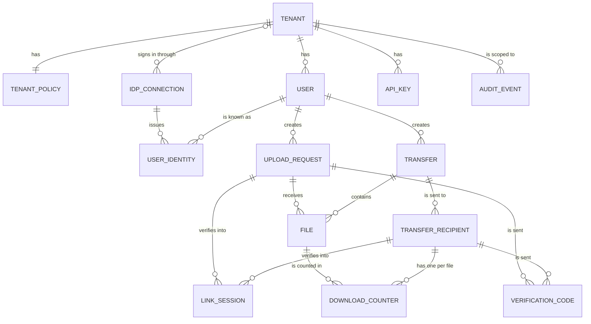
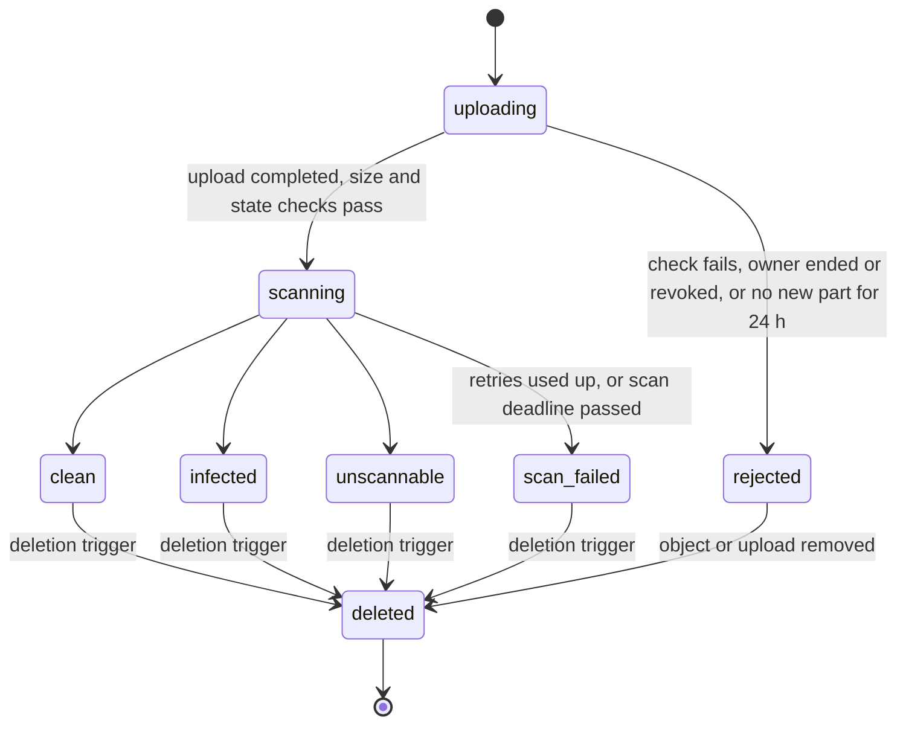
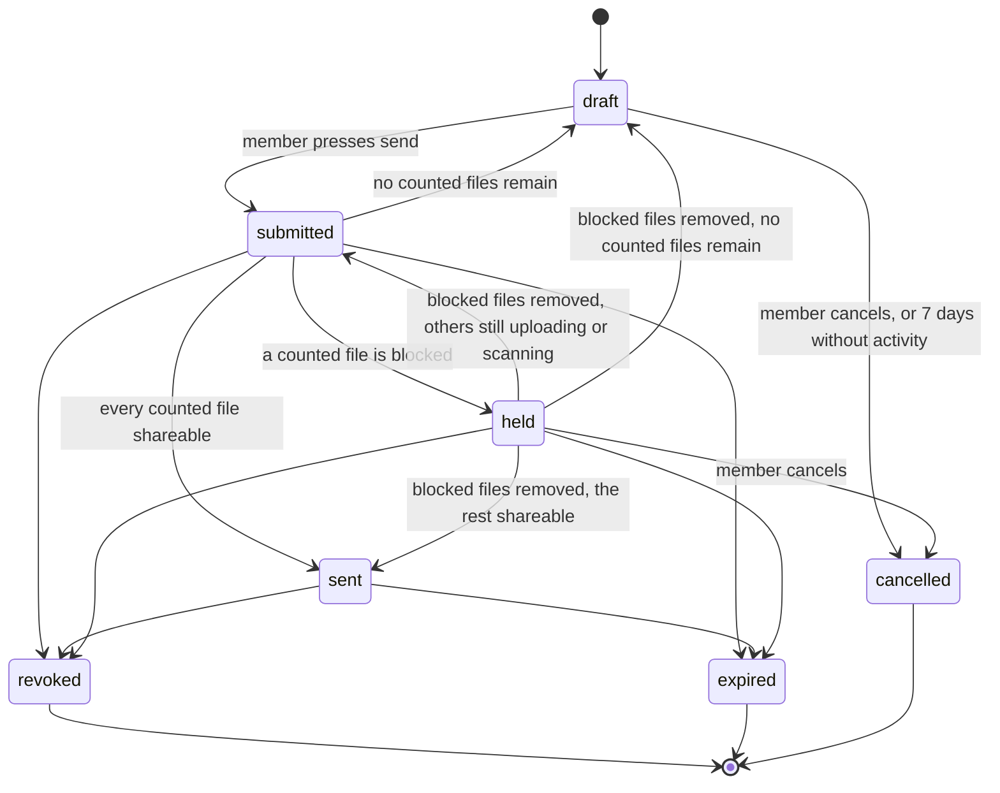
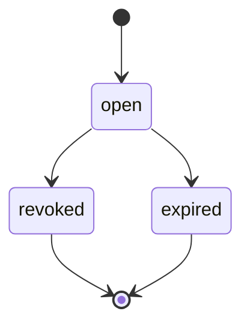
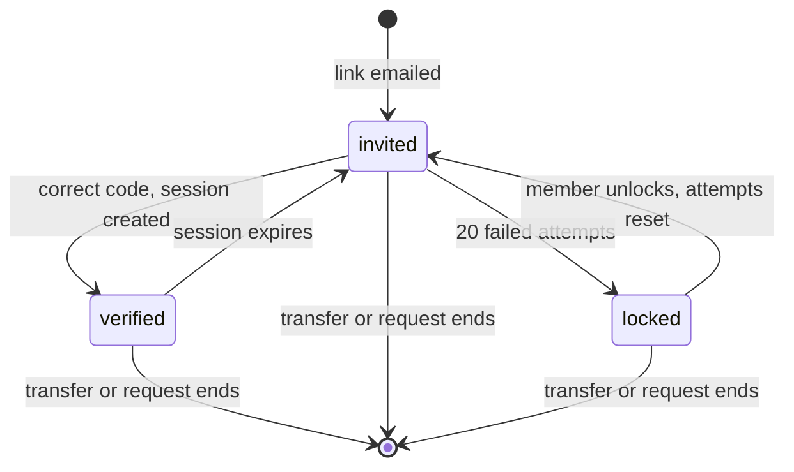

# Data model and multi-tenancy

| | |
|---|---|
| Requirements | [PRD](../prd.md), especially FR-1 to FR-35, NFR-8, NFR-9, NFR-12, NFR-14, NFR-15 |
| Architecture | [architecture.md](../architecture.md) |
| Decisions | [ADR-0003](../adr/0003-multi-tenancy-shared-schema.md) (tenancy model) |
| Tracking | [#13](https://github.com/codewithmuh/secure-file-transfer/issues/13), part of phase 2 ([#16](https://github.com/codewithmuh/secure-file-transfer/issues/16)) |

PostgreSQL is the single system of record (architecture section 2). This page defines its tables, the states rows move
through, how tenants are kept apart, and how the PRD's data lifecycle maps onto columns and jobs. Column lists show the
columns that carry meaning; every table also has `created_at`, and mutable tables have `updated_at`.

## 1. Conventions

- **IDs** are UUIDv7, generated by the application. They sort by creation time, which keeps indexes compact. They reveal
  when a row was created, which is acceptable: nobody can see an ID without access to the row, and no secret (link
  token, session, API key) can be derived from an ID alone.
- **Times** are `timestamptz`, stored in UTC.
- **States** are `text` columns with a `CHECK` constraint listing the allowed values. Unlike PostgreSQL enums, a value
  can be removed again, which keeps expand-then-contract migrations possible (section 7). States change only in the
  service layer, inside a transaction that also writes the audit event (architecture 5.2).
- **Counters that enforce a limit change in one conditional statement**, never read-check-write: download counts (2.3),
  code attempts and recipient lockouts (2.4).
- **Secrets are never stored in plain text.** Session tokens and API keys are random, and link tokens are derived with a
  secret key (2.2). Each is at least as hard to guess as 128 random bits, so a SHA-256 hash is enough. One-time codes
  have only 6 digits, so they are stored as HMAC-SHA-256 with a key from AWS Secrets Manager; a copy of the database
  alone can't be used to brute-force them.
- **Email addresses** are stored as entered, because we have to send mail to them, plus `email_normalized` (lowercase)
  for lookups. Logs and rate-limit keys use an HMAC of the normalized address, never the address itself.
- **File names** live only in the `files` table. They never appear in object keys, logs or queue messages.

## 2. Entities



Every arrow is a composite foreign key that includes `tenant_id` (section 4.2), with two exceptions. `AUDIT_EVENT`
refers to its actor and target by ID only, with no foreign keys, so audit records outlive the rows they describe
(section 6). `USER_IDENTITY` refers to its connection by ID alone, because the platform's own sign-in pools belong to no
tenant (2.1).

### 2.1 Tenants and people

| Table | Key columns | Notes |
|---|---|---|
| `tenants` | `id`, `name`, `status` (active, suspended) | Created by a platform operator (FR-34). A tenant that uses SSO has an `idp_connections` row (FR-26). |
| `tenant_policies` | `tenant_id` (PK), `max_expiry`, `unscannable_policy` (block, allow_with_warning), `received_file_retention_days` (1–90, default 30), `allowed_domains`, `blocked_domains`, `default_locale` (en, ja) | One row per tenant (FR-23, FR-24, FR-33). |
| `users` | `id`, `tenant_id`, `email`, `email_normalized`, `role` (admin, member), `status` (invited, active, deactivated) | Unique on `(tenant_id, email_normalized)` (FR-22, FR-25). |
| `idp_connections` | `id`, `tenant_id` (empty for the platform's own pools), `kind` (local, oidc, saml), `provider_name`, `issuer`, `status` | One row for each of the platform's own sign-in pools for local members (FR-25), and one for each tenant's SSO provider (FR-26). `provider_name` is unique: the pool's ID, or the name the operator CLI gives a tenant's provider. `issuer` is recorded for checks and display, but it is not unique and never used to find a connection, because issuer strings repeat across tenants (a copied SAML entity ID, a shared multi-tenant issuer). |
| `user_identities` | `id`, `tenant_id`, `user_id`, `idp_connection_id`, `subject` | Unique on `(idp_connection_id, subject)`: a subject is only unique within the connection it came through. Sign-in finds the connection from how the sign-in arrived (the pool that issued the token, and for SSO the provider it names), then the identity. Through a tenant's connection it accepts only an identity whose user is in that tenant, so one tenant's identity provider can never sign anyone in to another tenant (FR-26, NFR-12). |
| `api_keys` | `id`, `tenant_id`, `created_by`, `name`, `key_prefix`, `key_hash`, `scopes`, `expires_at`, `revoked_at`, `last_used_at` | The full key is shown once, at creation. `key_prefix` lets a tenant admin recognise a key without seeing it. `last_used_at` is updated at most once an hour, not on every call (FR-32). |

### 2.2 Transfers and upload requests

| Table | Key columns | Notes |
|---|---|---|
| `transfers` | `id`, `tenant_id`, `created_by`, `state`, `message`, `expiry_duration` (1 hour to 30 days), `expires_at` (empty until submitted), `download_limit` (null for no limit, or 1–100), `notify_on_first_download`, `last_activity_at`, `submitted_at`, `sent_at`, `ended_at`, `revoked_by`, `purge_after` | States in section 3.2. `expires_at` is the authority for expiry; the API compares it with the current time on every call (architecture 4.2). `ended_at` is set when the transfer is revoked, expires or is cancelled. |
| `transfer_recipients` | `id`, `tenant_id`, `transfer_id`, `email`, `email_normalized`, `locale`, `link_token_hash`, `link_key_id`, `link_issued_at`, `failed_attempts`, `locked_at`, `unlocked_by` | One row per recipient per transfer. Unique on `(tenant_id, transfer_id, email_normalized)`, so a request that lists the same address twice is rejected. `link_token_hash` is unique. |
| `upload_requests` | `id`, `tenant_id`, `created_by`, `state`, `uploader_email`, `email_normalized`, `locale`, `message`, `expires_at`, `link_token_hash`, `link_key_id`, `link_issued_at`, `failed_attempts`, `locked_at`, `unlocked_by`, `ended_at`, `revoked_by`, `purge_after` | One uploader per request (FR-10). States in section 3.3. |

**Expiry starts at send.** A draft stores the member's choice as `expiry_duration` (FR-3). The send call sets
`expires_at = now() + expiry_duration` under the row lock, so the time a transfer spends as a draft, with its files
uploading and scanning, isn't taken from the recipients. Scanning that is still running after the send does count,
and NFR-5 keeps it to minutes. If the tenant's `max_expiry` has dropped below the duration since the draft was made,
the send is refused with `expiry_out_of_range` and the draft is unchanged; the member chooses a new expiry and sends
again. Upload requests are open from creation, so their `expires_at` is set then.

**Draft activity.** `last_activity_at` is set when the transfer is created and moved forward by every edit of the draft
and by adding, completing or removing one of its files. It changes only while the transfer is a draft. These file
calls lock the transfer row anyway, to check its state and limits (architecture 4.1), so this adds no contention, and
a sent transfer's row is never touched. The 7-day draft rule reads it (section 6).

**Link tokens are derived, so a retry sends the same link.** A token is
`HMAC-SHA-256(K_link, "link/v1/" + subject_id + "/" + link_issued_at)`, where `subject_id` is the recipient's or the
upload request's ID and `link_issued_at` is written as microseconds since the Unix epoch. `K_link` is a versioned
keyring in AWS Secrets Manager, and the row records the version it used in `link_key_id`. In one short transaction,
the notification worker sets `link_issued_at`, `link_key_id` and `link_token_hash` (the SHA-256 of the token) if
`link_issued_at` is still empty; it commits, then sends the email. A retried notify message finds `link_issued_at` set,
rebuilds the same token and sends the same link, so a link that has already been delivered keeps working whichever
attempt delivered it.

- A new link is issued only on purpose: clearing `link_issued_at` and `link_token_hash` makes the worker issue a new
  token, and the old link stops working.
- The token is as hard to guess as the 256-bit key, which meets NFR-14's 128 bits, and the stored SHA-256 hash is
  enough. A copy of the database alone can't produce a token; with `K_link` as well it could produce every live link,
  so if the key may have leaked, every live link is issued again.
- A key version stays loaded for at least 14 days after a newer one takes over, the longest a notify message can wait
  in a dead-letter queue (architecture 5.6), so every retry can rebuild its link.

### 2.3 Files and download counts

| Table | Key columns | Notes |
|---|---|---|
| `files` | `id`, `tenant_id`, `transfer_id` or `upload_request_id`, `display_name`, `content_type`, `declared_size`, `actual_size`, `sha256`, `storage_key`, `s3_upload_id`, `state`, `last_part_at`, `removed_at`, `scan_attempts`, `scan_deadline`, `scan_engine`, `scan_detail`, `scanned_at`, `unscannable_allowed`, `retention_until`, `delete_after`, `deleted_at` | Exactly one of `transfer_id` and `upload_request_id` is set, each through its own composite foreign key, enforced by a check constraint. `storage_key` is `tenants/{tenant_id}/files/{file_id}` and is unique. States in section 3.1. |
| `download_counters` | `tenant_id`, `recipient_id`, `file_id`, `download_limit`, `count` | Primary key `(recipient_id, file_id)`. All rows for a transfer are created in the transaction that moves it to `sent`, with the transfer's limit copied in, so a row always exists before the first download. |

A download is counted with one statement, in the same transaction as its audit event (FR-4):

```sql
UPDATE download_counters
   SET count = count + 1
 WHERE recipient_id = $1 AND file_id = $2
   AND (download_limit IS NULL OR count < download_limit)
RETURNING count;
```

No row returned means the limit is reached. Parallel requests serialise on the row, so they can't exceed the limit.

For received files, `retention_until` and `delete_after` are both set at upload, from the tenant policy in force then
(FR-13). A member deleting a file earlier moves `delete_after` forward.

### 2.4 Verification and sessions

`verification_codes` and `link_sessions` belong to either a recipient or an uploader. Like `files`, each has two
nullable composite foreign keys, `(tenant_id, recipient_id)` and `(tenant_id, upload_request_id)`, with a check
constraint that exactly one is set. That keeps database-enforced isolation and lets purges cascade to them.

| Table | Key columns | Notes |
|---|---|---|
| `verification_codes` | `id`, `tenant_id`, `recipient_id` or `upload_request_id`, `code_hmac`, `expires_at` (≤ 10 min), `attempts`, `superseded_at`, `consumed_at` | Created by the notification worker, which emails the code (architecture 4.2). Creating a code sets `superseded_at` on every older live code for the same subject, so only the newest code can ever match. |
| `link_sessions` | `id`, `tenant_id`, `recipient_id` or `upload_request_id`, `session_hash`, `expires_at` (≤ 24 h), `revoked_at` | A verified browser session (FR-15). Revoking a transfer or request sets `revoked_at` on its sessions in the same transaction. |
| `member_sessions` | Depends on open question 1 | Web app sessions for members and admins. |

Checking a code (NFR-14), all in one transaction:

1. Lock the subject and check the lockout: `SELECT id FROM transfer_recipients WHERE id = $1 AND locked_at IS NULL
   FOR UPDATE` (the same for `upload_requests`). No row means the subject is locked, and no code is checked. The row
   lock queues parallel attempts for one subject, so none of them can be compared after the 20th failure.
2. Take an attempt atomically: `UPDATE verification_codes SET attempts = attempts + 1 WHERE id = $1 AND attempts < 5
   AND superseded_at IS NULL AND consumed_at IS NULL AND expires_at > now() RETURNING code_hmac`. No row means the code
   can't be used any more.
3. Compare the HMAC in constant time.
4. On a match, set `consumed_at`, create the session, and write the audit event.
5. On a mismatch, `UPDATE transfer_recipients SET failed_attempts = failed_attempts + 1, locked_at = CASE WHEN
   failed_attempts + 1 >= 20 THEN now() ELSE locked_at END WHERE id = $1 RETURNING failed_attempts, locked_at` (the same
   for `upload_requests`), and write the audit event for the failed attempt. If this attempt locked the subject, the
   transaction also writes a lockout event marked `security_critical` and an outbox lockout notice to the member and
   the tenant admins (NFR-14).

Every outcome is audited (FR-27): a match, a mismatch, a code that can't be used any more, and a refusal because the
subject is locked. After a lockout commits, the API writes the lockout record straight to the audit archive in both
regions before it answers (architecture 5.2).

When the member unlocks a recipient, `failed_attempts` goes back to 0 and `locked_at` is cleared, so one typo after an
unlock doesn't lock them again.

### 2.5 Audit and plumbing

| Table | Key columns | Notes |
|---|---|---|
| `audit_events` | `id`, `tenant_id` (null for platform events), `tx_id`, `occurred_at`, `actor_type` (member, admin, recipient, uploader, api_key, operator, system), `actor_id`, `action`, `target_type`, `target_id`, `source_ip`, `user_agent`, `request_id`, `security_critical`, `details` (JSON) | Partitioned by month on `occurred_at`. `tx_id` defaults to `pg_current_xact_id()`. The application role can only insert. `details` holds IDs and enums, never file names or message text (FR-27, NFR-15). |
| `audit_archive_cursor` | `generation`, `archived_up_to_tx`, `archived_at` | One row: the current archive generation, and how far the archive job has got in it. |
| `outbox` | `id`, `tenant_id`, `topic`, `payload` (IDs only), `trace_context`, `published_at` | Unpublished rows are found through a partial index on `published_at IS NULL` (architecture 5.3). |
| `processed_messages` | `consumer`, `message_id`, `processed_at` | Primary key `(consumer, message_id)`; makes every consumer idempotent. |
| `idempotency_keys` | `tenant_id`, `caller_type`, `caller_id`, `key`, `request_fingerprint`, `response_status`, `resource_type`, `resource_id`, `expires_at` | Primary key `(caller_type, caller_id, key)` (architecture 5.4). Written in the same transaction as the resource it created. It keeps the status and a reference to the resource, never the response body, so no secret, file name or message is stored here. A retry gets the response rebuilt from the resource as it is now. Calls whose response holds a secret, such as API key creation, take no idempotency key. |

**Archiving without gaps.** IDs and `occurred_at` follow insert time, not commit time, so a row from a slow transaction
can commit after a row with a later ID. A cursor on either would skip it for good. The archive job therefore works by
transaction ID: it reads `pg_snapshot_xmin(pg_current_snapshot())`, the oldest transaction still running, and archives
every row with `archived_up_to_tx <= tx_id < xmin`, in `(tx_id, id)` order. No transaction below `xmin` can still
commit, so nothing is skipped; then the cursor moves to `xmin`.

- **Long transactions would stall it**, because the cursor can't pass a transaction that is still open. So every
  transaction that writes stays short. The workload roles set `statement_timeout`, `idle_in_transaction_session_timeout`
  and `transaction_timeout` (PostgreSQL 17 or later), which ends any transaction open for more than 30 seconds. Jobs
  delete and purge in small batches, one transaction each (section 6). No code holds a transaction open across an S3 or SES call.
  Migrations are the exception (section 7). An alert fires when the oldest unarchived audit row is more than 2 minutes
  old (NFR-15).
- **Restores and failovers reuse transaction IDs.** A point-in-time restore, or a regional failover that loses the
  replica's unreplicated tail, takes the database back in time: transaction IDs used after that point are given out
  again, and the cursor row goes back too. So archive object keys start with the cursor's `generation`. The restore
  and failover runbooks set it to one more than the highest generation in the archive before the service writes
  again. Records archived before stay under the old generation and new ones go under the new one, so a reused ID never
  overwrites or hides an archived record. Rows between the restored cursor and the restore point are archived a second
  time; readers drop duplicates by `id`. An AZ failover loses nothing and keeps the generation.

Rate-limit counters are not in PostgreSQL unless their ADR chooses it (architecture section 9).

## 3. State machines

State values use underscores, so the PRD's `scan-failed` is `scan_failed` here.

### 3.1 File



- A file is **shareable** when it is `clean`, or `unscannable` with `unscannable_allowed` set (FR-16, FR-18). Only
  shareable files can be downloaded. `infected` files can never be downloaded by anyone (FR-17).
- A file is **blocked** when it is `infected`, `scan_failed`, or `unscannable` without `unscannable_allowed`.
- **The policy decision is recorded at scan time.** When the scan worker records `unscannable`, it sets
  `unscannable_allowed` from the tenant's `unscannable_policy` in the same transaction. A later policy change applies
  only to files scanned after it: it never makes a shared file blocked or a held file shareable, so it never needs to
  run the evaluation (3.2). To stop sharing such a file, a member or admin revokes its transfer.
- **Rejecting an upload** aborts its multipart upload by `s3_upload_id`, so unfinished parts are removed at once, not
  only by the 7-day bucket rule. A rejection runs the transfer's evaluation (3.2).
- **A scan has a deadline.** When a file enters `scanning`, `scan_deadline` is set from its size: long enough for
  every attempt's timeout and the backoff between them. If a worker dies without recording a result (for example out of
  memory on a zip bomb, with the message dead-lettered), reconciliation moves the file to `scan_failed` once the
  deadline passes, raises the operator alert (FR-19) and runs the evaluation. The scan worker records a result only
  with `WHERE state = 'scanning'`, so a result that arrives later changes nothing.
- **Deletion waits for a scan to finish.** The deletion job skips files in `scanning`. If a deletion trigger passes
  while a file is being scanned, the scan worker records the result, and the next deletion run removes it. The deadline
  is longer than every attempt together, so no file stays in `scanning` for good, and none is deleted underneath a
  running scan.

### 3.2 Transfer



**The evaluation.** The send call, every scan result (including a scan deadline passing, 3.1), every file removal and
every file rejection lock the transfer row (`SELECT … FOR UPDATE`) and run the same evaluation (architecture 4.1). It
counts the transfer's files that are not `rejected` and have no `removed_at`. The first row that matches decides:

| Situation | Result |
|---|---|
| The transfer is neither `submitted` nor `held` | No change. |
| `expires_at` has passed | Nothing is sent; the transfer is treated as expired. |
| No counted file remains | `draft`, with an outbox notice to the member. `submitted_at` and `expires_at` are cleared and `last_activity_at` is moved to now, so the next send starts the expiry again (2.2). |
| Any counted file is blocked | `held`, with an outbox message to the member, unless it is held already. |
| Any counted file is still `uploading` or `scanning` | `submitted`: no change for a submitted transfer, and a held one goes back. A later scan result or rejection runs the evaluation again. |
| Every counted file is shareable | `sent`: download counters are created and an outbox message notifies the recipients. |

A transfer can only be submitted with at least one counted file (FR-1), and the send call sets `expires_at` (2.2).
`expired` is recorded by the lifecycle job, but the API already treats the transfer as expired from `expires_at`
onwards.

### 3.3 Upload request



Closing a request stops new uploads only. Each received file keeps its own `retention_until` (FR-13).

### 3.4 Recipient or uploader access



These states are derived from `link_issued_at`, `locked_at` and the active `link_sessions`, not stored as a column.

## 4. Multi-tenancy model

### 4.1 Options

The decision and its trade-offs are recorded in [ADR-0003](../adr/0003-multi-tenancy-shared-schema.md).

| Option | Isolation | Cost and operations | Fit |
|---|---|---|---|
| **Shared schema, `tenant_id` on every row** (chosen) | Enforced by the data-access layer, composite foreign keys and tests; row-level security can be added as a second layer | One schema, one migration path, one connection pool; cheap per tenant | Fits 500 tenants of similar size and one maintainer |
| Schema per tenant | Stronger: queries can't cross a schema boundary by accident | 500 schemas to migrate on every release; connection pooling per schema; slow migrations | Worth it only if tenants need custom schemas or very strong isolation guarantees |
| Database per tenant | Strongest; per-tenant backup and restore | 500 databases, or a fleet of clusters; very high cost and toil | Only for a few very large or regulated tenants |

### 4.2 How isolation is enforced (NFR-12)

1. **Scoped data access.** Every query runs with an explicit scope (ADR-0002):
   - **Tenant:** from a member session or API key; every query carries `tenant_id`.
   - **Resource:** from a verified link session; only that transfer or request and its files.
   - **System:** a named job such as deletion or reconciliation, audited.
   - **Credential lookup:** the one place that searches across tenants. It maps a credential to its owner and returns
     only `(tenant_id, subject)`: a link token hash, session hash, API key hash, or an identity's connection and
     subject (2.1). The request then continues in tenant or resource scope. With row-level security it would run as a
     narrow `SECURITY DEFINER` function, so normal roles never read across tenants.

   There is no other unscoped query method.
2. **Composite foreign keys.** Every tenant-owned table has a unique key `(tenant_id, id)`, and children reference
   their parent by both columns, for example `files (tenant_id, transfer_id) → transfers (tenant_id, id)`. The database
   itself refuses a row that points at another tenant's parent. This includes `verification_codes` and `link_sessions`
   (section 2.4).
3. **Row-level security as a second layer** (decided in phase 3). The service would set `app.tenant_id` per
   transaction, and policies would compare it with each row's `tenant_id`. System jobs would use a separate database
   role, and credential lookup a security-definer function.
4. **Tests.** The isolation suite runs on every pull request. For every endpoint and every data-access function it
   creates two tenants and tries each operation with the other tenant's IDs, tokens and keys; anything but "not found"
   fails the build. It also gives two tenants SSO connections with the same issuer string and an identity with the
   same subject in each, signs in through each connection, and checks that each sign-in reaches only its own tenant's
   user.
5. **Storage.** Object keys start with `tenants/{tenant_id}/`, so per-tenant KMS keys (open question 3) and IAM
   conditions can be added without moving data.

## 5. Indexes for the main queries

| Query | Index |
|---|---|
| Credential lookups | unique `transfer_recipients (link_token_hash)`, `upload_requests (link_token_hash)`, `link_sessions (session_hash)`, `api_keys (key_hash)`, `idp_connections (provider_name)`, `user_identities (idp_connection_id, subject)` |
| Identities of a user | `user_identities (tenant_id, user_id)` |
| A member's transfers, newest first | `transfers (tenant_id, created_by, created_at DESC)` |
| An admin's view of all transfers, by state | `transfers (tenant_id, state, created_at DESC)` |
| Recipients of a transfer (status, notify, revoke), and no address twice | unique `transfer_recipients (tenant_id, transfer_id, email_normalized)` |
| Audit search by email | `transfer_recipients (tenant_id, email_normalized)`, `upload_requests (tenant_id, email_normalized)` |
| Files of a transfer or request | `files (tenant_id, transfer_id)`, `files (tenant_id, upload_request_id)` |
| Sessions to close on revoke | `link_sessions (recipient_id)`, `link_sessions (upload_request_id)` |
| Latest code for a subject | `verification_codes (recipient_id, created_at DESC)`, `verification_codes (upload_request_id, created_at DESC)` |
| Download counters of a file (purge) | `download_counters (file_id)` |
| Expiry job | partial `transfers (expires_at) WHERE state IN ('submitted', 'sent', 'held')`, same for `upload_requests` |
| Abandoned drafts | partial `transfers (last_activity_at) WHERE state = 'draft'` |
| Abandoned uploads | partial `files (last_part_at) WHERE state = 'uploading'` |
| Stuck scans | partial `files (scan_deadline) WHERE state = 'scanning'` |
| Deletion job | partial `files (delete_after) WHERE deleted_at IS NULL` |
| Reconciliation | unique `files (storage_key)` |
| Purge job | partial `transfers (purge_after)`, `upload_requests (purge_after)` |
| Audit search by time, target or actor | per partition: `(tenant_id, occurred_at DESC)`, `(tenant_id, target_type, target_id)`, `(tenant_id, actor_id, occurred_at DESC)` |
| Audit archive | per partition: `(tx_id, id)` |
| Unpublished outbox rows | partial `outbox (created_at) WHERE published_at IS NULL` |
| Users by email | unique `users (tenant_id, email_normalized)` |

Every foreign key column that a parent's delete has to check is covered by an index in this table.

## 6. Lifecycle and retention

How the PRD's data lifecycle table and the architecture's operational retention become columns and jobs:

| Data | Trigger, as a column | Job |
|---|---|---|
| Files of a transfer | `files.delete_after` set when the transfer is revoked, expires or is cancelled, or the file is removed | Deletion job: deletes every object version in Tokyo and Osaka, then sets `deleted_at` (architecture 4.5) |
| Received files | `files.delete_after`, set at upload to `retention_until`, or earlier when the member deletes the file | Same deletion job |
| Abandoned drafts | `transfers.last_activity_at` older than 7 days while `state = draft` | Draft job locks the row, checks again, and cancels the transfer, which sets `delete_after` on its files |
| Unfinished uploads | `files.last_part_at` older than 24 hours while `state = uploading` | Reconciliation job rejects the file and aborts the multipart upload |
| Stuck scans | `files.scan_deadline` passed while `state = scanning` | Reconciliation job moves the file to `scan_failed` and alerts (3.1) |
| Orphan objects | An object no `files` row refers to, older than 24 hours | Reconciliation job |
| Metadata of transfers | `purge_after = ended_at + 7 days + 365 days` | Purge job deletes the transfer and its child rows, only once every one of its files has `deleted_at`; audit events stay, because they have no foreign keys |
| Metadata of upload requests | `purge_after` = the later of `ended_at` and the last received file's `retention_until`, plus 7 days and 365 days | Same purge job, with the same check |
| Audit events | `occurred_at + 365 days` | Daily job deletes expired rows; empty monthly partitions are dropped |
| Verification codes, link sessions | `expires_at` (unusable from then) | Deleted by the next daily run |
| Outbox rows | `published_at + 7 days` | Daily job |
| Processed messages | `processed_at + 14 days` | Daily job |
| Idempotency keys | `expires_at` (24 hours) | Daily job |

**Why `purge_after` is computed, not tracked.** After a transfer ends, no download or verification can happen, and its
files are deleted within 7 days, so its last audit event is at most 7 days after `ended_at`. An upload request's last
event is at most 7 days after its last file's retention ends. Computing `purge_after` from those bounds keeps every
audit record's metadata readable for its full 365 days without updating the transfer row on every event, which would
contend with the evaluation lock.

**The purge never orphans an object.** It skips a transfer or request that still has a file without `deleted_at`, and
an alert fires, because deleting the `files` row would leave its object with nothing pointing at it. The scan deadline
(3.1) keeps a file from staying in `scanning`, which deletion skips, so this should only fire on a bug.

**Jobs work in small transactions.** Every job deletes or purges in batches of at most 1,000 rows, one transaction per
batch, and never has a transaction open while it calls S3. The deletion job, for example, deletes the objects first
and then marks the files deleted in a short transaction. That keeps the archive cursor moving (2.5) and row locks
short.

**Audit partitions.** The lifecycle job creates monthly partitions three months ahead. A `DEFAULT` partition catches
any row whose month is missing, so audit writes, and with them every fail-closed action, never fail for lack of a
partition. An alert fires if the next month's partition is missing 7 days before the month ends, or if any row lands in
the default partition.

Database backups keep 14 days of point-in-time recovery, so deleted rows age out of backups within 14 days. File
contents are never in database backups.

## 7. Migrations

Alembic migrations follow **expand, then contract**: a release only adds columns, tables, indexes or allowed state
values in a way the running version ignores; the code switches over; a later release removes what is no longer used.
This keeps every deploy free of downtime (NFR-18).

- **Indexes on ordinary tables** are built with `CREATE INDEX CONCURRENTLY`, inside Alembic's `autocommit_block()`,
  because PostgreSQL doesn't allow it in a transaction.
- **Indexes on `audit_events`**, which is partitioned, can't be built concurrently in one statement. The migration
  creates the index `ON ONLY` the parent (it starts invalid), builds it `CONCURRENTLY` on each partition, and attaches
  each partition's index; the parent's index becomes valid when the last one is attached.
- **Every DDL statement runs with a short `lock_timeout`** (2 seconds) and is retried. A migration that can't get its
  lock gives up instead of making the application's queries queue behind it.
- **A new state value, or any other changed `CHECK`,** is never made by replacing the constraint in place, which takes
  an `ACCESS EXCLUSIVE` lock and scans the whole table while holding it. Instead:
  1. `ADD CONSTRAINT … CHECK (…) NOT VALID` with the new list: a brief lock and no scan, and new writes are checked at
     once.
  2. `VALIDATE CONSTRAINT` in its own transaction: it scans the table without blocking reads or writes.
  3. `DROP CONSTRAINT` on the old one. Code starts writing a new value only once the old constraint is gone.
- **A new foreign key** follows the same steps: the referencing columns are indexed concurrently first, then
  `ADD CONSTRAINT … FOREIGN KEY … NOT VALID`, then `VALIDATE CONSTRAINT` in its own transaction.
- **A new `NOT NULL`** on an existing column goes through a validated `CHECK (column IS NOT NULL)` first, so
  `SET NOT NULL` doesn't scan the table.
- The migration role isn't held to the 30-second transaction limit (2.5). Long steps can hold the archive cursor back
  while they run, so they run outside peak hours, and the archive lag alert shows any delay.

## 8. Size at the design load

From the PRD design load (section 6.1). The capacity estimate ([#15](https://github.com/codewithmuh/secure-file-transfer/issues/15))
turns these into database sizing.

| Table | New rows per day | Rows kept | Notes |
|---|---|---|---|
| `transfers` + `upload_requests` | 10,000 | about 3.9 million | Kept about 372 days after they end |
| `transfer_recipients` | about 20,000 | about 7.4 million | About 2 recipients per transfer |
| `files` | 30,000 | about 11 million | Rows outlive file contents, for the audit trail |
| `download_counters` | about 60,000 | about 22 million | One per recipient per file |
| `audit_events` | about 300,000 | about 110 million | About 25 events per transfer, plus sign-ins |
| `outbox` | about 100,000 | about 0.7 million | Kept 7 days |

That comes to roughly 100–150 GB including indexes at steady state, most of it audit events.

## 9. Requirements coverage

| PRD | Tables |
|---|---|
| FR-1 to FR-9 (transfers) | `transfers`, `transfer_recipients`, `files`, `download_counters`, `audit_events` |
| FR-10 to FR-13 (upload requests) | `upload_requests`, `files` (`retention_until`), `tenant_policies` |
| FR-14, FR-15 (verification) | `verification_codes`, `link_sessions`, the `link_token_hash` columns |
| FR-16 to FR-19 (scanning) | `files` (state, scan columns, `scan_deadline`, `unscannable_allowed`), `tenant_policies.unscannable_policy` |
| FR-20, FR-21 (control and lifecycle) | `ended_at`, `expiry_duration`, `expires_at`, `delete_after`, `purge_after` (section 6) |
| FR-22 to FR-26 (tenant administration and sign-in) | `users`, `idp_connections`, `user_identities`, `tenant_policies`, `member_sessions` |
| FR-27 to FR-29 (audit) | `audit_events` |
| FR-32 (API keys) | `api_keys` |
| FR-33 (languages) | `tenant_policies.default_locale`, `transfer_recipients.locale`, `upload_requests.locale` |
| FR-34 (tenant provisioning) | `tenants`, `tenant_policies`, first row in `users` |
| FR-35 (break-glass access) | `audit_events` for now; any grant table comes with the phase 3 design |

## 10. Open items

- **Member sessions and sign-in** wait for open question 1.
- **Row-level security** as a second layer is decided in phase 3.
- **Per-tenant encryption** of `display_name` and `message` with tenant keys depends on open question 3.
- **Download counting under resume** may need a `download_grants` table, depending on open question 8.
