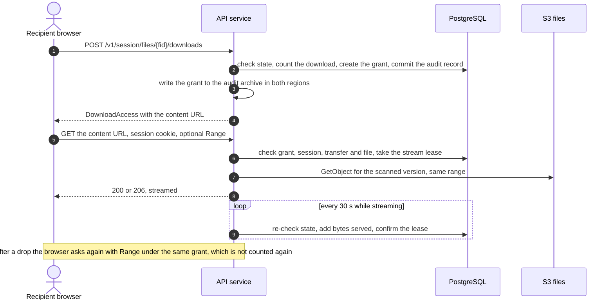

# Abuse prevention, rate limits and the download mechanism

| | |
|---|---|
| Requirements | [PRD](../prd.md), especially FR-4, FR-6, FR-14, FR-15, NFR-4, NFR-6, NFR-14 and open question 8 |
| Architecture | [architecture.md](../architecture.md), [data model](../design/data-model.md), [capacity and cost](../design/capacity-and-cost.md) |
| API | [openapi.yaml](../api/openapi.yaml) |
| Tracking | [#24](https://github.com/codewithmuh/secure-file-transfer/issues/24), part of phase 3 ([#25](https://github.com/codewithmuh/secure-file-transfer/issues/25)) |

This page covers how the service is misused and what stops it: the abuse cases, every rate limit with its key, value and
enforcement point, the WAF, where the counters live (input to the rate-limit store ADR in phase 4), and the decision on
PRD open question 8, the download mechanism. The other phase 3 documents cover the threat model
([#21](https://github.com/codewithmuh/secure-file-transfer/issues/21)), encryption and keys
([#22](https://github.com/codewithmuh/secure-file-transfer/issues/22)) and authentication and authorization
([#23](https://github.com/codewithmuh/secure-file-transfer/issues/23)). Where this page relies on them, it says so.

Every number here is a starting value. Limits are configuration, promoted dev → staging → prod like code, and a
platform operator can override them for one tenant; every override is audited. The first load test and the first
weeks in prod tune them. NFR-14 lets phase 3 tighten its numbers; this page tightens one (codes per address per day,
section 2) and adds limits NFR-14 left open (uploads and downloads).

**Decisions in short**

- **Open question 8: stream downloads through the API.** A download is counted once, when its grant is created. The
  grant belongs to the recipient and works only with that recipient's verified session. The browser fetches the
  bytes from the API and resumes with HTTP Range requests under the same grant. The stream re-checks state every 30
  seconds, so a revocation stops it within 60 seconds. Section 5.
- **Counters: ElastiCache Serverless for Valkey**, one cache per environment and region, with WAF rate-based rules in
  front for coarse per-IP floods. Security state that must survive a failover (code attempts, lockouts, download
  counts, grant byte use, storage quotas) stays in PostgreSQL. Sign-in and link verification fail closed when the
  cache is down; other calls fall back to a per-pod limiter. Section 4.
- **Failed sign-ins per account** are counted by a Cognito pre-authentication trigger, because Cognito's built-in
  lockout alone allows up to 14 failures in the first 15 minutes, more than NFR-14's 10. Section 2.3.

## 1. Abuse cases

| ID | Abuse case | Who | Main controls |
|---|---|---|---|
| AB-1 | Link token brute force and enumeration | Anyone on the internet | 128-bit tokens, per-IP limits, a block on repeated `link_not_found` |
| AB-2 | Verification code guessing | Someone holding a forwarded or leaked link | 5 attempts per code, lockout after 20 failures, per-IP failure limit |
| AB-3 | Code flooding and email bombing of a victim | Leaked-link holder, or a member or API key | Per-address code caps, per-address and per-sender email caps, coalesced notices |
| AB-4 | Sending spam or phishing through the service | A malicious or compromised tenant or member | Fixed templates, no sender text in emails, caps, per-tenant SES reputation |
| AB-5 | Storage abuse | Members, API keys, outsider uploaders | Per-transfer limits, signed part sizes, tenant quotas, 24-hour cleanup |
| AB-6 | Scan evasion | Any uploader | Never `clean` unless fully inspected; encrypted or over-limit files are `unscannable` |
| AB-7 | Enumeration and scraping | Members, API keys, outsiders | `404` across tenants, scoped lists, per-caller limits, audit export limits |
| AB-8 | Credential stuffing on member sign-in | Anyone on the internet | Mandatory MFA, Cognito threat protection, per-account and per-IP limits |
| AB-9 | API key abuse | Whoever holds a leaked key | Hashed, scoped, expiring keys with no download right; per-key limits |
| AB-10 | Denial of service | Anyone on the internet | Shield Standard, WAF, per-IP and per-stream caps, fair scan queues |
| AB-11 | Download-limit and session abuse | A verified recipient | Count at grant creation, grants bound to the recipient, byte and request budgets |

### AB-1 Link token brute force and enumeration

| | |
|---|---|
| Prevention | Link tokens carry at least 128 bits from the OS random generator (NFR-14); the exact format is set in #23. They are stored as SHA-256 and found by hash. They travel only in the URL fragment and in request bodies (architecture 4.2). `resolveLink` returns only the link kind, access state and locale (FR-14). Per IP: 60 link-step requests a minute in the app (NFR-14) and 100 a minute at the WAF. An IP above 30 link-step requests in 5 minutes must pass a WAF challenge, which a real browser solves silently and a plain script doesn't (section 3.2). After 20 `link_not_found` answers in an hour, that IP gets `429` on every link step for the rest of the hour. With about 10^5 live links and 10^6 guesses a second, the expected time to hit any link is longer than 10^19 years. |
| Detection | `link_lookups_total{result}` (found, not_found, revoked, expired), IPs caught by the not-found rule, and the WAF rule that counts link-step requests per ASN. |
| Response | Runbook `link-enumeration`: add the IPs or ASNs to the WAF block list and turn on the attack-mode rule (section 3.2). |

### AB-2 Verification code guessing

| | |
|---|---|
| Prevention | Codes have at least 6 digits and are stored as an HMAC. A code is valid for at most 10 minutes and allows 5 attempts, taken by one conditional update in PostgreSQL (data model 2.4). A new code supersedes every older one. After 20 failed attempts in total, the recipient or uploader is locked until the member unlocks them (NFR-14). Each IP gets at most 30 failed attempts an hour across all links, and the WAF challenge applies as in AB-1. Before a lockout an attacker gets 20 guesses, each against a code drawn from 10^6 values, so the chance of success is at most 2 × 10^-5. |
| Detection | `verification_attempts_total{result}`, lockouts per hour, and failures per IP. The member and tenant admins are told of every lockout (NFR-14). |
| Response | The member unlocks the recipient, or revokes and re-sends the transfer (PRD risk table). Runbook `verification-abuse`: block the IPs. A leaked link can still be used to lock the real recipient out; that stays a residual risk (section 9). |

### AB-3 Code flooding and email bombing

There are four ways to make the service email someone, and each one is capped:

| Vector | Cap |
|---|---|
| A leaked link is used to request codes | ≤ 5 codes per address an hour (NFR-14), ≤ 20 a day, ≥ 30 s between codes for one recipient; codes go only to the invited address |
| A member or API key sends transfers or upload requests to a victim | ≤ 20 link emails per address per tenant a day; ≤ 100 a day across all tenants; per-member, per-key and per-tenant hourly caps (section 7) |
| A tenant admin sends invitations | ≤ 100 per tenant an hour; ≤ 3 per address a day |
| An uploader triggers notices to a member, for example by uploading 50 files | Notices are coalesced: at most one files-arrived or blocked-file email per upload request every 10 minutes |

| | |
|---|---|
| Detection | `email_caps_hit_total{cap}`, codes refused per hour, SES bounces and complaints by tenant. |
| Response | Runbook `email-abuse`: find the source (a link, a member or an API key) in the audit log, revoke the transfer, deactivate the member or revoke the key, and add a suppression entry for the victim (section 7.4). |

### AB-4 Spam or phishing sent through the service

| | |
|---|---|
| Prevention | There is no self-service sign-up (FR-34): every tenant is provisioned by an operator. Every email uses a fixed template. No sender-written text and no file names appear in any email (FR-14); the email names the tenant (set by the operator) and the sender's verified address. Links point only to our web app. The file behind a link reaches only the invited, verified recipient, and only after a malware scan. Tenant domain policy (FR-24), per-member and per-tenant caps on recipients and emails an hour, and SPF, DKIM and DMARC apply. Each of our tenants is its own SES tenant, so SES tracks its reputation and pauses it alone. Past a bounce or complaint threshold, a tenant's sending is paused automatically and an operator is paged (section 7.3). |
| Detection | Bounce and complaint findings per SES tenant, each tenant's send volume against its 7-day baseline, and the infected-file rate per tenant. |
| Response | Runbook `tenant-abuse`: pause the tenant's SES sending, suspend the tenant (`tenants.status = suspended`), revoke its open transfers and tell its admins. Phishing documents that contain no malware still pass the scan (section 9). |

### AB-5 Storage abuse

| | |
|---|---|
| Prevention | Per transfer and per upload request: 50 files, 5 GB each, 20 GB in total, counted from declared sizes and checked again at completion (FR-1, FR-2, FR-11). Part URLs are issued only for the declared parts, each signed with its exact `Content-Length`. Each tenant has a storage quota (2 TB by default) and a daily upload volume (200 GB in 24 hours). An upload request accepts at most 100 file declarations in total, so rejected uploads can't be replayed forever. Unfinished uploads are rejected and aborted 24 hours after their last part. Drafts are cancelled after 7 days. Retention deletes the rest (FR-13, NFR-8). Section 6. |
| Detection | Quota use per tenant, uploads against the tenant's baseline, orphans and unfinished multipart bytes found by the reconciliation job. |
| Response | Runbook `tenant-quota`: an operator raises the quota or suspends the tenant; a member revokes an abused upload request. |

### AB-6 Scan evasion

| | |
|---|---|
| Prevention | A file becomes `clean` only when the engine inspected all of it. Encrypted archives and documents are `unscannable`, which tenant policy blocks by default (FR-18). Any engine limit exceeded (size, nesting depth, file count, compression ratio, time) also gives `unscannable`, never `clean`. Engine errors are retried and end in `scan_failed` (FR-19). The declared content type is ignored. Downloads serve the exact object version that was scanned, always as an attachment. Section 6.4. |
| Detection | `scan_results_total{state,reason}`, with the unscannable rate per tenant and reason, and scan times far above the size-based estimate. |
| Response | Runbook `scan-evasion`: tell the tenant's admins, who review their unscannable policy; an operator looks for a pattern across tenants. |

### AB-7 Enumeration and scraping

| | |
|---|---|
| Prevention | Another tenant's items, and another member's, return `404` (NFR-12). Authorization never depends on an ID being hard to guess. Lists are scoped to the caller and paged at most 100 items at a time. Each caller and each tenant has a rate limit; audit search and export have tighter ones. A link session sees only its own transfer or request. Cognito returns the same error whether or not a user exists (#23). |
| Detection | `404` responses per caller (a member walking IDs), the list request rate per caller, and audit export volume per tenant. |
| Response | Runbook `api-key-compromise` or `account-compromise`: revoke the key or deactivate the member, then search the audit log for what was read. |

### AB-8 Credential stuffing on member sign-in

Members sign in through Cognito managed login with mandatory MFA, or through their tenant's identity provider (#23).
SSO users never send a password to us or to Cognito.

| | |
|---|---|
| Prevention | Mandatory MFA (FR-25), so a guessed password alone signs nobody in. Cognito threat protection in enforce mode blocks known compromised credentials and high-risk sign-ins (#23). A pre-authentication trigger allows at most 10 failed sign-ins per account in 15 minutes (NFR-14), on top of Cognito's own lockout. A WAF web ACL on the user pool blocks IPs with a bad reputation and limits each IP to 100 requests in 5 minutes. Our API allows 30 sign-in starts and 30 callbacks per IP a minute. |
| Detection | Cognito sign-in failure and risk metrics, denials by the trigger, and failures per IP and ASN in WAF logs. |
| Response | Runbook `credential-stuffing`: block IPs or ASNs, add a CAPTCHA rule for managed login pages (but not TOTP registration, which a CAPTCHA breaks), force a password reset for the accounts targeted, and tell their tenant admins. |

### AB-9 API key abuse

| | |
|---|---|
| Prevention | A key is shown once and stored as a hash. It has scopes and an expiry (90 days by default, at most 365). It can never download file contents or create another key (API README section 2). It carries a fixed, recognisable prefix so secret scanners such as gitleaks can find it in code. Each key gets 300 requests a minute and shares its tenant's 1,000. Email caps apply to keys as they do to members. |
| Detection | Failed bearer authentications per IP, keys held at their rate limit, a key used from an ASN it has never used, export volume, and `last_used_at`. |
| Response | A tenant admin revokes the key (`revokeApiKey`); an operator can revoke it in an emergency. Runbook `api-key-compromise`: search the audit log with the key as the actor. |

### AB-10 Denial of service

| | |
|---|---|
| Prevention | Shield Standard (automatic) for network and transport floods on the load balancer, CloudFront and Route 53. WAF managed rules and rate-based rules (section 3). Application limits (section 2). Request bodies are capped at 64 KB, except the tenant policy (256 KB). Audit exports run one at a time per tenant. Download streams are capped per session, per IP, per tenant and per pod. A stream that reads slower than 2 KB/s over 2 minutes is closed, so slow readers can't hold the slots. Pods also scale on active streams (section 5.7). File uploads go straight to S3, not through the pods. Scan queues are SQS fair queues with the tenant ID as the message group, and each tenant has a cap on concurrent scans, so one tenant's burst can't delay every other tenant's scans (NFR-5, section 6.4). Daily byte caps per tenant and per recipient bound the egress any one party can cause (section 2.2, D). |
| Fail-closed cost | When the counter store is down, link verification and sign-in fail closed, which is itself an outage for recipients. The cache is Multi-AZ, and its alert pages (section 8). |
| Detection | WAF blocked requests, 5xx and latency SLO burn, active streams, scan queue age, and SQS's count of noisy message groups. |
| Response | Runbook `http-flood`: block list, attack-mode rule, lower WAF thresholds, scale out. Shield Advanced is not in v1. |

### AB-11 Download-limit and session abuse

| | |
|---|---|
| Prevention | A download is counted once, when its grant is created, by one conditional update in the same transaction as its audit record (FR-4), so parallel requests can't exceed the limit. A grant belongs to one recipient and one file. It works only with a valid link session of that recipient, for at most 24 hours, 20 requests and 3 × the file size in bytes, with one active stream at a time. Resuming within the grant is free (FR-6). Without the session cookie the content URL returns `401`, and with another recipient's session it returns `404`. A transfer with no download limit still has a cap: each recipient can be granted at most 100 GB a day (section 2.2, D). Section 5. |
| Detection | Grants used up, stream takeovers from a different IP, and many grants for one recipient. |
| Response | The member revokes the transfer. A recipient who keeps a copy can share it; limits bound fetches, not copies (section 9). |

## 2. Rate limits

### 2.1 Keys

| Key | Value used | Notes |
|---|---|---|
| IP | The client address from the `X-Forwarded-For` entry our load balancer adds (ADR-0002) | The load balancer is IPv4-only in v1. Dual-stack needs the limiter to group IPv6 addresses by /64 first, because WAF rate rules key each IPv6 address separately. |
| Account | The member's user ID; for sign-in, the Cognito user | |
| Tenant | `tenant_id` from the member session or API key | Recipients and uploaders don't count against their tenant's request budget (2.2, H) |
| Invited email | HMAC-SHA-256 of the normalized address (data model section 1) | Never the address itself |
| Subject | The recipient (`transfer_recipients.id`) or upload request ID | Who a link was sent to |
| Verification proof | `verification_codes.id` | Its attempts are counted in PostgreSQL |
| Link session | `link_sessions.id` | Never the cookie value |
| API key | `api_keys.id` | |
| Grant | `download_grants.id` (section 5.4) | |

### 2.2 Limits by endpoint group

Groups use the operation IDs of the [API contract](../api/openapi.yaml). "App" means the API service, using the counter
store (section 4); "PostgreSQL" means a conditional update in the transaction of the request; "WAF" means a
rate-based rule on the load balancer's web ACL. A WAF `429` has a fixed `Retry-After` equal to the rule's window.

**A. Link steps:** `resolveLink`, `requestVerificationCode`, `createLinkSession` (public). Fail closed: `503`.

| Key | Limit | Enforced by | Over the limit |
|---|---|---|---|
| IP | 100 requests a minute, all link steps | WAF `rate-links-ip` | `429`, `Retry-After: 60` |
| IP | Above 30 requests in 5 minutes, all link steps | WAF `challenge-links` | WAF challenge; the web app's WAF integration solves it silently |
| IP | 60 requests a minute, all link steps (NFR-14) | App | `429` |
| IP | 20 `link_not_found` answers an hour | App | `429` on every link step for the rest of the hour |
| IP | 30 failed code attempts an hour, across all links | App | `429` |
| Invited email | 5 codes an hour (NFR-14) and 20 a day; the probe mailbox is exempt (NFR-1) | App | `429` |
| Subject | 1 code every 30 s | App | `429` |
| Tenant | 1,000 codes an hour | App | `429` |
| Verification proof | 5 attempts; valid for 10 minutes (NFR-14) | PostgreSQL | `422 code_attempts_exhausted`, `422 code_expired` |
| Subject | 20 failed attempts in total, then locked until the member unlocks (NFR-14) | PostgreSQL | `403 recipient_locked` |

**B. Member sign-in:** `/v1/auth/sign-in` and `/v1/auth/callback` (defined in #23), and Cognito managed login. Fail
closed.

| Key | Limit | Enforced by | Over the limit |
|---|---|---|---|
| IP | 100 requests in 5 minutes to the user pool's sign-in endpoints | WAF web ACL on the user pool | `403` from Cognito |
| IP | 30 sign-in starts a minute and 30 callbacks a minute | App | `429` |
| Account | 10 failed sign-ins in 15 minutes (NFR-14) | Pre-authentication trigger (2.3) | Sign-in denied with a generic message |
| Account | Cognito's own lockout after 5 failed passwords | Cognito | `Password attempts exceeded` |

**C. Link session reads:** `getLinkSession`, `endLinkSession`, `listSessionFiles`. Fail open to the per-pod limiter.

| Key | Limit | Enforced by | Over the limit |
|---|---|---|---|
| Link session | 120 requests a minute | App | `429` |
| IP | 6,000 requests in 5 minutes, whole API | WAF `rate-api-ip` | `429`, `Retry-After: 300` |

**D. Download grants:** `createSessionDownload`, `createReceivedFileDownload`. Fail open to the per-pod limiter; the
count itself is always in PostgreSQL.

| Key | Limit | Enforced by | Over the limit |
|---|---|---|---|
| Subject | 100 grant requests an hour, resumes included (twice the 50 files a transfer can hold) | App | `429` |
| Account | 300 grant requests an hour, for members | App | `429` |
| IP | 300 grant requests an hour | App | `429` |
| Tenant | 2,000 grants an hour, recipients and members together | App | `429` |
| Subject | 100 GB of granted bytes a day: each counted grant adds the file's size. This also caps transfers with no download limit. | App | `429` |
| Tenant | 200 GB of granted bytes a day, recipients and members together | App | `429` |
| Subject and file | The transfer's download limit, 1–100 (FR-4) | PostgreSQL | `403 download_limit_reached` |

**E. Download content:** `getSessionDownloadContent`, `getReceivedFileDownloadContent` (new, section 5). The grant
checks are always in PostgreSQL; the concurrency caps fail open to the per-pod limiter.

| Key | Limit | Enforced by | Over the limit |
|---|---|---|---|
| Grant | 1 active stream (a new request takes over), 20 requests, 3 × file size in bytes, 24 hours | PostgreSQL | `403 download_grant_exhausted` |
| Link session or account | 6 concurrent streams | App | `429` |
| IP | 20 concurrent streams | App | `429` |
| Tenant | 200 concurrent streams | App | `429` |
| Stream | At least 2 KB/s averaged over 2 minutes | In process | Stream closed; the browser resumes under the same grant |
| API pod | 100 concurrent streams | In process | `503`, `Retry-After: 10` |

**F. Uploads:** `addTransferFile`, `addSessionUploadFile`, `requestUploadPartUrls`, `requestSessionUploadPartUrls`,
`listUploadedParts`, `listSessionUploadedParts`, `completeUpload`, `completeSessionUpload`. Fail open to the per-pod
limiter, except the PostgreSQL rows.

| Key | Limit | Enforced by | Over the limit |
|---|---|---|---|
| Member, API key or link session | 600 requests a minute, whole group | App | `429` |
| IP | 1,200 requests a minute, whole group | App | `429` |
| File | 10 × `part_count` part URLs over the file's life | App | `429` |
| Upload request | 100 file declarations in total; 50 counted files (FR-11) | PostgreSQL | `422 too_many_files` |
| Tenant | 200 GB of declared uploads in 24 hours | App | `429` |
| Tenant | 2 TB of files that are uploading, scanning or stored | PostgreSQL | `413 storage_quota_exceeded` |

**G. Actions that send email:** `sendTransfer`, `createUploadRequest`, `inviteUser`. Fail open to the per-pod limiter.
Section 7 explains each cap.

| Key | Limit | Enforced by | Over the limit |
|---|---|---|---|
| Member or API key | 200 recipient emails an hour | App | `429` |
| Tenant | 2,000 recipient emails an hour | App | `429` |
| Invited email, within the tenant | 20 link emails a day | App | `429` |
| Invited email, across tenants | 100 link emails a day | Notification worker | Delayed, not refused, so a tenant never learns what other tenants send (NFR-12) |
| Tenant, for `inviteUser` | 100 invitations an hour; 3 per address a day | App | `429` |

**H. Tenant API:** every other operation of members and API keys. Fail open to the per-pod limiter.

| Key | Limit | Enforced by | Over the limit |
|---|---|---|---|
| Account | 300 requests a minute | App | `429` |
| API key | 300 requests a minute | App | `429` |
| Tenant | 1,000 requests a minute (NFR-14), members and API keys together, groups D, F, G, H and I included | App | `429` |
| IP | 100 failed authentications (any `401`) in 5 minutes | App | `429` for 15 minutes |
| IP | 6,000 requests in 5 minutes | WAF `rate-api-ip` | `429`, `Retry-After: 300` |

Safety actions never count against the tenant budget and are never refused by it: `revokeTransfer`,
`revokeUploadRequest`, `revokeApiKey`, `deactivateUser`, `unlockRecipient` and `unlockUploader`. A runaway automation
can't stop an admin from revoking a leaked transfer. The per-member limit still applies to them.

**I. Audit:** `searchAuditEvents`, `exportAuditEvents`. Fail open to the per-pod limiter.

| Key | Limit | Enforced by | Over the limit |
|---|---|---|---|
| Tenant | 60 searches a minute | App | `429` |
| Tenant | 10 exports an hour, 1 at a time | App | `429` |

**J. Key and tenant administration:** `createApiKey`, `createTenant`.

| Key | Limit | Enforced by | Over the limit |
|---|---|---|---|
| Tenant | 20 new API keys a day; at most 50 active keys | App; PostgreSQL | `429`; `422 validation_failed` |
| Operator | 30 new tenants an hour | App | `429` |

### 2.3 NFR-14 coverage

| NFR-14 requirement | Key | Value | Where it is enforced |
|---|---|---|---|
| Limits per IP, account and tenant on sign-in, verification, link access, uploads and downloads | IP, account, tenant | Groups A, B, D, E, F | App, WAF, PostgreSQL |
| ≤ 10 failed sign-ins per account per 15 minutes | Account | 10 in a sliding 15 minutes | Cognito pre-authentication trigger with the counter store; Cognito's lockout as well |
| ≤ 5 verification codes per email address per hour | Invited email | 5 an hour, plus 20 a day | App |
| ≤ 60 link-page requests per IP per minute | IP | 60 a minute | App; WAF backstop at 100 |
| ≤ 1,000 API requests per tenant per minute | Tenant | 1,000 a minute | App |
| A verification proof is valid ≤ 10 minutes and allows ≤ 5 attempts | Verification proof | 10 minutes, 5 attempts | PostgreSQL |
| Codes have at least 6 digits | — | 6 digits | Notification worker; the contract's pattern |
| Lockout after 20 failed attempts until the member unlocks; the member and admins are told | Subject | 20 | PostgreSQL; a notice through the outbox |
| A verified session lasts ≤ 24 hours | Link session | 24 hours | `link_sessions.expires_at`, checked on every call |
| Link tokens carry ≥ 128 bits of randomness | — | ≥ 128 bits | Notification worker (#23 sets the format) |

**Why sign-in needs a trigger.** After 5 failed passwords, Cognito locks the user out for 2^(n−5) seconds and caps
the lockout at about 15 minutes. Failures 6 to 14 can therefore come at 1, 3, 7, 15, 31, 63, 127, 255 and 511 seconds,
which is 14 failures in the first 15 minutes. A pre-authentication trigger counts each sign-in attempt per account in
the counter store, in a sliding 15-minute window. The post-authentication trigger clears the count, so the count is
the number of attempts since the last success. The trigger denies the 11th attempt, and it denies sign-in when it
can't reach the store. It is a small function in the VPC, deployed by Terraform. The alternative is to amend NFR-14
to Cognito's curve and drop the trigger (section 10).

### 2.4 How limits behave

- **Over a limit:** `429` with `application/problem+json`, code `rate_limited`, and `Retry-After` in whole seconds
  (at least 1). The value is when the limiting key next admits a request; if several limits are exceeded, it is the
  largest of them. The `detail` is generic: it never names the key, another tenant or another address.
- **From the WAF:** a custom response with status `429`, a fixed `Retry-After` (60 or 300) and a JSON body with the
  same problem fields. WAF custom bodies can't use the `application/problem+json` type, so clients branch on the
  status, as they already do for unknown codes.
- **Not `429`:** a code's own attempts (`422`), a lockout (`403 recipient_locked`), a download limit
  (`403 download_limit_reached`), a used-up grant (`403 download_grant_exhausted`), a storage quota
  (`413 storage_quota_exceeded`), a full pod (`503`) and an unavailable counter store (`503 service_unavailable`,
  `Retry-After: 5`).
- **Order of checks on link steps:** per-IP limits first, before the token lookup, so a `429` reveals nothing about a
  token. Then the token, then the lockout, then the per-address and per-subject limits, then the code itself.
- **Logging:** each rejection is counted in `rate_limit_rejections_total{group,key_type}` and logged with the request
  ID, never with an email address or token. Rejected requests aren't audited one by one; a rate-limited
  verification call isn't an attempt (FR-27), because no code was checked.
- **No `RateLimit` headers.** The IETF `RateLimit` header fields are still a draft; v1 sends only `Retry-After`.
- **Clients:** the web app waits for `Retry-After`. API-key clients must do the same, and a key that keeps ignoring it
  ends up at the WAF's per-IP limit.

## 3. WAF

### 3.1 Web ACLs

| Web ACL | Protects | Scope |
|---|---|---|
| API | The API's Application Load Balancer, in Tokyo and in Osaka | Regional, one per region |
| Sign-in | The Cognito user pool: managed login and its public API operations (#23) | Regional, one per region |
| Web app | The CloudFront distribution that serves the web app bundle | CloudFront (global) |

The API isn't behind CloudFront, so the API web ACL sees the real client address as the source IP. If CloudFront is
ever put in front of the API, the rate rules must switch to the forwarded-IP setting.

### 3.2 Rules of the API web ACL

In priority order; the default action is Allow.

| Priority | Rule | Action | Why |
|---|---|---|---|
| 0 | `block-list`: an IP set that operators maintain | Block | Incident response |
| 1 | `AWSManagedRulesAmazonIpReputationList` | Block; its DDoS list stays Count, the AWS default | Known malicious and reconnaissance sources |
| 2 | `AWSManagedRulesAnonymousIpList` | Count (labels only) | Labels VPNs, Tor and hosting providers. Corporate recipients often reach the internet through cloud proxies that look like hosting providers, so these aren't blocked by default. |
| 3 | `AWSManagedRulesKnownBadInputsRuleSet` | Block | Log4j, Java deserialization and similar exploit patterns |
| 4 | `AWSManagedRulesCommonRuleSet` | Block, with `SizeRestrictions_BODY` set to Count | OWASP-style patterns; its 8 KB body rule is replaced by rule 5 |
| 5 | `body-size`: requests labelled by the core rule set's body size rule, except `POST /v1/transfers`, `POST /v1/upload-requests` and `PATCH /v1/tenant/policy` | Block | Bodies over 8 KB only where they are legitimate: 50 recipients, a 2,000-character message, 1,000 policy domains |
| 6 | `rate-links-ip`: `/v1/links/` per IP, 100 in 60 s | Block, `429` | Flood backstop above the app's 60 a minute |
| 7 | `rate-api-ip`: whole API per IP, 6,000 in 300 s | Block, `429` | Flood backstop above the per-tenant budget |
| 8 | `rate-links-asn`: `/v1/links/` per ASN, 3,000 in 300 s | Count | Shows distributed guessing from one network |
| 9 | `challenge-links`: `/v1/links/` per IP, above 30 in 300 s | Challenge | Above normal use (a verification takes 3 to 6 calls), a request must carry a valid WAF token (AB-1 to AB-3) |
| 10 | `attack-mode-links`: `/v1/links/` with an anonymous-IP or hosting-provider label | Off by default; Block when turned on | A runbook lever during AB-1, AB-2 or AB-3 |
| 11 | `geo-block`: a country list operators maintain, empty by default | Block | A runbook lever. Recipients may be anywhere; NFR-21 limits where data is stored, not who may connect. |

About 1,000 WCU in total, under the 1,500 a web ACL includes. The sign-in web ACL has rules 0, 1 and a per-IP rate
rule (100 in 300 s). Cognito can't be combined with the WAF account takeover prevention rule group, so that group isn't
used; Cognito threat protection does that job (#23). The web app web ACL has rules 0, 1 and 4 and a per-IP rate rule
(2,000 in 300 s).

**The challenge needs the web app's help.** The web app and the API are separate origins, and a WAF challenge
response carries no CORS headers. A plain `fetch` from the web app therefore can't read it. So the recipient and
uploader pages load the WAF JavaScript integration, and the link-step calls go through its `fetch` wrapper. That
wrapper gets a WAF token silently in the browser and sends it with each call, so real browsers pass rule 9 without
noticing, while scripts that don't run the challenge are stopped.

- The web ACL lists the API's domain as a token domain.
- The web app's content security policy allows the integration script.
- Each region's web ACL has its own integration URL, so the web app's config names both regions' URLs.

Challenge responses carry a small fee each.

**Rollout.** Managed rules start in Count for two weeks in staging and then in prod, while their matches are checked
for false positives (messages in Japanese, messages that quote code). Each rule moves to Block on its own, with
scope-down exceptions where a field legitimately matches.

**Not in v1:** Bot Control ($10 a month per web ACL plus a per-request fee) and CAPTCHA on API calls. Both are levers
to revisit if AB-1 to AB-3 get past the challenge.

**The application still enforces every limit itself.** WAF rate rules are approximate, and AWS documents that a flood
can run for up to several minutes, usually less than 30 seconds, before the rule acts. WAF also can't key by tenant,
invited address or failed attempt, because it doesn't see responses or the data behind a token. It keeps floods off
the pods; the application enforces NFR-14.

### 3.3 Body and header limits

- **Uploads don't pass through the API**: file parts go from the browser straight to S3 (architecture 4.1). The
  largest API bodies are JSON.
- **WAF:** on a load balancer, the WAF inspects only the first 8 KB of a body, a limit that can't be raised. Rule 5
  blocks larger bodies except on the three routes listed. On those routes the WAF inspects the first 8 KB and lets
  the rest through.
- **Application:** the API rejects any body over 64 KB with `413 request_too_large` before parsing it. The exception
  is `updateTenantPolicy` at 256 KB (two lists of up to 500 domains).
- **Headers:** the core rule set blocks cookie headers over 10 KB, query strings over 2 KB and paths over 1 KB. The
  load balancer drops invalid header fields and runs HTTP desync mitigation in strictest mode.

### 3.4 Logging (NFR-21)

- All web ACLs log to one S3 bucket per region, in the same account, named `aws-waf-logs-…`: Tokyo for the Tokyo web
  ACLs and the CloudFront-scoped web ACL, Osaka for the Osaka web ACLs. Both regions are in Japan. This avoids
  CloudWatch Logs in us-east-1, the only CloudWatch destination a CloudFront-scoped web ACL has (architecture 5.5).
- WAF delivers log files every 5 minutes. They are encrypted with the logs KMS key (#22) and deleted after 90 days
  (PRD data lifecycle table).
- A logging filter keeps Block, CAPTCHA and Challenge actions, and Count matches of the rules in 3.2. Allowed requests
  aren't logged; the WAF's sampled requests cover them (capacity A19).
- The `authorization` and `cookie` headers are redacted. Tokens are never in URLs and audit filters are in bodies
  (API README section 7), so paths and query strings are safe to keep.
- Athena queries over the bucket support investigations; the runbooks hold the saved queries.

**Cost.** The capacity estimate prices 2 web ACLs with 8 rules each. This design has 3 per region in prod (2 regional
in Tokyo and the CloudFront one, plus 2 regional in Osaka), with up to 12 rules on the API web ACL, plus the challenge
fees. That adds about $20 a month; the capacity page should be updated (section 10).

## 4. Counter store

### 4.1 What it holds, and what it doesn't

The counter store holds short-lived windows: requests per key, codes per address, failures per IP, granted bytes
per day, leases for concurrent streams and scans and, for #23, the sign-in state between the redirect and the
callback. Losing these counters resets some
windows. That is acceptable, because the state that decides access lives in PostgreSQL: code attempts and lockouts
(data model 2.4), download counts (data model 2.3), grant byte use and storage quotas (sections 5 and 6). That state
fails over with the database and is protected by NFR-10.

### 4.2 Requirements

| Requirement | Target |
|---|---|
| Shared | Every API pod sees the same count (ADR-0002) |
| Atomic | Check and increment in one operation, never read, check, then write |
| Latency | p99 ≤ 5 ms per check from an API pod; ≤ 10 ms of NFR-2's budget per request |
| Throughput | 600 operations a second at the burst (capacity A24), 1,200 at 2× design load (NFR-16), and 10× that during an attack without touching PostgreSQL |
| Keys | IP, account, tenant, invited-email HMAC, subject, link session, API key, grant (2.1) |
| Consistency | Exact per key on the primary. Losing a few seconds of counts in a cache failover is acceptable. |
| Durability | None. Nothing in the store is needed after a regional failover (4.1). |
| Failure mode | Fail closed for sign-in and link verification; fail open to a per-pod limiter for the rest, with an alert (4.5) |
| Data | No plain email address, token or cookie value in a key; every key has a TTL of at most 25 hours |
| Regions | One store per environment and region, nothing replicated; Osaka at its smallest size until a failover |
| Security | TLS, IAM authentication, private subnets; reachable only from API pods and the sign-in trigger |

### 4.3 Options

| Option | Fit | Latency and load | Failure behaviour | Cost | Verdict |
|---|---|---|---|---|---|
| **ElastiCache Serverless for Valkey** | Every key and algorithm in this page; atomic scripts | About 1 ms in-region; attack load lands on the cache, not the database | Multi-AZ, managed failover; counts since the last replication can be lost | About $7 a month per cache at its 100 MB minimum, $8 at design load (capacity 5.1) | **Recommended** |
| PostgreSQL counters | Every key; transactional with business data | 1–5 ms on the writer. About 260 M extra writes a month at design load, several times the business writes, and every one replicates to Osaka through the global database. Under attack, hot counter rows load the system of record at the worst moment. | Fails over with the database | Writer I/O and replication I/O | Rejected for counters. PostgreSQL keeps the security state (4.1). |
| WAF rate rules only | IP, ASN, header, cookie and path keys only: no tenant, invited address, subject or failure counts | No application latency | Approximate and delayed (3.2); a minimum of 10 requests per window; windows of 1, 2, 5 or 10 minutes | Already paid for | Kept for coarse per-IP floods only |
| DynamoDB | Every key; conditional updates with TTL | Single-digit milliseconds | Regional, highly available | Pays per counter write, about 260 M a month at design load, where the cache bills mostly its minimum | Rejected: higher latency and cost for data that needn't survive |
| In-process limiter per pod | Per pod only | None | None | None | Fallback only: with 3 to 12 pods, the effective limit would change with the pod count |

### 4.4 Recommendation (input to the ADR)

Use **ElastiCache Serverless for Valkey**, one cache per environment and region, behind the WAF rate rules, with
PostgreSQL holding the security state. The phase 4 ADR confirms it.

- **Algorithms.** Request rates use GCRA (the generic cell rate algorithm): one key per limit, and an exact
  `Retry-After`. Small event quotas (codes per address, failures per account or IP, `link_not_found` per IP) use a
  sliding log in a sorted set, which is exact and cheap for counts of 30 or fewer. Concurrent streams use a sorted
  set of stream IDs scored by lease expiry; each stream renews its lease every 30 seconds and the lease lasts 60.
- **Cluster mode.** ElastiCache Serverless runs in cluster mode, so a script may touch only keys in one hash slot.
  Each limit uses one key, and a request's checks go out pipelined in one round trip.
- **Key names** look like `rl:{group}:{key type}:{value}`, where the value is an ID, an HMAC or an IPv4 address.
- **Timeouts.** 50 ms per call. After 5 errors in a row, the API stops calling the store for 10 seconds and applies
  each group's failure mode, so a sick cache doesn't add latency to every request.
- **Access.** IAM authentication from the API's and the trigger's roles; TLS; a security group open only to them.

### 4.5 Failure modes

| Group | When the counter store is unavailable | Why |
|---|---|---|
| A, link steps | `503 service_unavailable`, `Retry-After: 5` | The NFR-14 limits are the main defence against AB-1 to AB-3 |
| B, sign-in | `503` from the sign-in routes; the trigger denies sign-in | Per-account limit and pre-auth state live in the store (#23) |
| D to J | A per-pod limiter at each limit divided by 3, the minimum pod count | Availability (NFR-1). The service as a whole allows at most (pods ÷ 3) × each limit during the outage. |
| E, grants | Unchanged | The grant checks are in PostgreSQL |

Members and recipients who already have a session keep working. The alert `RateLimitStoreUnavailable` pages
(section 8), because recipients can't verify while it lasts.

## 5. Download mechanism (open question 8)

### 5.1 Options

| | Stream through the API | CloudFront signed cookies bound to the session | Pre-signed S3 URL (rejected baseline) |
|---|---|---|---|
| FR-14: a forwarded download address grants nothing | Yes. Every request needs the link session cookie of the grant's recipient. | Partly. The URL alone grants nothing, but the cookies are bearer tokens for up to 60 s. They need a `Domain` attribute shared with the CDN host, so they can't be `__Host-` cookies. | No. The URL is a bearer token (PRD risk table). |
| FR-4: counted once, safe under parallel requests | Yes, at grant creation; the server also sees every byte it sends | Counted at grant creation, but the server sees only cookie refreshes. Bytes show up in CDN logs minutes later. | Counted when the URL is issued; reuse of the URL is invisible |
| FR-6: resume without using the limit, and no way around it | Range requests under the same grant, bounded by bytes, requests and time | Range chunks with refreshed cookies, bounded only by time | Reuse while the URL is valid, unbounded |
| NFR-6: no new download ≤ 5 s after revocation | Every request checks PostgreSQL, so at once | A cookie keeps working for new requests until it expires; meeting 5 s needs cookies of ≤ 5 s | No: the URL works until it expires |
| NFR-6: a download in progress stops ≤ 60 s after revocation | The stream re-checks every 30 s | CloudFront checks a cookie only when a request starts, so the web app must fetch in chunks of ≤ 60 s | No |
| NFR-4: first byte p95 ≤ 1 s | About 0.3 s: the grant call, then the first bytes from S3 in the same region | Similar, plus the CDN hop | Fastest |
| NFR-21: no file contents stored outside Japan | Bytes go only from Tokyo or Osaka to the client | Edges outside Japan pass the bytes through with caching off; NFR-21 allows this, but a cache policy must guarantee it | Direct from S3 |
| NFR-22: latest two versions of four browsers | The browser's own download manager, in every browser | Chunked downloads in JavaScript need the File System Access API, which Firefox and Safari don't offer for saving files, or a service-worker workaround that is fragile for files of several GB | The browser's download manager |
| Cost at design load | About $243 a month of load balancer capacity plus about 0.4 vCPU (capacity 5.5) | A few dollars a month of requests | None extra |
| Operations | Pods carry file bytes; a deploy cuts long downloads, which resume (5.7) | A second distribution, a key group whose private key must be rotated, origin access with a KMS key policy that lets CloudFront decrypt file objects (#22), origin failover to Osaka, and a chunked-download engine in the web app | Simplest |
| Verdict | **Chosen** | Rejected | Rejected; the PRD doesn't accept a bearer URL |

A third variant, a per-request session check at the CDN edge (Lambda@Edge), was also rejected: it still checks only
when a request starts, it runs in edge regions outside Japan with session data, and it adds a component. Internet
egress costs the same in every option ($0.114/GB for the first 10 TB a month, about $2,962 a month at design load), so
it doesn't decide between them.

### 5.2 Decision

**Stream downloads through the API service.** It is the only option that meets FR-4, FR-6, FR-14 and NFR-6 together
without new client code or new components, and it works in every browser in the NFR-22 matrix. Its cost is about $243
a month at design load and close to nothing at idle (capacity scenario a), so the recommended budget doesn't change.
Its operational cost is that pods carry file bytes and a deploy cuts long downloads, which then resume (5.7).

### 5.3 How it works

- The web app starts a download by navigating to the content URL, so the browser's own download manager writes the
  file to disk and can resume it. The web app and the API share a registrable domain (open question 5), so the
  `SameSite=Strict` session cookie is sent on that navigation.
- A content request that arrives without the cookie, for example a URL pasted into another browser or opened from an
  email client, gets `401`. With another recipient's session it gets `404` (NFR-12).
- On a revocation, the transfer's link sessions are closed in the same transaction (data model 2.4). New grant and
  content requests fail at once with `410 link_revoked`, and a running stream stops at its next re-check, within 30
  seconds.
- The member's download of a received file works the same way: `createReceivedFileDownload` creates a grant bound to
  the member, and `getReceivedFileDownloadContent` needs that member's session.

### 5.4 Download grants

A new table, `download_grants` (data model, section 10): `id`, `tenant_id`, `file_id`, `recipient_id` or `user_id`,
`s3_version_id`, `created_at`, `expires_at`, `byte_budget`, `bytes_served`, `request_count`, `active_stream_id`,
`last_stream_at`.

| Rule | Value | Why |
|---|---|---|
| Who | One recipient (or one member) and one file | FR-14, FR-15 |
| Where it works | Only with a valid link session of that recipient, or that member's session | FR-14. A re-verified recipient, with a new session, can resume the same grant. |
| Lifetime | 24 hours from creation, and never past the transfer's expiry or revocation | Bounded like the session (NFR-14) |
| Bytes | 3 × the file size | Covers resumes, and a full restart in browsers that can't resume |
| Requests | 20 content requests | Stops many small ranges from turning one grant into many copies |
| Streams | One active stream; a new request takes over, and the old stream stops at its next re-check | Bounds overlap to 30 s |
| Counting | Once, at creation, with the audit record committed and the grant written to both regions' archive first (NFR-15, NFR-10) | FR-4 |
| Resuming | `createSessionDownload` with `resume_grant_id` returns the same grant, uncounted, while it has time and bytes left; otherwise `403 download_grant_exhausted`, and a call without `resume_grant_id` counts a new download | FR-6 |
| The grant ID in the URL | Not a credential: useless without the right session | FR-14 |
| Audit | `download.granted` at creation (fail closed); `download.completed` when the last byte of the file is sent and `download.stopped` when a revocation cuts a stream (best effort, not fail closed) | FR-7, FR-27 |

A grant's row is a security-critical record like the download count. After a regional failover the byte count may
be up to 5 minutes behind (NFR-10), which can only allow a few extra bytes, never an extra download.

### 5.5 FR-4, FR-6, FR-14 and NFR-6 together

| Requirement | How streaming meets it | Test (section 9) |
|---|---|---|
| FR-4 download limit | One conditional update at grant creation, in the audit transaction | 50 parallel grant requests at limit 1 give exactly one grant |
| FR-6 resume without using the limit | Range requests under the same grant are free; `resume_grant_id` gets the grant back after a reload | Interrupt at 50 %, resume, count unchanged |
| FR-6 resuming can't get around the limit | A grant is bounded to 3 × size, 20 requests, 24 hours and one stream | The 4th copy and the 21st request are refused |
| FR-14 a forwarded download address grants nothing | Every request needs the grant's recipient's session | Content URL without the cookie gives `401`; with another recipient's session, `404` |
| NFR-6 no new download ≤ 5 s after revocation | Grant and content requests read the state from the PostgreSQL writer | Revoke, then request: `410` at once |
| NFR-6 a download in progress stops ≤ 60 s after revocation | The stream re-checks every 30 s | Revoke during a 1 GB stream: it stops within 35 s |

### 5.6 Content responses

| Header or behaviour | Value | Why |
|---|---|---|
| `Accept-Ranges`, `ETag`, `If-Range` | `bytes`; a strong ETag from the file's SHA-256 | Browsers resume only from a strong validator |
| Ranges | One range per request: `206` with `Content-Range`. Several ranges, or a range past the end: `416` | Keeps the byte budget simple |
| `Content-Type` | Always `application/octet-stream` | The bytes are served from the API's origin and must never be rendered there |
| `Content-Disposition` | `attachment; filename*=UTF-8''…` with the display name, percent-encoded | FR-6; no inline display |
| `X-Content-Type-Options`, `Content-Security-Policy` | `nosniff`; `sandbox; default-src 'none'` | Defence in depth against a file that looks like HTML |
| `Cache-Control`, `Cross-Origin-Resource-Policy`, `Referrer-Policy` | `no-store`; `same-origin`; `no-referrer` | Nothing cached; no embedding from other sites |
| Object version | The `s3_version_id` recorded when the upload completed and scanned | The bytes served are the bytes scanned (6.4) |
| `HEAD` | Not offered | Avoids a second code path; every browser downloads with `GET` |

### 5.7 Pod sizing and deploys

- **Bytes.** At design load downloads move 35 MB/s in the peak hour and about 70 MB/s in bursts (capacity 3.1). At
  about 1 vCPU per 100 MB/s (capacity A8), that is 0.35 to 0.7 vCPU spread across the API pods. Node networking isn't
  a constraint.
- **Streams.** About 15 run at once in the peak hour (capacity 4.1), more with slow clients: a 5 GB file takes over an
  hour at 10 Mbit/s. Each pod accepts at most 100 streams, using 1 MiB buffers, so at most about 200 MiB, inside the
  pod's 1.5 GiB limit. The autoscaler adds pods on active streams (an average of 50 per pod) as well as request rate
  and CPU. A stream slower than 2 KB/s over 2 minutes is closed, so a client that reads almost nothing can't hold a
  slot. Even a slow mobile link is far above that, and the load balancer's 60-second idle timeout already closes a
  stream that sends nothing.
- **Async S3 reads.** boto3 is synchronous (ADR-0002), so the content routes use an async S3 client. They don't hold a
  thread for the whole stream.
- **Deploys.** The runtime contract drains requests for at most 20 s (architecture section 8). Download streams are an
  exception. On SIGTERM a pod fails readiness and the load balancer stops sending it new requests. Ordinary requests
  finish within 20 s. Streams may continue for up to 120 s, and any still open then are closed. The pod's grace period
  is 150 s, and the target group's deregistration delay is longer than the stream drain. A stream that was cut
  resumes with Range under the same grant, not counted again.
- **How often a cut happens.** With releases several times a week, a long download may be cut now and then;
  `download_streams_ended_total{reason="shutdown"}` measures it. If cuts turn out to hurt, the next step is a separate
  deployment of the same image for the two content routes, with longer drains and rarer rollouts. That isn't planned
  for v1.
- **Rollback.** NFR-18's 10 minutes is unaffected: new pods serve at once while old ones drain in parallel. Draining
  pods keep their resources for up to 150 s, so rollouts use `maxUnavailable: 0` and `maxSurge: 25%`.
- **Lost pods and AZs** cut their streams, and the browser resumes them (NFR-1, NFR-11).

### 5.8 Cost

From the capacity estimate (section 5.5): streaming adds about 42 load balancer capacity units an hour at design load,
about $243 a month, and about 0.4 vCPU in the API pods. At idle it adds almost nothing. CloudFront would have saved
that $243 at the price of the drawbacks in 5.1. Internet egress is the same either way.

## 6. Upload abuse controls

### 6.1 Limits

| Limit | Value | Enforced by | Error |
|---|---|---|---|
| Files per transfer or upload request | 50 (FR-1, FR-11) | PostgreSQL, under the row lock | `422 too_many_files` |
| File size | 5 GB declared; the real size must equal the declared size (FR-2) | API, when declared and when completed | `413 file_too_large`, `422 upload_size_mismatch` |
| Total per transfer or upload request | 20 GB declared (FR-2, FR-11) | PostgreSQL, under the row lock | `413 total_too_large` |
| File declarations per upload request | 100 in total, rejected files included | PostgreSQL | `422 too_many_files` |
| Parts | The service chooses `part_size` (at least 5 MiB) so a file has at most 1,000 parts | API | — |
| Part URLs | At most 100 per call; 10 × `part_count` over a file's life | API schema; counter store | `422 validation_failed`; `429` |
| Part URL lifetime | At most 15 minutes | Signature, and a bucket policy on signature age | `403` from S3 |
| Unfinished uploads | Rejected and aborted 24 hours after the last part | Reconciliation job (data model 6) | — |
| Abandoned drafts | Cancelled after 7 days without activity | Draft job | — |
| Tenant daily upload volume | 200 GB declared in 24 hours | Counter store | `429` |
| Tenant storage | 2 TB of files that are uploading, scanning or stored | PostgreSQL usage row | `413 storage_quota_exceeded` |

**Uploaders.** An outsider can upload only to the one upload request they verified for, within its 50 files and 20
GB, while it is open. Their uploads count against the requesting tenant's daily volume and storage quota, so the
tenant's members create the exposure and the tenant pays for it. The member sees what arrived and can revoke the
request at any time (UC-3).

**The tenant usage row.** `tenant_usage` holds one row per tenant with the bytes reserved. Declaring a file reserves
its declared size with one conditional update (`bytes + size <= quota`). Rejection and deletion release it. Because
the real size must equal the declared size, the reservation is exact.

**Defaults.** The 2 TB quota is about 65 times the average tenant's 30 GB at design load (PRD 6.1). The 200 GB daily
volume is a fifth of the whole service's daily upload. Operators raise either for a tenant that needs more.

### 6.2 Part URLs

- Each URL is a pre-signed `UploadPart` request for one bucket, key, upload ID and part number, with `Content-Length`
  among the signed headers. S3 rejects any other length, method or part, so the browser can't send more than the
  declared bytes, read anything, or write anywhere else.
- After `CompleteMultipartUpload` the upload ID no longer exists, so an old part URL can't change a completed object.
- The bucket policy denies requests signed more than 15 minutes earlier (`s3:signatureAge`) and requests without TLS.
- The API's role can start, sign, complete and abort multipart uploads and read object metadata. It can't delete
  objects except to reject a failed upload (architecture 3.1).

### 6.3 Completion checks (architecture 4.1)

1. The API lists the parts in S3 itself and doesn't trust part lists from the client. Every part from 1 to
   `part_count` must be there, each `part_size` long except the last.
2. It completes the multipart upload with that list, then reads the object's metadata: the size must equal the
   declared size. It records the object's version ID.
3. It locks the transfer or upload request row and re-checks it: not revoked, expired or cancelled; the file still
   `uploading`; the counted files and the total within FR-1, FR-2 and FR-11.
4. If any check fails, the API deletes that object version, marks the file `rejected` and releases its quota.
5. Otherwise the file moves to `scanning`, with the outbox scan message and the audit record in the same transaction.

Completing a file that is already past `uploading` returns it unchanged. Parts sent after a revocation are never
assembled (NFR-6).

### 6.4 Scan limits and zip bombs

The scan engine is chosen in phase 4 (open question 2). Whatever it is, its results map to file states like this:

| Engine result | ClamAV, the candidate | GuardDuty Malware Protection for S3, the alternative | File state |
|---|---|---|---|
| Fully inspected, no threat | Clean, with no limit exceeded | `NO_THREATS_FOUND` | `clean` |
| Threat found | A signature or heuristic detection | `THREATS_FOUND` | `infected` |
| Encrypted archive or document | An encrypted-content alert | `UNSUPPORTED` (`PASSWORD_PROTECTED`) | `unscannable` |
| A limit exceeded: size, nesting, file count, extracted bytes, compression ratio | A limits-exceeded alert | `UNSUPPORTED` (`OBJECT_SIZE_LIMIT_EXCEEDED`, `EXTRACTED_*_LIMIT_EXCEEDED`, `EXTRACTION_RATIO_LIMIT_EXCEEDED`) | `unscannable` |
| Engine error or timeout | An error, or the worker's timeout | `FAILED`, `ACCESS_DENIED` | Retried, then `scan_failed` (FR-19) |

- **A limit is never a pass.** ClamAV must run with its limit alerts on, so that a file it stopped inspecting is
  reported as such instead of as clean. The scan ADR sets the engine's limits and must test them with 5 GB files.
- **Zip bombs** stop at the engine's nesting, file-count and ratio limits and become `unscannable`, blocked by default
  (FR-18). Our code never extracts archives; only the engine does.
- **Scan workers** have a memory limit and at most 5 GB of scratch disk (capacity 4.1). Each file has a timeout scaled
  to its size, and a scan that runs out of time counts as a failed attempt. The engine container has a read-only root
  file system and no network access except to its signature mirror, so a malicious file that exploits the engine
  gets little.
- **Fair scanning.** Scan queues are SQS fair queues with the tenant ID as the message group. On top of that, each
  tenant may have at most 4 small-file scans and 2 large-file scans running at once, counted with leases in the
  counter store. A worker that receives a message over its tenant's cap puts it back with a 30-second visibility
  delay. Two large-file scans at a time still finish a 20 GB transfer (four 5 GB files) in about 9 minutes, inside
  NFR-5's 15. If the counter store is down, the cap is skipped and the fair queue alone applies.
- **The declared content type is never used** for scanning or serving.
- **Time of check and time of use.** The scan worker reads the version recorded at completion, and downloads serve
  that same version (5.6), so nothing can change the bytes between the scan and the download.
- **Unscannable files allowed by policy** are served with the `unscannable` warning (FR-18).

## 7. Email abuse

### 7.1 Who can cause which email

| Email | Triggered by | Sent to | Bounded by |
|---|---|---|---|
| Transfer link | A member or API key (`sendTransfer`), sent when every file is shareable | Each recipient | 50 recipients a transfer; group G caps |
| Upload-request invitation | A member or API key (`createUploadRequest`) | The uploader | Group G caps |
| Verification code | Anyone holding a valid link token | Only that link's invited address | 5 an hour and 20 a day per address; 1 every 30 s per recipient; 1,000 an hour per tenant |
| Member invitation | A tenant admin (`inviteUser`), or an operator for the first admin (`createTenant`) | The new member | 100 an hour per tenant; 3 a day per address |
| Sign-in and MFA emails | Cognito (#23) | The member | Cognito's quotas and lockout |
| First-download notice (FR-8) | The system, on the first download | The member | Once per transfer |
| Files-arrived and blocked-file notices (FR-12) | The system, on scan results | The member; for blocked files also the uploader | Coalesced: at most one per upload request every 10 minutes |
| Held-transfer notice | The system | The member | Once per hold |
| Lockout notice (NFR-14) | The system | The member and tenant admins | Once per lockout |

No unauthenticated person can make the service email an address of their choosing. The only public trigger, a code
request, goes to an address a member chose.

### 7.2 Caps

The caps are in section 2.2, groups A and G. Two design points:

- **Per address across tenants** (100 link emails a day) is applied by the notification worker, which delays the
  email until the window allows it and marks the recipient's status as delayed. Refusing it in the API would tell one
  tenant how much other tenants send to that address (NFR-12).
- **Notices are coalesced** in the notification worker: one email lists what changed since the last one.

### 7.3 SES reputation

- **Thresholds.** SES puts an account under review at a 5 % bounce rate or a 0.1 % complaint rate, and may pause
  sending at 10 % or 0.5 %. It advises staying below 2 % bounces and 0.1 % complaints. We alarm at 2 % bounces and
  0.05 % complaints on the account's `Reputation.BounceRate` and `Reputation.ComplaintRate` (section 8).
- **One SES tenant per tenant.** SES tenant management keeps a reputation per SES tenant and, under the Standard
  reputation policy, pauses only the tenant with high-severity findings. `createTenant` creates the SES tenant in
  Tokyo and Osaka (SES tenants are regional) and associates the shared domain identity and configuration set. Every
  send names the tenant. When SES pauses one, an EventBridge event reaches the notification worker. The worker marks
  that tenant's emails as paused, and an operator is paged. The account's overall reputation still sums every
  tenant, so the account alarms stay. SES tenant management costs $0.005 per tenant a month plus $0.005 per 1,000
  emails: about $10 a month at design load. Its availability in Tokyo and Osaka must be confirmed before the email
  ADR.
- **Our own automatic pause.** Whatever SES does, the notification worker computes each tenant's bounce and complaint
  rates from the events (below). It pauses that tenant's sending itself when, over the last 24 hours and at least 200
  emails, hard bounces reach 5 % or complaints reach 0.1 %. Paged operators review the tenant and resume or suspend
  it. While a tenant is paused, its emails wait in the outbox and its members see the delay. Under our own pause,
  verification codes are still sent, because they go only to addresses that already received a link. Under an SES
  pause, nothing can be sent for that tenant until it is lifted.
- **Events.** The configuration set publishes bounce, complaint, delivery, reject and delivery-delay events, tagged
  with the tenant and the email type, to a queue the notification worker reads. They update the recipient's delivery
  status (FR-7) and the suppression list.
- **Shared sending IPs.** Dedicated IPs ($24.95 an IP a month, and a warm-up period) are not in v1.
- **Quota.** Request at least 100,000 emails a day and 20 a second in both regions before the load test (capacity
  3.2). The notification worker sends below that rate and backs off when throttled.

### 7.4 Suppression list

- The SES account-level suppression list is on for bounces and complaints, as a backstop.
- Our own `email_suppressions` table (address HMAC, scope, reason, created, expiry) decides what we send.
  - A hard bounce suppresses the address everywhere, because an address that doesn't exist doesn't exist for anyone.
  - A complaint suppresses it only for the tenant that sent the email.
  - An operator can remove an entry once the person confirms the address works.
- `createTransfer` and `createUploadRequest` refuse a suppressed recipient with `422 recipient_undeliverable`, and the
  member sees it in the recipient's status (FR-7).
- A code request for a suppressed address sends nothing. The recipient page says the code couldn't be sent and to
  contact the sender.

### 7.5 What emails contain

- Fixed, localized templates (FR-33). No message text, file names or other sender-written content (FR-14).
- The tenant's name as the operator recorded it, and the sender's verified address. The `From` address is always on
  our own domain; `Reply-To` is the sender.
- Links only to our web app. No attachments.
- A "report this email" link in the footer, which would suppress the address for that tenant and alert an operator, is
  recommended for the API contract (section 10).

## 8. Monitoring and response

### 8.1 Signals

| Signal | Metric | Source |
|---|---|---|
| Rejections | `rate_limit_rejections_total{group,key_type}` | API |
| Counter store | `rate_limit_store_errors_total`, `rate_limit_store_latency_seconds`, `rate_limit_fallback_active` | API |
| WAF | `BlockedRequests` and `CountedRequests` per rule and label | CloudWatch |
| Link probing | `link_lookups_total{result}` | API |
| Verification | `verification_attempts_total{result}`, `verification_codes_total{result}`, `recipient_lockouts_total` | API |
| Sign-in | Cognito sign-in and risk metrics; `signin_attempts_denied_total` from the trigger | Cognito, trigger |
| Authentication | `auth_failures_total{scheme}` | API |
| Downloads | `download_grants_total{result}`, `download_streams_active`, `download_bytes_total`, `download_streams_ended_total{reason}` (complete, client, revoked, shutdown, budget, takeover) | API |
| Uploads and quotas | `upload_declared_bytes_total`, `tenant_quota_used_ratio` | API, lifecycle job |
| Scans | `scan_results_total{state,reason}` | Scan worker |
| Email | `emails_sent_total{type}`, `email_caps_hit_total{cap}`, SES reputation metrics, sends, bounces and complaints per SES tenant, SES tenant status events | Notification worker, SES |
| Queues | Age per queue; the number of noisy message groups | SQS |

Metric labels never carry IP addresses, email addresses or tokens. Per-tenant views come from logs and the audit
table, except the quota gauge, which has one series per tenant.

### 8.2 Alerts

Every alert links to its runbook (NFR-17). The runbooks are written in phase 6 under `docs/runbooks/`, with these
names; the NFR-17 test fails until each exists.

| Alert | Fires when | Severity | Runbook |
|---|---|---|---|
| `RateLimitStoreUnavailable` | Store errors above 1 % for 2 minutes, or the fallback is active | Page | `rate-limit-store-unavailable` |
| `LinkProbing` | More than 200 `link_not_found` a minute for 5 minutes | Ticket | `link-enumeration` |
| `VerificationGuessing` | Failed code attempts above 5× the 7-day baseline for 15 minutes, or more than 10 lockouts an hour | Page | `verification-abuse` |
| `EmailBombing` | Per-address caps hit for more than 20 addresses in an hour, or more than 100 code requests refused in an hour | Ticket | `email-abuse` |
| `SesReputation` | Bounce rate ≥ 2 % or complaint rate ≥ 0.05 % | Page | `ses-reputation` |
| `TenantSendingPaused` | SES pauses an SES tenant, or the notification worker pauses a tenant at its bounce or complaint threshold | Page | `tenant-abuse` |
| `TenantSendingSpike` | A tenant's emails above 5× its 7-day baseline and above 500 in an hour | Ticket | `tenant-abuse` |
| `CredentialStuffing` | Sign-in failures above 5× baseline, more than 50 trigger denials in 15 minutes, or high-risk sign-in events | Page | `credential-stuffing` |
| `ApiKeyMisuse` | More than 50 bearer authentication failures in 5 minutes, or a key held at its limit for 10 minutes | Ticket | `api-key-compromise` |
| `HttpFlood` | WAF blocks above 10× baseline for 5 minutes, together with an error or latency burn | Page | `http-flood` |
| `DownloadCapacity` | Active streams above 70 % of the pods' total cap for 10 minutes, or any stream refused with `503` | Ticket | `download-capacity` |
| `TenantQuota` | A tenant at 80 % of its storage quota, its daily upload volume or its daily granted download bytes | Ticket | `tenant-quota` |
| `ScanEvasion` | A tenant's unscannable rate above 5 % of its files in an hour, or more than 20 limits-exceeded results in an hour | Ticket | `scan-evasion` |

The `account-compromise` runbook (AB-7) has no alert of its own; other alerts and admin reports lead to it.

### 8.3 Response levers

| Lever | Who | Effect |
|---|---|---|
| Add IPs or networks to the WAF block list | Operator | Blocked at the WAF for the whole API |
| Turn on `attack-mode-links` or `geo-block` | Operator | Link steps refused from anonymous or hosting networks, or from listed countries |
| Lower a limit globally or for one tenant | Operator | Deploy config, or a per-tenant override (section 10) |
| Pause a tenant's email | Operator | SES stops sending for that tenant only |
| Suspend a tenant | Operator | Every call for that tenant refused; its links stop working |
| Revoke a transfer or upload request, unlock a recipient | Member or tenant admin | Immediate (NFR-6) |
| Revoke an API key, deactivate a member | Tenant admin; an operator in an emergency | Immediate |

A dashboard, "Abuse and rate limits", defined as code (NFR-17), shows each group's rejections, the WAF rules, the
verification funnel, streams and email reputation.

## 9. Residual risks and tests

### 9.1 Residual risks

| Risk | Why it remains | Mitigation or next step |
|---|---|---|
| A verified recipient keeps and re-shares a file | Download limits bound fetches, not copies; there is no DRM (PRD non-goals) | Audit trail; the member chooses whom to send to |
| A leaked link lets someone lock the real recipient out | Failed attempts can't be told apart by who makes them | The member and admins are told; unlock, or revoke and re-send (PRD risk table) |
| Many people behind one address (corporate NAT, cloud proxies, mobile carrier NAT) share per-IP limits | IP is the only key before verification | Per-IP limits apply only to public steps and floods, and are generous; tuned from metrics |
| WAF rules act late and approximately | AWS documents up to several minutes, usually under 30 s | The application enforces every NFR-14 limit exactly |
| During a counter store outage, recipients can't verify and members can't sign in | Fail closed by design | Multi-AZ cache, a paging alert, a runbook |
| During that outage, other calls run at up to (pods ÷ 3) × each limit | Fail open to keep the service up | Bounded; alert |
| Phishing documents and links inside clean files pass the scan | Content inspection beyond malware is a non-goal | Only invited, verified recipients see them; complaint signals and SES tenant pauses |
| A malicious tenant sends up to its caps before it is stopped | Detection needs volume | Caps, SES tenant pause, suspension |
| One counted download can deliver up to 3 copies of the file | The byte budget allows restarts | Accepted; tenants are told |
| Deploys cut downloads still running after 120 s, and browsers differ in whether they resume a cut download with a `Strict` cookie | Streaming through pods | Measured; otherwise a restart within the same grant |
| Files clean at upload aren't re-scanned when signatures update | Files live at most 90 days | Possible later: re-scan on download when the scan is older than a set age |
| IPv6 clients would each get their own limits | WAF and our limiter key single addresses | The load balancer stays IPv4-only until the limiter groups IPv6 by /64 |
| A botnet spreads code guesses over many IPs and leaked links | Per-IP limits don't see it | The per-code and per-recipient limits are in PostgreSQL and hold whatever the IP; the odds stay ≤ 2 × 10^-5 per recipient |

### 9.2 Tests

| Control | Test | Runs in |
|---|---|---|
| Every application limit in section 2.2 | A table-driven test against a real Valkey container: the limit is allowed, the next request gets `429` with the right `Retry-After`, and the window rolls over | CI, every pull request |
| Failure modes (4.5) | Stop Valkey: link steps and sign-in return `503`; tenant calls work under the per-pod limiter | CI; a staging drill |
| Code attempts, lockout, code length and lifetime | 20 parallel wrong codes: exactly 5 counted per code, lockout at 20 failures, an unlock resets it; a code fails after 10 minutes | CI |
| Download limit under concurrency (FR-4) | 50 parallel grant requests at limit 1: exactly one grant | CI |
| Forwarded content URL (FR-14) | No cookie: `401`. Another recipient's session: `404`. Another tenant: `404` (NFR-12 suite) | CI |
| Resume and the grant budget (FR-6) | Interrupt at 50 % and resume with Range: `206`, count unchanged. Past 3 × size, or the 21st request: `403 download_grant_exhausted` | CI; browser matrix in staging |
| Revocation (NFR-6) | Revoke during a 1 GB stream: it stops within 35 s. New grant or content request after the revocation: `410` at once | CI integration; staging |
| Deploy during a download | A rolling deploy during a 5 GB download: the stream finishes or is cut after 120 s and resumes without a new count | Staging release rehearsal |
| Browser resume | The four browsers of NFR-22 resume a cut download with Range and the `Strict` cookie; the result for each is recorded | Staging browser matrix |
| WAF rules | k6 from a test runner: more than 100 link requests a minute from one IP get a WAF `429` within 2 minutes; a body over 8 KB on another route is blocked; managed rules don't block Japanese messages or messages with code | Staging |
| WAF challenge | Above 30 link-step requests in 5 minutes from one IP: a client without a WAF token is stopped, and the web app in each browser of NFR-22 passes without the user noticing | Staging browser matrix |
| Byte and stream caps | A recipient of a transfer with no download limit is refused past 100 GB of grants in a day; a tenant past 200 GB; a 7th stream for one session and a 201st for one tenant get `429`; a client reading below 2 KB/s for 2 minutes is cut | CI |
| Scan fairness | One tenant uploads 50 large files: other tenants' files still meet NFR-5, and that tenant never has more than 2 large-file scans running | Staging load test |
| Automatic sending pause | Mailbox simulator bounces past 5 % of at least 200 emails pause the tenant's sending, page the operator and keep its emails in the outbox | Staging |
| Failed sign-ins per account | 11 wrong passwords within 15 minutes: the 11th is denied by the trigger; a success clears the count | Staging (needs Cognito) |
| Part URLs | A different `Content-Length`, an expired URL, or a `GET` with a part URL: rejected by S3 | dev, once the AWS profile exists |
| Completion checks | A size mismatch is rejected and the object deleted; completing after a revocation returns `409` and assembles nothing | CI with a mocked S3; dev |
| Scan results and zip bombs | A corpus: a test signature in a nested archive is `infected`; an encrypted archive and a zip bomb are `unscannable`, never `clean`; a forced timeout ends `scan_failed` | Scan worker CI with the engine container |
| Email caps and coalescing | The 21st link to one address in a day from one tenant gets `429`; the cross-tenant cap delays and doesn't refuse; 50 uploads give one files-arrived email | CI |
| Bounces and complaints | SES mailbox simulator addresses for bounce, complaint and suppression give an undeliverable recipient, a suppression entry and the metrics | Staging |
| Tenant quotas | Declaring past 2 TB gets `413 storage_quota_exceeded`; past 200 GB in 24 hours, `429` | CI |
| Alerts have runbooks (NFR-17) | The test that fails if an alert has no runbook | CI |

## 10. Changes this design asks of other documents

Each change lands through its own issue and pull request.

**API contract** ([#14](https://github.com/codewithmuh/secure-file-transfer/issues/14)):

1. `DownloadMethod` keeps only `stream`; `signed_cookie` and `refresh_after` go.
2. Add `getSessionDownloadContent` (`GET /session/downloads/{grant_id}/content`, `linkSession`) and
   `getReceivedFileDownloadContent` (`GET /files/{file_id}/downloads/{grant_id}/content`, `memberSession`). Both are
   safe methods with no CSRF header (#23), support Range and `If-Range`, and return `200`, `206`, `401`, `403`, `404`,
   `410`, `416`, `429` and `503` with the headers in 5.6.
3. `resume_grant_id` returns the same grant, uncounted, while it has time and bytes left; otherwise
   `403 download_grant_exhausted`.
4. New error codes: `403 download_grant_exhausted`, `413 storage_quota_exceeded`, `416 range_not_satisfiable`,
   `422 recipient_undeliverable`.
5. README section 6: the upload, download and email limits of this page; `503` for the sign-in routes when the
   counters are unavailable.
6. Recommended, for the maintainer to decide:
   - operator operations to suspend and resume a tenant and to set per-tenant limit overrides;
   - optional source address ranges on an API key;
   - a public operation behind the "report this email" link;
   - a cap on expiry extensions, for example no later than 90 days after the transfer was sent (README open point).

**PRD:**

- Mark open question 8 decided (stream through the API) and point FR-6, FR-14 and the pre-signed URL risk row to this
  page.
- In NFR-14, add the upload and download starting limits and the 20 codes per address a day.
- Keep "≤ 10 failed sign-ins per account per 15 minutes", met by the pre-authentication trigger. The alternative is
  to amend it to Cognito's curve (up to 14 in the first 15 minutes, then about one per 15 minutes) and drop the trigger.
  Mandatory MFA and threat protection make that a reasonable trade, but it changes a measured target.

**Architecture** ([#12](https://github.com/codewithmuh/secure-file-transfer/issues/12)):

- Section 4.2: replace the candidates table with the decision.
- Section 8: the 120-second drain for download streams.
- Section 2: the counter store and its failure modes; the sign-in trigger as a small component.
- Section 9: rows for the download mechanism and the counter store candidate.

**Data model** ([#13](https://github.com/codewithmuh/secure-file-transfer/issues/13)): add `download_grants`,
`files.s3_version_id`, `tenant_usage`, `email_suppressions`, and per-tenant limit overrides.

**Capacity** ([#15](https://github.com/codewithmuh/secure-file-transfer/issues/15)): confirm the streaming load
balancer line (about $243 a month at design load); add the third web ACL per region and the extra rules (about $20 a
month), SES tenant management (about $10 a month at design load) and the sign-in trigger (a few dollars).

**Open points for the maintainer:**

- The grant's budget (3 × size, 20 requests, 24 hours) and the 120-second stream drain.
- The default tenant quotas (2 TB stored, 200 GB uploaded and 200 GB granted for download a day) and the 100 GB a day
  per recipient.
- Shipping the WAF JavaScript integration in the recipient and uploader pages, which the link-step challenge needs.
- Keeping the load balancer IPv4-only in v1.
- Option (a), the trigger, or (b), amending NFR-14, for failed sign-ins.
- Whether recipients and uploaders should stay outside the tenant's 1,000-a-minute budget, as this page proposes.
