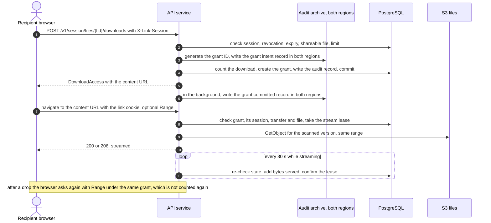

# Abuse prevention, rate limits and the download mechanism

| | |
|---|---|
| Requirements | [PRD](../prd.md), especially FR-4, FR-6, FR-14, FR-15, FR-43, FR-47, NFR-4, NFR-6, NFR-14 and open question 8 |
| Architecture | [architecture.md](../architecture.md), [data model](../design/data-model.md), [capacity and cost](../design/capacity-and-cost.md) |
| API | [openapi.yaml](../api/openapi.yaml) |
| Tracking | [#24](https://github.com/codewithmuh/secure-file-transfer/issues/24), part of phase 3 ([#25](https://github.com/codewithmuh/secure-file-transfer/issues/25)); DLP limits in [#64](https://github.com/codewithmuh/secure-file-transfer/issues/64) |

This page covers how the service is misused and what stops it: the abuse cases, every rate limit with its key, value and
enforcement point, the WAF, where the counters live (input to the rate-limit store ADR in phase 4), and the decision on
PRD open question 8, the download mechanism. The other phase 3 documents cover the threat model
([#21](https://github.com/codewithmuh/secure-file-transfer/issues/21)), encryption and keys
([#22](https://github.com/codewithmuh/secure-file-transfer/issues/22)) and authentication and authorization
([#23](https://github.com/codewithmuh/secure-file-transfer/issues/23)). Where this page relies on them, it says so.

Every number here is a starting value: configuration promoted dev → staging → prod like code, tuned by the first load
test and the first weeks in prod. A limit changes only through deploy config, for every tenant at once: per-tenant
overrides of limits and quotas are not in v1 (section 10). NFR-14 lets phase 3 tighten its numbers; this page adds daily
code caps (section 2) and the upload and download limits NFR-14 left open.

**Decisions in short**

- **Open question 8: stream downloads through the API.** A download is counted once, when its grant is created; the
  grant belongs to the link session that created it. The browser navigates to a content URL, authorised by the grant
  ID and the link-session cookie, and resumes with Range requests under the same grant. The stream re-checks state
  every 30 seconds, so a revocation stops it within 60 seconds. Section 5.
- **Counters: ElastiCache Serverless for Valkey**, one cache per environment and region, with WAF rate-based rules in
  front for coarse per-IP floods. Security state that must survive a failover (code attempts, lockouts, download
  counts, grant byte use, storage quotas) stays in PostgreSQL. Sign-in and link verification fail closed when the
  cache is down; other calls fall back to a per-pod limiter. Section 4.
- **Failed sign-ins per account** are counted by a Cognito pre-authentication trigger, because Cognito's built-in
  lockout alone allows up to 14 failures in the first 15 minutes, more than NFR-14's 10. Section 2.3.

## 1. Abuse cases

| ID | Abuse case | Who | Main controls |
|---|---|---|---|
| AB-1 | Link token brute force and enumeration | Anyone on the internet | 256-bit tokens, per-IP limits, a block on repeated `link_not_found` |
| AB-2 | Verification code guessing | Someone holding a forwarded or leaked link | 5 attempts per code, lockout after 20 failures, per-IP failure limit |
| AB-3 | Code flooding and email bombing of a victim | Leaked-link holder, or a member or API key | Per-link and per-address code caps, per-address and per-sender email caps, coalesced notices |
| AB-4 | Sending spam or phishing through the service | A malicious or compromised tenant or member | Fixed templates, no sender text in emails, caps, per-tenant SES reputation |
| AB-5 | Storage abuse | Members, API keys, outsider uploaders | Per-transfer limits, signed part sizes, tenant quotas, 24-hour cleanup |
| AB-6 | Scan evasion | Any uploader | Never `clean` unless fully inspected; encrypted or over-limit files are `unscannable` |
| AB-7 | Enumeration and scraping | Members, API keys, outsiders | `404` across tenants, scoped lists, per-caller limits, audit export limits |
| AB-8 | Credential stuffing on member sign-in | Anyone on the internet | Mandatory MFA, Cognito threat protection, per-account and per-IP limits |
| AB-9 | API key abuse | Whoever holds a leaked key | Hashed, scoped, expiring keys with no download right; per-key limits |
| AB-10 | Denial of service | Anyone on the internet | Shield Standard, WAF, per-IP and per-stream caps, fair scan queues |
| AB-11 | Download-limit and session abuse | A verified recipient | Count at grant creation, grants bound to a session, byte and request budgets |
| AB-12 | DLP evasion and approval abuse | A member, a member and an approver together, or a crafted file | Reasons for every file not fully inspected, counts across files and 24 hours, inspection limits, no self-approval, capped approval requests |

### AB-1 Link token brute force and enumeration

| | |
|---|---|
| Prevention | Link tokens are 256-bit HMAC-SHA-256 outputs under the 256-bit keyring `K_link`, so guessing one is as hard as guessing the key (#23 4.1, #22 6.2); NFR-14 asks for at least 128 bits. They are stored as SHA-256, found by hash, and travel only in the URL fragment and in request bodies (architecture 4.2). `resolveLink` returns only the link kind, access state and locale (FR-14). Per IP: 60 link-step requests a minute in the app (NFR-14) and 100 a minute at the WAF. An IP that loads the recipient or uploader page more than 30 times in 5 minutes gets a WAF challenge on that navigation (section 3.2); a script that calls the API directly never sees the page and meets the per-IP limits instead. After 20 `link_not_found` answers in an hour, that IP gets `429` on every link step for the rest of the hour. Even at 128 bits, with about 10^5 live links and 10^6 guesses a second, the expected time to hit any link is longer than 10^19 years. |
| Detection | `link_lookups_total{result}` (found, not_found, revoked, expired), IPs caught by the not-found rule, and the WAF rule that counts link-step requests per ASN. |
| Response | Runbook `link-enumeration`: add the IPs or ASNs to the WAF block list and turn on the attack-mode rule (section 3.2). |

### AB-2 Verification code guessing

| | |
|---|---|
| Prevention | Codes have at least 6 digits and are stored as an HMAC. A code is valid for at most 10 minutes and allows 5 attempts, taken by one conditional update in PostgreSQL (data model 2.4). A new code supersedes every older one. After 20 failed attempts in total, the recipient or uploader is locked until the member unlocks them (NFR-14). Each IP gets at most 30 failed attempts an hour across all links. Before a lockout an attacker gets 20 guesses, each against a code drawn from 10^6 values, so the chance of success is at most 2 × 10^-5. |
| Detection | `verification_attempts_total{result}`, lockouts per hour, and failures per IP. The member and tenant admins are told of every lockout (NFR-14). |
| Response | The member unlocks the recipient, or revokes and re-sends the transfer (PRD risk table). Runbook `verification-abuse`: block the IPs. A leaked link can still lock the real recipient out or use up its codes; both stay residual risks (section 9). |

### AB-3 Code flooding and email bombing

There are four ways to make the service email someone, and each one is capped:

| Vector | Cap |
|---|---|
| A leaked link is used to request codes | Per address, across all tenants: ≤ 5 codes an hour (NFR-14) and ≤ 50 a day. Per link: ≤ 20 a day, ≥ 30 s between codes. Codes go only to the invited address. |
| A member or API key sends transfers or upload requests to a victim | ≤ 20 link emails per address per tenant a day; ≤ 100 a day across all tenants, queued rather than refused; per-member, per-key and per-tenant hourly caps (section 7) |
| A tenant admin sends invitations | ≤ 100 per tenant an hour; ≤ 3 per address a day |
| An uploader triggers notices to a member, for example by uploading 50 files | Coalesced: at most one files-arrived or blocked-file email per upload request every 10 minutes |

| | |
|---|---|
| Detection | `email_caps_hit_total{cap}`, codes refused per hour, SES bounces and complaints by tenant. |
| Response | Runbook `email-abuse`: find the source (a link, a member or an API key) in the audit log, revoke the transfer, deactivate the member or revoke the key, and add a suppression entry for the victim (section 7.4). |

### AB-4 Spam or phishing sent through the service

| | |
|---|---|
| Prevention | There is no self-service sign-up (FR-34): an operator provisions every tenant. Every email uses a fixed template, with no sender-written text and no file names (FR-14); it names the tenant (set by the operator) and the sender's verified address. Links point only to our web app. The file behind a link reaches only the invited, verified recipient, and only after a malware scan. Tenant domain policy (FR-24), per-member and per-tenant caps, and SPF, DKIM and DMARC apply. Each of our tenants is its own SES tenant, so SES tracks its reputation and pauses it alone. Past a bounce or complaint threshold measured over enough emails to mean something, the tenant's sending is paused automatically (section 7.3). |
| Detection | Bounce and complaint findings per SES tenant, each tenant's send volume against its 7-day baseline, and the infected-file rate per tenant. |
| Response | Runbook `tenant-abuse`: pause the tenant's SES sending, suspend the tenant (`tenants.status = suspended`), revoke its open transfers and tell its admins. Phishing documents that contain no malware still pass the scan (section 9). |

### AB-5 Storage abuse

| | |
|---|---|
| Prevention | Per transfer and per upload request: 50 files, 5 GB each, 20 GB in total, counted from declared sizes and checked again at completion (FR-1, FR-2, FR-11). Part URLs are issued only for the declared parts, each signed with its exact `Content-Length`. Each tenant has a storage quota (2 TB by default) and a daily upload volume (200 GB in 24 hours). An upload request accepts at most 100 file declarations in total, so rejected uploads can't be replayed forever. Unfinished uploads are rejected and aborted 24 hours after their last part, drafts are cancelled after 7 days, and retention deletes the rest (FR-13, NFR-8). Section 6. |
| Detection | Quota use per tenant, uploads against the tenant's baseline, orphans and unfinished multipart bytes found by the reconciliation job. |
| Response | Runbook `tenant-quota`: an operator raises the quota or suspends the tenant; a member revokes an abused upload request. |

### AB-6 Scan evasion

| | |
|---|---|
| Prevention | A file becomes `clean` only when an engine inspected all of it: ClamAV for files up to 2 GB, GuardDuty Malware Protection for S3 above (the capacity baseline; the scan ADR decides). Encrypted archives and documents are `unscannable`, which tenant policy blocks by default (FR-18). Any engine limit exceeded (size, nesting depth, file count, compression ratio, time) also gives `unscannable`, never `clean`. Engine errors are retried and end in `scan_failed` (FR-19). The declared content type is ignored. Downloads serve the exact object version that was scanned, always as an attachment. Section 6.4. |
| Detection | `scan_results_total{state,reason}`, with the unscannable rate per tenant and reason, and scan times far above the size-based estimate. |
| Response | Runbook `scan-evasion`: tell the tenant's admins, who review their unscannable policy; an operator looks for a pattern across tenants. |

### AB-12 DLP evasion and approval abuse

| | |
|---|---|
| Prevention | A file is never treated as having no findings unless all of it was inspected: encrypted content, an unsupported type, a file over 2 GB and every inspection limit give a reason that the tenant's rules act on (FR-47). Counts add up across a transfer's files and message, and optionally the sender's last 24 hours (FR-48, FR-49). The type comes from the bytes. Inspection limits stop bombs (6.5). Approvals: never by the sender, never by an API key, at most 3 requests per transfer, step-up to approve (FR-43, authn-authz 6.3). |
| Detection | `dlp_decisions_total{outcome}`, `dlp_not_inspected_total{reason}`, `dlp_inspection_seconds`, `dlp_approval_requests_pending` and the age of the oldest; DLP reports by sender and by approver (FR-55). |
| Response | Runbook `dlp-evasion`: tell the tenant's admins, who review their rules for uninspectable files and the sender's transfers; an operator looks for crafted files that crash the inspector across tenants. |

### AB-7 Enumeration and scraping

| | |
|---|---|
| Prevention | Another tenant's items, and another member's, return `404` (NFR-12). Authorization never depends on an ID being hard to guess. Lists are scoped to the caller and paged at most 100 items at a time. Each caller and each tenant has a rate limit; audit search and export have tighter ones. A link session sees only its own transfer or request. Cognito returns the same error whether or not a user exists (#23). |
| Detection | `404` responses per caller (a member walking IDs), the list request rate per caller, and audit export volume per tenant. |
| Response | Runbook `api-key-compromise` or `account-compromise`: revoke the key or deactivate the member, then search the audit log for what was read. |

### AB-8 Credential stuffing on member sign-in

| | |
|---|---|
| Prevention | Members sign in through Cognito managed login, or through their tenant's identity provider, so SSO users never send a password to us or to Cognito (#23). Mandatory MFA (FR-25), so a guessed password alone signs nobody in. Cognito threat protection in enforce mode blocks known compromised credentials and high-risk sign-ins (#23). A pre-authentication trigger allows at most 10 failed sign-ins per account in 15 minutes (NFR-14), on top of Cognito's own lockout. A WAF web ACL on the user pool blocks IPs with a bad reputation, accepts code exchanges only from our NAT gateways, and limits every other IP to 2,000 requests and 500 form submissions in 5 minutes, sized for a large tenant behind one corporate address (section 3.2). Our API allows 60 sign-in starts and 60 callbacks per IP a minute. |
| Detection | Cognito sign-in failure and risk metrics, denials by the trigger, and failures per IP and ASN in WAF logs. |
| Response | Runbook `credential-stuffing`: block IPs or ASNs, add a CAPTCHA rule for managed login pages (but not TOTP registration, which a CAPTCHA breaks), force a password reset for the accounts targeted, and tell their tenant admins. |

### AB-9 API key abuse

| | |
|---|---|
| Prevention | A key is shown once and stored as a hash. It has scopes and an expiry (90 days by default, at most 365). It can never download file contents or create another key (API README section 2). Its fixed, recognisable prefix lets secret scanners such as gitleaks find it in code. Each key gets 300 requests a minute and shares its tenant's 1,000. Email caps apply to keys as they do to members. |
| Detection | Failed bearer authentications per IP, keys held at their rate limit, a key used from an ASN it has never used, export volume, and `last_used_at`. |
| Response | A tenant admin revokes the key (`revokeApiKey`); an operator can revoke it in an emergency. Runbook `api-key-compromise`: search the audit log with the key as the actor. |

### AB-10 Denial of service

| | |
|---|---|
| Prevention | Shield Standard (automatic) for network and transport floods on the load balancer, CloudFront and Route 53. WAF managed and rate-based rules (section 3). Application limits (section 2). Request bodies are capped at 64 KB, except the tenant policy (256 KB). Audit exports run one at a time per tenant. Download streams are capped per session, per IP, per tenant and per pod, and a stream that reads slower than 2 KB/s over 2 minutes is closed, so slow readers can't hold the slots. Pods also scale on active streams (section 5.7). File uploads go straight to S3, not through the pods. Scan queues are SQS fair queues keyed by tenant, and each tenant has a cap on concurrent scans, so one tenant's burst can't delay every other tenant's scans (NFR-5, section 6.4). Daily byte caps per tenant and per recipient bound the egress any one party can cause (section 2.2, D). |
| Fail-closed cost | When the counter store is down, link verification and sign-in fail closed, which is itself an outage for recipients. The cache is Multi-AZ, and its alert pages (section 8). |
| Detection | WAF blocked requests, 5xx and latency SLO burn, active streams, scan queue age, and SQS's count of noisy message groups. |
| Response | Runbook `http-flood`: block list, attack-mode rule, lower WAF thresholds, scale out. Shield Advanced is not in v1. |

### AB-11 Download-limit and session abuse

| | |
|---|---|
| Prevention | A download is counted once, when its grant is created, by one conditional update in the same transaction as its audit record (FR-4), so parallel requests can't exceed the limit. A grant belongs to one file and to the link session that created it. It lasts at most 24 hours and never past that session, and allows 20 requests and 3 × the file size in bytes, with one active stream at a time. Resuming within the grant is free (FR-6). Without the link cookie the content URL returns `401`; with a cookie that doesn't hold the grant's session it returns `404`. A transfer with no download limit still has a cap: each recipient can be granted at most 25 GB a day (section 2.2, D). Section 5. |
| Detection | Grants used up, stream takeovers from a different IP, and many grants for one recipient. |
| Response | The member revokes the transfer. A recipient who keeps a copy can share it; limits bound fetches, not copies (section 9). |

## 2. Rate limits

### 2.1 Keys

| Key | Value used | Notes |
|---|---|---|
| IP | The client address from the `X-Forwarded-For` entry our load balancer adds (ADR-0002) | The load balancer is IPv4-only in v1. The limiter already counts an IPv6 address per /64 (#97); the WAF rate rules still key each IPv6 address separately, so dual-stack needs a WAF change too. |
| Account | The member's user ID; for sign-in, the Cognito user | |
| Tenant | `tenant_id` from the member session or API key | Recipients and uploaders don't count against their tenant's request budget (2.2, H) |
| Invited email | HMAC-SHA-256 of the normalized address (data model section 1) | Never the address itself. For 25 hours after an HMAC key rotation, each per-address limit adds the old pseudonym's count, so a rotation never resets a cap (#22). |
| Subject | The recipient (`transfer_recipients.id`) or upload request ID | Who a link was sent to. Per-link caps add `link_issued_at`, so a newly issued link starts afresh. |
| Verification proof | `verification_codes.id` | Its attempts are counted in PostgreSQL |
| Link session | `link_sessions.id` | Never the cookie value |
| API key | `api_keys.id` | |
| Grant | `download_grants.id` (section 5.4) | |

### 2.2 Limits by endpoint group

Groups use the operation IDs of the [API contract](../api/openapi.yaml). "App" is the API service with the counter
store (section 4); "PostgreSQL" a conditional update in the request's transaction; "WAF" a rate-based rule on the
load balancer's web ACL unless the row says otherwise, whose `429` has a fixed `Retry-After` equal to its window.

**A. Link steps:** `resolveLink`, `requestVerificationCode`, `createLinkSession` (public). Fail closed: `503`.

| Key | Limit | Enforced by | Over the limit |
|---|---|---|---|
| IP | 100 requests a minute, all link steps | WAF `rate-links-ip` | `429`, `Retry-After: 60` |
| IP | 60 requests a minute, all link steps (NFR-14) | App | `429` |
| IP | 20 `link_not_found` answers an hour | App | `429` on every link step for the rest of the hour |
| IP | 30 failed code attempts an hour, across all links | App | `429` |
| Subject | 1 code every 30 s; 20 codes a day per link issued | App | `429` |
| Invited email | 5 codes an hour (NFR-14) and 50 a day, across all tenants | App | `429` |
| Tenant | 1,000 codes an hour | App | `429` |
| Verification proof | 5 attempts; valid for 10 minutes (NFR-14) | PostgreSQL | `422 code_attempts_exhausted`, `422 code_expired` |
| Subject | 20 failed attempts in total, then locked until the member unlocks (NFR-14) | PostgreSQL | `403 recipient_locked` |

Only the probe mailbox's addresses are exempt from the per-address caps here and in group G, and only on the
synthetic tenant's links (NFR-1). The recipient-page challenge is on the web app's web ACL (3.2).

**B. Member sign-in:** `/v1/auth/sign-in` and `/v1/auth/callback` (defined in #23), `startInvitationSignIn`, and
Cognito managed login. Fail closed.

| Key | Limit | Enforced by | Over the limit |
|---|---|---|---|
| IP, except our NAT gateways | 2,000 requests and 500 form submissions in 5 minutes | Sign-in web ACL on the user pool (3.2) | `403` from Cognito |
| Our NAT gateways | Only they may call the token and revoke endpoints, at most 10,000 times per gateway in 5 minutes | Sign-in web ACL | `403` |
| IP | 60 sign-in starts a minute and 60 callbacks a minute | App | `429` |
| IP | 60 invitation sign-ins (`startInvitationSignIn`) a minute | App | `429` |
| Account | 10 failed sign-ins in 15 minutes (NFR-14) | Pre-authentication trigger (2.3) | Sign-in denied with a generic message |
| Account | Cognito's own lockout after 5 failed passwords | Cognito | `Password attempts exceeded` |

**C. Link session reads:** `getLinkSession`, `endLinkSession`, `listSessionFiles`. Fail open to the per-pod limiter.

| Key | Limit | Enforced by | Over the limit |
|---|---|---|---|
| Link session | 120 requests a minute | App | `429` |
| IP | 6,000 requests in 5 minutes, whole API | WAF `rate-api-ip` | `429`, `Retry-After: 300` |

**D. Download grants:** `createSessionDownload`, `createReceivedFileDownload`. Fail open to the per-pod limiter; the
count itself is always in PostgreSQL.

| Key | Limit | Enforced by | Over the limit |
|---|---|---|---|
| Subject | 100 grant requests an hour, resumes included (twice the 50 files a transfer can hold) | App | `429` |
| Account | 300 grant requests an hour, for members | App | `429` |
| IP | 300 grant requests an hour | App | `429` |
| Tenant | 2,000 grants an hour, recipients and members together | App | `429` |
| Subject | 25 GB of granted bytes a day: each counted grant adds the file's size. This also caps transfers with no download limit. | App | `429` |
| Tenant | 500 GB of granted bytes a day, recipients and members together; 200 MB per member for tenants over 2,500 members | App | `429` |
| Subject and file | The transfer's download limit, 1–100 (FR-4) | PostgreSQL | `403 download_limit_reached` |

**Sizing.** At design load the service grants about 40,000 downloads and 1 TB a day (capacity 3.1), a mean of 2 GB
per tenant. A large tenant of 1,000 members (4 % of the load) has about 1,600 downloads and 40 GB a day, 200 in its
peak hour. Its caps are 10 times that hour and 12 times that day (25 full 20 GB transfers); above 2,500 members they
grow at 200 MB per member, 5 times the mean of 40 MB. A recipient's caps are 5 % of the tenant's: 25 GB covers a full
20 GB transfer plus restarts, and it takes 20 recipients at their caps, not two, to use up a tenant's day. A tenant at
its cap costs about $57 a day in egress; `TenantQuota` fires at 80 %.

**E. Download content:** `getSessionDownloadContent`, `getReceivedFileDownloadContent` (new, section 5). The grant
checks are always in PostgreSQL; the concurrency caps fail open to the per-pod limiter.

| Key | Limit | Enforced by | Over the limit |
|---|---|---|---|
| Grant | 1 active stream (a new request takes over), 20 requests, 3 × file size in bytes, 24 hours | PostgreSQL | `403 download_grant_exhausted` |
| Link session or account | 6 concurrent streams | App | `429` |
| IP | 20 concurrent streams | App | `429` |
| Tenant | 200 concurrent streams | App | `429` |
| Stream | At least 2 KB/s averaged over 2 minutes | In process | Stream closed; the browser resumes under the same grant |
| API pod | 100 concurrent streams | In process | `503`, `Retry-After: 10` |

**F. Uploads:** `addTransferFile`, `addSessionUploadFile`, `requestUploadPartUrls`, `requestSessionUploadPartUrls`,
`listUploadedParts`, `listSessionUploadedParts`, `completeUpload`, `completeSessionUpload`. Fail open to the per-pod
limiter, except the PostgreSQL rows.

| Key | Limit | Enforced by | Over the limit |
|---|---|---|---|
| Member, API key or link session | 600 requests a minute, whole group | App | `429` |
| IP | 1,200 requests a minute, whole group | App | `429` |
| File | 10 × `part_count` part URLs over the file's life | App | `429` |
| Upload request | 100 file declarations in total; 50 counted files (FR-11) | PostgreSQL | `422 too_many_files` |
| Tenant | 200 GB of declared uploads in 24 hours | App | `429` |
| Tenant | 2 TB of files that are uploading, scanning or stored | PostgreSQL | `413 storage_quota_exceeded` |

**G. Actions that send email:** `sendTransfer`, `createUploadRequest`, `inviteUser`. Fail open to the per-pod limiter.
Section 7 explains each cap.

| Key | Limit | Enforced by | Over the limit |
|---|---|---|---|
| Member or API key | 200 recipient emails an hour | App | `429` |
| Tenant | 2,000 recipient emails an hour | App | `429` |
| Invited email, within the tenant | 20 link emails a day | App | `429` |
| Invited email, across tenants | 100 link emails a day | Notification worker | Queued, not refused, behind a neutral status (7.2) |
| Tenant, for `inviteUser` | 100 invitations an hour; 3 per address a day | App | `429` |

**H. Tenant API:** every other operation of members and API keys. Fail open to the per-pod limiter.

| Key | Limit | Enforced by | Over the limit |
|---|---|---|---|
| Account | 300 requests a minute | App | `429` |
| API key | 300 requests a minute | App | `429` |
| Tenant | 1,000 requests a minute (NFR-14), members and API keys together, groups D, F, G, H, I and K included | App | `429` |
| IP | 100 failed authentications (any `401` except `reauthentication_required`, which a valid session gets on a step-up) in 5 minutes | App | `429` for 15 minutes on every operation, checked before authentication, so a blocked IP never gets a `401` back |
| IP | 6,000 requests in 5 minutes | WAF `rate-api-ip` | `429`, `Retry-After: 300` |

Safety actions never count against the tenant budget and are never refused by it: `revokeTransfer`,
`revokeUploadRequest`, `revokeApiKey`, `deactivateUser`, `unlockRecipient`, `unlockUploader` and `rejectTransfer`. A
runaway automation can't stop an admin from revoking a leaked transfer. The per-member limit still applies to them.

**I. Audit:** `searchAuditEvents`, `exportAuditEvents`. Fail open to the per-pod limiter.

| Key | Limit | Enforced by | Over the limit |
|---|---|---|---|
| Tenant | 60 searches a minute | App | `429` |
| Tenant | 10 exports an hour, 1 at a time | App | `429` |
| API key | 1 export an hour, each at most 100,000 events | App | `429`; a larger range gets `422 export_too_large` |

**J. Key and tenant administration:** `createApiKey`, `createTenant`.

| Key | Limit | Enforced by | Over the limit |
|---|---|---|---|
| Tenant | 20 new API keys a day; at most 25 active keys (#23 5.2) | App; PostgreSQL | `429`; `422 validation_failed` |
| Operator | 30 new tenants an hour | App | `429` |

**K. Data loss prevention:** the policy, rule and detector writes (`updateDlpPolicy`, `createDlpRule`,
`updateDlpRule`, `deleteDlpRule`, `createDlpDetector`, `updateDlpDetector`, `deleteDlpDetector`), `testDlpDetectors`,
`confirmTransfer`, `approveTransfer`, `rejectTransfer`, `getTransferDlp`, `getFileInspection`, `getDlpReport` and
`listDlpDecisions`. Fail open to the per-pod limiter, except the PostgreSQL rows.

| Key | Limit | Enforced by | Over the limit |
|---|---|---|---|
| Tenant | 100 DLP policy changes a day | App | `429` |
| Account | 30 detector tests a minute, each at most 16,384 characters | App; the contract's schema | `429`; `413 request_too_large` |
| Account | 30 confirmations a minute | App | `429` |
| Transfer | 3 approval requests in total, 1 pending at a time | PostgreSQL | `409 approval_limit_reached` |
| Account | 120 approval decisions an hour | App | `429` |
| Account | 600 responses with finding details an hour, each audited | App | `429` |
| Tenant | 60 DLP report and decision-list reads a minute | App | `429` |

The detail-read cap keeps a stolen member session or an approver's from scraping masked previews quickly; a sender
reviewing a transfer uses a few. Approval decisions are capped per approver so a compromised approver session can't
release a backlog in seconds; `rejectTransfer`, a safety action, counts only against it.

### 2.3 NFR-14 coverage

| NFR-14 requirement | Key | Value | Where it is enforced |
|---|---|---|---|
| Limits per IP, account and tenant on sign-in, verification, link access, uploads and downloads | IP, account, tenant | Groups A, B, D, E, F | App, WAF, PostgreSQL |
| ≤ 10 failed sign-ins per account per 15 minutes | Account | 10 in a sliding 15 minutes | Cognito pre-authentication trigger with the counter store; Cognito's lockout as well |
| ≤ 5 verification codes per email address per hour | Invited email | 5 an hour across all tenants, plus 50 a day; 20 a day per link | App |
| ≤ 60 link-page requests per IP per minute | IP | 60 a minute | App; WAF backstop at 100 |
| ≤ 1,000 API requests per tenant per minute | Tenant | 1,000 a minute | App |
| A verification proof is valid ≤ 10 minutes and allows ≤ 5 attempts | Verification proof | 10 minutes, 5 attempts | PostgreSQL |
| Codes have at least 6 digits | — | 6 digits | Notification worker; the contract's pattern |
| Lockout after 20 failed attempts until the member unlocks; the member and admins are told | Subject | 20 | PostgreSQL; a notice through the outbox |
| A verified session lasts ≤ 24 hours | Link session | 24 hours | `link_sessions.expires_at`, checked on every call |
| Link tokens carry ≥ 128 bits of randomness | — | 256 bits, derived with `K_link` (#23 4.1) | Notification worker |

**Why sign-in needs a trigger.** After 5 failed passwords, Cognito locks the user out for 2^(n−5) seconds, capped at
about 15 minutes, so failures 6 to 14 can come at 1, 3, 7, 15, 31, 63, 127, 255 and 511 seconds: 14 in the first 15
minutes. A pre-authentication trigger counts each attempt per account in the counter store over a sliding 15
minutes, and the post-authentication trigger clears the count. The trigger denies the 11th attempt, and denies
sign-in when it can't reach the store. It is a small function in the VPC, deployed by Terraform. NFR-14 keeps its 10
and names the trigger, rather than moving to Cognito's curve.

### 2.4 How limits behave

- **Over a limit:** `429` with `application/problem+json`, code `rate_limited`, and `Retry-After` in whole seconds
  (at least 1). The value is when the limiting key next admits a request; if several limits are exceeded, it is the
  largest of them. The `detail` is generic: it never names the key, another tenant or another address.
- **From the WAF:** a custom response with status `429`, a fixed `Retry-After` (60 or 300), a JSON body with the same
  problem fields, and CORS headers so the web app can read it: `Access-Control-Allow-Origin` with the web app's
  origin, `Access-Control-Allow-Credentials: true` and `Access-Control-Expose-Headers: Retry-After`. WAF custom bodies
  can't use the `application/problem+json` type, so clients branch on the status. A blocked CORS preflight can't be
  read at all, so the web app treats a failed fetch as retryable after 60 s.
- **Not `429`:** a code's own attempts (`422`), a lockout (`403 recipient_locked`), a download limit
  (`403 download_limit_reached`), a used-up grant (`403 download_grant_exhausted`), a storage quota
  (`413 storage_quota_exceeded`), a full pod (`503`) and an unavailable counter store (`503 service_unavailable`,
  `Retry-After: 5`).
- **Order of checks:** narrowest first, and a request refused by one limit isn't counted against a wider one (4.4).
  On link steps the per-IP limits come before the token lookup, so a `429` reveals nothing about a token; then the
  token, the lockout, the per-link, per-address and per-tenant limits, and the code itself.
- **Logging:** each rejection is counted in `rate_limit_rejections_total{group,key_type}` and logged with the request
  ID, never an email address or token. Rejections aren't audited one by one; a rate-limited verification call isn't
  an attempt (FR-27).
- **Clients** wait for `Retry-After`; a key that keeps ignoring it ends up at the WAF's per-IP limit. v1 sends no
  IETF `RateLimit` headers, which are still a draft.

## 3. WAF

### 3.1 Web ACLs

| Web ACL | Protects | Scope |
|---|---|---|
| API | The API's Application Load Balancer, in Tokyo and in Osaka | Regional, one per region |
| Sign-in | The Cognito user pool: managed login, its OAuth endpoints and its public API operations (#23) | Regional, one per region |
| Web app | The CloudFront distribution that serves the web app bundle | CloudFront (global) |

The API isn't behind CloudFront, so the API web ACL sees the real client address as the source IP. If CloudFront is
ever put in front of the API, the rate rules must switch to the forwarded-IP setting.

### 3.2 Rules

**API web ACL**, in priority order; the default action is Allow.

| Priority | Rule | Action | Why |
|---|---|---|---|
| 0 | `block-list`: an IP set that operators maintain | Block | Incident response |
| 1 | `AWSManagedRulesAmazonIpReputationList` | Block; its DDoS list stays Count, the AWS default | Known malicious and reconnaissance sources |
| 2 | `AWSManagedRulesAnonymousIpList` | Count (labels only) | Labels VPNs, Tor and hosting providers. Corporate recipients often reach the internet through cloud proxies that look like hosting providers, so these aren't blocked by default. |
| 3 | `AWSManagedRulesKnownBadInputsRuleSet` | Block | Log4j, Java deserialization and similar exploit patterns |
| 4 | `AWSManagedRulesCommonRuleSet` | Block, with `SizeRestrictions_BODY` set to Count | OWASP-style patterns; its 8 KB body rule is replaced by rule 5 |
| 5 | `body-size`: requests labelled by the core rule set's body size rule, except `POST /v1/transfers`, `POST /v1/upload-requests` and `PATCH /v1/tenant/policy` | Block | Bodies over 8 KB only where they are legitimate: 50 recipients, a 2,000-character message, 1,000 policy domains |
| 6 | `rate-links-ip`: `/v1/links/` per IP, 100 in 60 s | Block, `429` | Flood backstop above the app's 60 a minute |
| 7 | `rate-api-ip`: whole API per IP, 6,000 in 300 s | Block, `429` | Flood backstop above the per-tenant budget |
| 8 | `rate-links-asn`: `/v1/links/` per ASN, 3,000 in 300 s | Count | Shows distributed guessing from one network |
| 9 | `attack-mode-links`: `/v1/links/` with an anonymous-IP or hosting-provider label | Off by default; Block when turned on | A runbook lever during AB-1, AB-2 or AB-3 |
| 10 | `geo-block`: a country list operators maintain, empty by default | Block | A runbook lever. Recipients may be anywhere; NFR-21 limits where data is stored, not who may connect. |

About 1,000 WCU, under the 1,500 a web ACL includes. API calls are never challenged: a challenge carries no CORS
headers, so the web app's `fetch` couldn't read it.

**Sign-in web ACL**, on the user pool in each region. Cognito allows Count, Allow, Block and CAPTCHA, not Challenge,
answers blocked form submissions with its default `403`, and can't use the account takeover prevention rule group, so
threat protection does that job (#23).

| Priority | Rule | Action | Why |
|---|---|---|---|
| 0, 1 | `block-list`; `AWSManagedRulesAmazonIpReputationList` | Block | As on the API web ACL |
| 2 | `token-nat-only`: `/oauth2/token` and `/oauth2/revoke` from an IP outside the region's NAT IP set | Block | Only our API, a confidential client, exchanges codes and revokes tokens, and it reaches Cognito through its egress proxy listener and the NAT gateways behind it, the only way out of the VPC (ADR-0021). Terraform builds the IP set from the gateways' Elastic IPs. |
| 3 | `rate-token-nat`: those two paths from the NAT IP set, per IP, 10,000 in 300 s | Block | Stops a runaway loop in our own code, far above the need |
| 4 | `rate-signin-ip`: every request from other IPs, per IP, 2,000 in 300 s | Block | Flood backstop sized for a large tenant behind one address |
| 5 | `rate-signin-post-ip`: `POST` requests (form submissions) from other IPs, per IP, 500 in 300 s | Block | Bounds password and code submissions per address |

**Sizing.** At design load members sign in 20,000 times a day with about 10 requests each through this web ACL
(capacity A36): 8 from the browser, 2 of them form submissions, and 2 from the API (code exchange and token
revocation, #23). Assume 30 % of the day's sign-ins in the busiest hour, and twice its average rate in its busiest
5 minutes:

- **NAT gateways:** 20,000 × 30 % ÷ 12 × 2 = 1,000 sign-ins, so 2,000 requests in 5 minutes; 4,000 at 2× design load
  (NFR-16), even through one gateway. `rate-token-nat` leaves 2.5 times that; the old shared limit of 100 per IP
  would have blocked our own exchanges after 50 sign-ins per gateway.
- **One corporate address for a 1,000-member tenant** (800 sign-ins a day): 40 sign-ins, 320 requests and 80
  submissions in 5 minutes; 800 and 200 at 2× with 25 % retries. 2,000 and 500 leave 2.5 times that, where 100
  allowed about 12 sign-ins. Tenants behind one cloud proxy share these limits; MFA, threat protection and the
  per-account trigger stop stuffing, and these rules only stop floods.

**Web app web ACL**, on CloudFront: rules 0, 1 and 4 of the API web ACL, a per-IP rate rule (2,000 in 300 s), and
`challenge-link-pages`: above 30 navigations to the recipient or uploader page per IP in 300 s, each gets a
Challenge. Those pages read the link token from the fragment, so they load no third-party script, remove the
fragment before anything else runs and keep `script-src 'self'` (#23); the WAF JavaScript SDK isn't used. A browser
solves the challenge silently and gets the page, fragment intact. The interstitial is AWS WAF's own, served at the
edge in the same trust boundary as CloudFront serving our bundle. A script that calls the API directly never meets
it; group A's limits and rules 6 and 7 stop that. Challenges carry a small fee each.

**Rollout.** Managed rules and the sign-in rate rules start in Count for two weeks in staging and then in prod, while
matches are checked for false positives (messages in Japanese or quoting code) and busy mornings confirm the sizing;
each moves to Block on its own, with scope-down exceptions where needed. Not in v1: Bot Control ($10 a month per web
ACL plus a per-request fee) and CAPTCHA on API calls.

**The application still enforces every limit itself.** WAF rate rules are approximate (AWS documents that a flood can
run for up to several minutes, usually under 30 seconds, before a rule acts), and WAF can't key by tenant, invited
address or failed attempt. It keeps floods off the pods; the application enforces NFR-14.

### 3.3 Body and header limits

- **Uploads don't pass through the API**: parts go from the browser straight to S3 (architecture 4.1).
- **WAF:** on a load balancer the WAF inspects only the first 8 KB of a body, a fixed limit. Rule 5 blocks larger
  bodies except on its three routes, where the WAF inspects the first 8 KB and lets the rest through.
- **Application:** the API rejects bodies over 64 KB with `413 request_too_large` before parsing, except
  `updateTenantPolicy` at 256 KB (two lists of up to 500 domains).
- **Headers:** the core rule set blocks cookie headers over 10 KB, query strings over 2 KB and paths over 1 KB. The
  load balancer drops invalid header fields and runs HTTP desync mitigation in strictest mode.

### 3.4 Logging (NFR-21)

- All web ACLs log to an `aws-waf-logs-…` S3 bucket in their region (the CloudFront one to Tokyo), which avoids
  CloudWatch Logs in us-east-1 (architecture 5.5). Files arrive every 5 minutes, encrypted with the logs key (#22),
  and are deleted after 90 days (PRD data lifecycle table).
- A logging filter keeps Block, CAPTCHA and Challenge actions and Count matches; sampled requests cover allowed ones
  (capacity A19). The `authorization` and `cookie` headers are redacted. Tokens are never in URLs and audit filters
  are in bodies (API README section 7), so paths and query strings are safe to keep. Athena queries support
  investigations; the runbooks hold them.

**Cost.** Per region in prod, the API web ACL has 11 rules and the sign-in web ACL 6; the CloudFront web ACL has 5.
Challenges come only from page loads. The capacity page prices these counts (A29): about $130 a month in Tokyo and
$27 in Osaka at design load.

## 4. Counter store

### 4.1 What it holds, and what it doesn't

The counter store holds short-lived windows: requests per key, codes per address and per link, failures per IP,
granted bytes per day, leases for streams and scans, the notification worker's per-address caps across tenants (7.2)
and, for #23, the sign-in state between redirect and callback.
Losing them resets some windows, which is acceptable because the state that decides access is in PostgreSQL: code
attempts and lockouts (data model 2.4), download counts (2.3), grant byte use and storage quotas (sections 5 and 6).
That state fails over with the database and is protected by NFR-10.

### 4.2 Requirements

| Requirement | Target |
|---|---|
| Shared | Every API pod sees the same count (ADR-0002) |
| Atomic | Check and increment in one operation per key, never read, check, then write; a request refused by one limit is never counted against a wider one (4.4) |
| Latency | p99 ≤ 5 ms per check from an API pod; ≤ 10 ms of NFR-2's budget per request |
| Throughput | 600 operations a second at the burst (capacity A24), 1,200 at 2× design load (NFR-16), and 10× that during an attack without touching PostgreSQL |
| Keys | IP, account, tenant, invited-email HMAC, subject, link session, API key, grant (2.1) |
| Consistency | Exact per key on the primary. Losing a few seconds of counts in a cache failover is acceptable. |
| Durability and regions | None: nothing in the store is needed after a regional failover (4.1). One store per environment and region, nothing replicated; Osaka at its smallest size until a failover. |
| Failure mode | Fail closed for sign-in and link verification; fail open to a per-pod limiter for the rest, with an alert (4.5) |
| Data and security | No plain email address, token or cookie value in a key; every key has a TTL of at most 25 hours. TLS, IAM authentication, isolated subnets; reachable only from the API, the sign-in triggers, the scan worker (scan leases, 6.4) and the notification worker (per-address caps, 7.2) |

### 4.3 Options

| Option | Fit | Latency and load | Failure behaviour | Cost | Verdict |
|---|---|---|---|---|---|
| **ElastiCache Serverless for Valkey** | Every key and algorithm in this page; atomic scripts | About 1 ms in-region; attack load lands on the cache, not the database | Multi-AZ, managed failover; counts since the last replication can be lost | About $7 a month per cache at its 100 MB minimum, $8 at design load (capacity 5.1) | **Recommended** |
| PostgreSQL counters | Every key; transactional with business data | 1–5 ms on the writer. About 260 M extra writes a month at design load, several times the business writes, and every one replicates to Osaka through the global database. Under attack, hot counter rows load the system of record at the worst moment. | Fails over with the database | Writer I/O and replication I/O | Rejected for counters. PostgreSQL keeps the security state (4.1). |
| WAF rate rules only | IP, ASN, header, cookie and path keys only: no tenant, invited address, subject or failure counts | No application latency | Approximate and delayed (3.2); a minimum of 10 requests per window; windows of 1, 2, 5 or 10 minutes | Already paid for | Kept for coarse per-IP floods only |
| DynamoDB | Every key; conditional updates with TTL | Single-digit milliseconds | Regional, highly available | Pays per counter write, about 260 M a month at design load, where the cache bills mostly its minimum | Rejected: higher latency and cost for data that needn't survive |
| In-process limiter per pod | Per pod only | None | None | None | Fallback only: with 3 to 12 pods, the effective limit would change with the pod count |

### 4.4 Recommendation (input to the ADR)

Use **ElastiCache Serverless for Valkey**, one cache per environment and region, behind the WAF rate rules, with
PostgreSQL holding the security state. The phase 4 ADR confirms it.

- **Algorithms.** Request rates use GCRA (the generic cell rate algorithm): one key per limit, and an exact
  `Retry-After`. A limit of N per period admits a burst of ⌊N/2⌋ + 1 requests at once, then ⌈N/2⌉ per period, one
  every period ÷ ⌈N/2⌉, so no window of one period, the same window the sliding log keeps, holds more than N (#97).
  Sized with N for both, GCRA would let 2N − 1 through in one period. A request that costs more than the burst, such
  as more recipient emails at once than half a limit, is never admitted. Small event quotas (codes per address or
  link, failures per account or IP, `link_not_found` per IP) use a sliding log in a sorted set, which is exact and
  cheap for counts of 50 or fewer. Concurrent streams use a sorted set of stream IDs scored by lease expiry; each
  stream renews its lease every 30 seconds and the lease lasts 60.
- **Several limits on one request.** Each limit is one key, checked by a script that increments it only if it admits
  the request. Limits run narrowest first (the caller's own keys, then IP, invited address, tenant; link steps put IP
  first, 2.4) and stop at the first refusal, so a flood refused per IP or per key never uses up a tenant's budget or a
  victim's code cap. That costs up to four 1 ms round trips, plus one on every request for the failed-authentication
  block (2.2, H); one script over all keys would need one hash slot, which cluster mode denies.
- **Key names** look like `rl:{group}.{limit}:{key type}:{value}`, for example `rl:A.ip_requests:ip:203.0.113.7`,
  where the value is an ID, an HMAC, an IPv4 address or an IPv6 /64. The limit's name keeps two limits on one key
  type apart; a key holds no braces, so no hash tag, and each script touches its one key (#97).
  Access is by IAM authentication from the roles of the API, the sign-in triggers, the scan worker and the
  notification worker, over TLS, through a security group open only to them (ADR-0014).
- **Timeouts.** 50 ms per call. After 5 errors in a row, the API stops calling the store for 10 seconds and applies
  each group's failure mode, so a sick cache doesn't add latency to every request. After the rest, one failed call
  starts the next rest at once; one success ends it.
- **Retry-After.** After the first refusal the wider limits are only read, never counted, so the answer can still
  give the largest wait (2.4) without spending a tenant's budget.

### 4.5 Failure modes

| Group | When the counter store is unavailable | Why |
|---|---|---|
| A, link steps | `503 service_unavailable`, `Retry-After: 5` | The NFR-14 limits are the main defence against AB-1 to AB-3 |
| B, sign-in | `503` from the sign-in routes; the trigger denies sign-in | Per-account limit and pre-auth state live in the store (#23) |
| C to J | A per-pod limiter at each limit divided by 3, the minimum pod count | Availability (NFR-1). The service as a whole allows at most (pods ÷ 3) × each limit during the outage. |
| D and E, counts and grants | Unchanged | Download counts and grant checks are in PostgreSQL |

Existing sessions keep working; `RateLimitStoreUnavailable` pages (section 8), because recipients can't verify.

## 5. Download mechanism (open question 8)

### 5.1 Options

| | Stream through the API | CloudFront signed cookies bound to the session | Pre-signed S3 URL (rejected baseline) |
|---|---|---|---|
| FR-14: a forwarded download address grants nothing | Yes. Every request needs a cookie that holds the grant's session. | Partly. The URL alone grants nothing, but the cookies are bearer tokens for up to 60 s. They need a `Domain` attribute shared with the CDN host, so they can't be `__Host-` cookies. | No. The URL is a bearer token (PRD risk table). |
| FR-4: counted once, safe under parallel requests | Yes, at grant creation; the server also sees every byte it sends | Counted at grant creation, but the server sees only cookie refreshes. Bytes show up in CDN logs minutes later. | Counted when the URL is issued; reuse of the URL is invisible |
| FR-6: resume without using the limit, and no way around it | Range requests under the same grant, bounded by bytes, requests and time | Range chunks with refreshed cookies, bounded only by time | Reuse while the URL is valid, unbounded |
| NFR-6: no new download ≤ 5 s after revocation | Every request checks PostgreSQL, so at once | A cookie keeps working for new requests until it expires; meeting 5 s needs cookies of ≤ 5 s | No: the URL works until it expires |
| NFR-6: a download in progress stops ≤ 60 s after revocation | The stream re-checks every 30 s | CloudFront checks a cookie only when a request starts, so the web app must fetch in chunks of ≤ 60 s | No |
| NFR-4: first byte p95 ≤ 1 s | About 0.3 s: the grant call, then the first bytes from S3 in the same region | Similar, plus the CDN hop | Fastest |
| NFR-21: no file contents stored outside Japan | Bytes go only from Tokyo or Osaka to the client | Edges outside Japan pass the bytes through with caching off; NFR-21 allows this, but a cache policy must guarantee it | Direct from S3 |
| NFR-22: latest two versions of four browsers | The browser's own download manager, in every browser | Chunked downloads in JavaScript need the File System Access API, which Firefox and Safari don't offer for saving files, or a service-worker workaround that is fragile for files of several GB | The browser's download manager |
| Cost at design load | About $243 a month of load balancer capacity plus about 0.4 vCPU (capacity 5.6) | A few dollars a month of requests | None extra |
| Operations | Pods carry file bytes; a deploy cuts long downloads, which resume (5.7) | A second distribution, a key group whose private key must be rotated, origin access with a KMS key policy that lets CloudFront decrypt file objects (#22), origin failover to Osaka, and a chunked-download engine in the web app | Simplest |
| Verdict | **Chosen** | Rejected | Rejected; the PRD doesn't accept a bearer URL |

A per-request session check at the CDN edge (Lambda@Edge) was also rejected: it still checks only when a request
starts, runs outside Japan with session data, and adds a component. Internet egress costs the same in every option
($0.114/GB for the first 10 TB a month, about $2,962 a month at design load).

### 5.2 Decision

**Stream downloads through the API service.** It is the only option that meets FR-4, FR-6, FR-14 and NFR-6 together
without new client code or components, in every browser of NFR-22. It costs about $243 a month at design load and
close to nothing at idle (capacity scenario a). Pods carry file bytes, and a deploy cuts long downloads, which resume.

### 5.3 How it works

- The intent record (`download.grant_intent`) comes before the count (API contract): a `503` from the grant call
  means nothing was counted. After the commit, the committed record (`download.grant_committed`) goes to both
  archives in the background, retried until both confirm. A failover or restore re-applies only grants that have a
  committed record or a database row; an intent with neither was refused or rolled back (data model 2.3).
- **Navigation, not `fetch`.** The web app starts a download by navigating to the content URL, so the browser's
  download manager saves and resumes it. A navigation can't send `X-Link-Session`, so the content GETs are exempt
  from it (every other `/session` call keeps it): the grant ID in the path names the grant, and the `__Host-sft_link`
  cookie must hold that grant's session. The web app and the API share a registrable domain (open question 5), so
  the `SameSite=Strict` cookie is sent. Without it (a URL pasted elsewhere) the request gets `401`; with a cookie
  that doesn't hold the grant's session, `404` (NFR-12).
- On a revocation, the transfer's link sessions are closed in the same transaction (data model 2.4). New grant and
  content requests fail at once with `410 link_revoked`, and a running stream stops at its next re-check, within 60
  seconds of the revocation (NFR-6).
- The member's download of a received file works the same way: `createReceivedFileDownload` creates a grant bound to
  the member's session, and `getReceivedFileDownloadContent` needs that session's cookie.

### 5.4 Download grants

The `download_grants` table (data model): `id`, `tenant_id`, `file_id`, `s3_version_id`, either `recipient_id` and
`link_session_id` or `user_id` and `member_session_id`, `byte_budget`, `bytes_served`, `request_count`, `expires_at`,
`active_stream_id` and `active_stream_until` (the stream lease, renewed at each 30-second re-check), `archived_at`
(when both regions' archive confirmed the committed record) and `created_at`.

| Rule | Value | Why |
|---|---|---|
| Who | One file, and the link session (or member session) that created it | FR-14, FR-15 |
| Where it works | Only with a cookie that holds that session. A recipient who verifies again gets a new session and a new, counted grant. | FR-14 |
| Lifetime | 24 hours from creation, never past its session, the transfer's expiry or revocation | Bounded like the session (NFR-14) |
| Budget | 3 × the file size in bytes; 20 content requests; one active stream, where a new request takes over and the old stream stops at its next re-check | Covers resumes and a full restart in browsers that can't resume; stops many small ranges from becoming many copies; bounds overlap to 30 s |
| Counting | Once, at creation: the intent record goes to both regions' archive first, then the count, the grant and the audit record commit together, then the committed record follows (NFR-15, NFR-10) | FR-4 |
| Resuming | `createSessionDownload` with `resume_grant_id`, in the same session, returns the same grant, uncounted, while it has time and bytes left; otherwise `403 download_grant_exhausted`, and a call without `resume_grant_id` counts a new download | FR-6 |
| The grant ID in the URL | Not a credential: useless without the right session | FR-14 |
| Audit | `download.granted` at creation (fail closed); `download.completed` when the last byte of the file is sent and `download.stopped` when a revocation cuts a stream (best effort, not fail closed) | FR-7, FR-27 |

A grant's row is a security-critical record like the download count. After a regional failover the byte count may
be up to 5 minutes behind (NFR-10), which can only allow a few extra bytes. The one way to an extra download is the
residual window of data model 2.3: a grant committed in Tokyo whose committed record and row hadn't reached Osaka
when Tokyo was lost, normally under a second. Grant byte counters lost within the replication lag are a
disaster-recovery gap tracked in [#42](https://github.com/codewithmuh/secure-file-transfer/issues/42).

### 5.5 FR-4, FR-6, FR-14 and NFR-6 together

| Requirement | How streaming meets it | Test (section 9) |
|---|---|---|
| FR-4 download limit | One conditional update at grant creation, in the audit transaction | 50 parallel grant requests at limit 1 give exactly one grant |
| FR-6 resume without using the limit, and no way around it | Range requests under the same grant are free, and `resume_grant_id` gets it back after a reload; a grant is bounded to 3 × size, 20 requests, 24 hours, one session and one stream | Interrupt at 50 %, resume, count unchanged; the 4th copy and the 21st request are refused |
| FR-14 a forwarded download address grants nothing | Every request needs a cookie holding the grant's session | Without the cookie, `401`; with another session, `404` |
| NFR-6 no new download ≤ 5 s, and a running one stopped ≤ 60 s, after revocation | Grant and content requests read the state from the PostgreSQL writer; the stream re-checks every 30 s | Revoke, then request: `410` at once; revoke during a 1 GB stream: it stops within 35 s |

### 5.6 Content responses

| Header or behaviour | Value | Why |
|---|---|---|
| `Accept-Ranges`, `ETag`, `If-Range` | `bytes`; a strong ETag from the file's SHA-256 | Browsers resume only from a strong validator |
| Ranges | One range per request: `206` with `Content-Range`. Several ranges, or a range past the end: `416` | Keeps the byte budget simple |
| `Content-Type` | Always `application/octet-stream` | The bytes are served from the API's origin and must never be rendered there |
| `Content-Disposition` | `attachment; filename*=UTF-8''…` with the display name, percent-encoded | FR-6; no inline display |
| `X-Content-Type-Options`, `Content-Security-Policy`, `Cache-Control`, `Cross-Origin-Resource-Policy`, `Referrer-Policy` | `nosniff`; `sandbox; default-src 'none'`; `no-store`; `same-origin`; `no-referrer` | Defence in depth against a file that looks like HTML; nothing cached; no embedding from other sites |
| Object version | The `s3_version_id` recorded when the upload completed and scanned | The bytes served are the bytes scanned (6.4) |
| `HEAD` | Not offered | Avoids a second code path; every browser downloads with `GET` |

### 5.7 Pod sizing and deploys

- **Bytes.** Downloads move 35 MB/s in the peak hour and about 70 MB/s in bursts (capacity 3.1): 0.35 to 0.7 vCPU at
  1 vCPU per 100 MB/s (A8). Node networking isn't a constraint.
- **Streams.** About 15 at once in the peak hour (capacity 4.1), more with slow clients (a 5 GB file takes over an
  hour at 10 Mbit/s). A pod accepts at most 100 streams with 1 MiB buffers, about 200 MiB within its 1.5 GiB limit,
  and pods scale on active streams (50 per pod) as well as request rate and CPU. The 2 KB/s floor is far below a slow
  mobile link; the load balancer's 60-second idle timeout closes a stream that sends nothing. The content routes use
  an async S3 client, because boto3 is synchronous (ADR-0002).
- **Deploys.** Ordinary requests drain within 20 s (architecture section 8); streams get up to 120 s, then close. On
  SIGTERM a pod fails readiness; its grace period is 150 s, and the target group's deregistration delay exceeds the
  stream drain. A cut stream resumes with Range under the same grant, uncounted;
  `download_streams_ended_total{reason="shutdown"}` measures how often. If cuts hurt, the next step is a separate
  deployment of the same image for the content routes with longer drains, not planned for v1.
- **Rollback** stays within NFR-18's 10 minutes: new pods serve at once while old ones drain, with
  `maxUnavailable: 0` and `maxSurge: 25%`. Lost pods and AZs cut their streams, and the browser resumes them (NFR-1,
  NFR-11).

### 5.8 Cost

From the capacity estimate (section 5.6): about 42 load balancer capacity units an hour at design load, about $243 a
month, and about 0.4 vCPU; almost nothing at idle. CloudFront would have saved the $243 at the price of the drawbacks
in 5.1. Internet egress is the same either way.

## 6. Upload abuse controls

### 6.1 Limits

| Limit | Value | Enforced by | Error |
|---|---|---|---|
| Files per transfer or upload request | 50 (FR-1, FR-11) | PostgreSQL, under the row lock | `422 too_many_files` |
| File size | 5 GB declared; the real size must equal the declared size (FR-2) | API, when declared and when completed | `413 file_too_large`, `422 upload_size_mismatch` |
| Total per transfer or upload request | 20 GB declared (FR-2, FR-11) | PostgreSQL, under the row lock | `413 total_too_large` |
| File declarations per upload request | 100 in total, rejected files included | PostgreSQL | `422 too_many_files` |
| Parts and part URLs | The service chooses `part_size` (at least 5 MiB) so a file has at most 1,000 parts; at most 100 part URLs per call and 10 × `part_count` over a file's life | API schema; counter store | `422 validation_failed`; `429` |
| Part URL lifetime | At most 15 minutes | Signature, and a bucket policy on signature age | `403` from S3 |
| Unfinished uploads; abandoned drafts | Rejected and aborted 24 hours after the last part; drafts cancelled after 7 days without activity | Reconciliation job (data model 6); draft job | — |
| Tenant daily upload volume | 200 GB declared in 24 hours | Counter store | `429` |
| Tenant storage | 2 TB of files that are uploading, scanning or stored | PostgreSQL usage row | `413 storage_quota_exceeded` |

**Uploaders** can upload only to the one open upload request they verified for, within its 50 files and 20 GB. Their
uploads count against the requesting tenant's daily volume and storage quota, so the tenant that creates the exposure
pays for it; the member sees what arrived and can revoke the request at any time (UC-3).

**Quota.** `tenant_usage` holds one row per tenant with the bytes reserved. Declaring a file reserves its declared
size with one conditional update (`bytes + size <= quota`); rejection and deletion release it, and the reservation is
exact because the real size must equal the declared one. The 2 TB default is about 65 times the average tenant's
30 GB at design load (PRD 6.1), and 200 GB a day is a fifth of the service's daily upload; operators raise either.

### 6.2 Part URLs

- Each URL is a pre-signed `UploadPart` request for one bucket, key, upload ID and part number, with `Content-Length`
  signed. S3 rejects any other length, method or part, so the browser can't send more than the declared bytes, read
  anything, or write anywhere else. After `CompleteMultipartUpload` the upload ID is gone, so an old part URL can't
  change a completed object. The bucket policy denies requests signed over 15 minutes earlier (`s3:signatureAge`)
  or without TLS.
- The API's role can create, sign, list, complete and abort multipart uploads and read any object's attributes
  (`s3:GetObjectAttributes`), but reads bytes (`s3:GetObject`) only from objects the scan worker tagged `scan=clean`
  or `scan=unscannable_allowed`. It can't delete objects; only the lifecycle jobs can (#22, architecture 3.1).

### 6.3 Completion checks (architecture 4.1)

Completion runs in three phases, and no lock is held across the S3 calls (data model 3.1):

1. **Short transaction, row lock.** The API locks the transfer or upload request row and re-checks it: not revoked,
   expired or cancelled; the file still `uploading`; the counted files and the total within FR-1, FR-2 and FR-11,
   counting files already `completing`. If a check fails, the file is rejected (below) and no part is assembled.
   Otherwise the file becomes `completing` and the transaction commits.
2. **No transaction.** It lists the parts in S3 itself, never trusting the client's list (every part from 1 to
   `part_count`, each `part_size` long except the last), completes the upload with that list, then reads the size and
   version ID with `GetObjectAttributes`.
3. **Short transaction, row lock.** It locks the row again and re-checks: the transfer or request still open, the file
   still `completing`. If so and the size is the declared size, the file moves to `scanning`, with the outbox scan
   message and the audit record. If parts were missing, it goes back to `uploading` and the client sends them.
   Otherwise the file is rejected.

**Rejecting a file** marks it `rejected`, sets `delete_after = now()` and releases its quota, with no S3 call; the
deletion job aborts the multipart upload if it still exists and removes any object in both regions. Parallel
completions don't queue behind each other's S3 calls, and a revocation that lands during phase 2 wins at phase 3, so a
revoked transfer never gets a scannable file (NFR-6). A retry that finds the file `completing` runs phases 2 and 3
again, which are safe to repeat; reconciliation does the same for a file left `completing` for 15 minutes.

### 6.4 Scan limits and zip bombs

ClamAV can't scan files over 2 GB, so scanning is a hybrid: ClamAV for files up to 2,000,000,000 bytes, GuardDuty
Malware Protection for S3 above (capacity 3.3, ADR-0019). A protection plan can't select by size, so files declared over
2 GB go to a second files bucket pair, chosen at upload start, with the same settings, keys and `tenants/{tenant_id}/`
key layout, and the plan covers that whole bucket. GuardDuty's role may decrypt with the files key, through S3, for that
bucket only (#22). Results map to file states like this:

| Engine result | ClamAV, files up to 2 GB | GuardDuty, files over 2 GB | File state |
|---|---|---|---|
| Fully inspected, no threat | Clean, with no limit exceeded | `NO_THREATS_FOUND` | `clean` |
| Threat found | A signature or heuristic detection | `THREATS_FOUND` | `infected` |
| Encrypted archive or document | An encrypted-content alert | `UNSUPPORTED` (`PASSWORD_PROTECTED`) | `unscannable` |
| A limit exceeded: size, nesting, file count, extracted bytes, compression ratio | A limits-exceeded alert | `UNSUPPORTED` (`OBJECT_SIZE_LIMIT_EXCEEDED`, `EXTRACTED_*_LIMIT_EXCEEDED`, `EXTRACTION_RATIO_LIMIT_EXCEEDED`) | `unscannable` |
| Engine error or timeout | An error, or the worker's timeout | `FAILED`, `ACCESS_DENIED` | Retried, then `scan_failed` (FR-19) |

- **A limit is never a pass.** ClamAV runs with its limit alerts on, so a file it stopped inspecting isn't reported
  clean. The scan ADR sets each engine's limits and tests them at its largest size: 2 GB for ClamAV, 5 GB for
  GuardDuty. Zip bombs stop at the nesting, file-count and ratio limits and become `unscannable`, blocked by default
  (FR-18); our code never extracts archives.
- **clamd in its own pods** (ADR-0019). clamd runs as its own Deployment, one pod beside each scan worker on the scan
  node pool, with no service account token, no AWS identity, no database access and a read-only root file system.
  Its network policy allows ingress only from the scan workers and egress only to the signature mirror. The scan
  worker reads the object from S3 and streams its bytes to clamd (INSTREAM); the worker needs no scratch disk. clamd
  requests 4 GiB of memory and has 4 GiB of scratch for the streamed file and temporary extraction (capacity 4.1). A
  compromised engine can reach neither the worker's AWS endpoints nor the database, and holds nothing to
  authenticate with. A file's timeout scales with its size (a scan takes about 1 s plus 0.058 s per MB, 2 minutes for
  2 GB; capacity 3.3), and running out of time counts as a failed attempt.
- **Fair scanning.** Scan queues are SQS fair queues keyed by tenant. Each tenant may run at most 4 small-file ClamAV
  scans at once, and max(1, large pool size − 1) large-file scans, so one tenant never fills the large pool; the
  large pool keeps at least 3 pods while any large file waits. The scan worker counts them with leases in the counter
  store. A worker that receives a message
  over its tenant's cap writes a new scan message to the outbox, which the relay sends with a 30-second delay, and
  once that commits deletes the one it received. It never changes the visibility to put a message back: each receive
  raises the receive count and would send a healthy file to the dead-letter queue. A duplicate is harmless; the
  worker re-reads the file's state. Ten 2 GB files run at least 2 at a time (the cap with the pool at its 3-pod
  floor), so they take at most about 10 minutes, inside NFR-5's 15 for a 20 GB transfer, and less as the pool grows. GuardDuty publishes no time-to-result target, so the scan ADR measures it. Without the counter store, the
  cap is skipped and the fair queue alone applies.
- **The declared content type is never used.** The scan worker reads the version recorded at completion and downloads
  serve that same version (5.6), so the bytes can't change between scan and download. Unscannable files allowed by
  policy are served with the `unscannable` warning (FR-18).

### 6.5 DLP inspection limits

DLP inspection runs in the same pass as the malware scan, in the DLP inspector beside each scan worker (ADR-0022,
architecture 4.6), so it shares the scan's queues, fair queues, per-tenant caps and pools. Its own limits per file:
3 levels of nesting, 10,000 archive members, 4 GiB decompressed and a 100:1 ratio per member, 256 MiB of extracted
text, 5,000 PDF pages, 10 minutes of CPU and 15 of wall-clock time, 2 GiB of memory and 4 GiB of scratch. Past a
limit, the file is `partial` with `limit_exceeded`; the findings so far count, and the tenant's rules for uninspected
files decide (FR-47). XML is parsed with DTDs and entities off, so an entity bomb has nothing to expand. Tenant
patterns run on RE2, in linear time, and are timed when they are saved (detectors 5). A file that crashes or times out
the inspector on every attempt ends `failed`: blocked, with an operator alert, as for `scan_failed`.

## 7. Email abuse

### 7.1 Who can cause which email

| Email | Triggered by | Sent to | Bounded by |
|---|---|---|---|
| Transfer link; upload-request invitation | A member or API key (`sendTransfer` once every file is shareable; `createUploadRequest`) | Each recipient; the uploader | 50 recipients a transfer; group G caps |
| Verification code | Anyone holding a valid link token | Only that link's invited address | Per address 5 an hour and 50 a day; per link 20 a day and 1 every 30 s; 1,000 an hour per tenant |
| Member invitation | A tenant admin (`inviteUser`), or an operator for the first admin (`createTenant`) | The new member | 100 an hour per tenant; 3 a day per address |
| Sign-in and MFA emails | Cognito (#23), sending through our SES identity with the same DKIM and DMARC (ADR-0015) | The member | Cognito's quotas and lockout; the same SES quota and reputation as ours |
| First-download notice (FR-8) | The system, on the first download | The member | Once per transfer |
| Files-arrived and blocked-file notices (FR-12) | The system, on scan results | The member; for blocked files also the uploader | Coalesced: at most one per upload request every 10 minutes |
| Held-transfer and lockout notices (NFR-14) | The system | The member; for a lockout also the tenant admins | Once per hold or lockout |
| DLP notices to the sender: confirmation needed, approval decided or expired (FR-42, FR-43) | The system, on a DLP decision or an approval event | The transfer's sender | Once per event; a transfer has at most 3 approval requests |
| DLP approval requests (FR-43) | A member requesting approval (`confirmTransfer`) | The tenant's eligible approvers | 3 requests per transfer; one email per request per approver, coalesced into one digest an hour past 20 an hour |
| DLP policy changes and approver changes (FR-54) | A tenant admin | Every tenant admin | Coalesced: at most one email per tenant every 10 minutes, listing every change |
| Any email to an address the tenant had suppressed | A tenant admin clearing the suppression (`clearEmailSuppression`, 7.4) | That address, by the next email a member sends it | Tenant admins only, audited; the address's own later bounce or complaint suppresses it again |

No unauthenticated person can make the service email an address of their choosing. The only public trigger, a code
request, goes to an address a member chose.

### 7.2 Caps

The caps are in section 2.2, groups A and G. Three design points:

- **Per address across tenants** (100 link emails a day) is applied by the notification worker, which holds the email
  until the window allows it. The member sees the recipient as `queued`, the neutral status every delay shows (a
  paused tenant, SES throttling, an outbox backlog), and `notified_at` stays empty. Refusing it in the API, or naming
  the reason, would tell one tenant what other tenants send to that address (NFR-12).
- **Codes:** the daily cap a leaked link can use up is per link (20), so it can't deny the address a code from every
  tenant for a day; the cross-tenant caps (5 an hour, 50 a day) stay against email bombing (9.1).
- **Notices are coalesced** in the notification worker: one email lists what changed since the last one.
- **DLP emails go only to the tenant's own people,** never to a recipient or an uploader, and hold no file names,
  messages, findings or approve links (architecture 4.6). A blocked received file reaches the uploader only as the
  FR-12 notice, which says the company's policy blocked it and nothing more.

### 7.3 SES reputation

- **SES's thresholds.** SES reviews an account at a 5 % bounce or 0.1 % complaint rate, may pause it at 10 % or
  0.5 %, and advises staying below 2 % and 0.1 %. It measures over a "representative volume", not a fixed window,
  counting complaints only from providers that send feedback. We alarm on the account's `Reputation.BounceRate` and
  `Reputation.ComplaintRate` at 2 % and 0.05 % held for 3 hours (section 8).
- **One SES tenant per tenant.** SES tenant management keeps a reputation per SES tenant and, under the Standard
  reputation policy, pauses only the tenant with high-severity findings. `createTenant` creates it in Tokyo and Osaka
  (SES tenants are regional) with the shared domain identity and configuration set, and every send names it. An SES
  pause reaches the notification worker as an EventBridge event; the worker holds that tenant's emails and an operator
  is paged. The account alarms stay, because the account's reputation sums every tenant. It costs about $10 a month
  at design load ($0.005 per tenant a month plus $0.005 per 1,000 emails). Tenant management and tenant-level
  suppression are still unconfirmed in Tokyo and Osaka; the first staging build confirms them, and a region without
  them relies on our own pause and suppression table (ADR-0015).
- **Our own automatic pause.** The notification worker rates each tenant over its most recent 1,000 emails, none
  older than 30 days (a tenant with fewer isn't rated), and pauses its sending when hard bounces reach 5 % and at
  least 50, or complaints reach 0.3 % and at least 3. Smaller samples prove nothing: one complaint in 200 emails is
  already 0.5 %. 5 % is SES's bounce review level and 0.3 % lies between its complaint review and pause levels, so we
  stop a tenant before SES would. A 1,000-member tenant fills the window in about 13 hours, the mean tenant in about
  11 days. The pause opens a ticket; an operator resumes or suspends the tenant. Meanwhile its emails wait in the
  outbox and its recipients show `queued`, except verification codes, which go only to addresses that already
  received a link. Under an SES pause nothing is sent for that tenant until it is lifted.
- **Events.** The configuration set publishes bounce, complaint, delivery, reject and delivery-delay events, tagged
  with the tenant and the email type, through an SNS topic to a queue the notification worker reads (#22). They
  update the recipient's delivery status (FR-7) and the suppression list.
- **Shared sending IPs.** Dedicated IPs ($24.95 an IP a month, and a warm-up period) are not in v1.
- **Quota.** Request at least 100,000 emails a day and 20 a second in both regions before the load test (capacity
  3.2). The notification worker sends below that rate and backs off when throttled.

### 7.4 Suppression list

- **Every suppression is per tenant** (ADR-0015). A bounce or complaint on one tenant's email never blocks another
  tenant's, so a suppression reveals nothing across tenants (NFR-12). No entry applies to every tenant.
  - **A hard bounce** suppresses the address for the sending tenant for 90 days. After that one email may go out
    again; a second hard bounce suppresses it with no expiry, until a tenant admin clears it.
  - **A complaint** suppresses the address for that tenant until a tenant admin clears it.
  - **Clearing** is `clearEmailSuppression` (`POST /email-suppressions/clear`, the address in the JSON body, never the
    URL), for tenant admins only, with a passkey for a local admin and never with an API key, because a complaint is
    the recipient's own choice. It is audited and always answers `204`, whether or not an entry existed (authn-authz
    6.3).
- **Our own `email_suppressions` table decides what we send:** `tenant_id` (always set), `email_hmac`, `hmac_key_id`,
  `reason`, `bounce_count`, `expires_at` and `ses_released_at` (data model 2.5). A lookup checks the address under
  every key that still has rows and re-keys an old match (#22). An ended entry stays as a marker for 365 days, so a
  second bounce is recognised.
- **SES's tenant-level suppression lists back it up** for both kinds; the account-level list is off, because it would
  block an address for every tenant. Our table holds only the address's HMAC, so an entry that ends doesn't release
  the address from SES at once: on the first send after it ends, the notification worker removes the address from
  that SES tenant's list.
- Because suppression is per tenant, a dead address can bounce once for each tenant that sends to it. Those bounces
  count in the account's rate, which the account alarms in 7.3 watch.
- `createTransfer` and `createUploadRequest` refuse a suppressed recipient with `422 recipient_undeliverable`, shown
  in the recipient's status (FR-7). A code request for a suppressed address sends nothing, and the recipient page
  says the code couldn't be sent and to contact the sender.

### 7.5 What emails contain

- Fixed, localized templates (FR-33), with no message text, file names or other sender-written content (FR-14);
  links only to our web app and no attachments.
- The tenant's name as the operator recorded it, and the sender's verified address. `From` is always on our own
  domain; `Reply-To` is the sender.
- A "report this email" footer link, which would suppress the address for that tenant and alert an operator, is
  recommended for the API contract (section 10).
- **As built** (#100): one template per email of 7.1 in each language, in `services/api/src/sft/service/email`. The
  service builds every link from the web app's origin, so a template can't link anywhere else. Tests check that each
  link token, code and temporary password appears only in its own email, that the code email has no link, that every
  URL is on the web app, and that every value is escaped in HTML. DLP notices name no file, finding or comment.

## 8. Monitoring and response

### 8.1 Signals

| Signal | Metric | Source |
|---|---|---|
| Rejections | `rate_limit_rejections_total{group,key_type}` | API |
| Counter store | `rate_limit_store_errors_total`, `rate_limit_store_latency_seconds`, `rate_limit_fallback_active` | API |
| WAF | `BlockedRequests`, `CountedRequests` and `ChallengeRequests` per rule and label | CloudWatch |
| Links and verification | `link_lookups_total{result}`, `verification_attempts_total{result}`, `verification_codes_total{result}`, `recipient_lockouts_total` | API |
| Sign-in and authentication | Cognito sign-in and risk metrics; `signin_attempts_denied_total` from the trigger; `auth_failures_total{scheme}` | Cognito, trigger, API |
| Downloads | `download_grants_total{result}`, `download_streams_active`, `download_bytes_total`, `download_streams_ended_total{reason}` (complete, client, revoked, shutdown, budget, takeover) | API |
| Uploads, quotas and scans | `upload_declared_bytes_total`, `tenant_quota_used_ratio`, `scan_results_total{state,reason}`, `scan_deferrals_total` | API, lifecycle job, scan worker |
| DLP | `dlp_inspection_seconds`, `dlp_inspection_results_total{state,reason}`, `dlp_inspector_failures_total{kind}`, `dlp_decisions_total{outcome,mode}`, `dlp_approval_requests_pending`, `dlp_oldest_pending_approval_seconds`; detector IDs and counts, never values (NFR-26) | Scan worker, API, lifecycle job |
| Email | `emails_sent_total{type}`, `email_caps_hit_total{cap}`, SES reputation metrics, sends, bounces and complaints per SES tenant, SES tenant status events | Notification worker, SES |
| Queues | Age per queue, dead-letter queue depth, the number of noisy message groups | SQS |

Metric labels never carry IP addresses, email addresses or tokens. Per-tenant views come from logs and the audit
table, except the quota gauge, which has one series per tenant.

### 8.2 Alerts

Every alert links to its runbook (NFR-17). The runbooks are written in phase 6 under `docs/runbooks/`, with these
names; the NFR-17 test fails until each exists.

| Alert | Fires when | Severity | Runbook |
|---|---|---|---|
| `RateLimitStoreUnavailable` | Store errors above 1 % for 2 minutes, or the fallback is active | Page | `rate-limit-store-unavailable` |
| `LinkProbing` | More than 200 `link_not_found` a minute for 5 minutes | Ticket | `link-enumeration` |
| `VerificationGuessing` | Failed code attempts above 5× the 7-day baseline for 15 minutes, or more than 10 lockouts an hour | Page | `verification-abuse` |
| `EmailBombing` | Per-address caps hit for more than 20 addresses in an hour, or more than 100 code requests refused in an hour | Ticket | `email-abuse` |
| `SesReputation` | The account's bounce rate ≥ 2 % or complaint rate ≥ 0.05 % for 3 hours in a row | Page | `ses-reputation` |
| `TenantSendingPaused` | SES paused an SES tenant (page), or our worker paused a tenant at its threshold (ticket) | Page or ticket | `tenant-abuse` |
| `TenantSendingSpike` | A tenant's emails above 5× its 7-day baseline and above 500 in an hour | Ticket | `tenant-abuse` |
| `CredentialStuffing` | Sign-in failures above 5× baseline, more than 50 trigger denials in 15 minutes, or high-risk sign-in events | Page | `credential-stuffing` |
| `SignInWafBlocks` | `rate-token-nat` blocks anything, so our own code exchanges are failing | Page | `credential-stuffing` |
| `ApiKeyMisuse` | More than 50 bearer authentication failures in 5 minutes, or a key held at its limit for 10 minutes | Ticket | `api-key-compromise` |
| `HttpFlood` | WAF blocks above 10× baseline for 5 minutes, together with an error or latency burn | Page | `http-flood` |
| `DownloadCapacity` | Active streams above 70 % of the pods' total cap for 10 minutes, or any stream refused with `503` | Ticket | `download-capacity` |
| `TenantQuota` | A tenant at 80 % of its storage quota, its daily upload volume or its daily granted download bytes | Ticket | `tenant-quota` |
| `ScanEvasion` | A tenant's unscannable rate above 5 % of its files in an hour, or more than 20 limits-exceeded results in an hour | Ticket | `scan-evasion` |
| `DlpInspectorFailing` | Inspector failures above 1 % of inspections for 10 minutes, any file ending `failed`, or NFR-23's p95 missed for 30 minutes | Page | `dlp-inspector` |
| `DlpEvasion` | A tenant's files not fully inspected for `encrypted` or `limit_exceeded` above 5 % in an hour, or one sender with more than 20 warnings confirmed in a day | Ticket | `dlp-evasion` |
| `DlpApprovalBacklog` | A pending approval request older than half the tenant's approval timeout, or a tenant whose rules need approval with no eligible approver | Ticket | `dlp-approvals` |

The `account-compromise` runbook (AB-7) has no alert of its own; other alerts and admin reports lead to it.

### 8.3 Response levers

| Lever | Who | Effect |
|---|---|---|
| Add IPs or networks to the WAF block list | Operator | Blocked at the WAF for the whole API |
| Turn on `attack-mode-links` or `geo-block` | Operator | Link steps refused from anonymous or hosting networks, or from listed countries |
| Lower a limit | Operator | Deploy config, for every tenant at once; per-tenant overrides are not in v1 (section 10) |
| Pause a tenant's email; suspend a tenant | Operator | SES stops sending for that tenant only; or every call for that tenant is refused and its links stop working |
| Revoke a transfer, upload request or API key; unlock a recipient; deactivate a member | Member or tenant admin; an operator in an emergency for keys and members | Immediate (NFR-6) |

A dashboard, "Abuse and rate limits", defined as code (NFR-17), shows each group's rejections, the WAF rules, the
verification funnel, streams and email reputation.

## 9. Residual risks and tests

### 9.1 Residual risks

| Risk | Why it remains | Mitigation or next step |
|---|---|---|
| A verified recipient keeps and re-shares a file | Download limits bound fetches, not copies; there is no DRM (PRD non-goals) | Audit trail; the member chooses whom to send to |
| A leaked link lets someone lock the real recipient out | Failed attempts can't be told apart by who makes them | The member and admins are told; unlock, or revoke and re-send (PRD risk table) |
| A leaked link uses up its recipient's codes: that link's 20 for the day, and the address's 5 an hour on every tenant's links for up to 4 hours. Three leaked links for one address reach the 50 a day across tenants. | NFR-14's hourly cap is per address, and a cross-tenant daily cap is needed against email bombing | Far less than a global daily cap, which denied the address everywhere for a day. The member re-sends; `EmailBombing` alerts. |
| Many people behind one address (corporate NAT, cloud proxies, mobile carrier NAT) share per-IP limits | IP is the only key before verification | Per-IP limits apply only to public steps and floods and are sized for a 1,000-member tenant behind one address (3.2); tuned from metrics |
| WAF rules act late and approximately, and the link-page challenge doesn't touch scripts that call the API directly | AWS documents up to several minutes, usually under 30 s; challenges work only on page navigations, and the link pages load no WAF script | The application enforces every NFR-14 limit exactly; Bot Control is a later lever |
| During a counter store outage, recipients can't verify and members can't sign in, while other calls run at up to (pods ÷ 3) × each limit | Fail closed where the limits are the main defence; fail open elsewhere to keep the service up | Multi-AZ cache, a paging alert, a runbook |
| Phishing documents and links inside clean files pass the scan | DLP inspection (FR-36) looks for sensitive data, not phishing | Only invited, verified recipients see them; complaint signals and SES tenant pauses |
| A sender gets data past DLP by encryption the policy allows, by splitting it over days, or as images | No content inspection stops a determined insider; v1 has no OCR | Reasons for every file not fully inspected, counts across files and 24 hours, `DlpEvasion`; threat model R-16, R-17 |
| A sender and an approver together release a transfer | Approval is a second person's decision, not a guarantee | Two-approver rules, reports by approver, the audit trail; threat model R-18 |
| A malicious tenant sends up to its caps before it is stopped | A pause needs at least 1,000 emails to judge | Caps, SES tenant pause, `TenantSendingSpike`, suspension |
| A long `queued` status can hint that an address receives many emails from other tenants | The cross-tenant cap delays rather than refuses | The status never says why or from whom |
| One counted download can deliver up to 3 copies of the file | The byte budget allows restarts | Accepted; tenants are told |
| Closing the browser ends the link cookie, so finishing a download after verifying again counts a new download | Grants are bound to their session | Accepted; resumes within the session are free |
| Deploys cut downloads still running after 120 s, and browsers differ in whether they resume a cut download with a `Strict` cookie | Streaming through pods | Measured; otherwise a restart within the same grant |
| Files clean at upload aren't re-scanned when signatures update | Files live at most 90 days | Possible later: re-scan on download when the scan is older than a set age |
| IPv6 clients would each get their own WAF limits | The WAF keys single addresses; our limiter counts per /64 | The load balancer stays IPv4-only until the WAF rules are revisited |
| A botnet spreads code guesses over many IPs and leaked links | Per-IP limits don't see it | The per-code and per-recipient limits are in PostgreSQL and hold whatever the IP; the odds stay ≤ 2 × 10^-5 per recipient |

### 9.2 Tests

| Control | Test | Runs in |
|---|---|---|
| Every application limit in section 2.2 | A table-driven test against a real Valkey container: the limit is allowed, the next request gets `429` with the right `Retry-After`, and the window rolls over. Requests refused per IP or per key leave the tenant's and the address's counters unchanged. | CI, every pull request |
| Failure modes (4.5) | Stop Valkey: link steps and sign-in return `503`; tenant calls work under the per-pod limiter | CI; a staging drill |
| Codes: attempts, lockout, length, lifetime and caps | 20 parallel wrong codes: exactly 5 counted per code, lockout at 20 failures, an unlock resets it; a code fails after 10 minutes. The 21st code on one link in a day gets `429` while another tenant's link to the same address still gets one; the 51st across tenants gets `429`; the probe mailbox is exempt only on the synthetic tenant's links. | CI |
| Download limit under concurrency (FR-4) | 50 parallel grant requests at limit 1: exactly one grant. A failed archive write gives `503` and no count. | CI |
| Forwarded content URL (FR-14) | No cookie: `401`. A cookie without the grant's session: `404`. Another tenant: `404` (NFR-12 suite). The content GET works without `X-Link-Session`; any other `/session` call without it gets `401`. | CI |
| Resume and the grant budget (FR-6) | Interrupt at 50 % and resume with Range: `206`, count unchanged. Past 3 × size, or the 21st request: `403 download_grant_exhausted`. The four browsers of NFR-22 resume a cut download with Range and the `Strict` cookie; the result for each is recorded. | CI; staging browser matrix |
| Revocation (NFR-6) | Revoke during a 1 GB stream: it stops within 35 s. New grant or content request after the revocation: `410` at once | CI integration; staging |
| Deploy during a download | A rolling deploy during a 5 GB download: the stream finishes or is cut after 120 s and resumes without a new count | Staging release rehearsal |
| WAF rules | k6 from a test runner: more than 100 link requests a minute from one IP get a WAF `429` within 2 minutes, which the web app can read (CORS headers, `Retry-After`); a body over 8 KB on another route is blocked; managed rules don't block Japanese messages or messages with code | Staging |
| WAF challenge | More than 30 recipient-page loads in 5 minutes from one IP: a client that can't run JavaScript gets no page, and each browser of NFR-22 passes without the user noticing and still reads the link from the fragment | Staging browser matrix |
| Sign-in WAF and failed sign-ins | Twice the busiest 5 minutes at design load (2,000 sign-ins, 80 of them from one address) pass with no block; a token request from outside the NAT IP set is blocked. 11 wrong passwords within 15 minutes: the 11th is denied by the trigger; a success clears the count. | Staging (needs Cognito) |
| Byte, stream and storage caps | A recipient of a transfer with no download limit is refused past 25 GB of grants in a day; a tenant past 500 GB; a 7th stream for one session and a 201st for one tenant get `429`; a client reading below 2 KB/s for 2 minutes is cut. Declaring past 2 TB gets `413 storage_quota_exceeded`; past 200 GB in 24 hours, `429`. | CI |
| Scan fairness | One tenant uploads 50 large files: other tenants' files still meet NFR-5, that tenant never has more large-file scans running than one fewer than the large pool's pods, the pool keeps at least 3 pods while its files wait, and no deferred message reaches the dead-letter queue | Staging load test |
| Bounces, complaints and the automatic pause | SES mailbox simulator: bounce, complaint and suppression addresses give an undeliverable recipient, a suppression entry and the metrics. 3 complaints in 1,000 emails pause the tenant's sending, open a ticket and keep its emails in the outbox; 2 in 1,000, or 3 in 500, don't. | Staging |
| Part URLs and completion checks | A different `Content-Length`, an expired URL, or a `GET` with a part URL: rejected by S3. Completing after a revocation returns `409` and calls no `CompleteMultipartUpload`; a size mismatch marks the file `rejected` and leaves the object to the deletion job; the API role's `DeleteObject` is denied. | CI with a mocked S3; dev, once the AWS profile exists |
| Scan results and zip bombs | A corpus: a test signature in a nested archive is `infected`; an encrypted archive and a zip bomb are `unscannable`, never `clean`; a forced timeout ends `scan_failed`; a 3 GB file goes to GuardDuty, never ClamAV | Scan worker CI with the engine container; GuardDuty in dev |
| Email caps and coalescing | The 21st link to one address in a day from one tenant gets `429`; the cross-tenant cap delays and doesn't refuse, and the recipient shows `queued`; 50 uploads give one files-arrived email | CI |
| DLP limits and approval caps | Each limit of 6.5 with its fixture: the file ends `partial` with `limit_exceeded`, and the inspector pod survives; a pattern that takes 51 ms on the test text is refused; a fourth approval request gets `409 approval_limit_reached`; the 121st decision in an hour, the 601st detail read and the 101st policy change in a day get `429`; `rejectTransfer` still works for a tenant at its request budget | CI |
| Alerts have runbooks (NFR-17) | The test that fails if an alert has no runbook | CI |

## 10. Changes asked of other documents: status

Applied in [#26](https://github.com/codewithmuh/secure-file-transfer/issues/26) unless marked otherwise:

- **API contract, done.** `DownloadMethod` keeps only `stream`; `getSessionDownloadContent` and
  `getReceivedFileDownloadContent` as in 5.3 and 5.6, the first exempt from `X-Link-Session`; `403
  download_grant_exhausted`, `413 storage_quota_exceeded`, `416 range_not_satisfiable` and `422
  recipient_undeliverable`; the `queued` delivery state; README section 6 with this page's limits, the WAF `429` and
  its CORS headers, and `503` for the sign-in routes; `422 export_too_large` for an API key's export past 100,000
  events.
- **PRD, done.** Open question 8 decided; FR-6, FR-14 and the pre-signed URL risk point here; NFR-14 has the upload
  and download limits, the daily code caps (20 per link, 50 per address) and the trigger for failed sign-ins; NFR-1
  exempts the probe mailbox from the per-address link-email caps too.
- **Architecture, done.** Section 2, the counter store, its failure modes and the sign-in trigger; 4.1, the completion
  order and the deferred-scan re-send through the outbox; 4.2, the download decision; 8, the 120-second stream drain;
  9, rows for the download mechanism and the counter store.
- **Data model, done.** `download_grants` with its session columns, `files.s3_version_id`, `tenant_usage`,
  `email_suppressions` with `hmac_key_id`, and the recipient's `delivery_state`.
- **Capacity, done.** The streaming load balancer line (about $243 a month at design load, capacity 5.6); A29 at 11,
  6 and 5 rules, with challenges only on page loads; SES tenant management and the sign-in triggers.
- **Left for the maintainer:** operator operations to suspend and resume a tenant, per-tenant limit overrides (and
  their `tenant_limit_overrides` table), source address ranges on an API key, a public "report this email" operation,
  and a cap on expiry extensions. The API README and the data model list them as open. Until they exist, a limit
  changes only through deploy config for every tenant, and the runbooks that raise a tenant's quota or suspend a tenant
  (AB-4, AB-5, 8.3) have no operator operation to call.

- **Phase 4 review fixes** ([#41](https://github.com/codewithmuh/secure-file-transfer/issues/41)): no per-tenant
  overrides in v1 (intro, 8.3); the egress proxy in front of Cognito (3.2); who reaches the counter store (4.2, 4.4);
  grant intent and committed records and the 60-second stop (5.3, 5.4); three-phase completion and rejected-file
  deletion (6.3); clamd in its own pods, the 2,000,000,000-byte boundary and the large-file cap (6.4); per-tenant
  suppression with `clearEmailSuppression` (7.1, 7.4).

- **DLP, [#64](https://github.com/codewithmuh/secure-file-transfer/issues/64).** AB-12, group K, the inspection
  limits (6.5), the DLP emails (7.1, 7.2), signals and alerts (8.1, 8.2), and `rejectTransfer` among the safety
  actions. The API README lists group K.

- **Rate limiting, [#97](https://github.com/codewithmuh/secure-file-transfer/issues/97).** Groups A, B, G
  (`inviteUser`), H and J are data in `services/api/src/sft/service/rate_limits/limits.py`, with each operation's
  bundle; the key names (4.4), IPv6 per /64 (2.1), the read-only check of wider limits after a refusal (4.4), GCRA's
  burst (4.4), `startInvitationSignIn` in group B and the failed-authentication block on every operation (2.2).
  Groups C to F, I and K, the stream leases and the byte budgets join with their routes.

**Open points for the maintainer:**

- The grant's budget (3 × size, 20 requests, 24 hours, one session) and the 120-second stream drain.
- The default quotas (2 TB stored, 200 GB uploaded and 500 GB granted a day per tenant; 25 GB a day per recipient)
  and the sign-in sizing assumptions (30 % of sign-ins in the busiest hour, a 1,000-member tenant behind one address).
- IPv4-only load balancer in v1, and whether recipients and uploaders stay outside the tenant's 1,000-a-minute budget,
  as this page proposes.
- SES tenant management and tenant-level suppression are still unconfirmed in Tokyo and Osaka. The first staging build
  confirms them; a region without them relies on our own pause and suppression table (7.3, 7.4, ADR-0015).
