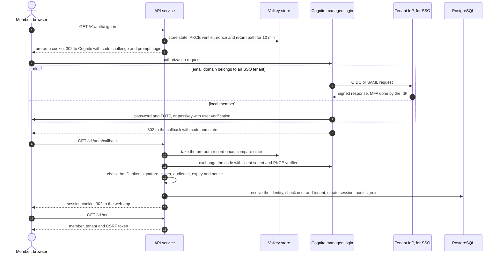
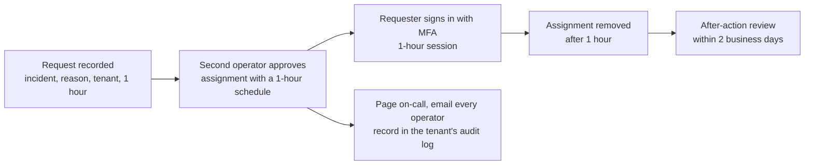

# Authentication and authorization

| | |
|---|---|
| Status | Proposed in phase 3; the phase 4 ADR records the identity provider choice |
| Requirements | [PRD](../prd.md), especially FR-14, FR-15, FR-20, FR-22 to FR-27, FR-32, FR-34, FR-35, NFR-12 to NFR-14 |
| Architecture | [architecture.md](../architecture.md), sections 4.2, 5.1, 5.4 and 8 |
| API | [openapi.yaml](../api/openapi.yaml) and its [README](../api/README.md) |
| Data model | [data-model.md](../design/data-model.md), sections 2.1, 2.4 and 4.2 |
| Decisions | [ADR-0002](../adr/0002-api-framework.md) (caller resolution, permissions in the service layer, the `public` marker) |
| Tracking | [#23](https://github.com/codewithmuh/secure-file-transfer/issues/23), part of phase 3 ([#25](https://github.com/codewithmuh/secure-file-transfer/issues/25)) |

This page decides how every caller proves who it is, how long that proof lasts, how it is revoked, and what each caller
may do. It answers PRD open question 1 (member sign-in) and decides that PostgreSQL row-level security is a second
isolation layer. The other phase 3 documents cover the threat model
([#21](https://github.com/codewithmuh/secure-file-transfer/issues/21)), encryption and key management
([#22](https://github.com/codewithmuh/secure-file-transfer/issues/22)) and abuse and rate limiting
([#24](https://github.com/codewithmuh/secure-file-transfer/issues/24)). Where this page depends on them, it names the
issue.

## 1. Caller types

| Caller | Proves who it is with | Sent on each request | Lifetime | Idle timeout | Access ends when |
|---|---|---|---|---|---|
| Member or tenant admin, web app | Amazon Cognito managed login: a password and TOTP, or a passkey with user verification; or the tenant's own identity provider through federation (section 2) | `__Host-sft_session` cookie, plus `X-CSRF-Token` on unsafe methods | 12 hours from sign-in | 30 minutes | They sign out; an admin signs them out, deactivates them, resets their sign-in or changes their role; the tenant is suspended; the session times out |
| Recipient | The link token from the email, then a one-time code sent to the invited address (section 4) | `__Host-sft_link` cookie, plus `X-CSRF-Token` on unsafe methods | 24 hours, never past the transfer's expiry | 1 hour | The transfer is revoked or expires; they end the session; the tenant is suspended |
| Uploader | The same, for one upload request | The same | 24 hours, never past the request's expiry | 1 hour | The request is revoked or expires; they end the session; the tenant is suspended |
| Tenant automation | A tenant API key (section 5) | `Authorization: Bearer` | The key's expiry: 90 days by default, at most 365 | None | An admin revokes it; it expires; its owner is deactivated or stops being an admin; the tenant is suspended |
| Platform operator, AWS | IAM Identity Center with MFA by security key or passkey (section 8) | Temporary AWS credentials | 1 hour | None | The assignment is removed or the user is disabled in Identity Center |
| Platform operator, operator API | Signed AWS identity, exchanged for an operator token (section 8.2) | `Authorization: Bearer` operator token | 15 minutes | None | The token expires or is revoked; Identity Center access is removed |
| System jobs and workers | Their own IAM role per workload and their own PostgreSQL login role through IAM database authentication (#22) | No HTTP credential; a named system actor on every service call | IAM credentials rotate automatically | None | Terraform removes the role or its policy |

- **One credential per request.** Member routes read only `__Host-sft_session` or an API key; `/session` routes read
  only `__Host-sft_link`. A request that carries a session cookie and an `Authorization` header together is refused with
  `401 credentials_invalid`, so a caller is never ambiguous.
- A tenant admin is a member with the `admin` role. There is no separate admin account.
- Every secret the service issues (session, link, CSRF and operator tokens, and API keys) carries 256 bits from the
  operating system's random generator and is stored only as a SHA-256 hash. The one exception is the 6-digit
  verification code, stored as an HMAC (data model section 1).

## 2. Member sign-in: open question 1

### 2.1 Options

| Option | Security | Effort | Cost | FR-25 (MFA) and FR-26 (SSO) | Regional failover |
|---|---|---|---|---|---|
| **Managed user pool (Amazon Cognito, Plus plan) for local members, with tenant SSO federated through it; our own session after an authorization-code + PKCE flow** (chosen) | AWS stores passwords, TOTP secrets and passkeys. MFA is mandatory; breached passwords are blocked and risky sign-ins are challenged (threat protection). AWS parses SAML and OIDC responses. Our service never sees a password. | Low to medium: Terraform for the pool, a callback endpoint, identity mapping, and runbooks for SSO onboarding and failover | $0.02 per local monthly active user, with no free tier; federated users $0.015 above the first 50. About $400–500 a month at the design load of 25,000 members; under a dollar in the reference run | Both. TOTP or a passkey with user verification for every local member; one SAML or OIDC provider per tenant (300 per pool by default, raisable to 1,000) | A user pool is regional and can't be replicated, and password hashes, TOTP secrets and passkeys can't be exported. SSO members fail over to a standby pool; local members re-enroll (2.6). |
| Build our own: passwords and TOTP, or passkeys (WebAuthn), plus our own SAML and OIDC | Everything is ours: password hashing and breach checks, TOTP replay protection, WebAuthn ceremonies, account recovery, and SAML signature validation, a long-standing source of critical bugs | High: weeks of security-critical code for one maintainer, and most of ASVS 5.0 chapters V6 and V10 become ours to meet and test | No per-user fee; the cost is engineering time | Both, once built | Best: credentials live in PostgreSQL and replicate to Osaka with everything else |
| SSO only: every tenant signs in through its own identity provider | No credentials stored at all. MFA is each identity provider's job, and for SAML we can't verify it was used. | Medium: federation only, through Cognito or our own code | Federated users only | FR-26 yes. FR-25 only as strong as each tenant's identity provider. Tenants without one, and the synthetic probe tenant (NFR-1), can't sign in at all. | As for federation in the first option |

### 2.2 Recommendation

Use the first option.

- **FR-25 is a Must, and the hard parts come configured, not coded.** Mandatory MFA, passkeys with user verification,
  breached-password checks (ASVS 5.0 chapter V6 at Level 2, NFR-13) and lockout are settings of the user pool.
- **FR-26 without writing SAML.** Cognito is the service provider for every tenant's identity provider.
- **Few moving parts.** It is a managed AWS service, not another service of ours to run.
- **Cognito is used only at sign-in.** The API does the code exchange and issues its own server-side session, so no
  token reaches browser JavaScript, and replacing Cognito later changes sign-in only, not sessions or authorization.

The cost is regional failover for local members (2.6) and lock-in for their credentials, which can't be exported.

**When to revisit:** if the first regional failover drill shows local-member re-enrollment can't meet NFR-11, or most
tenants turn out to need local accounts, write a superseding ADR for our own passkey sign-in (the second option without
passwords), keeping Cognito for federation or replacing it.

### 2.3 User pool configuration

| Setting | Value | Why |
|---|---|---|
| Pools | One pool per environment in Tokyo, shared by all tenants. A standby pool in Osaka for staging and prod (2.6). | A pool per tenant would mean 500 pools, each with its own domain, and custom domains are limited to 4 per region. Isolation comes from our identity mapping (2.4). |
| Feature plan | Plus | Threat protection in enforce mode: compromised-credentials check on sign-in and password change, adaptive authentication, and exported user activity logs. Passkeys and managed login need Essentials or higher. |
| Sign-up | Admins only (`AllowAdminCreateUserOnly`) | No self-service sign-up (FR-34) |
| Username | Our user ID; the email address is a sign-in alias that users can't change themselves | Aliases are unique in a pool, so one address can be a local member of one tenant only. A second tenant needs SSO or another address (`409 user_exists`). |
| MFA | Required: TOTP, or a passkey with user verification required (`FactorConfiguration` `MULTI_FACTOR_WITH_USER_VERIFICATION`). SMS and email codes are off, as MFA and as a first factor. | SMS invites SIM-swap attacks. An email code adds nothing when email is also the recovery channel. |
| Passwords | At least 15 characters, up to 99, no composition rules; breached passwords refused | ASVS 5.0 V6.2 |
| Passkey relying party ID | The service's registrable domain (open question 5), fixed before launch | Changing it later makes every member register their passkeys again |
| Temporary password | Valid 3 days | Invitations (2.5) |
| Lockout | Cognito's built-in temporary lockout, plus a pre-authentication trigger that refuses the 11th attempt in 15 minutes | NFR-14; the trigger is designed in #24 |
| Domain | Managed login on our custom domain `auth.<domain>`, in English or Japanese (`lang`) | The custom domain is served through CloudFront, one of NFR-21's exempt global services. The pool and its data stay in Tokyo. |
| App client | One confidential client: authorization code grant only, PKCE with S256, client secret in Secrets Manager, one callback URL (`https://api.<domain>/v1/auth/callback`); implicit grant off | |
| Tokens | The API reads the ID token once, revokes the refresh token at once and keeps nothing | Our session is the only session |
| Edge protection | A regional WAF web ACL on the user pool | Rate rules in #24 |
| Logs | User activity logs exported to S3 in Tokyo. A lifecycle job copies failed sign-ins into the audit log as `sign_in_failed` (FR-27), so tenant admins see them. | |

### 2.4 Sign-in flow



- **`prompt=login` on every sign-in.** Managed login keeps its own session cookie for an hour. Without `prompt=login`,
  anyone at an unattended browser could sign in again silently after our session timed out, which would make the
  30-minute idle timeout meaningless.
- **Pre-auth state.** `GET /v1/auth/sign-in` sets a random `__Host-sft_auth` cookie and stores the state, PKCE verifier,
  nonce and return path under its SHA-256 in the Valkey store (#24), for 10 minutes, single use. Nothing is signed, and
  the verifier never leaves the server. Both sign-in routes fail closed when the store is down.
- **The callback.** It takes the pre-auth record (deleting it), compares `state` in constant time, exchanges the code,
  and validates the ID token against the pool's published keys: signature, `iss`, `aud`, `token_use = id`, `exp` and
  `nonce`. The code in the callback URL reaches load balancer logs, but it is valid for 5 minutes, single use and
  useless without the verifier and the client secret. Application logs drop this route's query string.
- **No open redirect.** The return path must be a relative path on the web app; anything else becomes `/`.
- **Identity resolution** (data model section 2.1, changed in section 10):
  - A local member is identified by the pool's issuer and the Cognito `sub`.
  - An SSO member is identified by the tenant's provider name and the subject their identity provider sent (from the
    `identities` claim). A provider belongs to exactly one tenant, so a tenant's identity provider can only sign people
    in to that tenant.
  - On an invited SSO member's first sign-in, the service matches the invited user in the provider's tenant by the
    normalized email address from the identity provider, then binds the subject. Later sign-ins match the subject
    only, never the email address.
  - There are no just-in-time accounts. Someone nobody invited is told to ask their admin.
  - Refused and audited: an unknown identity, a deactivated user, a suspended tenant, a provider that isn't the user's
    tenant's, and a local sign-in to a tenant that requires SSO by a user who isn't one of its fallback admins (2.5).
- Every sign-in creates a new session (section 3.3).

### 2.5 Invitations, recovery and SSO setup

**Invitations.** `inviteUser` creates the user as `invited` and writes an outbox message.

- For a tenant without SSO, the notification worker creates the Cognito user with Cognito's own message suppressed and
  a temporary password the worker generates, then emails the invitation itself. As with link tokens, the secret never
  enters the outbox (architecture 4.1). At first sign-in, Cognito makes the member choose a password and enroll TOTP;
  they can add passkeys afterwards.
- For an SSO tenant, the email only points to sign-in. No Cognito user is created.

**Lost factor.** A tenant admin resets the member's sign-in (`resetUserSignIn`, proposed, with a recent sign-in). The
worker deletes the member's Cognito user and creates it again, which removes the password, TOTP and passkeys; every
session of the member ends; the member gets a new invitation. That is the same assurance as their first enrollment
(ASVS 5.0 V6.4). If a tenant's last admin loses their factor, an operator resets it after confirming the request
through a second contact recorded when the tenant was provisioned; the reset is audited and the tenant's admins are
told.

Only the notification worker's IAM role can call Cognito's admin operations, and only to create, delete, disable and
sign out users of the two pools. The internet-facing API role has no Cognito permissions.

**SSO setup (FR-26).**

- A tenant admin asks for SSO; an operator sets it up with the operator CLI. The tenant first proves each email domain
  with a DNS TXT record.
- The CLI creates the SAML or OIDC provider in both pools with the operator's own AWS credentials, named after the
  tenant ID. It maps only email and subject, requires signed SAML assertions, and attaches the proven domains as the
  provider's identifiers, so managed login sends `name@customer.example` straight to that provider. It then records
  the configuration through the operator API (`configureTenantSso`, proposed). The API role never manages providers.
- The tenant admin confirms that their identity provider enforces MFA, and the confirmation is audited. Cognito's MFA
  doesn't apply to federated users (section 9.1).
- **SSO required.** When a tenant sets it, members can sign in only through the identity provider. Up to two admins keep
  local credentials as the tenant's own fallback for when its identity provider breaks.
- A daily job compares each tenant's recorded configuration with both pools and alerts on any difference.

### 2.6 Regional failover

- **Signed-in members stay signed in.** Member sessions live in PostgreSQL and replicate to Osaka. Deactivations and
  admin-forced sign-outs are security-critical records (architecture 5.2), re-applied after a failover.
- **SSO members sign in normally.** The Osaka standby pool comes from the same Terraform, with no users. Every SSO
  provider exists in both pools, and each tenant's identity provider trusts both: two redirect URIs for OIDC, two
  service providers for SAML. A test sign-in through each pool is part of onboarding and of every drill.
- **Local members re-enroll.** Cognito can't export password hashes, TOTP secrets or passkeys. The failover runbook
  creates every active local member in the Osaka pool, and the notification worker emails each a re-enrollment
  invitation: a new password and a new MFA factor. The assurance is the same as the first invitation, but during that
  window control of the mailbox is enough to take over a local member's account. Tenant admins are told, and every
  re-enrollment is audited.
- **After failback** the Tokyo pool is unchanged, so local members use their original credentials again. Identities are
  stored per pool (`user_identities`, section 10), so a member can hold both.
- Recipients, uploaders and API keys don't depend on Cognito. The synthetic probe (NFR-1) uses an API key and a
  recipient link, so it keeps measuring them during a failover.

## 3. Member sessions

### 3.1 Cookies

| Cookie | Value | Attributes | Purpose |
|---|---|---|---|
| `__Host-sft_session` | 256-bit random token | HttpOnly, Secure, Path=/, SameSite=Strict, no Domain, no Max-Age | The member session |
| `__Host-sft_auth` | 256-bit random token | HttpOnly, Secure, Path=/, SameSite=Lax, Max-Age 600 | Finds the pre-auth record during sign-in (2.4). Lax, because the callback arrives as a cross-site redirect. |
| `__Host-sft_link` | 256-bit random token | HttpOnly, Secure, Path=/, SameSite=Strict, no Domain, no Max-Age | The link session (section 4.3) |

- The `__Host-` prefix makes a cookie host-only on the API host, Secure and Path=/, so no subdomain can set or overwrite
  it.
- **SameSite=Strict for the member session** (the contract says Lax). The session is used only by the web app's fetch
  calls and the downloads it starts, which are all same-site. Nothing needs it on a cross-site navigation.
- No Max-Age: the cookie ends with the browser, and the server enforces the lifetime.
- The web app never sees the session token or any Cognito token. The only value it holds is the CSRF token (3.4).

### 3.2 Session store

Sessions live in a `member_sessions` table in PostgreSQL (the data model's placeholder): `id`, `tenant_id`, `user_id`,
`identity_id`, `session_hash` (unique), `csrf_token_hash`, `auth_time`, `auth_method` (`password_totp`, `passkey`,
`sso`), `created_at`, `last_seen_at`, `expires_at`, `revoked_at`, `revoked_reason`, `created_ip`, `user_agent`.

Why PostgreSQL rather than the Valkey store:

- **Revocation is transactional.** Deactivation and role changes end sessions in the same transaction that writes the
  audit event.
- **It survives a failover.** Sessions and their revocations replicate to Osaka (NFR-10).
- **One system of record.** The cost is one primary-key lookup per request and a write of `last_seen_at` at most once a
  minute per session, small at the design load's bursts of 300 requests per second.

On every request the API looks the session up by its hash (section 7.1) and checks that it isn't revoked, that
`expires_at` hasn't passed, that `last_seen_at` is less than 30 minutes ago, and that the user and tenant are active.
The role is read from `users` on every request, never copied into the session. A failed check returns
`401 session_expired`. A member can have up to 10 sessions at once, for several devices; starting an 11th ends the
oldest.

### 3.3 Rotation

| Event | What happens to sessions |
|---|---|
| Sign-in | Always a new session with a new token and CSRF token. A session cookie the browser already sent is revoked, so a planted cookie can't be carried into a signed-in session. |
| Step-up sign-in | A new session replaces the old one, with a new `auth_time` |
| Role change (`updateUser`) | Every session of that user ends, for a promotion as well as a demotion, so privileges never change under a live session |
| Sign-in reset, deactivation, forced sign-out | Every session of that user ends (3.6) |
| Tenant suspended | Every session of the tenant ends |

**Step-up.** `createApiKey`, `updateUser`, `deactivateUser`, `updateTenantPolicy` and `resetUserSignIn` need a sign-in
within the last 15 minutes. Otherwise they return `401 reauthentication_required` (a new code, section 10). The web app
runs sign-in again, which sends `prompt=login` to Cognito and on to the tenant's identity provider, and then retries.

### 3.4 CSRF

The design keeps the contract's `csrfToken` scheme: `X-CSRF-Token` on every POST, PATCH and DELETE from a cookie
session. It changes how the token reaches the web app.

1. **SameSite=Strict.** A cross-site request carries no session cookie at all.
2. **Synchronizer token.** Each member or link session gets its own random CSRF token; the session row stores its
   SHA-256. The token is returned in response bodies: `csrf_token` in `GET /me`, `GET /session` and the
   `createLinkSession` response. The web app keeps it in memory and sends it in `X-CSRF-Token`. The service compares
   hashes in constant time; a missing or wrong token gets `403 csrf_failed`. The token changes whenever the session
   does.
3. **Origin check.** On unsafe methods, `Origin` must equal the web app's origin, and `Sec-Fetch-Site`, when sent, must
   be `same-origin` or `same-site`. Otherwise `403 csrf_failed`.
4. **CORS** allows only the web app's origin, with credentials, never `*`.
5. **JSON only.** Unsafe methods accept only `application/json` bodies, which a cross-origin page can't send without a
   preflight. Upload parts go to S3, not to the API.

**Why not the readable `__Host-sft_csrf` cookie in the contract:** the web app and the API are separate origins
(ADR-0002 limits CORS to the web app's origin), and script on the web app's host can't read a host-only cookie of the
API host. A token in the response body works across origins and needs no signing key.

API keys and operator tokens need no CSRF protection, because browsers never attach an `Authorization` header on their
own.

### 3.5 Sign-out

- `signOut` (proposed, `POST /v1/auth/sign-out`) revokes the session, clears the cookie and returns Cognito's logout
  URL; the web app goes there, so managed login's own cookie is cleared too. With `all_sessions: true` it ends every
  session of the member.
- SSO members stay signed in at their own identity provider. SAML single logout is not in v1.
- A routine sign-out is not a security-critical record. It already cleared the cookie in the browser, so a revocation
  lost in a failover would also need a stolen cookie to matter.

### 3.6 Deactivation and admin-forced sign-out

- **`deactivateUser`**, in one transaction: the user becomes `deactivated`, every session of theirs is revoked, every
  API key they own is revoked (section 5.2), and the audit event is written. It is a security-critical record, in both
  regions' archive before the response (as the contract says). An outbox message then disables the Cognito user and
  signs it out everywhere; that is defence in depth, because the callback already refuses a deactivated user. The next
  request from any of the user's browsers gets `401 session_expired`.
- **`signOutUser`** (proposed): an admin ends every session of a member without deactivating them, for example after a
  lost laptop. It is a security-critical record too.
- A member removed only at the tenant's identity provider keeps a session they already have until it times out (30
  minutes idle, 12 hours at most). Deactivating them in the web app takes effect at once. SCIM deprovisioning is later.

## 4. Recipient and uploader access

### 4.1 Link token

- 256 bits, base64url. The notification worker creates it when it sends the email and stores only its hash
  (`link_token_hash`); the token never passes through the outbox or SQS (architecture 4.1). There is one token per
  recipient per transfer, and one per upload request.
- **It travels in the URL fragment**, `https://app.<domain>/t#<token>`, because:
  - Browsers never send the fragment in an HTTP request, so the token never reaches CloudFront, the WAF, the load
    balancer or any log, and never appears in a `Referer` header.
  - The page is static. The CDN serves the same file for every link and never needs the token.
  - The web app reads the fragment, removes it from the address bar and history with `history.replaceState`, and posts
    the token in a JSON body to `resolveLink`, `requestVerificationCode` and `createLinkSession`.
  - Email link scanners that fetch the URL get only the static page. `resolveLink` changes nothing, so a scanner that
    runs the page's script uses up no code and no attempt.
  - Recipient and uploader pages load no third-party script, which could read `location.hash`, and send
    `Referrer-Policy: no-referrer`.
- A token alone reveals only the link kind, the access state and the locale (FR-14). It stays valid until the transfer
  or request ends. It isn't single use, because a recipient may come back over several days.

### 4.2 Code verification

- `requestVerificationCode` sends the code only to the address stored with the recipient or request, never to an
  address in the request.
- The code has 6 digits from a secure random generator. The notification worker creates it and stores it as an
  HMAC-SHA-256 with a key from Secrets Manager (#22). It is valid for 10 minutes and allows 5 attempts, and a new code
  supersedes every older one (data model section 2.4).
- A code is bound to its recipient or request. A code for one recipient can't open another recipient's link, even on
  the same transfer.
- **Guessing.** Five attempts per code, at most 5 codes per address per hour, and a lockout after 20 failures allow at
  most 20 guesses before a person has to act: a 1 in 50,000 chance against 6 digits. Every attempt is audited.
- Rate limits and failing closed are designed in #24.

### 4.3 Link session

- After a correct code, `createLinkSession` sets `__Host-sft_link` (3.1) with a new token whose hash goes into
  `link_sessions`, and returns `csrf_token` (3.4). A link session the browser already sent is revoked, so a browser
  holds one link session at a time.
- **Bound to one subject** (FR-15): one transfer recipient or one upload request. Every `/session` call takes its
  subject from the session row only. An ID in the path must belong to that subject's transfer or request (resource
  scope, section 7.1), or the answer is `404`.
- **Bound to the browser** by the HttpOnly cookie. It is not bound to an IP address, because mobile and corporate
  networks change addresses during a session. The source IP and user agent go into every audit record (FR-27).
- **Lifetime:** 24 hours (NFR-14) and never past the item's expiry; 1 hour idle. A download stream in progress counts as
  activity (#24 re-checks its state at least every 30 seconds). `last_seen_at` is written at most once a minute.
- **Revocation** of the transfer or request ends its sessions in the same transaction (data model 2.4), and every call
  compares the item's `expires_at` with the current time.
- **Downloads.** The browser fetches the bytes with `getSessionDownloadContent` (proposed in #24). It needs the link
  cookie, and the grant must belong to that session's recipient, so a forwarded content URL gets `401` (FR-14). It is a
  safe GET with no CSRF header; SameSite=Strict keeps it from being used cross-site.
- A recipient may read and download; an uploader may read and upload (section 6.3).

### 4.4 Lockout and unlock

- After 20 failed attempts in total, the recipient or uploader is locked (`locked_at`, data model 2.4). A locked subject
  is refused before any code is checked, and `requestVerificationCode` sends no email (`403 recipient_locked`).
- The member who created the transfer or request and every tenant admin are emailed, and the web app shows `locked`.
- The owner or a tenant admin unlocks them (`unlockRecipient`, `unlockUploader`). Unlocking resets `failed_attempts` to
  0 and **always issues a new link**: it clears `link_token_hash`, so the notification worker emails a fresh token and
  the old link stops working (`404 link_not_found`). Whoever caused the lockout with a leaked link is cut off; a
  recipient who mistyped just gets a new email.
- Lockouts and unlocks are security-critical audit records.
- **API keys can't unlock** (a change to the contract). A lockout signals a possible attack, so a person decides.

## 5. API keys

### 5.1 Format and storage

A key looks like `sft_prd_<secret>_<check>`:

- **`prd`** is the environment (`dev`, `stg` or `prd`), so a key can't be mistaken for another environment's.
- **`<secret>`** is 43 base62 characters: 256 bits from a secure random generator.
- **`<check>`** is 6 base62 characters of a CRC-32 over the rest, so the service and secret scanners reject typos and
  random strings without a database lookup.

`key_prefix` is `sft_prd_` plus the first 8 characters of the secret; lists show it so an admin can recognise a key. The
database stores the SHA-256 of the whole key (data model section 2.1); 256 random bits need no slow password hash. A
gitleaks rule in this repository matches the format, and the format suits GitHub secret scanning custom patterns.

### 5.2 Ownership, scopes and lifecycle

| Aspect | Rule |
|---|---|
| Creation | By a tenant admin in the web app only, with a recent sign-in (3.3). A key can't create a key. The full key is shown once (`ApiKeyCreated.secret`). |
| Owner | The admin who created it (`created_by`). A key acts as its owner, limited to its scopes. What it creates belongs to that admin; the audit log names the key as the actor and the owner in the details. |
| Valid while | Its owner is an active admin and the tenant is active. Deactivating or demoting the owner revokes their keys in the same transaction, as a security-critical record, and the lookup checks the owner too. Before an admin is deactivated or demoted, the web app lists the keys they own, so automation can move to another admin's key first. |
| Scopes | As in the contract: `transfers:read`, `transfers:write`, `upload_requests:read`, `upload_requests:write`, `audit:read`. Chosen at creation and never changed; a new key is how scopes change. |
| Expiry | 90 days by default, at most 365; no key without one. The owner and the tenant's admins are emailed 14 and 3 days before. |
| Rotation | Create a new key, switch the automation over, revoke the old one. Keys may overlap. At most 25 active keys per tenant. |
| Revocation | `revokeApiKey`, by any admin of the tenant. It applies to the next request, because lookups aren't cached. |
| Use | Every change a key makes is audited with actor type `api_key`. Reads are summarised as one `api_key_used` audit event per key per hour with a call count (FR-27), and `last_used_at` is updated hourly. |

### 5.3 Restrictions

- **No file contents, ever.** This confirms the contract. A key is a long-lived bearer secret kept in another system,
  outside the browser's protections, so a leaked key must not expose files. FR-32's examples, creating transfers and
  exporting the audit log, don't need contents. Automated retrieval of received files would be a later feature with
  its own scope and an IP allowlist.
- No user, role, policy, SSO or key management. Those need a web session.
- No unlocking of recipients or uploaders (4.4).
- No operator API and no `/session` routes.
- Accepted only in `Authorization: Bearer`, never in a query string or a body.
- Rate limits per key and per tenant (#24).

## 6. Authorization model

### 6.1 How a check runs

1. **Caller resolution.** A FastAPI dependency turns the credential into a `Caller` (ADR-0002): its kind (member,
   API key, recipient, uploader, operator or system), tenant, user (the member, or the key's owner), role, scopes and,
   for a link session, its subject. It doesn't decide what the caller may do.
2. **Declared permission.** Every route declares an `x-permission` value or `public`. A test fails if a route has
   neither, or if the code and the contract disagree.
3. **Service-layer check.** The service function checks the permission against the caller (6.3), then the resource
   rule (6.4). Workers call the same functions with a named system actor, so HTTP and workers share every check.
4. **404 or 403.** An item the caller can't see answers `404`: another tenant's item, another member's item for a
   non-admin, a file outside the link session's transfer. An item the caller can see but may not act on answers
   `403 permission_denied`: an admin downloading another member's received file, an uploader session downloading, an
   API key calling an operation for web sessions only.

### 6.2 Roles

| Caller | May |
|---|---|
| Member | Everything on their own transfers and upload requests: create, upload, send, cancel, extend, revoke, unlock, delete files, and download files received through their own requests. Read the tenant policy. |
| Tenant admin | Everything a member may do on their own items. Tenant-wide: read, revoke and unlock every transfer and upload request (metadata only, never contents); members and roles; tenant policy; audit search and export; API keys. |
| API key | Its owner's rights, limited to its scopes, without downloads, unlocks or any administration |
| Recipient | Read and download within one transfer |
| Uploader | Read and upload within one upload request |
| Platform operator | The operator API only: no tenant data, no file contents (section 8) |
| System | One named actor per job, limited to that job's tables (7.3) |

### 6.3 Permission table

Every `x-permission` value in the API contract, then the values this design adds (marked proposed). **Own**: items the
caller created (for a key, items its owner created). **Tenant**: every item in the caller's tenant. A dash means the
caller is refused (`401` if it has no credential the operation accepts, `403` if it has).

| Permission | Operations | Member | Admin | API key | Recipient | Uploader | Operator | Resource rule |
|---|---|---|---|---|---|---|---|---|
| `account.read` | `getCurrentMember` | Self | Self | — | — | — | — | Only the caller's own user and tenant |
| `transfer.create` | `createTransfer` | Yes | Yes | `transfers:write` | — | — | — | The member, or the key's owner, owns the new transfer |
| `transfer.read` | `listTransfers`, `getTransfer`, `listTransferRecipients` | Own | Tenant | `transfers:read`, tenant | — | — | — | `scope=tenant` needs an admin or a key, otherwise `403` |
| `transfer.send` | `sendTransfer` | Own | Own | `transfers:write`, own | — | — | — | Only the owner sends a draft |
| `transfer.cancel` | `cancelTransfer` | Own | Own | `transfers:write`, own | — | — | — | |
| `transfer.revoke` | `revokeTransfer` | Own | Tenant | `transfers:write`, tenant | — | — | — | FR-20 |
| `transfer.extend` | `extendTransferExpiry` | Own | Own | `transfers:write`, own | — | — | — | FR-9 |
| `recipient.unlock` | `unlockRecipient` | Own | Tenant | — (the contract allows `transfers:write`, 4.4) | — | — | — | Always issues a new link |
| `file.upload` | `addTransferFile`, `requestUploadPartUrls`, `listUploadedParts`, `completeUpload` | Own | Own | `transfers:write`, own | — | — | — | The file belongs to a transfer, never to an upload request |
| `file.read` | `getFile` | Own | Tenant | `transfers:read` for a transfer's file, `upload_requests:read` for a received file; tenant | — | — | — | The scope must match the file's parent, otherwise `404` |
| `file.delete` | `deleteFile` | Own | Own | `transfers:write` or `upload_requests:write`, matching the parent; own | — | — | — | |
| `file.download_received` | `createReceivedFileDownload`; `getReceivedFileDownloadContent` (proposed in #24) | Own | Own | — | — | — | — | Another member's request gets `403` for an admin. The content GET needs the member the grant was issued to. |
| `upload_request.create` | `createUploadRequest` | Yes | Yes | `upload_requests:write` | — | — | — | |
| `upload_request.read` | `listUploadRequests`, `getUploadRequest`, `listUploadRequestFiles` | Own | Tenant | `upload_requests:read`, tenant | — | — | — | As `transfer.read` |
| `upload_request.revoke` | `revokeUploadRequest` | Own | Tenant | `upload_requests:write`, tenant | — | — | — | FR-20 |
| `uploader.unlock` | `unlockUploader` | Own | Tenant | — (the contract allows `upload_requests:write`, 4.4) | — | — | — | Always issues a new link |
| `public` | `resolveLink`, `requestVerificationCode`, `createLinkSession`; `startSignIn`, `completeSignIn` (proposed); `createOperatorToken` (proposed, operator port only) | Anyone | Anyone | Anyone | Anyone | Anyone | Anyone | Rate-limited (#24); reveals nothing about an item before verification |
| `session.read` | `getLinkSession`, `listSessionFiles` | — | — | — | Own transfer | Own request | — | The session's subject only |
| `session.end` | `endLinkSession` | — | — | — | Yes | Yes | — | |
| `session.upload` | `addSessionUploadFile`, `requestSessionUploadPartUrls`, `listSessionUploadedParts`, `completeSessionUpload` | — | — | — | — (`403`) | Own request | — | The request is open and the file belongs to it |
| `session.download` | `createSessionDownload`; `getSessionDownloadContent` (proposed in #24) | — | — | — | Own transfer | — (`403`) | — | The file is shareable and under the limit; the grant belongs to the session's recipient |
| `audit.search` | `searchAuditEvents` | — | Tenant | `audit:read` | — | — | — | |
| `audit.export` | `exportAuditEvents` | — | Tenant | `audit:read` | — | — | — | |
| `user.invite` | `inviteUser` | — | Tenant | — | — | — | — | |
| `user.read` | `listUsers`, `getUser` | — | Tenant | — | — | — | — | |
| `user.update_role` | `updateUser` | — | Tenant, step-up | — | — | — | — | Keeps one active admin; ends the user's sessions |
| `user.deactivate` | `deactivateUser` | — | Tenant, step-up | — | — | — | — | Keeps one active admin; ends sessions; revokes the user's keys |
| `tenant_policy.read` | `getTenantPolicy` | Yes | Yes | `transfers:read` or `upload_requests:read` | — | — | — | |
| `tenant_policy.update` | `updateTenantPolicy` | — | Tenant, step-up | — | — | — | — | |
| `api_key.create` | `createApiKey` | — | Tenant, step-up | — | — | — | — | Web session only |
| `api_key.read` | `listApiKeys` | — | Tenant | — | — | — | — | |
| `api_key.revoke` | `revokeApiKey` | — | Tenant | — | — | — | — | Any key of the tenant |
| `operator.tenant.create` | `createTenant` | — | — | — | — | — | Yes | Creates the tenant and invites its first admin; no tenant data returned |
| `account.sign_out` (proposed) | `signOut` | Self | Self | — | — | — | — | |
| `user.sign_out` (proposed) | `signOutUser` | — | Tenant | — | — | — | — | Security-critical record |
| `user.reset_sign_in` (proposed) | `resetUserSignIn` | — | Tenant, step-up | — | — | — | — | Local members only |
| `operator.tenant.sso.update` (proposed) | `configureTenantSso` | — | — | — | — | — | Yes | Records what the operator CLI set up in both pools |
| `operator.break_glass.record` (proposed) | `recordBreakGlassGrant` | — | — | — | — | — | Yes | Written before any break-glass access is granted (8.3) |

### 6.4 Resource rules

- **Own** means `created_by` is the caller's user; for an API key, the key's owner.
- **Tenant** means any item with the caller's `tenant_id`.
- **State rules** (only drafts are sent, only shareable files are downloaded) are checked after authorization, in the
  same locked transaction as the change (architecture 4.1), and answer `409` or `410`, never `403`.
- **Order:** `404`, then `403`, then `409`, so a caller can't learn the state of an item they can't see.

### 6.5 Where the table lives

The service layer holds this table as data, in a permission registry, and every service function names its permission.
A CI test checks the registry against the contract's `x-permission` values and against this table, and the
authorization matrix test (9.2) is generated from it.

## 7. Tenant isolation in authorization

### 7.1 Scopes

| Scope | Comes from | Reaches |
|---|---|---|
| Tenant | The member session or API key row, never a request parameter or header | That tenant's rows |
| Resource | The link session row: the tenant, plus one recipient or one upload request | That item and its files |
| System | A named job (expiry, deletion, reconciliation, purge, audit archive, outbox relay, failover replay), audited | The tables that job needs (7.3) |
| Credential lookup | The credential itself | Only `(tenant_id, subject)`; the request then continues in tenant or resource scope |
| Platform | An operator token | Platform tables, and the new tenant's rows during `createTenant` |

**Credential lookup** is the only query that crosses tenants (data model 4.2). It is five `SECURITY DEFINER` functions,
for a member session hash, a link session hash, a link token hash, an API key hash, and an identity (issuer and
subject). Each returns IDs and status columns only. They are owned by `sft_lookup` (7.3), pin their `search_path`, and
only `sft_api` may execute them.

### 7.2 Row-level security: yes, as a second layer

Row-level security is on for every tenant-owned table in every environment, including dev and CI. A scoping bug in
code then returns no rows instead of another tenant's rows. Tenant isolation is a primary goal (NFR-12), and the cost
is small (7.4).

```sql
CREATE FUNCTION app_tenant_id() RETURNS uuid
    LANGUAGE sql STABLE
    AS $$ SELECT NULLIF(current_setting('app.tenant_id', true), '')::uuid $$;

ALTER TABLE transfers ENABLE ROW LEVEL SECURITY;
CREATE POLICY tenant_isolation ON transfers
    TO sft_api, sft_scan, sft_notify
    USING (tenant_id = app_tenant_id())
    WITH CHECK (tenant_id = app_tenant_id());
```

- **Setting the tenant.** The data-access layer opens every transaction through its scope object, whose first statement
  is `SELECT set_config('app.tenant_id', :tenant_id, true)`. The `true` makes the setting transaction-local: it ends
  at commit or rollback and can't leak to the next user of a pooled connection. A session-level `SET` is forbidden,
  and a lint rule checks for it. The scope can't change within a transaction.
- **Fail closed, loudly.** If the setting is missing, `app_tenant_id()` is null and no policy matches. The data-access
  layer refuses to run a query without a scope before it reaches the database, so a missing scope is an error, not an
  empty result that looks like "not found".
- **Tenant boundary only.** Row-level security keeps tenants apart. Within a tenant, the resource scope of a link
  session and the own-or-tenant rule (6.4) are enforced by the data-access layer and the service checks.
- **Audit events.** Inserts must carry the scope's tenant, or no tenant for a platform event when no tenant is set.
  Reads are tenant-scoped (audit search).

### 7.3 Database roles

The login roles use IAM database authentication, one per workload (#22).

| Role | Used by | Scope | Row-level security |
|---|---|---|---|
| `sft_api` | API service | Tenant or resource, plus the credential lookup functions | Tenant policy on every table |
| `sft_scan` | Scan worker | Tenant, from the message | Tenant policy |
| `sft_notify` | Notification worker | Tenant, from the message | Tenant policy |
| `sft_relay` | Outbox relay | System | Reads and marks `outbox` rows of every tenant; no other tenant table |
| `sft_jobs` | Lifecycle jobs | System to find work, tenant to do it | Reads across tenants on the tables it scans; every write under the tenant policy |
| `sft_archive` | Audit archive job | System | Reads every `audit_events` row; no other tenant table |
| `sft_migrate` | Migration job | Becomes `sft_owner` with `SET ROLE` | Not applied: the table owner |
| `sft_owner` | Nobody logs in; owns every table | — | — |
| `sft_lookup` | Nobody logs in; owns the credential lookup functions | — | `BYPASSRLS`, with column-level `SELECT` on the five credential tables only |
| Master user | Break-glass only (8.3) | — | Bypasses everything; any use alerts (#22) |

- **Find across, act within.** A lifecycle job finds due work with one cross-tenant query, then handles each item in its
  own transaction with that item's tenant set, so its writes pass the same policies as the API's.
- Workers take the tenant from the outbox message, which only our own workloads can send (IAM on SQS).

### 7.4 Performance

- Each policy adds `tenant_id = $1` to a query. The data model's indexes for the main queries start with `tenant_id`,
  and lookups by credential hash go through the definer functions.
- `set_config` adds one statement per transaction, well under a millisecond inside the VPC.
- The first load test (NFR-2) measures the overhead, with a budget of 5 % added p95 latency. Above that, indexes and
  plans are fixed first; turning row-level security off would need an ADR.

### 7.5 Pitfalls

| Pitfall | Guard |
|---|---|
| A session-level setting leaks to the next user of a pooled connection | Transaction-local settings only; a test checks that a connection back in the pool carries no tenant |
| Table owners and `BYPASSRLS` roles skip row-level security | No workload role owns a table, has `BYPASSRLS` or can become `sft_owner`; a CI test reads the catalog |
| A view runs with its owner's rights | Every view is created with `security_invoker = true` |
| Querying a partition of `audit_events` directly skips the parent's policies | No role has privileges on partitions; queries go through the parent |
| Foreign key and unique checks don't apply row-level security | Composite foreign keys with `tenant_id` (data model 4.2) refuse a reference to another tenant's row. Unique violations happen only on random hashes and reveal nothing. |
| A new table ships without a policy | A CI test checks that every table with a `tenant_id` column has row-level security enabled and a policy for each role granted on it |
| A definer function is hijacked through `search_path` | Every definer function pins `search_path` and is owned by `sft_lookup` |
| `TRUNCATE` ignores row-level security | No workload role is granted `TRUNCATE` |
| Migrations see every tenant | By design, as the owner. Data migrations are reviewed in the pull request. |

### 7.6 A third layer

File names and messages are encrypted with per-tenant data keys, and the tenant of the caller's scope is the encryption
context (#22). A scoping bug that slips past both layers above returns a row that fails to decrypt instead of leaking.

## 8. Platform operators and break-glass (FR-35)

### 8.1 Normal operator access

- People reach AWS only through IAM Identity Center, with MFA by security key or passkey. There are no IAM users for
  daily work and no long-lived access keys. Identity Center needs AWS Organizations (open question 4). Its home region
  and replication decide whether operators can sign in while Tokyo is down; the accounts ADR confirms this, and 8.4
  covers an outage.
- Deploys run from GitHub Actions through OIDC roles, never from a person's credentials (architecture 3.3).

| Permission set | For | May | May not |
|---|---|---|---|
| `ReadOnly` | Dashboards, logs, alarms | Read metrics, logs and configuration | Read objects in the files or audit buckets, decrypt with the files key, read secrets, connect to the database |
| `Operator` | Runbooks and the operator CLI | What `ReadOnly` may, plus: scale and restart workloads, port-forward to the operator port, manage SSO providers in the user pools, run failover steps | Open a shell in, attach to or add containers to a pod; create pods or jobs; read Kubernetes secrets; anything `ReadOnly` may not |
| `BreakGlassApprover` | A second operator | Assign `BreakGlass` to another operator for one hour (8.3) | Use `BreakGlass` itself |
| `BreakGlass` | Emergencies only | See 8.3 | See 8.3 |

- **No shell in pods.** A shell in an API pod carries the pod's IAM role, which can read files. Taking it away is what
  makes "operators can't read file contents" true.
- **Contents are protected by policy, not procedure.** The files bucket allows reads only by the API, scan worker and
  lifecycle roles and `BreakGlass`; the files key allows decryption only by the same (#22); infected objects are denied
  to everyone by their tag (FR-17), break-glass included.

### 8.2 Operator API authentication

- The operator API (FR-34) runs in the API pods on a second port that the public load balancer doesn't route to.
  Operators reach it with `kubectl port-forward`, which needs the `Operator` permission set.
- **Token exchange** (`createOperatorToken`, proposed). The operator CLI signs an STS `GetCallerIdentity` request with
  the operator's Identity Center credentials, including a signed `X-SFT-Audience: operator-api-<env>` header, and
  sends the signed request, not the credentials. The API refuses a signature older than 1 minute or seen before, sends
  the request only to the regional STS endpoint, and reads the caller's role from the answer. Only the `Operator`
  permission set's role is accepted. The API then issues a 15-minute operator token, whose hash is stored in
  `operator_sessions`.
- Every operator call is audited with actor type `operator` and the operator's Identity Center user name.
- The operator API never returns file names, messages or contents.

### 8.3 Break-glass access



| Step | How |
|---|---|
| Request | The operator gives the incident, the reason, the tenants and resources concerned, and the time needed (at most 1 hour) to the break-glass tool. The tool first records the request through the operator API (`recordBreakGlassGrant`, proposed): a security-critical platform audit record, plus a record in each affected tenant's audit log, where its admins can see it (UC-4). No record, no access. |
| Approval | A second operator with `BreakGlassApprover` approves. The tool assigns `BreakGlass` to the requester and creates a one-time EventBridge Scheduler schedule that removes the assignment after 1 hour. |
| Use | The requester signs in with MFA; the session lasts at most 1 hour, so access ends at most 2 hours after approval. Nobody holds a standing `BreakGlass` assignment, and a daily check alerts if one exists. |
| Allows | Reading file objects and decrypting them with the files key; reading the database master password and connecting as the master user; administering the Kubernetes cluster |
| Never allows | Downloading infected files (FR-17, bucket policy). Decrypting file names and messages: the fields key is not in its key policy (#22). Changing or deleting audit archive objects (Object Lock in compliance mode in prod). Stopping or changing CloudTrail, AWS Config or the alerting rules, or changing IAM or KMS key policies: a service control policy denies these to everyone except the Terraform deploy role. |
| Alerts | EventBridge rules on the assignment, every sign-in with `BreakGlass`, every call by its role, every read of the master password, and every decryption with the files key by a person's role. On-call is paged and every operator emailed within 5 minutes. Self-approval and use without a recorded request raise their own alerts. |
| Evidence | An organization CloudTrail trail, with S3 data events on the files bucket and KMS events, delivered to an Object Lock bucket; pgaudit logs every statement of the master user |
| Afterwards | The master password is rotated (#22). An after-action review within 2 business days compares what was read (CloudTrail data events) with the approved scope, says whether the access was needed, and opens an issue to make it unnecessary next time. Uses are counted; the target is zero. |

With one maintainer, the reference run has a single operator, so the two-person rule can't be met. Self-approval is
then allowed, still alerts, and the after-action review records it (section 11).

### 8.4 When Identity Center is unavailable

- Each AWS account has one emergency IAM user with a hardware security key, console access only and no access keys. Its
  password is kept offline. Any sign-in alerts. It is used only when Identity Center can't be reached, for example in
  a regional outage that also takes down Identity Center's home region.
- The root user has a hardware security key, is never used, and any sign-in alerts.

## 9. Residual risks and tests

### 9.1 Residual risks

| Risk | Why it remains | What limits it |
|---|---|---|
| An SSO tenant's identity provider doesn't enforce MFA | Cognito's MFA doesn't apply to federated users, and SAML gives no reliable proof that MFA was used | The tenant admin confirms MFA at setup, audited; the onboarding runbook states the shared responsibility |
| Re-enrollment of local members after a regional failover rests on mailbox control | Cognito credentials can't be exported | Only during a failover an operator declares; admins told; audited; SSO members unaffected |
| Script injected into the web app can use a member's session, though it can't read the cookie | HttpOnly stops theft, not use | Strict Content Security Policy with no inline or third-party script; output escaping; the CSRF token lives only in memory |
| A leaked link lets someone lock the recipient out | The lockout is what stops guessing | The member is told; unlocking issues a new link (4.4) |
| A recipient's mailbox is compromised | FR-14 trusts control of the invited address | Codes valid 10 minutes, sessions at most 24 hours, every action audited with its IP address |
| An API key leaks | It is a bearer secret | Scopes, no downloads, expiry, rate limits, instant revocation, the gitleaks rule |
| A member removed only at the identity provider keeps their session | No SCIM in v1 | 30 minutes idle, 12 hours at most; deactivation in the web app is immediate |
| Local credentials are locked in to Cognito | They can't be exported | The exit path is re-enrollment; SSO members are unaffected |
| Break-glass is misused by two operators together, or by the only operator | A two-person rule can't stop collusion, and needs two people | Alerts to every operator, records in the tenant's audit log, CloudTrail in Object Lock, the after-action review |
| Code sets the wrong tenant in the scope, which row-level security then trusts | Row-level security checks `app.tenant_id`, not where it came from | The scope comes only from the credential row; the isolation suite; tenant encryption context (7.6) |
| A browser holds one link session at a time | One cookie name | Verifying a second link replaces the first; the recipient verifies again |
| No SAML single logout | The identity provider's session continues | Our session ends at sign-out; `prompt=login` is forwarded to the identity provider |

### 9.2 Tests

| Control | Test | Runs |
|---|---|---|
| Declared permissions | Every route declares `x-permission` or `public`; code and contract match; the registry matches table 6.3 | Every pull request |
| Authorization matrix | Generated from the registry: every operation with every caller (no credential; a member who owns the item; another member; an admin; an admin of another tenant; a key with each scope and with none; a recipient; an uploader; an operator), each expecting its 2xx, `401`, `403` or `404` | Every pull request, and against staging |
| Isolation suite (NFR-12) | Two tenants; every endpoint and data-access function tried with the other tenant's IDs, tokens, keys and sessions; anything but `404` fails. Run three ways: as built; with row-level security off, so the data-access layer alone must hold; and with the data-access layer's tenant filter removed by a test hook, so row-level security alone must hold. | Every pull request; staging |
| Row-level security configuration | Every tenant table has row-level security and its policies; no workload role owns tables, has `BYPASSRLS` or can become `sft_owner`; definer functions pin `search_path`; a pooled connection carries no tenant after commit | Every pull request |
| Sign-in | State reused or wrong; nonce wrong; issuer, audience or `token_use` wrong; token expired or from the other pool; tenant A's provider signing in to tenant B; an uninvited, deactivated or suspended user: all refused and audited. `prompt=login` is always sent; an absolute return path is ignored. In dev and staging a second user pool plays the tenant's identity provider. | Every pull request with a stub provider; staging against Cognito |
| Sessions | Cookie attributes; a new token at sign-in and step-up; idle and absolute expiry with the clock moved; deactivation and role change end sessions; step-up returns `401 reauthentication_required` | Every pull request |
| CSRF | Missing or wrong token; missing or foreign `Origin`; cookie plus bearer refused; non-JSON body refused | Every pull request |
| Link access | After an end-to-end run, no link token appears in load balancer, CDN, WAF or application logs. `resolveLink` reveals nothing; a code works only for its own subject; a superseded code fails; 5 attempts per code; lockout at 20; unlocking issues a new link and the old one fails; another transfer's file IDs get `404`; an uploader can't download and a recipient can't upload; revocation ends sessions within 5 seconds (NFR-6). | Every pull request; staging end to end |
| API keys | The checksum rejects typos; only the hash is stored; scopes hold; a download gets `403`; a key can't create keys or unlock; a revoked or expired key gets `401` on the next call; deactivating the owner revokes their keys | Every pull request |
| Operator access | The operator port isn't reachable through the public load balancer. The token exchange refuses another role, a wrong audience, an old or replayed signature, and any host other than STS. | Every pull request; staging |
| Break-glass | A drill: request, approval, alerts within 5 minutes, assignment removed after 1 hour, review written | Staging, in every disaster recovery drill |
| User pool configuration | Static checks on the Terraform: MFA required, Plus plan, threat protection enforced, admin-only sign-up, implicit grant off. Once deployed, a daily drift check. | Every pull request; daily |

### 9.3 ASVS 5.0 Level 2 (NFR-13)

| ASVS chapter | Where this page covers it |
|---|---|
| V3 Web Frontend Security (cookies, CSRF, CORS) | 3.1, 3.4, 4.1 |
| V6 Authentication | 2.3 to 2.5 |
| V7 Session Management | 3, 4.3 |
| V8 Authorization | 6, 7 |
| V10 OAuth and OIDC | 2.3, 2.4 |

The threat model (#21) holds the full ASVS checklist.

## 10. Changes this design asks for

**API contract** ([#14](https://github.com/codewithmuh/secure-file-transfer/issues/14)):

- Add sign-in: `startSignIn` (`GET /auth/sign-in`) and `completeSignIn` (`GET /auth/callback`), both `public`, and
  `signOut` (`POST /auth/sign-out`, `account.sign_out`).
- Add `signOutUser` (`POST /users/{user_id}/sign-out`, `user.sign_out`) and `resetUserSignIn`
  (`POST /users/{user_id}/reset-sign-in`, `user.reset_sign_in`).
- Add to the operator API: `createOperatorToken` (`POST /operator/token`, `public`, operator port only),
  `configureTenantSso` (`PUT /operator/tenants/{tenant_id}/sso`, `operator.tenant.sso.update`) and
  `recordBreakGlassGrant` (`POST /operator/break-glass-grants`, `operator.break_glass.record`).
- CSRF: drop the readable `__Host-sft_csrf` cookie and return `csrf_token` in `CurrentMember`, `LinkSession` and the
  `createLinkSession` response. `X-CSRF-Token` stays.
- `memberSession`: SameSite=Strict instead of Lax.
- `unlockRecipient` and `unlockUploader`: remove `tenantApiKey`, and say that unlocking always issues a new link.
- A new error code, `reauthentication_required` (401), on the step-up operations (3.3).
- `operatorToken`: describe the exchange (8.2) and the operator port.
- `ApiKeyCreated.secret`: document the format (5.1).
- The download content operations proposed in #24 take `session.download` and `file.download_received`.

**Data model** ([#13](https://github.com/codewithmuh/secure-file-transfer/issues/13)):

- `member_sessions` as in 3.2.
- `link_sessions`: add `csrf_token_hash` and `last_seen_at`.
- Replace `users.idp_issuer` and `users.idp_subject` with `user_identities` (`tenant_id`, `user_id`, `issuer`,
  `subject`), unique on `(issuer, subject)`: one identity per pool for a local member, one per provider for an SSO
  member.
- `tenants`: `sso_provider_name` (replacing `idp_issuer`), `sso_protocol`, `sso_domains`, `sso_required`,
  `sso_mfa_confirmed_by` and `sso_mfa_confirmed_at`. `users`: `sso_fallback`, for at most two admins per tenant.
- Platform tables without row-level security: `operator_sessions`, and `break_glass_grants` (requester, approver,
  reason, incident, tenants, starts and ends, review due, review link).

**PRD:** NFR-11 should say how sign-in for local members recovers after a regional failover (2.6).

## 11. Open points for review

| Point | Proposal |
|---|---|
| Local members after a regional failover (NFR-11) | Re-enroll them as a runbook step, so sign-in meets the 1-hour RTO, at the cost of mailbox-only assurance during the failover (2.6). The alternative is to wait for Tokyo, which breaks NFR-11 for them. |
| Two-person break-glass with one maintainer | Allow self-approval in the reference run, with its own alert and a note in the review (8.3) |
| Cognito Plus plan | Needed for the breached-password check (ASVS 5.0 V6.2); about $400–500 a month at design load, under a dollar in the reference run |
| API keys bound to their owner | Deactivating or demoting the owner revokes their keys (5.2). Tenant-owned service keys would survive staff changes but leave credentials with no person behind them. |
| Contract changes in section 10 | For the contract's owner to apply in #14 |
