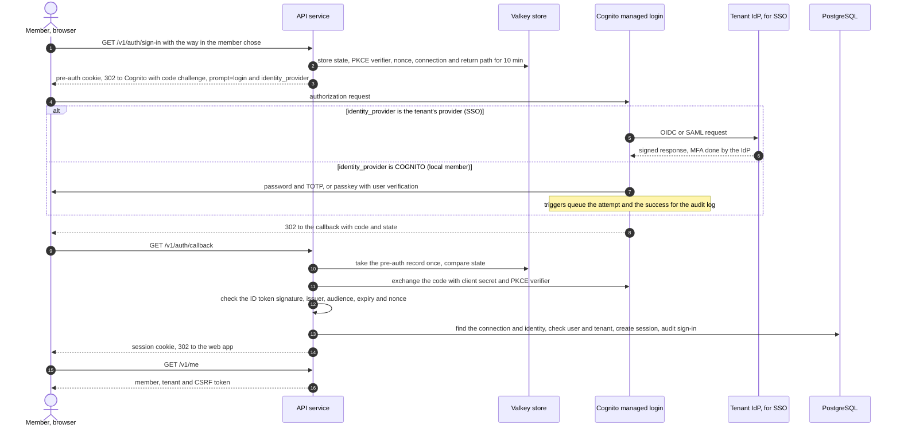
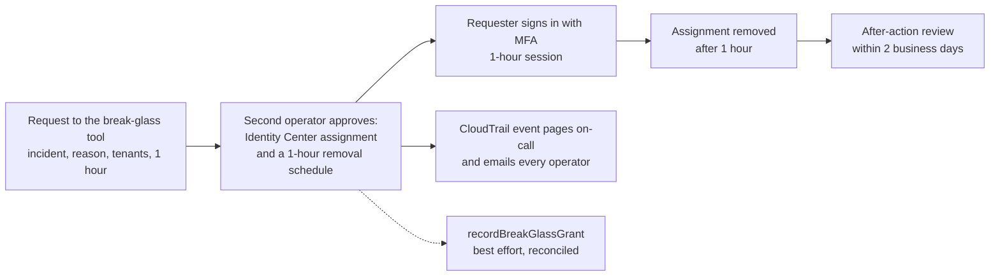

# Authentication and authorization

| | |
|---|---|
| Status | Phase 3 design, aligned with the phase 2 documents in [#26](https://github.com/codewithmuh/secure-file-transfer/issues/26); ADR-0016 records the identity provider choice |
| Requirements | [PRD](../prd.md), especially FR-14, FR-15, FR-20, FR-22 to FR-27, FR-32, FR-34, FR-35, FR-40 to FR-44, FR-53 to FR-55, NFR-12 to NFR-15 |
| Architecture | [architecture.md](../architecture.md), sections 4.2, 5.1, 5.2, 5.4 and 8 |
| API | [openapi.yaml](../api/openapi.yaml) and its [README](../api/README.md) |
| Data model | [data-model.md](../design/data-model.md), sections 2.1, 2.2, 2.4 and 4.2 |
| Decisions | [ADR-0002](../adr/0002-api-framework.md) (caller resolution, permissions in the service layer, the `public` marker) |
| Tracking | [#23](https://github.com/codewithmuh/secure-file-transfer/issues/23), part of phase 3 ([#25](https://github.com/codewithmuh/secure-file-transfer/issues/25)); DLP approvers and permissions in [#64](https://github.com/codewithmuh/secure-file-transfer/issues/64) |

This page decides how every caller proves who it is, how long that proof lasts, how it is revoked, and what each caller
may do. It answers PRD open question 1 (member sign-in) and decides that PostgreSQL row-level security is a second
isolation layer. The other phase 3 documents cover the threat model
([#21](https://github.com/codewithmuh/secure-file-transfer/issues/21)), encryption and key management
([#22](https://github.com/codewithmuh/secure-file-transfer/issues/22)) and abuse and rate limiting
([#24](https://github.com/codewithmuh/secure-file-transfer/issues/24)). Where this page depends on them, it names the
issue.

## 1. Caller types

| Caller | Proves who it is with | Sent on each request | Lifetime | Idle timeout | Access ends when |
|---|---|---|---|---|---|
| Member or tenant admin, web app | Amazon Cognito managed login: a password and TOTP, or a passkey with user verification; or the tenant's own identity provider through federation (section 2) | `__Host-sft_session` cookie, plus `X-CSRF-Token` on unsafe methods | 12 hours from sign-in | 30 minutes | They sign out; an admin signs them out, deactivates them, resets their sign-in or changes their role; the tenant is suspended; the session times out |
| Recipient | The link token from the email, then a one-time code sent to the invited address (section 4) | `__Host-sft_link` cookie and `X-Link-Session` naming the session, plus `X-CSRF-Token` on unsafe methods. A content download sends only the cookie (4.3). | 24 hours, never past the transfer's expiry | 1 hour | The transfer is revoked or expires; they end the session; the tenant is suspended |
| Uploader | The same, for one upload request | The same | 24 hours, never past the request's expiry | 1 hour | The request is revoked or expires; they end the session; the tenant is suspended |
| Tenant automation | A tenant API key (section 5) | `Authorization: Bearer` | The key's expiry: 90 days by default, at most 365 | None | An admin revokes it; it expires; its owner is deactivated or stops being an admin; the tenant is suspended |
| Platform operator, AWS | IAM Identity Center with MFA by security key or passkey (section 8) | Temporary AWS credentials | 1 hour | None | The assignment is removed or the user is disabled in Identity Center |
| Platform operator, operator API | Signed AWS identity, exchanged for an operator token (section 8.2) | `Authorization: Bearer` operator token, through a port-forward to the operator API | 15 minutes | None | The token expires or is revoked; Identity Center access is removed |
| System jobs and workers | Their own IAM role per workload and their own PostgreSQL login role through IAM database authentication (#22). The Cognito sign-in triggers have an IAM role that may only send to the sign-in events queue and use the counter store. | No HTTP credential; a named system actor on every service call | IAM credentials rotate automatically | None | Terraform removes the role or its policy |

- **One credential per request.** Member routes read only `__Host-sft_session` or an API key; `/session` routes read
  only `__Host-sft_link`. A request that carries a session cookie and an `Authorization` header together is refused with
  `401 credentials_invalid`, so a caller is never ambiguous.
- A tenant admin is a member with the `admin` role. There is no separate admin account.
- **Secrets.** Session, link session, invitation and operator tokens and API keys carry 256 bits from the operating
  system's random generator and are stored only as SHA-256 hashes. Two kinds are derived instead: link tokens, from
  `K_link` (4.1, data model section 2.2), stored as a SHA-256 hash like the others; and CSRF tokens, from `K_csrf` and
  the session token (3.4), which are never stored. The 6-digit verification code is stored as an HMAC (data model
  section 1).

## 2. Member sign-in: open question 1

### 2.1 Options

| Option | Security | Effort | Cost | FR-25 (MFA) and FR-26 (SSO) | Regional failover |
|---|---|---|---|---|---|
| **Managed user pool (Amazon Cognito, Plus plan) for local members, with tenant SSO federated through it; our own session after an authorization-code + PKCE flow** (chosen) | AWS stores passwords, TOTP secrets and passkeys. MFA is mandatory; breached passwords are blocked and risky sign-ins are challenged (threat protection). AWS parses SAML and OIDC responses. Our service never sees a password. | Low to medium: Terraform for the pool, a callback endpoint, identity mapping, two small triggers, and runbooks for SSO onboarding and failover | $0.02 per local monthly active user, with no free tier; federated users $0.015 above the first 50. About $400–500 a month at the design load of 25,000 members; under a dollar in the reference run | Both. TOTP or a passkey with user verification for every local member; one SAML or OIDC provider per tenant (300 per pool by default, raisable to 1,000) | Cognito's multi-Region replication (an add-on since June 2026) doesn't offer Osaka as a replica Region and doesn't support TOTP on a replica (2.6). Password hashes, TOTP secrets and passkeys can't be exported. SSO members fail over to a standby pool; local members re-enroll (2.6). |
| Build our own: passwords and TOTP, or passkeys (WebAuthn), plus our own SAML and OIDC | Everything is ours: password hashing and breach checks, TOTP replay protection, WebAuthn ceremonies, account recovery, and SAML signature validation, a long-standing source of critical bugs | High: weeks of security-critical code for one maintainer, and most of ASVS 5.0 chapters V6 and V10 become ours to meet and test | No per-user fee; the cost is engineering time | Both, once built | Best: credentials live in PostgreSQL and replicate to Osaka with everything else |
| SSO only: every tenant signs in through its own identity provider | No credentials stored at all. MFA is each identity provider's job, and for SAML we can't verify it was used. | Medium: federation only, through Cognito or our own code | Federated users only | FR-26 yes. FR-25 only as strong as each tenant's identity provider. Tenants without one, and the synthetic probe tenant (NFR-1), can't sign in at all. | As for federation in the first option |

### 2.2 Recommendation

Use the first option.

- **FR-25 is a Must, and the hard parts come configured, not coded.** Mandatory MFA, passkeys with user verification,
  breached-password checks (ASVS 5.0 chapter V6 at Level 2, NFR-13) and lockout are settings of the user pool.
- **FR-26 without writing SAML.** Cognito is the service provider for every tenant's identity provider.
- **Few moving parts.** It is a managed AWS service, not another service of ours to run.
- **Cognito is used only at sign-in.** The API does the code exchange and issues its own server-side session, so no
  token reaches browser JavaScript, and replacing Cognito later changes sign-in only, not sessions or authorization.

The costs are regional failover for local members (2.6), lock-in for their credentials, which can't be exported, and
one local sign-in per email address across the platform (2.5).

**When to revisit:** if the first regional failover drill shows local-member re-enrollment can't meet NFR-11, or most
tenants turn out to need local accounts, write a superseding ADR for our own passkey sign-in (the second option without
passwords), keeping Cognito for federation or replacing it. Revisit too when Cognito's replication supports Osaka
(2.6).

### 2.3 User pool configuration

| Setting | Value | Why |
|---|---|---|
| Pools | One pool per environment in Tokyo, shared by all tenants. A standby pool in Osaka for staging and prod (2.6); dev has no standby pool. Each pool is an `idp_connections` row with no tenant. | A pool per tenant would mean 500 pools, each with its own domain, and custom domains are limited to 4 per region. Isolation comes from our identity mapping (2.4). |
| Feature plan | Plus | Threat protection in enforce mode: compromised-credentials check on sign-in and password change, adaptive authentication, and exported user activity logs. Passkeys, managed login and the `amr` claim that the admin passkey rule reads (3.3) need Essentials or higher. |
| Sign-up | Admins only (`AllowAdminCreateUserOnly`) | No self-service sign-up (FR-34) |
| Username | Our user ID. The email address is a sign-in alias, marked verified by the notification worker, that users can't change themselves. `custom:tenant_id` holds the user's tenant. The app client can write neither. | An alias is unique in a pool, so an address can hold a local sign-in for one tenant only. An invitation from a second tenant still succeeds, and the worker handles the conflict without telling that tenant anything (2.5). |
| MFA | Required: TOTP, or a passkey with user verification required (`FactorConfiguration` `MULTI_FACTOR_WITH_USER_VERIFICATION`). SMS and email codes are off, as MFA and as a first factor. | SMS invites SIM-swap attacks. An email code adds nothing when email is also the recovery channel. |
| Passwords | At least 15 characters, up to 99, no composition rules; breached passwords refused | ASVS 5.0 V6.2 |
| Passkey relying party ID | The service's registrable domain (open question 5), fixed before launch | Changing it later makes every member register their passkeys again |
| Temporary password | Valid 3 days | Invitations (2.5) |
| Lockout | Cognito's built-in temporary lockout, plus a pre-authentication trigger that refuses the 11th attempt in 15 minutes | NFR-14; the trigger is designed in #24 |
| Domain | Managed login on our custom domain `auth.<domain>`, in English or Japanese (`lang`). No identity provider identifiers are configured. | The custom domain is served through CloudFront, one of NFR-21's exempt global services. The pool and its data stay in Tokyo. Our sign-in page, not Cognito, picks the provider (2.4). |
| App client | One confidential client per pool: authorization code grant only, PKCE with S256, client secret in Secrets Manager (`sft/{env}/app/idp-client/<region>`, #22), one callback URL (`https://api.<domain>/v1/auth/callback`); implicit grant off | |
| Tokens | The API reads the ID token once, revokes the refresh token at once and keeps nothing | Our session is the only session |
| Edge protection | A regional WAF web ACL on each user pool | Rules in #24 |
| Sign-in audit | A pre-authentication trigger reports every local sign-in attempt and a post-authentication trigger every success, through an SQS queue, so failed sign-ins reach the audit log within 60 seconds (2.4). User activity logs are still exported to S3 in Tokyo, for investigations only. | FR-27, NFR-15 |

### 2.4 Sign-in flow



- **Choosing the provider.** The web app's sign-in page asks for the work email address and offers two ways in.
  "Continue with SSO" sends only the address's domain (`sso_domain`). If a tenant has proven that domain (2.5), the API
  sends `identity_provider=<that tenant's provider>`; otherwise it falls back to local sign-in. "Sign in with a
  password or passkey" always sends `identity_provider=COGNITO`. Cognito's own routing by email domain (identity
  provider identifiers) isn't used, so the choice is always ours. That a domain uses SSO isn't secret: its DNS TXT
  proof is public. A staging test checks that the local sign-in page lists no tenant's provider.
- **`prompt=login` on every sign-in.** Managed login keeps its own session cookie for an hour. Without `prompt=login`,
  anyone at an unattended browser could sign in again silently after our session timed out, which would make the
  30-minute idle timeout meaningless.
- **Pre-auth state.** `GET /v1/auth/sign-in`, or `startInvitationSignIn` for an invitation (2.5), sets a random
  `__Host-sft_auth` cookie and stores the state, PKCE verifier, nonce, the connection chosen, the return path and, for
  an invitation, the invited user under its SHA-256 in the Valkey store (#24), for 10 minutes, single use. Nothing is
  signed, and the verifier never leaves the server. The sign-in routes fail closed when the store is down.
- **The callback.** It takes the pre-auth record (deleting it), compares `state` in constant time, exchanges the code,
  and validates the ID token against the pool's published keys: signature, `iss`, `aud`, `token_use = id`, `exp` and
  `nonce`. The code in the callback URL reaches load balancer logs, but it is valid for 5 minutes, single use and
  useless without the verifier and the client secret. Application logs drop this route's query string.
- **No open redirect.** The return path must be a relative path on the web app; anything else becomes `/`.
- **Identity resolution** (data model section 2.1):
  - **The connection comes from how the sign-in arrived,** never from an issuer string or an email claim. `iss` must
    be one of the environment's two pools. A local sign-in uses that pool's connection. An SSO sign-in uses the
    connection of the provider named in the token's `identities` claim, found by the connection lookup (7.1), which
    also returns the connection's tenant. It must be the connection the pre-auth record chose.
  - **The identity is `(idp_connection_id, subject)`:** the Cognito `sub` for a local member, the subject the identity
    provider sent (from the `identities` claim) for an SSO member. An identity found through a tenant's connection
    must belong to a user of that tenant, so one tenant's identity provider can't sign anyone in to another tenant.
    For a local identity, the user ID must also equal `cognito:username`.
  - **Binding.** Identities are created in two places only. A local identity is recorded by the notification worker
    when it creates the Cognito user, from the `sub` that Cognito returns (2.5). An SSO identity is bound only
    through an invitation: the one-time invitation link starts sign-in for that invited user, and the callback binds
    the subject to that user (2.5). The email address in a token is never used to find or bind a user.
  - There are no just-in-time accounts. Someone nobody invited is told to ask their admin.
  - Refused and audited: an unknown identity (a platform event, since it has no tenant), a deactivated user, a
    suspended tenant, an inactive connection, an invitation that is used, expired or meant for another connection, a
    subject already bound to another user, and a local sign-in to a tenant that requires SSO by a user who isn't one
    of its fallback admins (2.5).
- **Audit of Cognito sign-ins.** The pre-authentication trigger sends `sign_in.attempted` for every local attempt
  before Cognito checks it, and the post-authentication trigger sends `sign_in.authenticated` on success. Both carry the
  user ID, the tenant from `custom:tenant_id`, and the source IP address and user agent from the trigger's context
  data, and go through an SQS queue to the notification worker, which writes them to the tenant's audit log in
  seconds. So every failed attempt is in the audit log within 60 seconds (NFR-15). The worker marks an attempt
  `sign_in_failed` when the next attempt for that account arrives first, or when 10 minutes pass without a success.
  If the trigger can't reach the queue, it denies the sign-in. An alarm fires when a queued event is more than 30
  seconds old. Attempts for usernames that don't exist have no tenant: they count in metrics and WAF data, not in a
  tenant's audit log. Failed SSO sign-ins happen at the tenant's identity provider and are in its logs; refusals at
  our callback are audited by the API at once.
- Every sign-in creates a new session (section 3.3).

### 2.5 Invitations, recovery and SSO setup

**Invitations.** `inviteUser` (step-up, 3.3) creates the user as `invited` and writes an outbox message.
`409 user_exists` means only that the address is already a user of this tenant. Other tenants are never checked, so
the answer reveals nothing about them (NFR-12). An invitation never changes an existing user's role; only `updateUser`
does.

- **Local member.** The notification worker creates the Cognito user in the active pool, with our user ID as the
  username, the email address marked verified, `custom:tenant_id`, Cognito's own message suppressed, and a temporary
  password the worker generates. In the same job it records the identity `(pool connection, sub)` from Cognito's
  answer, then emails the invitation itself. As with link tokens, the secret never enters the outbox (architecture
  4.1). At first sign-in, Cognito makes the member choose a password and enroll TOTP; they can add passkeys afterwards,
  and admins need one (3.3).
- **An address that already signs in locally for another tenant.** Cognito refuses the alias with
  `AliasExistsException`. The worker never sets `ForceAliasCreation`, which would move the alias and lock the other
  tenant's member out. It sends the address a different email instead: an organisation has invited them, but an
  address can hold one local sign-in on this service, so they can ask for an invitation to another address or for
  SSO. The inviting tenant sees the user as `invited`, like anyone who hasn't accepted yet, and its audit log records
  that an invitation email was sent. The conflict is recorded only in the platform audit log.
- **Locally** (#197) Keycloak plays the pool, and the notification worker its admin side through Keycloak's admin API,
  as the client `sft-notify-local`, whose service account may only manage the realm's users. The steps are the same: the
  user with our user ID as the username and a temporary password Keycloak makes them replace at the first sign-in,
  the identity, then the invitation through Mailpit. A sign-in reset (below) deletes and creates the Keycloak user the
  same way. In AWS Cognito's admin API does it (#193, `sft.runtime.cognito`): `AdminCreateUser` with
  `MessageAction=SUPPRESS`, so the invitation is always ours, in the tenant's language; our user ID is the username and
  the address a verified alias, never moved from another user (`ForceAliasCreation` off). Members left `invited` before
  the pool existed are invited by a one-off pass (`invite-backlog`). Each pool user carries the
  enrolment it was made for (`invitation`, or the reset's ID), so a redelivered message reuses its own user and never
  deletes it; the identity is recorded with the invitation's `email.sent` event. An address in use for another tenant
  is logged in the tenant's log exactly as an invitation (`email.sent`, `member_invitation`) and in the platform log
  as `invitation.address_in_use`.
- **Resets supersede each other** (#197). Every `resetUserSignIn` ends the sessions, deletes the pool identities and
  gives the user a new `sign_in_reset_id`, carried by its outbox message; the worker acts only on the message of the
  user's current reset, so a reset while one is still being processed replaces its invitation, and a dead-lettered
  reset never blocks the next.
- **SSO member.** No Cognito user is created. The email holds a one-time invitation link,
  `https://app.<domain>/invite#<token>`: 256 random bits, stored as a SHA-256 hash, valid for 7 days, carried in the
  fragment like a link token (4.1). The web app posts the token to `startInvitationSignIn` (`public`), which
  checks it, puts the invited user and the tenant's connection in the pre-auth record, and sends the browser to that
  tenant's identity provider. On the callback the API binds the subject to the invited user, consumes the token and
  activates the user, in one transaction. A new invitation replaces the old token.
- **Turning SSO on.** When a tenant's SSO connection becomes active, every existing member gets an invitation link to
  bind their SSO identity. Their local sign-in keeps working until the tenant requires SSO.

**Lost factor.** A tenant admin resets the member's sign-in (`resetUserSignIn`, step-up). It acts on both
pools, so old credentials can't come back with a failover or failback:

1. In the API transaction that accepts the reset, every session of the member ends and their local identities in both
   pools are deleted, so no old credential maps to the user any more, even in a pool that can't be reached right now.
2. The notification worker deletes the member's Cognito user in each pool where one exists. If a pool can't be
   reached, the deletion waits in the outbox, and the failback runbook applies it before that pool serves sign-ins
   again.
3. The worker creates the user again in the active pool, which leaves no password, TOTP or passkey, records the new
   identity from the new `sub`, and emails a new invitation.

That is the same assurance as the first enrollment (ASVS 5.0 V6.4).

**Operator-assisted recovery** covers a tenant's last admin who has lost their factor, and an SSO tenant whose identity
provider is down with no fallback admin available. An operator calls `recoverTenantAdmin` (operator API) for
a named admin of the tenant, only after confirming the request through the second contact recorded when the tenant
was provisioned, and records how it was confirmed. For a local admin, it is the reset above. For an SSO tenant, it
gives that admin a temporary local sign-in: the worker creates a Cognito user and identity for them as for a local
invitation, and deletes both after 72 hours. It is a security-critical record in the tenant's audit log, and every
admin of the tenant is emailed.

Only the notification worker's IAM role can call Cognito's admin operations, and only to create, delete, disable and
sign out users of the two pools. The internet-facing API role and the operator API role have no Cognito permissions.

**SSO setup (FR-26).**

- A tenant admin asks for SSO; an operator sets it up with the operator CLI. The tenant first proves each email domain
  with a DNS TXT record. A domain belongs to one tenant at most.
- The CLI creates the SAML or OIDC provider in both pools with the operator's own AWS credentials, named after the
  tenant ID. It maps only email and subject, requires signed SAML assertions, and sets no identity provider
  identifiers. It then records the configuration through the operator API (`configureTenantSso`), which
  writes the tenant's `idp_connections` row and proven domains. The API role never manages providers.
- The tenant admin confirms that their identity provider enforces MFA, and the confirmation is audited. Cognito's MFA
  doesn't apply to federated users (section 9.1).
- **SSO required.** When a tenant sets it, its members can sign in only through the identity provider, except its
  fallback admins.
- **Fallback admins.** An SSO tenant may name up to two admins (`sso_fallback`, set with `updateUser`, step-up) who keep
  a local sign-in for when its identity provider breaks. The worker creates their Cognito users as for a local
  invitation. They choose "Sign in with a password or passkey", which works whatever the domain of their address,
  because our page picks the provider; as admins they need a passkey (3.3). Every local sign-in by a fallback admin of
  a tenant that requires SSO is a security-critical record and emails the tenant's admins. An address that doesn't
  depend on the identity provider, for example one outside the proven domains, is recommended, so that an outage that
  takes the tenant's mail down with its identity provider doesn't also block a reset. A tenant with no fallback admin
  uses operator-assisted recovery.
- **A local member in another tenant's domain.** A local member of tenant X whose address is in a domain that tenant Y
  has proven can still sign in to X: the sign-in page suggests SSO for that address, and they choose local sign-in
  instead. What remains is the mail: whoever runs that domain controls the mailbox that X's invitations and resets go
  to, as for any address on someone else's mail domain (section 9.1).
- A daily job compares each tenant's recorded configuration with both pools and alerts on any difference.

### 2.6 Regional failover

- **Signed-in members stay signed in.** Member sessions live in PostgreSQL and replicate to Osaka. Deactivations and
  admin-forced sign-outs are security-critical records (architecture 5.2), re-applied after a failover.
- **SSO members sign in normally.** The Osaka standby pool comes from the same Terraform, with no users. Every SSO
  provider exists in both pools under the same name, so an SSO member's identity (the connection and the identity
  provider's subject) is the same through either pool and needs no new binding. Each tenant's identity provider trusts
  both pools: two redirect URIs for OIDC, two service providers for SAML. A test sign-in through each pool is part of
  onboarding and of every drill.
- **Local members re-enroll.** Cognito can't export password hashes, TOTP secrets or passkeys. The failover runbook
  creates every active local member in the Osaka pool, records each new identity from Cognito's answer, and the
  notification worker emails each a re-enrollment invitation: a new password and a new MFA factor. The assurance is the
  same as the first invitation, but during that window control of the mailbox is enough to take over a local member's
  account. Tenant admins are told, and every re-enrollment is audited.
- **Why not Cognito's replication.** Since June 2026, Cognito can replicate a user pool, credentials included, to one
  other Region, as an add-on (in Tokyo, $0.006 per monthly active user on Plus, about $150 a month at design load). It
  doesn't fit yet:
  - Osaka isn't one of the Regions it supports, and any other Region would break NFR-21.
  - TOTP doesn't work on a replica, so members on TOTP would still be locked out.
  - A replica can't create users or reset passwords, so invitations, resets and recovery would wait for Tokyo, and a
    federated user can sign in to a replica only after signing in to the primary.
  - It needs the pool encrypted with a multi-Region KMS key.

  When Osaka is supported, an ADR revisits this: members with passkeys and SSO members would then fail over without
  re-enrolling.
- **After failback** the Tokyo pool is unchanged, so local members use their original credentials again, except those
  reset or deactivated in the meantime (2.5). Identities are stored per pool connection (`user_identities`, data
  model 2.1), so a member can hold one in each.
- Recipients, uploaders and API keys don't depend on Cognito. The synthetic probe (NFR-1) uses an API key and a
  recipient link, so it keeps measuring them during a failover.

## 3. Member sessions

### 3.1 Cookies

| Cookie | Value | Attributes | Purpose |
|---|---|---|---|
| `__Host-sft_session` | 256-bit random token | HttpOnly, Secure, Path=/, SameSite=Strict, no Domain, no Max-Age | The member session |
| `__Host-sft_auth` | 256-bit random token | HttpOnly, Secure, Path=/, SameSite=Lax, Max-Age 600 | Finds the pre-auth record during sign-in (2.4, 2.5). Lax, because the callback arrives as a cross-site redirect. |
| `__Host-sft_link` | The tokens of up to 10 link sessions, 256 random bits each, joined by `.`: at most about 440 bytes | HttpOnly, Secure, Path=/, SameSite=Strict, no Domain, no Max-Age | The browser's link sessions (section 4.3) |

- The `__Host-` prefix makes a cookie host-only on the API host, Secure and Path=/, so no subdomain can set or overwrite
  it.
- **SameSite=Strict for both session cookies**, as the contract says. The web app and the API share a registrable
  domain, so the web app's fetch calls and the downloads it starts by navigation are same-site, and nothing needs a
  session cookie on a cross-site request. A content URL opened from another site arrives without the cookie and gets
  `401`.
- No Max-Age: the cookie ends with the browser, and the server enforces the lifetime.
- The web app never sees a session token or any Cognito token. The only value it holds is each session's CSRF token
  (3.4).

### 3.2 Session store

Sessions live in a `member_sessions` table in PostgreSQL (the data model's placeholder): `id`, `tenant_id`, `user_id`,
`identity_id`, `session_hash` (unique), `auth_time`, `auth_method` (`passkey`, `password_totp`, `local` when Cognito
reports no method, `sso`; see 3.3), `created_at`, `last_seen_at`, `expires_at`, `revoked_at`, `revoked_reason`,
`created_ip`, `user_agent`. There is no CSRF column: the CSRF token is derived (3.4).

Why PostgreSQL rather than the Valkey store:

- **Revocation is transactional.** Deactivation and role changes end sessions in the same transaction that writes the
  audit event.
- **It survives a failover.** Sessions and their revocations replicate to Osaka (NFR-10).
- **One system of record.** The cost is one primary-key lookup per request and a write of `last_seen_at` at most once a
  minute per session, small at the design load's bursts of 300 requests per second.

On every request the API looks the session up by its hash (section 7.1) and checks that it isn't revoked, that
`expires_at` hasn't passed, that `last_seen_at` is less than 30 minutes ago, and that the user and tenant are active. A
download stream in progress under one of the session's grants counts as activity, as it does for link sessions (4.3), so
a long download never times its member session out. The role is read from `users` on every request, never copied into
the session. A failed check returns `401 session_expired`. A member can have up to 10 sessions at once, for several
devices; starting an 11th ends the oldest.

### 3.3 Rotation

| Event | What happens to sessions |
|---|---|
| Sign-in | Always a new session with a new token, and so a new CSRF token. A session cookie the browser already sent is revoked, so a planted cookie can't be carried into a signed-in session. |
| Step-up sign-in | A new session replaces the old one, with a new `auth_time` and `auth_method` |
| Role change (`updateUser`) | Every session of that user ends, for a promotion as well as a demotion, so privileges never change under a live session |
| Sign-in reset, deactivation, forced sign-out | Every session of that user ends (2.5, 3.6) |
| Tenant suspended | Every session of the tenant ends |

**Step-up.** `inviteUser`, `updateUser`, `deactivateUser`, `updateTenantPolicy`, `createApiKey`, `resetUserSignIn`,
`exportAuditEvents`, the DLP policy writes (`updateDlpPolicy`, `createDlpRule`, `updateDlpRule`, `deleteDlpRule`,
`createDlpDetector`, `updateDlpDetector`, `deleteDlpDetector`) and `approveTransfer` need a sign-in within the last 15
minutes. An approval releases data to outsiders, so it is as sensitive as an audit export; `rejectTransfer` only stops
sharing and needs none. `inviteUser` is on the list because an invitation can
create an admin; since an invitation never changes an existing user's role (2.5), every way to grant the admin role
needs step-up. Otherwise these operations return `401 reauthentication_required` (API contract). The web app
runs sign-in again the same way in, which sends `prompt=login` to Cognito and on to the tenant's identity provider, and
then retries. An API key may call only `exportAuditEvents` of these, within its own limits (5.3).

**Admin rights need a passkey or SSO.** The API sets `auth_method` from the ID token's `amr` claim: `hwk` or `swk` (a
passkey on a security key or a device) gives `passkey`; `pwd` with `otp` gives `password_totp`; a federated sign-in
gives `sso`. A local admin's session acts with the admin role only when its `auth_method` is `passkey`. Otherwise it
acts as a member, and an operation that needs the admin role answers `403 passkey_required` (API contract),
so the web app asks the admin to sign in with a passkey, or to register one first.

- **Why.** TOTP can be phished in real time (threat model R-01), and an admin session can invite admins, create API
  keys and export the audit log. Passkeys are bound to our domain and can't be relayed.
- **Revocations are exempt:** `revokeTransfer`, `revokeUploadRequest` and `revokeApiKey` keep working in an admin's
  TOTP session, because a phished session can use them only to stop sharing, never to start it.
- **SSO admins** get the assurance of their identity provider, which the tenant admin confirmed at setup (2.5).
- **`amr`, not `acr`.** Cognito ranks a password with TOTP (`urn:cognito:loa:4`) above a passkey (`urn:cognito:loa:3`),
  so the level alone can't tell a phishing-resistant sign-in apart.
- **Launch gate.** AWS is still rolling out the `acr` and `amr` claims, and some user pools don't have them yet. The
  rule is a setting, turned on in staging and prod once a staging test shows that both pools issue `amr`. While it is
  on, a session whose token has no `amr` gets `auth_method = local` and no admin rights. If the pools don't issue
  `amr` by launch, an ADR records running without the rule, and admins stay at the threat model's rating for TOTP.

### 3.4 CSRF

The design keeps the contract's `csrfToken` scheme: `X-CSRF-Token` on every POST, PATCH and DELETE from a cookie
session.

1. **SameSite=Strict.** A cross-site request carries no session cookie at all.
2. **A derived synchronizer token,** one per session, for the member session and for each link session:
   `csrf_token = key_id + "." + base64url(HMAC-SHA-256(K_csrf, raw session token))`. Nothing is stored. The service
   computes it again from the session token in the cookie (on `/session` routes, the token of the session that
   `X-Link-Session` names) and compares in constant time; a missing or wrong token gets `403 csrf_failed`. The token is
   returned in `GET /me`, in `GET /session` and when a session is created (`createLinkSession`), always with
   `Cache-Control: no-store`, so the web app gets it back after a page load. The web app keeps it in memory and sends
   it in `X-CSRF-Token`. It changes whenever the session token does, and two link sessions in one browser have
   different tokens.
3. **Origin check.** On unsafe methods, `Origin` must equal the web app's origin, and `Sec-Fetch-Site`, when sent, must
   be `same-origin` or `same-site`. Otherwise `403 csrf_failed`. The public `startInvitationSignIn` gets the same check.
4. **CORS** allows only the web app's origin, with credentials, never `*`.
5. **JSON only.** Unsafe methods accept only `application/json` bodies, which a cross-origin page can't send without a
   preflight. Upload parts go to S3, not to the API.

**Why derived.** A token stored only as a hash couldn't be returned again by `GET /me` after a page load; one stored in
plain text would be a second secret at rest. The HMAC can be computed again at any time, and it reveals nothing about
the session token, because `K_csrf` never leaves the API. `K_csrf` is the keyring `sft/{env}/app/csrf-hmac`, read only
by the API (#22). The `key_id` in the token picks the key, and after a rotation the previous key is accepted for 24
hours, the longest any session lives.

**Why there is no readable CSRF cookie:** the web app and the API are separate origins (ADR-0002 limits CORS to the web
app's origin), and script on the web app's host can't read a host-only cookie of the API host. A token in the response
body works across origins.

API keys and operator tokens need no CSRF protection, because browsers never attach an `Authorization` header on their
own.

### 3.5 Sign-out

- `signOut` (`POST /v1/auth/sign-out`) revokes the session, clears the cookie and returns the logout URL of
  the pool that signed the member in; the web app goes there, so managed login's own cookie is cleared too. With
  `all_sessions: true` it ends every session of the member.
- SSO members stay signed in at their own identity provider. SAML single logout is not in v1.
- A routine sign-out is not a security-critical record. It already cleared the cookie in the browser, so a revocation
  lost in a failover would also need a stolen cookie to matter.

### 3.6 Deactivation and admin-forced sign-out

- **`deactivateUser`**, in one transaction: the user becomes `deactivated`, every session of theirs is revoked, every
  API key they own is revoked (section 5.2), and the audit event is written. It is a security-critical record, in both
  regions' archive before the response (as the contract says). An outbox message then disables the Cognito user in
  both pools and signs it out everywhere; that is defence in depth, because the callback already refuses a deactivated
  user. The next request from any of the user's browsers gets `401 session_expired`.
- **`signOutUser`**: an admin ends every session of a member without deactivating them, for example after a
  lost laptop. It is a security-critical record too.
- A member removed only at the tenant's identity provider keeps a session they already have until it times out (30
  minutes idle, 12 hours at most). Deactivating them in the web app takes effect at once. SCIM deprovisioning is later.

## 4. Recipient and uploader access

### 4.1 Link token

- 256 bits, base64url, derived as `HMAC-SHA-256(K_link, "link/v1/" + subject_id + "/" + link_issued_at)` (data model
  section 2.2). The notification worker derives it when it sends the email and stores `link_issued_at`, `link_key_id`
  and the token's SHA-256 (`link_token_hash`), so a retried message rebuilds the same link. `K_link` is the keyring
  `sft/{env}/app/link-hmac`, read only by the notification worker, and old key versions stay loaded for at least 14
  days (#22). The API never needs the key: it finds a link by the SHA-256 of the token. The token never passes through
  the outbox or SQS (architecture 4.1). There is one token per recipient per transfer, and one per upload request.
- **It travels in the URL fragment**, `https://app.<domain>/t#<token>`, because:
  - Browsers never send the fragment in an HTTP request, so the token never reaches CloudFront, the WAF, the load
    balancer or any log, and never appears in a `Referer` header.
  - The page is static. The CDN serves the same file for every link and never needs the token.
  - Before anything else runs, the web app removes the fragment from the address bar and history with
    `history.replaceState`. It then posts the token in a JSON body to `resolveLink`, `requestVerificationCode` and
    `createLinkSession`.
  - Email link scanners that fetch the URL get only the static page. `resolveLink` changes nothing, so a scanner that
    runs the page's script uses up no code and no attempt.
  - Recipient and uploader pages load no third-party script, which could read the token: not even the WAF JavaScript
    SDK. WAF challenges apply only to the page navigation served through CloudFront, never to API calls (#24). The
    Content Security Policy stays `script-src 'self'`, and the pages send `Referrer-Policy: no-referrer`.
- A token alone reveals only the link kind, the access state and the locale (FR-14). It stays valid until the transfer
  or request ends. It isn't single use, because a recipient may come back over several days.

### 4.2 Code verification

- `requestVerificationCode` sends the code only to the address stored with the recipient or request, never to an
  address in the request.
- The code has 6 digits from a secure random generator. The notification worker creates it and stores it as an
  HMAC-SHA-256 with a key from Secrets Manager (#22). It is valid for 10 minutes and allows 5 attempts, and a new code
  supersedes every older one (data model section 2.4).
- A code is bound to its recipient or request. A code for one recipient can't open another recipient's link, even on
  the same transfer.
- **Guessing.** Five attempts per code, at most 5 codes per address per hour, and a lockout after 20 failures allow at
  most 20 guesses before a person has to act: a 1 in 50,000 chance against 6 digits. Every attempt is audited.
- Rate limits and failing closed are designed in #24.

### 4.3 Link sessions

- After a correct code, `createLinkSession` creates a link session with its own random token, whose SHA-256 goes into
  `link_sessions`, and returns the session's `id` and its `csrf_token` (3.4).
- **Several per browser.** The `__Host-sft_link` cookie holds the tokens of up to 10 link sessions, one per transfer
  recipient or upload request. Each verification sets a new cookie value: the new session's token plus the tokens of
  the browser's other live sessions, without those that have ended. So verifying a second link never ends the first;
  verifying again for a subject this browser already holds replaces that session; an 11th ends the oldest. The new
  session's token is always new, so nothing planted in the browser before verification becomes part of it.
- **Picking a session.** Every `/session` call names its session in `X-Link-Session`, the session's `id`, which is not
  a credential. The API hashes the cookie's tokens, finds them with one lookup (7.1), and uses the one whose ID
  matches. A missing ID, or one this cookie doesn't hold, gets `401 authentication_required`. `resolveLink` returns
  `link_session_id` when the cookie already holds a live session for that link.
- **Bound to one subject** (FR-15): one transfer recipient or one upload request. Every `/session` call takes its
  subject from the session row only. An ID in the path must belong to that subject's transfer or request (resource
  scope, section 7.1), or the answer is `404`.
- **Bound to the browser** by the HttpOnly cookie. It is not bound to an IP address, because mobile and corporate
  networks change addresses during a session. The source IP and user agent go into every audit record (FR-27).
- **Lifetime:** 24 hours (NFR-14) and never past the item's expiry; 1 hour idle. A download stream in progress counts
  as activity (#24): it re-checks its state every 30 seconds, so a revocation stops it within 60 seconds. `last_seen_at`
  is written at most once a minute.
- **Revocation** of the transfer or request ends its sessions in the same transaction (data model 2.4), and every call
  compares the item's `expires_at` with the current time.
- **Downloads.** A download grant belongs to the link session that created it (#24). The browser fetches the bytes by
  navigation with `getSessionDownloadContent` (#24), and a navigation can't send `X-Link-Session`, so this
  operation is exempt from the header. It is authorised by the grant ID in the path plus a cookie that holds the
  grant's session: without the cookie it gets `401`, and with a cookie that doesn't hold that session, such as another
  recipient's, `404`. A forwarded content URL grants nothing (FR-14). It is a safe GET with no CSRF header;
  SameSite=Strict keeps the cookie off cross-site requests.
- **Ending.** `endLinkSession` ends the session named by `X-Link-Session` and removes its token from the cookie, which
  is cleared once no session is left.
- A recipient may read and download; an uploader may read and upload (section 6.3).
- **As built (#179).** `__Host-sft_link` has the same attributes everywhere, the local stack included, as
  `__Host-sft_session` does (#113): browsers treat `http://localhost` as a secure context and keep `Secure` and
  `__Host-` cookies there, and scripted clients send them as `local/smoke.py` does. A cookie value that isn't a list
  of well-formed tokens is ignored, never an error. A missing or malformed `X-Link-Session` is
  `401 authentication_required`. `endLinkSession` passes the CSRF checks of 3.4 with that session's own token.

### 4.4 Lockout and unlock

- After 20 failed attempts in total, the recipient or uploader is locked (`locked_at`, data model 2.4). A locked subject
  is refused before any code is checked, and `requestVerificationCode` sends no email (`403 recipient_locked`).
- The member who created the transfer or request and every tenant admin are emailed, and the web app shows `locked`.
- The owner or a tenant admin unlocks them (`unlockRecipient`, `unlockUploader`). Unlocking resets `failed_attempts` to
  0, clears `locked_at` and **always issues a new link**: it clears both `link_token_hash` and `link_issued_at`, so the
  notification worker derives a new token from a new `link_issued_at` and emails it, and the old link stops working
  (`404 link_not_found`). Clearing the hash alone would rebuild the same token. Whoever caused the lockout with a
  leaked link is cut off; a recipient who mistyped just gets a new email.
- Lockouts and unlocks are security-critical audit records.
- **API keys can't unlock** (API contract). A lockout signals a possible attack, so a person decides.
- **As built (#179).** An API key gets `403 permission_denied` on `unlockRecipient` (the contract's answer), as it
  does on every other operation for web sessions only since #215 (5.4). A local admin without a passkey gets
  `403 passkey_required` on another member's recipient. Unlocking a recipient who isn't locked returns them unchanged
  and sends nothing, and writes the last unlock's archive record if it is still missing.

## 5. API keys

### 5.1 Format and storage

A key looks like `sft_prd_<secret>_<check>`:

- **`prd`** is the environment (`dev`, `stg` or `prd`), so a key can't be mistaken for another environment's.
- **`<secret>`** is 43 base62 characters: 256 bits from a secure random generator.
- **`<check>`** is 6 base62 characters of a CRC-32 over the rest, so the service and secret scanners reject typos and
  random strings without a database lookup.

`key_prefix` is `sft_prd_` plus the first 8 characters of the secret; lists show it so an admin can recognise a key. The
database stores the SHA-256 of the whole key (data model section 2.1); 256 random bits need no slow password hash. A
gitleaks rule in this repository matches the format, and the format suits GitHub secret scanning custom patterns.

### 5.2 Ownership, scopes and lifecycle

| Aspect | Rule |
|---|---|
| Creation | By a tenant admin in the web app only, with a recent sign-in, and with a passkey for a local admin (3.3). A key can't create a key. The full key is shown once (`ApiKeyCreated.secret`). |
| Owner | The admin who created it (`created_by`). A key acts as its owner, limited to its scopes. What it creates belongs to that admin; the audit log names the key as the actor and the owner in the details. |
| Valid while | Its owner is an active admin and the tenant is active. Deactivating or demoting the owner revokes their keys in the same transaction, as a security-critical record, and the lookup checks the owner too. Before an admin is deactivated or demoted, the web app lists the keys they own, so automation can move to another admin's key first. |
| Scopes | As in the contract: `transfers:read`, `transfers:write`, `upload_requests:read`, `upload_requests:write`, `audit:read`. Chosen at creation and never changed; a new key is how scopes change. |
| Expiry | 90 days by default, at most 365; no key without one. The owner and the tenant's admins are emailed 14 and 3 days before. |
| Rotation | Create a new key, switch the automation over, revoke the old one. Keys may overlap. At most 25 active keys per tenant. |
| Revocation | `revokeApiKey`, by any admin of the tenant. It applies to the next request, because lookups aren't cached. |
| Use | Every call a key makes, reads included, is audited on its own with actor type `api_key` (FR-27). There are no summaries. `last_used_at` is updated at most once an hour (data model section 2.1). |

### 5.3 Restrictions

- **No file contents, ever.** This confirms the contract. A key is a long-lived bearer secret kept in another system,
  outside the browser's protections, so a leaked key must not expose files. FR-32's examples, creating transfers and
  exporting the audit log, don't need contents. Automated retrieval of received files would be a later feature with
  its own scope and an IP allowlist.
- No user, role, policy, SSO or key management. Those need a web session. That includes the DLP policy, its rules and
  detectors, and the approver designation.
- **No DLP decisions.** A key can't confirm a warning, request an approval or approve or reject one (FR-42, FR-43), so
  every DLP decision on record is a person's. Automation can still send transfers that need no confirmation, and reads
  a transfer's DLP outcome and finding counts with `transfers:read`, never location hints or previews (FR-53).
- No unlocking of recipients or uploaders (4.4).
- **Audit export limits.** A key with `audit:read` may export at most once an hour, at most 100,000 events per export
  (an admin's export stops at 1,000,000), and every export is its own audit record. The tenant's admins are emailed the
  first time each key exports. So a leaked key can pull at most 100,000 events an hour, and its first pull is seen at
  once.
- No operator API and no `/session` routes.
- Accepted only in `Authorization: Bearer`, never in a query string or a body.
- Rate limits per key and per tenant (#24).

### 5.4 As built (#215, #216)

- **Format.** `sft.service.api_keys` makes the key: the secret is 43 characters drawn one by one from the base62
  alphabet `0-9A-Za-z` by the operating system's generator, and the check is the CRC-32 of `sft_<env>_<secret>` in 6
  base62 digits, most significant first. `parse_key` refuses a malformed key, another environment's or one whose check
  fails before any database query. `.gitleaks.toml` adds the rule `sft-api-key` to gitleaks' default rules; its test
  builds keys at run time, so no key-shaped string is in the repository.
- **Environment.** `API_KEY_ENVIRONMENT` (`dev`, `stg` or `prd`) is required everywhere but the test suite. The chart
  maps dev, staging and prod to it; the local stack uses `dev`, and a local key is useless elsewhere because its hash
  exists only in that database.
- **Lookup.** `lookup_api_key(p_key_hash bytea)` returns the key's ID and tenant only (7.1). The tenant's scope then
  checks that the key isn't revoked or expired, that its owner is an active admin and that the tenant is active. Any
  failure is `401 credentials_invalid` with the `invalid_token` challenge and counts as a failed authentication (abuse
  2.2, H). A session cookie with a key is `401 credentials_invalid`.
- **Web-only operations.** A live key is a credential the member routes read, so the registry answers it
  `403 permission_denied` on every operation whose row gives keys a dash: user, policy, key and suppression
  administration, unlocks, received-file downloads, DLP decisions, `getCurrentMember` and `signOut` (T-55). The
  `/session` routes read only the link cookie and still answer a bearer `401`.
- **Every use** writes one `api_key.used` event, with the operation ID and the answer's status and nothing of the body,
  in a short transaction of its own after the handler and before the answer starts (`sft.api.api_keys.RecordKeyUse`).
  If it can't be written, the answer is `503` instead (NFR-15). A write's own changes committed before that with their
  own events, which name the key as the actor, so nothing it did is unaudited. `last_used_at` moves at most once an
  hour, in the lookup's transaction.
- **Owners.** Deactivating or demoting an admin revokes every key they own in that transaction, one security-critical
  `api_key.revoked` each (`reason`: `owner_deactivated` or `owner_demoted`), archived with the change's own record; a
  retry completes the records. `revokeApiKey` records `reason: admin`.
- **Limits.** 25 active keys per tenant under a transaction-scoped advisory lock (`422 validation_failed`); group J's 20
  a day, charged once the key can be made (`429`). A creation's expiry is in the future and at most 365 days ahead.
- **Expiry emails.** The daily cleanup job queues `api_key.expiring` 14 and 3 days before a key expires, once per notice
  (`api_keys.expiry_notice`); the notification worker emails `api_key_expiring` to the owner and every active admin,
  naming the key by its prefix only, unless it was revoked meanwhile.
- **Audit exports by keys** (5.3, #216): one an hour per key (group I), at most 100,000 events
  (`422 export_too_large`, counted before anything is charged), and the first export of each key queues
  `api_key_first_export` to the tenant's admins (`api_keys.first_exported_at`).

## 6. Authorization model

### 6.1 How a check runs

1. **Caller resolution.** A FastAPI dependency turns the credential into a `Caller` (ADR-0002): its kind (member,
   API key, recipient, uploader, operator or system), tenant, user (the member, or the key's owner), effective role
   (3.3), scopes and, for a link session, its subject. It doesn't decide what the caller may do.
2. **Declared permission.** Every route declares an `x-permission` value or `public`. A test fails if a route has
   neither, or if the code and the contract disagree.
3. **Service-layer check.** The service function checks the permission against the caller (6.3), then the resource
   rule (6.4). Workers call the same functions with a named system actor, so HTTP and workers share every check.
4. **404 or 403.** An item the caller can't see answers `404`: another tenant's item, another member's item for a
   non-admin, a file outside the link session's transfer. An item the caller can see but may not act on answers
   `403 permission_denied`: an admin downloading another member's received file, an uploader session downloading, an
   API key calling an operation for web sessions only. A local admin without a passkey sign-in gets
   `403 passkey_required` on operations that need the admin role (3.3).

### 6.2 Roles

| Caller | May |
|---|---|
| Member | Everything on their own transfers and upload requests: create, upload, send, cancel, extend, revoke, unlock, delete files, and download files received through their own requests. See the DLP findings on their own files, with location hints and masked previews, and confirm their own transfers' warnings or request approval. Read the tenant policy. |
| Approver (designation) | A member or admin a tenant admin names with `dlp_approver`. Read the tenant's DLP approval requests, with the findings of those transfers, and approve or reject them, never their own. No download of the files. |
| Tenant admin | Everything a member may do on their own items. Tenant-wide: read, revoke and unlock every transfer and upload request (metadata and DLP finding counts only, never contents or finding details); members, roles and approvers; tenant policy and the DLP policy; audit search and export, and DLP reports; API keys. A local admin has these rights only in a session signed in with a passkey, apart from revocations (3.3). |
| API key | Its owner's rights, limited to its scopes, without downloads, unlocks, DLP decisions, finding details or any administration |
| Recipient | Read and download within one transfer |
| Uploader | Read and upload within one upload request |
| Platform operator | The operator API only: no tenant data, no file contents (section 8) |
| System | One named actor per job, limited to that job's tables (7.3) |

### 6.3 Permission table

Every `x-permission` value in the API contract, including those this design added in #26. **Own**: items the
caller created (for a key, items its owner created). **Tenant**: every item in the caller's tenant. Wherever the Admin
column gives more than the Member column, a local admin needs a passkey sign-in (3.3), except for revocations. A dash
means the caller is refused (`401` if it has no credential the operation accepts, `403` if it has).

| Permission | Operations | Member | Admin | API key | Recipient | Uploader | Operator | Resource rule |
|---|---|---|---|---|---|---|---|---|
| `account.read` | `getCurrentMember` | Self | Self | — | — | — | — | Only the caller's own user and tenant; returns the session's CSRF token |
| `transfer.create` | `createTransfer` | Yes | Yes | `transfers:write` | — | — | — | The member, or the key's owner, owns the new transfer |
| `transfer.read` | `listTransfers`, `getTransfer`, `listTransferRecipients` | Own | Tenant | `transfers:read`, tenant | — | — | — | `scope=tenant` needs an admin or a key, otherwise `403` |
| `transfer.send` | `sendTransfer` | Own | Own | `transfers:write`, own | — | — | — | Only the owner sends a draft |
| `transfer.cancel` | `cancelTransfer` | Own | Own | `transfers:write`, own | — | — | — | |
| `transfer.revoke` | `revokeTransfer` | Own | Tenant | `transfers:write`, tenant | — | — | — | FR-20 |
| `transfer.extend` | `extendTransferExpiry` | Own | Own | `transfers:write`, own | — | — | — | FR-9 |
| `recipient.unlock` | `unlockRecipient` | Own | Tenant | — (4.4) | — | — | — | Always issues a new link |
| `file.upload` | `addTransferFile`, `requestUploadPartUrls`, `listUploadedParts`, `completeUpload` | Own | Own | `transfers:write`, own | — | — | — | The file belongs to a transfer, never to an upload request |
| `file.read` | `getFile` | Own | Tenant | `transfers:read` for a transfer's file, `upload_requests:read` for a received file; tenant | — | — | — | The scope must match the file's parent, otherwise `404` |
| `file.delete` | `deleteFile` | Own | Own | `transfers:write` or `upload_requests:write`, matching the parent; own | — | — | — | |
| `file.download_received` | `createReceivedFileDownload`, `getReceivedFileDownloadContent` | Own | Own | — | — | — | — | Another member's request gets `403` for an admin. The content GET needs the member session that created the grant. |
| `upload_request.create` | `createUploadRequest` | Yes | Yes | `upload_requests:write` | — | — | — | |
| `upload_request.read` | `listUploadRequests`, `getUploadRequest`, `listUploadRequestFiles` | Own | Tenant | `upload_requests:read`, tenant | — | — | — | As `transfer.read` |
| `upload_request.revoke` | `revokeUploadRequest` | Own | Tenant | `upload_requests:write`, tenant | — | — | — | FR-20 |
| `uploader.unlock` | `unlockUploader` | Own | Tenant | — (4.4) | — | — | — | Always issues a new link |
| `public` | `resolveLink`, `requestVerificationCode`, `createLinkSession`; `startSignIn`, `completeSignIn`, `startInvitationSignIn`; `createOperatorToken` (operator API only) | Anyone | Anyone | Anyone | Anyone | Anyone | Anyone | Rate-limited (#24); reveals nothing about an item before verification |
| `session.read` | `getLinkSession`, `listSessionFiles` | — | — | — | Own transfer | Own request | — | The session named by `X-Link-Session`, and its subject only |
| `session.end` | `endLinkSession` | — | — | — | Yes | Yes | — | The session named by `X-Link-Session` |
| `session.upload` | `addSessionUploadFile`, `requestSessionUploadPartUrls`, `listSessionUploadedParts`, `completeSessionUpload` | — | — | — | — (`403`) | Own request | — | The request is open and the file belongs to it |
| `session.download` | `createSessionDownload`, `getSessionDownloadContent` | — | — | — | Own transfer | — (`403`) | — | The file is shareable and under the limit. The grant belongs to the session that created it; the content GET needs a cookie that holds that session, and no `X-Link-Session` (4.3). |
| `audit.search` | `searchAuditEvents` | — | Tenant | `audit:read` | — | — | — | |
| `audit.export` | `exportAuditEvents` | — | Tenant, step-up | `audit:read`; 1 an hour, at most 100,000 events (5.3) | — | — | — | |
| `user.invite` | `inviteUser` | — | Tenant, step-up | — | — | — | — | `409 user_exists` only within the tenant; never changes an existing user's role |
| `user.read` | `listUsers`, `getUser` | — | Tenant | — | — | — | — | |
| `user.update_role` | `updateUser` | — | Tenant, step-up | — | — | — | — | Keeps one active admin; ends the user's sessions on a role change; also names fallback admins (2.5) and DLP approvers (`dlp_approver`), which is audited and emailed to the tenant's admins |
| `user.deactivate` | `deactivateUser` | — | Tenant, step-up | — | — | — | — | Keeps one active admin; ends sessions; revokes the user's keys |
| `tenant_policy.read` | `getTenantPolicy` | Yes | Yes | `transfers:read` or `upload_requests:read` | — | — | — | |
| `tenant_policy.update` | `updateTenantPolicy` | — | Tenant, step-up | — | — | — | — | |
| `email_suppression.clear` | `clearEmailSuppression` | — | Tenant | — | — | — | — | Clears this tenant's suppression of one address, a hard bounce or a complaint (abuse 7.4); the address travels in the body, never the URL. Audited. Always `204`, whether or not an entry existed, so it reveals nothing about the address |
| `api_key.create` | `createApiKey` | — | Tenant, step-up | — | — | — | — | Web session only |
| `api_key.read` | `listApiKeys` | — | Tenant | — | — | — | — | |
| `api_key.revoke` | `revokeApiKey` | — | Tenant | — | — | — | — | Any key of the tenant |
| `dlp_findings.read` | `getTransferDlp`, `getFileInspection` | Own | Tenant, counts only | `transfers:read` or `upload_requests:read` as for `getFile`, tenant, counts only | — | — | — | Location hints and masked previews only for the file's owner and for approvers of its transfer's approval request (FR-53); every response with details is audited. An approver who isn't an admin reaches only transfers with an approval request. |
| `transfer.confirm` | `confirmTransfer` | Own | Own | — | — | — | — | Web session only; the transfer must be `awaiting_confirmation` for the decision named. Requesting approval needs an eligible approver and a justification. |
| `dlp_approval.read` | `listApprovalRequests`, `getApprovalRequest` | Own requests; the tenant's queue if an approver | Tenant | — | — | — | — | `scope=queue` needs the approver designation, `scope=tenant` the admin role |
| `dlp_approval.decide` | `approveTransfer`, `rejectTransfer` | Approvers only | Approvers only | — | — | — | — | The caller has `dlp_approver`, is active, and isn't the transfer's `created_by` (`403 self_approval_forbidden`); one decision per approver per request; approving needs step-up. Not an admin right, so no passkey rule (3.3). |
| `dlp_policy.read` | `getDlpPolicy`, `listDlpRules`, `getDlpRule`, `listDlpDetectors`, `getDlpDetector` | — | Tenant | — | — | — | — | Members never see thresholds or keyword lists, only the names of the rules that matched their own transfers |
| `dlp_policy.update` | `updateDlpPolicy`, `createDlpRule`, `updateDlpRule`, `deleteDlpRule`, `createDlpDetector`, `updateDlpDetector`, `deleteDlpDetector` | — | Tenant, step-up | — | — | — | — | Every change raises the policy version, is audited and is emailed to every tenant admin (FR-54) |
| `dlp_policy.test` | `testDlpDetectors` | — | Tenant | — | — | — | — | Text only, never stored or logged |
| `dlp_report.read` | `listDlpDecisions`, `getDlpReport` | — | Tenant | `audit:read` | — | — | — | Counts, IDs and enums only; viewing the report is audited |
| `operator.tenant.create` | `createTenant` | — | — | — | — | — | Yes | Creates the tenant and invites its first admin; no tenant data returned |
| `operator.tenant.read` | `listTenants`, `getTenant` | — | — | — | — | — | Yes | The tenant directory (7.2): tenant rows only, never a tenant's users, transfers, files or audit log; audited as a platform event |
| `operator.tenant.suspend` | `suspendTenant` | — | — | — | — | — | Yes | Ends the tenant's access at once; audited in the tenant's log and as a platform event |
| `account.sign_out` | `signOut` | Self | Self | — | — | — | — | |
| `user.sign_out` | `signOutUser` | — | Tenant | — | — | — | — | Security-critical record |
| `user.reset_sign_in` | `resetUserSignIn` | — | Tenant, step-up | — | — | — | — | Local members only; acts on both pools (2.5) |
| `operator.tenant.sso.update` | `configureTenantSso` | — | — | — | — | — | Yes | Records the connection and domains that the operator CLI set up in both pools |
| `operator.tenant.admin_recovery` | `recoverTenantAdmin` | — | — | — | — | — | Yes | Only after an out-of-band check with the tenant's second contact; security-critical; the tenant's admins are emailed (2.5) |
| `operator.break_glass.record` | `recordBreakGlassGrant` | — | — | — | — | — | Yes | Best effort: the Identity Center assignment and CloudTrail are the record, and a job fills any gap (8.3) |

### 6.4 Resource rules

- **Own** means `created_by` is the caller's user; for an API key, the key's owner.
- **Tenant** means any item with the caller's `tenant_id`.
- **State rules** (only drafts are sent, only shareable files are downloaded) are checked after authorization, in the
  same locked transaction as the change (architecture 4.1), and answer `409` or `410`, never `403`.
- **Order:** `404`, then `403`, then `409`, so a caller can't learn the state of an item they can't see.

### 6.5 Where the table lives

The service layer holds this table as data, in a permission registry, and every service function names its permission.
A CI test checks the registry against the contract's `x-permission` values and against this table, and the
authorization matrix test (9.2) is generated from it.

## 7. Tenant isolation in authorization

### 7.1 Scopes

| Scope | Comes from | Reaches |
|---|---|---|
| Tenant | The member session or API key row, never a request parameter or header | That tenant's rows |
| Resource | The link session row: the tenant, plus one recipient or one upload request | That item and its files |
| System | A named job (expiry, deletion, reconciliation, purge, audit archive, outbox relay, the outbox re-publish after a failover), audited | The tables that job needs (7.3) |
| Recovery | The restore and failover jobs that the runbooks start, as `sft_recovery`, before the service or any worker runs; audited | Across tenants, exactly the rows a security-critical record changes (7.3, data model 4.2) |
| Credential lookup | The credential itself | Only the IDs and status of its owner; the request then continues in tenant or resource scope |
| Platform | An operator token, or an event with no tenant, such as a refused sign-in by an unknown identity | Platform tables and platform audit events; one tenant's rows only after the operator API sets that tenant's scope |

**Credential lookup** is the only query that crosses tenants (data model 4.2). It is seven `SECURITY DEFINER`
functions:

| Function | Finds | Used by |
|---|---|---|
| Member session | A session by `session_hash` | Every member request |
| Link sessions | Up to 10 sessions by their hashes, from one cookie | Every `/session` request, `resolveLink` |
| Link token | A recipient or upload request by `link_token_hash` | `resolveLink`, `requestVerificationCode`, `createLinkSession` |
| API key | A key and its owner by `key_hash` | Every API key request |
| Invitation | An invited user by the invitation token's hash | `startInvitationSignIn` |
| Connection | An `idp_connections` row by `provider_name` (a pool's ID, or the name of a tenant's provider), or by a proven SSO domain; returns its ID, tenant, kind and status | `startSignIn`, the callback |
| Identity | A `user_identities` row by `(idp_connection_id, subject)` | The callback |

Each returns IDs and status columns only. They are owned by `sft_lookup` (7.3), pin their `search_path`, and only
`sft_api` may execute them. `sft_lookup` has no `BYPASSRLS`: it reads through policies and column grants of its own
(7.2).

### 7.2 Row-level security: yes, as a second layer

Row-level security is on for every tenant-owned table in every environment, including dev and CI. A scoping bug in
code then returns no rows instead of another tenant's rows. Tenant isolation is a primary goal (NFR-12), and the cost
is small (7.4).

```sql
CREATE FUNCTION app_tenant_id() RETURNS uuid
    LANGUAGE sql STABLE
    AS $$ SELECT NULLIF(current_setting('app.tenant_id', true), '')::uuid $$;

CREATE FUNCTION app_scope() RETURNS text
    LANGUAGE sql STABLE
    AS $$ SELECT current_setting('app.scope', true) $$;

-- Every tenant table: work within the tenant that the scope set (tenant and resource scope).
ALTER TABLE transfers ENABLE ROW LEVEL SECURITY;
CREATE POLICY tenant_isolation ON transfers
    TO sft_api, sft_scan, sft_notify, sft_jobs, sft_operator
    USING (tenant_id = app_tenant_id())
    WITH CHECK (tenant_id = app_tenant_id());

-- Lifecycle jobs find due work across tenants, in system scope only. They read; they never write in this scope.
CREATE POLICY jobs_find ON transfers FOR SELECT
    TO sft_jobs
    USING (app_scope() = 'system');

-- Audit events: a tenant's events in that tenant's scope; platform events, with no tenant, in platform scope only.
ALTER TABLE audit_events ENABLE ROW LEVEL SECURITY;
CREATE POLICY audit_tenant_insert ON audit_events FOR INSERT
    TO sft_api, sft_scan, sft_notify, sft_jobs, sft_operator
    WITH CHECK (tenant_id = app_tenant_id() AND app_scope() IN ('tenant', 'resource'));
CREATE POLICY audit_platform_insert ON audit_events FOR INSERT
    TO sft_api, sft_operator
    WITH CHECK (tenant_id IS NULL AND app_tenant_id() IS NULL AND app_scope() = 'platform');
-- Tenant scope only: a link session's resource scope carries the tenant too, and must not read the log.
CREATE POLICY audit_tenant_read ON audit_events FOR SELECT
    TO sft_api
    USING (tenant_id = app_tenant_id() AND app_scope() = 'tenant');
CREATE POLICY audit_archive_read ON audit_events FOR SELECT
    TO sft_archive
    USING (app_scope() = 'system');

-- The credential lookup functions run as sft_lookup, which has no BYPASSRLS, in lookup scope only.
ALTER TABLE member_sessions ENABLE ROW LEVEL SECURITY;
CREATE POLICY lookup_read ON member_sessions FOR SELECT
    TO sft_lookup
    USING (app_scope() = 'lookup');
```

- **Setting the scope.** The data-access layer opens every transaction through its scope object, whose first statement
  is `SELECT set_config('app.scope', :scope, true), set_config('app.tenant_id', :tenant_id, true)`. The `true` makes
  both settings transaction-local: they end at commit or rollback and can't leak to the next user of a pooled
  connection. A session-level `SET` is forbidden, and a lint rule checks for it. The scope can't change within a
  transaction.
- **Fail closed, loudly.** If the tenant is missing, `app_tenant_id()` is null and no tenant policy matches; system and
  platform scopes set no tenant, so in them only the policies written for that scope apply. The data-access layer
  refuses to run a query without a scope before it reaches the database, so a missing scope is an error, not an empty
  result that looks like "not found".
- **Why audit events have two insert policies.** A platform event has no tenant, and `NULL = NULL` is not true, so a
  single `tenant_id = app_tenant_id()` check would refuse every platform event. The platform policy accepts a row
  without a tenant only in platform scope. `tenant_id IS NOT DISTINCT FROM app_tenant_id()` would also accept one from
  any transaction that forgot to set its tenant, so it isn't used.
- **Every role has explicit policies.** Row-level security denies everything to a role that has no policy, so each role
  gets the policies of its scopes (7.3). Policies are written per table in the same pattern: `jobs_find` on each table
  the jobs scan, `lookup_read` on each credential table, and system-scope policies for the relay on `outbox`. A CI test
  fails if a role is granted a command on a table that no policy covers for that role.
- **Tenant boundary only.** Row-level security keeps tenants apart. Within a tenant, the resource scope of a link
  session and the own-or-tenant rule (6.4) are enforced by the data-access layer and the service checks.

### 7.3 Database roles

The login roles use IAM database authentication, one per workload (#22).

| Role | Used by | Scope | Row-level security |
|---|---|---|---|
| `sft_api` | API service | Tenant, resource or platform, plus the credential lookup functions | Tenant policy on every table; tenant and platform audit inserts; reads its tenant's audit events |
| `sft_operator` | Operator API and its jobs (8.2, 8.3) | Platform; tenant while acting on one tenant | Platform tables (no row-level security); tenant policy; tenant and platform audit inserts; in platform scope, the `tenants` rows alone (`operator_directory`, the tenant directory of `listTenants` and `getTenant`); in a tenant's scope, revoking its `member_sessions` when it suspends the tenant (two columns read, the two of a revocation written). No column grant on file names or messages. |
| `sft_scan` | Scan worker | Tenant, from the message | Tenant policy. For DLP it reads the tenant's DLP policy, rules, detectors and wrapped DLP data keys, recipient domains and known domains, and inserts findings and decisions; no column grant to select finding details or any field ciphertext (data model 4.2). |
| `sft_notify` | Notification worker | Tenant, from the message; platform for one event | Tenant policy. It records the `user_identities` row of a pool user it created, replacing the user's earlier one on that pool (2.5), and reads the pool rows of `idp_connections` (no tenant, `kind = 'local'`) to name the connection (`pool_read`, revision 0016). It inserts one platform audit event: an invited address that signs in for another tenant (2.5) |
| `sft_relay` | Outbox relay | System | `outbox` only: reads and marks rows of every tenant, in system scope |
| `sft_jobs` | Lifecycle jobs | System to find work, tenant to do it | `jobs_find` reads across tenants in system scope, with column grants limited to what the jobs need; every write under the tenant policy |
| `sft_archive` | Audit archive job | System | Reads `audit_events` in system scope; no other table |
| `sft_recovery` | Restore and failover jobs only (IAM role `sft-{env}-recovery`), never a running service | Recovery (`app_scope() = 'recovery'`) | `recovery_reapply` policies: read and update, across tenants, exactly the rows a security-critical record changes, and insert missing download counts and grants; insert-only on `audit_events` for re-imported rows; no column grant on file names or messages |
| `sft_migrate` | Migration job | Becomes `sft_owner` with `SET ROLE` | Not applied: the table owner |
| `sft_owner` | Nobody logs in; owns every table | — | — |
| `sft_lookup` | Nobody logs in; owns the credential lookup functions | — | No `BYPASSRLS`: `lookup_read` policies and column-level `SELECT` on the credential tables only |
| Master user | Break-glass only (8.3) | — | Bypasses everything; any use alerts (#22) |

- **Find across, act within.** A lifecycle job finds due work with one cross-tenant query in system scope, then handles
  each item in its own transaction with that item's tenant set, so its writes pass the same policies as the API's.
- Workers take the tenant from the outbox message, which only our own workloads can send (IAM on SQS). Sign-in events
  take it from `custom:tenant_id`, which only the notification worker can set (2.3).

### 7.4 Performance

- Each policy adds `tenant_id = $1` to a query. The data model's indexes for the main queries start with `tenant_id`,
  and lookups by credential hash go through the definer functions.
- `set_config` adds one statement per transaction, well under a millisecond inside the VPC.
- The first load test (NFR-2) measures the overhead, with a budget of 5 % added p95 latency. Above that, indexes and
  plans are fixed first; turning row-level security off would need an ADR.

### 7.5 Pitfalls

| Pitfall | Guard |
|---|---|
| A session-level setting leaks to the next user of a pooled connection | Transaction-local settings only; a test checks that a connection back in the pool carries no tenant and no scope |
| Table owners and `BYPASSRLS` roles skip row-level security | No role but the master user has `BYPASSRLS`; no workload role owns a table or can become `sft_owner`; a CI test reads the catalog |
| A role granted a table but given no policy sees nothing, and a null tenant never equals anything | Explicit policies per role and scope (7.2); the CI test that matches grants against policies; the policy tests (9.2) |
| A view runs with its owner's rights | Every view is created with `security_invoker = true` |
| Querying a partition of `audit_events` directly skips the parent's policies | No role has privileges on partitions; queries go through the parent |
| Foreign key and unique checks don't apply row-level security | Composite foreign keys with `tenant_id` (data model 4.2) refuse a reference to another tenant's row. Unique violations happen only on random hashes and reveal nothing. |
| A new table ships without a policy | A CI test checks that every table with a `tenant_id` column has row-level security enabled and a policy for each role granted on it |
| A definer function is hijacked through `search_path` | Every definer function pins `search_path` and is owned by `sft_lookup` |
| `TRUNCATE` ignores row-level security | No workload role is granted `TRUNCATE` |
| Migrations see every tenant | By design, as the owner. Data migrations are reviewed in the pull request. |

### 7.6 A third layer

File names and messages are encrypted with per-tenant data keys, and the tenant of the caller's scope is the encryption
context (#22). A scoping bug that slips past both layers above returns a row that fails to decrypt instead of leaking.

## 8. Platform operators and break-glass (FR-35)

### 8.1 Normal operator access

- People reach AWS only through IAM Identity Center, with MFA by security key or passkey. There are no IAM users for
  daily work and no long-lived access keys. Identity Center needs AWS Organizations, which open question 4 chose, with
  one account per environment (ADR-0006). Its home region
  and replication decide whether operators can sign in while Tokyo is down; the accounts ADR confirms this, and 8.4
  covers an outage.
- Deploys run from GitHub Actions through OIDC roles, never from a person's credentials (architecture 3.3).
- **Reaching the cluster.** The cluster API endpoint is private (ADR-0021). `ReadOnly` and `Operator` reach it, and
  Argo CD's API server, by Systems Manager port forwarding to a `system` node, through our session document, which
  forwards only to those two on 443; they may start no other session. Argo CD runs in normal mode with Identity Center
  sign-in and read-only roles for both permission sets, so nobody syncs or changes an Application by hand: every
  sync comes from Git (ADR-0004).

| Permission set | For | May | May not |
|---|---|---|---|
| `ReadOnly` | Dashboards, logs, alarms | Read metrics, logs and configuration; port-forward to Grafana in the `grafana` namespace (ADR-0009); view Argo CD applications, read-only | Read objects in the files or audit buckets, decrypt with the files key, read secrets, connect to the database |
| `Operator` | Runbooks and the operator CLI | What `ReadOnly` may, Grafana included, plus: port-forward to the operator API in the `sft-operator` namespace; view Argo CD applications, read-only; manage SSO providers in the user pools; run the AWS steps of the failover runbooks | Exec, attach, port-forward, debug or add containers in application namespaces; create, patch, scale, restart or delete workloads anywhere; sync, change or override an Argo CD Application (every sync comes from Git); read Kubernetes secrets; anything `ReadOnly` may not |
| `BreakGlassApprover` | A second operator | Assign `BreakGlass` to another operator for one hour (8.3) | Use `BreakGlass` itself |
| `BreakGlass` | Emergencies only | See 8.3 | See 8.3 |

Sessions last one hour for `BreakGlass`, `BreakGlassApprover`, `Admin` and `AuditReader`, two hours for `Operator`
and four for `ReadOnly`; the access portal asks for the security key again after four hours. `BreakGlassApprover` is
assigned in the management account, where Identity Center lives, and may assign `BreakGlass` and `Admin` only
(infra/README, "Organization and guardrails").

- **No shell or tunnel into application pods.** A shell in an API pod carries the pod's IAM and database roles, which
  can read files and unwrap tenant data keys, and a port-forward reaches its internal ports. An EKS access entry maps
  `Operator` to a Kubernetes group whose RBAC allows `pods/portforward` only in `sft-operator`, which runs nothing but
  the operator API, and in the `grafana` namespace, which runs nothing but Grafana and holds no role that can read files
  (ADR-0009). `ReadOnly` gets the Grafana port-forward only. Taking these away is what makes "operators can't read file
  contents" true in normal operation.
- **Contents are protected by policy, not procedure.** The files buckets allow reads only by the API role (scan-tagged
  objects only), the scan worker, the S3 replication role, the GuardDuty Malware Protection role (the large-file bucket
  only) and `BreakGlass`; the files key allows decryption only by the same, plus EBS for the scan nodes' volumes (#22
  4.3). The lifecycle jobs delete without reading. Infected objects are denied to every principal by their tag
  (FR-17). A normal operator holds none of these roles and, without exec, can't borrow
  one.

### 8.2 Operator API authentication

- **Its own workload.** The operator API (FR-34) runs as its own Deployment in the `sft-operator` namespace, with its
  own IAM role (`sft-{env}-operator`) and its own database role (`sft_operator`, 7.3). No load balancer or ingress
  routes to it. Operators reach it with `kubectl port-forward` to that namespace, which only `Operator` may do. It
  never returns file names, messages or contents, and its database role can't read those columns.
- **Token exchange** (`createOperatorToken`). The operator CLI signs an STS `GetCallerIdentity` request with
  the operator's Identity Center credentials, including a signed `X-SFT-Audience: operator-api-<env>` header, and
  sends the signed request, not the credentials. The operator API:
  1. accepts only a `GetCallerIdentity` request, signed for STS in its own Region, whose signed headers include the
     audience of its own environment;
  2. refuses a signature older than 1 minute or seen before: the signature's SHA-256 is unique in `operator_sessions`;
  3. sends the request itself to the regional STS endpoint in its configuration, never to a host taken from the
     request;
  4. checks STS's answer against the environment, from configuration that Terraform writes: the account must be this
     environment's AWS account ID, and the assumed role must be exactly this account's `Operator` permission set role.
     A caller from any other account, which includes another environment's `Operator` role, is refused, and so is any
     other role in this account, `BreakGlass` included;
  5. issues a 15-minute operator token, stored as a SHA-256 hash in `operator_sessions` with the account and the
     operator's Identity Center user name (the role session name).

  Each environment has its own AWS account (open question 4, ADR-0006). If one account ever hosted more than one, each
  environment would get its own `Operator` permission set, so the role would still tell environments apart.
- Every operator call is audited with actor type `operator` and the operator's Identity Center user name, as a platform
  event and, when it acts on a tenant, in that tenant's audit log.

### 8.3 Break-glass access



| Step | How |
|---|---|
| Request | The operator gives the incident, the reason, the tenants and resources concerned, and the time needed (at most 1 hour) to the break-glass tool. The tool writes them into the one-time removal schedule: its name carries the incident ID, its description the reason and tenants. |
| Approval | A second operator with `BreakGlassApprover` approves: under the approver's credentials, the tool assigns `BreakGlass` to the requester and creates the EventBridge Scheduler schedule that removes the assignment after 1 hour. **The record of the grant is the Identity Center assignment plus CloudTrail**, kept in the organization trail's Object Lock bucket, so break-glass works when the API or the database is down, which is often exactly when it is needed. |
| Record in the service | The tool then calls `recordBreakGlassGrant`: a security-critical platform audit record, plus a record in each affected tenant's audit log, where its admins can see it (UC-4). This is best effort. Every 15 minutes a job in `sft-operator` compares the `BreakGlass` assignments in CloudTrail with `break_glass_grants`, writes any missing record (marked as reconciled), and alerts if one is still missing an hour after the grant. |
| Use | The requester signs in with MFA; the session lasts at most 1 hour, so access ends at most 2 hours after approval. Nobody holds a standing `BreakGlass` assignment, and a daily check alerts if one exists. |
| Allows | Reading file objects and decrypting them with the files key; reading the database master password and connecting as the master user; administering the Kubernetes cluster. Cluster administration includes exec into application pods, and through a pod the operator acts with that workload's IAM and database roles: through an API pod they can unwrap tenant data keys and read file names and messages, although `BreakGlass` itself has no decrypt on the fields key (#22). It can also change object tags, so the tag that denies infected files to every principal (FR-17) doesn't stop it. |
| Can't, through an SCP or Object Lock | Disabling or deleting KMS keys, or changing a key policy directly: a service control policy denies these to everyone except the Terraform deploy roles, the bootstrap `Admin` role and the key-admin role `sft-{env}-keyadmin`. `BreakGlass` may assume the key-admin role only to put a broken key policy back, and every use pages (#22 4.4). Changing or deleting audit archive objects: Object Lock in compliance mode in prod. Stopping or changing CloudTrail, AWS Config, EKS control-plane audit logging or the alerting rules, and changing IAM: the same SCP. |
| Alerts | EventBridge rules on the assignment, every sign-in with `BreakGlass`, every call by its role, every read of the master password other than the deploy role's read-back during a data-layer apply (encryption 6.3), and every decryption with the files key by a person's role; and, from the Kubernetes audit log, every exec, attach or port-forward into an application pod. On-call is paged and every operator emailed within 5 minutes. Self-approval, and an assignment without a service record after an hour, raise their own alerts. |
| Evidence | The organization trail (ADR-0006), with management events, KMS calls included, delivered to the shared account's log archive under Object Lock; S3 data events on the files buckets, from the environment's trail (#22 3.1), delivered to the same Object Lock log archive, so a `BreakGlass` session in the prod account can't change or delete the record of what it read; pgaudit logs every statement of the master user; the Kubernetes audit log records each exec session, though not what is typed inside it |
| Afterwards | The master password is rotated (#22). An after-action review within 2 business days compares what was read (CloudTrail data events) with the approved scope, says whether the access was needed, and opens an issue to make it unnecessary next time. Uses are counted; the target is zero. |

Break-glass is meant to be able to repair anything, so it can also read anything the workloads can. What limits it is
the time box, the alerts and the evidence, not a technical barrier. With one maintainer, the reference run has a single
operator, so the two-person rule can't be met: self-approval is then allowed, still alerts, and the after-action review
records it. That is an accepted residual risk (section 9.1, threat model R-08).

### 8.4 When Identity Center is unavailable

- Each member account has one emergency IAM user with a hardware security key, console access only and no access
  keys. Its password is kept offline. Any sign-in alerts. It is used only when Identity Center can't be reached, for
  example in a regional outage that also takes down Identity Center's home region. It is `sft-{env}-emergency` under
  the `/sft-emergency/` path, created by the account's Tokyo bootstrap stack with `AdministratorAccess`, bound by the
  SCPs like any other principal; the maintainer sets its password and security keys in the console, so neither is in
  Terraform state (infra/README, "Roles for CI"). Only `Admin` may create, rename or delete IAM users or change their
  passwords, policies or MFA devices (SCP 4).
- In staging and prod it is a bootstrap admin of the Osaka state bucket and tfstate key, named by its exact ARN, never
  a pattern, so Osaka's bootstrap stack can still be applied with Tokyo, and so Identity Center and `Admin`, gone;
  SCPs 2 and 3 let it through for them, and those are the only policies that name it (#81). Osaka's other stacks
  keep applying from CI, whose OIDC roles don't depend on Identity Center.
- Member accounts have no root user credentials: centralized root access is on, and a privileged root task runs from
  the management account through `sts:AssumeRoot` for at most 15 minutes (ADR-0006). The management account's root
  user has a hardware security key, is never used, and any sign-in alerts.

## 9. Residual risks and tests

### 9.1 Residual risks

| Risk | Why it remains | What limits it |
|---|---|---|
| An SSO tenant's identity provider doesn't enforce MFA | Cognito's MFA doesn't apply to federated users, and SAML gives no reliable proof that MFA was used | The tenant admin confirms MFA at setup, audited; the onboarding runbook states the shared responsibility |
| A local admin on TOTP is phished in real time | The passkey rule (3.3) needs Cognito's `amr` claim, which AWS is still rolling out | The launch gate; until it passes, admins are protected like members: MFA, threat protection, sign-in limits (#24) |
| Re-enrollment of local members after a regional failover rests on mailbox control | Cognito credentials can't be exported, and its replication doesn't reach Osaka | Only during a failover an operator declares; admins told; audited; SSO members unaffected |
| An address can hold a local sign-in for one tenant only | A Cognito alias is unique in a pool, and per-tenant users would need a sign-in identifier other than the email address | A second tenant uses SSO, or invites another address; the conflict is handled without telling that tenant anything (2.5) |
| A local member's address is on another tenant's mail domain | Whoever runs that domain controls the mailbox that invitations and resets go to | Our page, not Cognito, picks the provider, so they can still sign in locally (2.5); the same holds for any address on someone else's mail |
| Script injected into the web app can use a member's session, though it can't read the cookie | HttpOnly stops theft, not use | Strict Content Security Policy with no inline or third-party script; output escaping; the CSRF token lives only in memory |
| A leaked link lets someone lock the recipient out | The lockout is what stops guessing | The member is told; unlocking issues a new link (4.4) |
| A recipient's mailbox is compromised | FR-14 trusts control of the invited address | Codes valid 10 minutes, sessions at most 24 hours, every action audited with its IP address |
| An API key leaks | It is a bearer secret | Scopes, no downloads, expiry, rate limits, audit export limits, every call audited, instant revocation, the gitleaks rule |
| A member removed only at the identity provider keeps their session | No SCIM in v1 | 30 minutes idle, 12 hours at most; deactivation in the web app is immediate |
| Local credentials are locked in to Cognito | They can't be exported | The exit path is re-enrollment; SSO members are unaffected |
| Break-glass can read anything the workloads can, file names and messages included through an application pod, and with one maintainer nobody else approves it | It has to be able to repair the platform, and a two-person rule needs two people | One hour at most; alerts to every operator, including on every exec into an application pod; records in the tenant's audit log, reconciled from CloudTrail; CloudTrail in Object Lock; the SCP on keys and logging; the after-action review. Accepted (threat model R-08). |
| Code sets the wrong tenant in the scope, which row-level security then trusts | Row-level security checks `app.tenant_id`, not where it came from | The scope comes only from the credential row; the isolation suite; tenant encryption context (7.6) |
| No SAML single logout | The identity provider's session continues | Our session ends at sign-out; `prompt=login` is forwarded to the identity provider |

### 9.2 Tests

| Control | Test | Runs |
|---|---|---|
| Declared permissions | Every route declares `x-permission` or `public`; code and contract match; the registry matches table 6.3 | Every pull request |
| Authorization matrix | Generated from the registry: every operation with every caller (no credential; a member who owns the item; another member; an admin signed in with a passkey; a local admin signed in with TOTP; an admin of another tenant; a key with each scope and with none; a recipient; an uploader; an operator), each expecting its 2xx, `401`, `403` or `404` | Every pull request, and against staging |
| Isolation suite (NFR-12) | Two tenants; every endpoint and data-access function tried with the other tenant's IDs, tokens, keys and sessions; anything but `404` fails. Two tenants' SSO connections with the same issuer and an identity with the same subject each reach only their own tenant's user. Run three ways: as built; with row-level security off, so the data-access layer alone must hold; and with the data-access layer's tenant filter removed by a test hook, so row-level security alone must hold. | Every pull request; staging |
| Row-level security configuration | Every tenant table has row-level security, and every command granted to a role on it has a policy for that role; no role but the master user has `BYPASSRLS`; no workload role owns tables or can become `sft_owner`; definer functions pin `search_path`; a pooled connection carries no tenant or scope after commit | Every pull request |
| Row-level security policies | A platform audit event inserts only in platform scope, and a tenant-scope insert without a tenant fails; a tenant scope can't insert another tenant's row; `sft_jobs` reads other tenants only in system scope and can't write outside the tenant it set; `sft_relay`, `sft_archive` and `sft_lookup` reach only their own tables, and the lookup functions work without `BYPASSRLS` | Every pull request |
| Sign-in | State reused or wrong; nonce wrong; issuer, audience or `token_use` wrong; token expired or from the other environment's pool; tenant A's provider signing in to tenant B; an uninvited, deactivated or suspended user: all refused and audited. The request always names the provider (`COGNITO` or the tenant's), and the pool has no provider identifiers. An email claim that matches an invited user binds nothing; a subject binds only with a valid invitation through that tenant's connection; an invitation can't be used twice; a subject bound to one user can't bind to another. `prompt=login` is always sent; an absolute return path is ignored. In dev and staging a second user pool plays the tenant's identity provider. | Every pull request with a stub provider; staging against Cognito |
| Sign-in audit | Each local attempt and each success reach the audit log within 60 seconds, with the source IP and user agent; a failed attempt is marked `sign_in_failed`; the trigger denies sign-in when the queue can't be reached | Staging against Cognito |
| Invitations and resets | An invitation to an address that signs in locally for another tenant leaves the inviting tenant's view at `invited` and its audit at "invitation sent", and `ForceAliasCreation` is never set; a reset removes the identities in both pools at once, the old credentials then fail through either pool, and the new user's `sub` is bound; `recoverTenantAdmin`'s temporary sign-in is gone after 72 hours | Every pull request with a stub; staging against both pools |
| Sessions | Cookie attributes; a new token at sign-in and step-up; idle and absolute expiry with the clock moved; deactivation and role change end sessions; step-up returns `401 reauthentication_required`, including on `inviteUser` and `exportAuditEvents`; `auth_method` follows `amr`, and a local admin without a passkey gets `403 passkey_required` except on revocations | Every pull request |
| CSRF | Missing or wrong token; a token from another session, including another link session in the same browser; the token from `GET /me` still works after a page load and changes with the session; the previous key works for 24 hours after a rotation, then fails; missing or foreign `Origin`; cookie plus bearer refused; non-JSON body refused | Every pull request |
| Link access | After an end-to-end run, no link token appears in load balancer, CDN, WAF or application logs. `resolveLink` reveals nothing; a code works only for its own subject; a superseded code fails; 5 attempts per code; lockout at 20; unlocking clears both `link_token_hash` and `link_issued_at`, issues a new link, and the old one fails; another transfer's file IDs get `404`; an uploader can't download and a recipient can't upload; revocation ends sessions within 5 seconds (NFR-6). One browser holds 10 link sessions, each picked by `X-Link-Session`, verifying a second link leaves the first working, and an 11th ends the oldest. The content GET works with the grant's session in the cookie and no `X-Link-Session`, gets `401` without the cookie and `404` with another session. | Every pull request; staging end to end |
| API keys | The checksum rejects typos; only the hash is stored; scopes hold; a download gets `403`; a key can't create keys or unlock; every call, reads included, writes its own audit record; a second export within the hour and an export of more than 100,000 events are refused; a revoked or expired key gets `401` on the next call; deactivating the owner revokes their keys | Every pull request |
| Operator access | The operator API has no load balancer or ingress. RBAC: `Operator` can port-forward only in `sft-operator` and the `grafana` namespace, and can't exec, attach, port-forward, patch or restart in application namespaces; Argo CD refuses a sync or change from `ReadOnly` or `Operator`. The token exchange refuses another role, `BreakGlass`, a role from another account (another environment's `Operator` included), a wrong audience or Region, an old or replayed signature, any action other than `GetCallerIdentity`, and any host other than the configured STS endpoint. | Every pull request; staging |
| Break-glass | A drill: request, approval, alerts within 5 minutes (including one for an exec into an API pod), assignment removed after 1 hour, the service record written, or filled in by reconciliation when the drill stops the API first, review written | Staging, in every disaster recovery drill |
| User pool configuration | Static checks on the Terraform: MFA required, Plus plan, threat protection enforced, admin-only sign-up, implicit grant off, no provider identifiers, the app client can't write `email` or `custom:tenant_id`, both triggers attached in both pools. Once deployed, a daily drift check. | Every pull request; daily |
| DLP approvals and findings | The authorization matrix adds an approver who is a member, an approver who is an admin, and the transfer's sender who is also an approver. The sender is refused on their own request (`403 self_approval_forbidden`), also when an API key created the transfer; a member without the designation gets `403`; a second decision by the same approver doesn't count twice; an API key gets `403` on `confirmTransfer`, `approveTransfer` and `rejectTransfer` and never sees location hints or previews; an admin who isn't an approver sees counts only; approving without a recent sign-in gets `401 reauthentication_required`; taking away `dlp_approver` stops that user deciding at once | Every pull request |

### 9.3 ASVS 5.0 Level 2 (NFR-13)

| ASVS chapter | Where this page covers it |
|---|---|
| V3 Web Frontend Security (cookies, CSRF, CORS) | 3.1, 3.4, 4.1 |
| V6 Authentication | 2.3 to 2.5 |
| V7 Session Management | 3, 4.3 |
| V8 Authorization | 6, 7 |
| V10 OAuth and OIDC | 2.3, 2.4 |

The threat model (#21) holds the full ASVS checklist.

## 10. Changes asked of other documents: status

Everything this design asked of the phase 2 documents was applied in
[#26](https://github.com/codewithmuh/secure-file-transfer/issues/26):

- **API contract, done.** The sign-in, sign-out, sign-in reset and operator operations with the permissions in 6.3;
  the content operations, exempt from `X-Link-Session`; `401 reauthentication_required` on the step-up operations,
  `inviteUser` and `exportAuditEvents` included, and `403 passkey_required`; `409 user_exists` within the tenant only;
  the API key export limits (`422 export_too_large` past 100,000 events); `sso_fallback` on `UserUpdate`; unlocks
  without API keys, always issuing a new link; the operator token exchange and the operator API reached by
  port-forward; the `ApiKeyCreated.secret` format; derived CSRF tokens and `SameSite=Strict`.
- **Data model, done.** `member_sessions` as in 3.2; `link_sessions.last_seen_at`; the invitation and `sso_fallback`
  columns on `users`; the SSO columns on `tenants`, with proven domains in `sso_domains`; the two writers of
  `user_identities`; `operator_sessions` and `break_glass_grants`; row-level security as in section 7 (ADR-0020).
- **Architecture, done.** The operator API as its own Deployment in `sft-operator`; the sign-in triggers' events
  through an SQS queue to the notification worker.
- **PRD, done.** NFR-11 states that members without SSO re-enroll after a regional failover; FR-22 says that an address
  holds a local sign-in for one tenant only.

- **Phase 4 review fixes** ([#41](https://github.com/codewithmuh/secure-file-transfer/issues/41)): the
  `email_suppression.clear` permission (6.3); the recovery scope and `sft_recovery` (7.1, 7.3); a stream in progress
  keeps a member session active (3.2); the private cluster endpoint and read-only Argo CD (8.1); data events in the
  Object Lock log archive and the key-admin role (8.3).

- **DLP, [#64](https://github.com/codewithmuh/secure-file-transfer/issues/64).** The approver designation
  (`users.dlp_approver`), the permissions `dlp_findings.read`, `transfer.confirm`, `dlp_approval.read`,
  `dlp_approval.decide`, `dlp_policy.read`, `dlp_policy.update`, `dlp_policy.test` and `dlp_report.read` (6.3), the
  step-up list (3.3), the API key restrictions (5.3) and `sft_scan`'s DLP grants (7.3) are in the API contract and the
  data model.

Left for later, on purpose: the admin passkey rule waits for the staging test that both pools issue `amr` (3.3); SCIM
deprovisioning and SAML single logout come after v1 (3.5, 3.6); Cognito's replication is revisited by an ADR once it
supports Osaka (2.6).

## 11. Open points for review

| Point | Proposal |
|---|---|
| Local members after a regional failover (NFR-11) | Decided: they re-enroll as a runbook step, so sign-in meets the 1-hour RTO, at the cost of mailbox-only assurance during the failover (2.6). NFR-11 says so. Cognito's replication can't help until it supports Osaka. |
| Passkeys for admins | On once both pools issue the `amr` claim (3.3); otherwise an ADR records running without the rule |
| One local sign-in per address | Accept for v1 (2.5). Revisit if people who work for several tenants under one address become common. |
| Two-person break-glass with one maintainer | Allow self-approval in the reference run, with its own alert and a note in the review (8.3) |
| Cognito Plus plan | Needed for the breached-password check (ASVS 5.0 V6.2); about $400–500 a month at design load, under a dollar in the reference run |
| API keys bound to their owner | Deactivating or demoting the owner revokes their keys (5.2). Tenant-owned service keys would survive staff changes but leave credentials with no person behind them. |
| Contract and data model changes in section 10 | Applied in #26 |
| DLP approvers | Named one by one by a tenant admin; any approver can decide any request of the tenant, never their own. Approver groups per rule, or the sender's manager, would need an org chart, which v1 doesn't have. |
| What an approver sees | Findings, masked previews, file names, the message and the justification, never contents (threat model point 14) |
| DLP and API keys | Keys never confirm or decide, so automation can't clear its own warnings; a tenant whose automation sends personal data runs those rules as allow and record, or in monitor mode |
