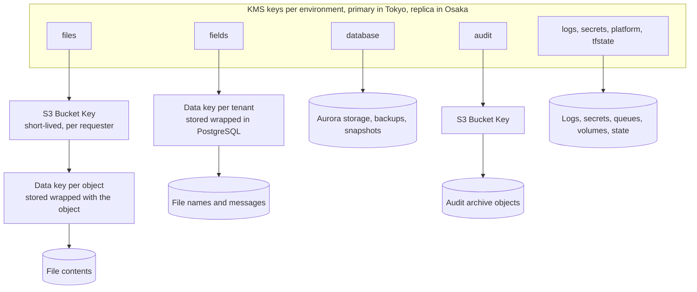

# Encryption and key management

| | |
|---|---|
| Requirements | [PRD](../prd.md), especially NFR-8, NFR-9, NFR-10, NFR-13, NFR-15, NFR-19, NFR-21 and open question 3 |
| Architecture | [architecture.md](../architecture.md), sections 2, 3, 5 and 7 |
| Related | [Data model](../design/data-model.md), [capacity and cost](../design/capacity-and-cost.md), [ADR-0003](../adr/0003-multi-tenancy-shared-schema.md); threat model ([#21](https://github.com/codewithmuh/secure-file-transfer/issues/21)), authentication and authorization ([#23](https://github.com/codewithmuh/secure-file-transfer/issues/23)), abuse and rate limits ([#24](https://github.com/codewithmuh/secure-file-transfer/issues/24)) |
| Tracking | [#22](https://github.com/codewithmuh/secure-file-transfer/issues/22), part of phase 3 ([#25](https://github.com/codewithmuh/secure-file-transfer/issues/25)) |

This page decides how data is encrypted in transit and at rest, which KMS keys exist and who may use them, how keys and
application secrets rotate, how deletion and teardown interact with keys, and PRD open question 3 (per-tenant keys).
Sign-in, sessions, row-level security and break-glass access belong to the authentication and authorization design;
the download mechanism and rate limits belong to the abuse design.

Technologies are the architecture's candidates (section 9 there). If a phase 4 ADR picks something else, this page
changes in the same pull request. Nothing here has been applied to an AWS account: until Rashid provides the AWS
profile, every control is checked statically (section 9).

Decisions on this page:

- **Eight customer managed keys per environment**, one per data class, each a multi-Region key with its primary in
  Tokyo and, in staging and prod, a replica in Osaka (section 4).
- **Open question 3:** shared keys per data class, plus per-tenant data keys for file names and messages, bound to the
  caller's `tenant_id`. Dedicated per-tenant KMS keys become an opt-in for tenants that require one (section 5).
- **S3 objects carry no custom encryption context.** With S3 Bucket Keys, KMS checks the bucket, not the object, so a
  `tenant_id` pair would not be enforced. `tenant_id` is used as encryption context where the service calls KMS
  itself (section 3.2).
- **TLS 1.2 or 1.3 on every hop that carries customer data**, including load balancer to pods and pods to the
  database (section 2).
- **Application HMAC keys live in Secrets Manager as keyrings** and rotate with an overlap. Sessions are random tokens
  stored as hashes, so there is no signing key (section 6).
- **The audit archive and its key live in a separate Terraform stack** with deletion guards. They survive teardown for
  about $2 a month (section 8).

## 1. Data classification

| Class | Meaning | Rules |
|---|---|---|
| Restricted | File contents, the reason the service exists | Only in the files buckets, on a scan worker's scratch volume while its scan runs, and in API memory while a download streams. Never in PostgreSQL, queues, caches, logs, traces or email. |
| Confidential | Personal and business data about transfers: file names, messages, email addresses, IP addresses, audit records, tenant settings | Only in the stores listed below. File names and messages are also field-encrypted (3.2). Never in object keys, queue messages, metrics or log lines. |
| Secret | Credentials: link tokens, session tokens, API keys, verification codes, HMAC keys, client secrets, the database master password | Plain text exists only in transit, in memory, or once at creation (the emailed link, the cookie, the API key response). At rest only as a hash, an HMAC, or inside Secrets Manager. |
| Internal | Operational data with no customer content: application logs, metrics, traces, queue messages, infrastructure state | Identifiers only: `tenant_id`, `request_id`, an HMAC of an email address. Application logs may also hold IP addresses. |
| Public | The web app bundle and the published OpenAPI document | TLS in transit; no encryption requirement at rest. |

| Data | Class | Where it lives | Encrypted with |
|---|---|---|---|
| File contents | Restricted | S3 files buckets (Tokyo, Osaka replica); scan worker scratch volumes, deleted after each scan; API memory while streaming | files key |
| File names, transfer and upload request messages | Confidential | PostgreSQL `files.display_name`, `transfers.message`, `upload_requests.message`; the browser after verification (FR-14) | Per-tenant data key under the fields key (3.2), inside storage encrypted with the database key |
| Email addresses of members, recipients and uploaders | Confidential, personal data | PostgreSQL, in plain text because we send mail to them and search by them (UC-4); Cognito for members; SES while sending. Logs and rate-limit counters hold only an HMAC (6.2). | database key; email HMAC keyring |
| Source IP addresses and user agents | Confidential, personal data | Audit records; CloudFront, WAF and load balancer logs; rate-limit counters (at most 1 hour) | database, audit, logs and platform keys |
| Tenant settings, users and roles | Confidential | PostgreSQL | database key |
| Link tokens, session tokens, API keys | Secret | SHA-256 hashes in PostgreSQL (data model section 1) | database key |
| Verification codes | Secret | HMAC-SHA-256 in PostgreSQL (6.2) | database key; code HMAC keyring |
| Sign-in state, PKCE verifiers, nonces | Secret | Valkey, single use, 10-minute TTL (authentication and authorization design) | platform key |
| HMAC keyrings, identity provider client secret, database master password | Secret | Secrets Manager, replicated to Osaka | secrets key |
| Audit records | Confidential, integrity-critical | PostgreSQL `audit_events` (365 days); S3 audit archive with Object Lock in both Regions | database key; audit key |
| Application logs and traces | Internal (may hold IP addresses) | Log and trace stores in Tokyo (architecture 5.5) | logs key |
| CloudFront, WAF and load balancer logs, CloudTrail, VPC flow logs | Confidential (IP addresses) | S3 log buckets and CloudWatch Logs in Tokyo (NFR-21) | logs key; load balancer access logs are the exception in 3.1 |
| Metrics | Internal | Prometheus volumes; no personal data in labels | platform key |
| Queue messages | Internal | SQS; IDs only (architecture 5.3) | platform key |
| Terraform state | Internal, sensitive | One state bucket per environment, holding no secret values (6.4) | tfstate key |
| Web app bundle | Public | S3 behind CloudFront | SSE-S3 (3.1) |

Every store above is in Tokyo or Osaka (NFR-21). Keys can replicate only to Osaka (4.4). The CloudFront certificate in
us-east-1 holds no customer data.

## 2. Encryption in transit

Every hop that carries customer data uses TLS 1.2 or 1.3. On the internet, plain HTTP only ever redirects to HTTPS.

### 2.1 Edge

| Hop | Protocol and policy | Notes |
|---|---|---|
| Browser to CloudFront (web app) | HTTPS only; HTTP redirects to HTTPS. Security policy `TLSv1.2_2025`: TLS 1.2 with ECDHE and AES-GCM only, and TLS 1.3, where CloudFront also offers hybrid post-quantum key exchange. | ACM certificate in us-east-1 (a global-service exception in NFR-21); SNI only |
| CloudFront to the web bundle bucket | Origin access control: SigV4-signed requests over HTTPS | |
| Browsers and API clients to the load balancer (API) | One HTTPS listener on port 443 with `ELBSecurityPolicy-TLS13-1-2-Res-PQ-2025-09`: TLS 1.3 with hybrid post-quantum key exchange, and TLS 1.2 limited to forward-secret AEAD ciphers. This is the policy AWS recommends. The API hostname has no HTTP listener. | ACM certificates in Tokyo and Osaka |
| Browser to S3 (pre-signed upload parts) | HTTPS to the regional S3 endpoint. The bucket policy denies requests without TLS (`aws:SecureTransport`) or below TLS 1.2 (`s3:TlsVersion`). | Part URLs are SigV4-signed and valid at most 15 minutes (architecture 4.1) |
| Every response from the web app and the API | `Strict-Transport-Security: max-age=63072000; includeSubDomains`. Cookies are `Secure` with the `__Host-` prefix (API contract). | HSTS preload once the domain is chosen (open question 5) |

Certificates are ECDSA P-256 public certificates from ACM, validated through DNS in Route 53 and renewed by ACM. A CAA
record lets only Amazon's certificate authority issue certificates for the domain.

### 2.2 Inside the VPC

| Hop | How |
|---|---|
| Load balancer to API pods | HTTPS target group. Each pod serves TLS 1.2 or later with a certificate it generates at start. The load balancer doesn't validate target certificates, so this encrypts the hop without authenticating it; security groups and network policies decide who can reach the pods. It is needed because the Nitro system's automatic encryption between instances doesn't cover traffic through a load balancer. The load balancer offers TLS 1.0 and up to targets, so the pod's TLS settings enforce the 1.2 minimum. |
| Pods to AWS APIs (S3, KMS, SQS, Secrets Manager, STS, ECR) | HTTPS through the VPC endpoints (architecture 3.1); AWS APIs require TLS 1.2. Bucket and queue policies also deny requests with `aws:SecureTransport` false. |
| Pods to SES | HTTPS through the NAT gateways |
| SES to recipients' mail servers | A configuration set with TLS policy `Require`: a message is delivered only over TLS. A mail server without TLS gets no email (section 9). |
| Pods to Aurora PostgreSQL | `rds.force_ssl = 1` and `ssl_min_protocol_version = TLSv1.2` in the cluster parameter group. Clients connect with `sslmode=verify-full` and the RDS certificate bundle. IAM database authentication (6.3) also refuses connections without TLS. |
| Pods to Valkey (rate-limit counters, sign-in state) | ElastiCache Serverless always uses TLS; clients verify the server certificate. |
| Pod to pod (metrics scrapes, traces) | Plain HTTP inside the cluster. Between m8g nodes in one VPC the Nitro hardware encrypts it, and AWS encrypts all traffic between Availability Zones. No file contents, names, messages or secrets travel pod to pod, and network policies limit the paths. A service mesh would add mutual TLS; it is a moving part this design doesn't need yet. |
| Scan worker to scan engine | Same pod, over a local socket |

Downloads stream from S3 through the API (abuse and download design, #24): S3 decrypts the object, the bytes reach
the pod over TLS through the S3 endpoint, and leave over TLS through the load balancer. The API never writes them to
disk; its filesystem is read-only (architecture section 8).

### 2.3 Tokyo to Osaka

AWS encrypts all traffic between Regions on its network at the physical layer. On top of that:

| Flow | Protection |
|---|---|
| S3 replication: files, audit archive, Terraform state | S3 decrypts with the Tokyo key and re-encrypts with the Osaka key named in the replication rule. S3 treats multi-Region keys as single-Region keys here. |
| Aurora global database | Storage-level replication; the Osaka cluster is encrypted with the Osaka copy of the database key |
| Secrets Manager replicas | Replicated by the service; each replica is encrypted with the Osaka secrets key |
| Security-critical audit records written by the API straight to Osaka (architecture 4.2, 4.4) | HTTPS to the Osaka S3 endpoint through NAT |
| ECR replication | Replicated by the service; replicas are encrypted with the Osaka platform key |

## 3. Encryption at rest

### 3.1 Per store

| Store | Encryption | Key | Notes |
|---|---|---|---|
| S3 files, Tokyo and Osaka | SSE-KMS with S3 Bucket Keys, as the bucket default | files | The bucket policy denies any upload that names another KMS key, and any SSE-C request, so no object can be stored under a key we don't control. Versioning is on, because replication needs it. No Object Lock, because NFR-8 must be able to delete. Never in an AWS Backup plan. |
| S3 audit archive, Tokyo and Osaka | SSE-KMS with S3 Bucket Keys | audit | Object Lock in compliance mode with 365-day retention in prod. Governance mode with 1-day retention in dev and staging, so they can be torn down (NFR-15). Object Lock protects the objects, not their key, so the key has its own guards (8.4). |
| S3 log buckets: CloudTrail, CloudFront, WAF, VPC flow logs, log and trace stores | SSE-KMS with S3 Bucket Keys | logs | The log delivery services write through key policy statements limited by `aws:SourceAccount` and `aws:SourceArn`. |
| S3 load balancer access logs | SSE-S3 | — | **Exception to NFR-13:** load balancer access logs support only SSE-S3. They hold IP addresses, paths with opaque IDs and user agents. Link tokens never reach them, because they travel in the URL fragment (architecture 4.2). Only the log reader role can read the bucket. |
| S3 server access logs | Not used | — | They also need SSE-S3. CloudTrail S3 data events on the files and audit buckets are the "storage access logs" for NFR-15's daily match instead, and they are encrypted with the logs key. |
| S3 web app bundle | SSE-S3 | — | Public content. A KMS key would add a CloudFront key policy to the failover path without protecting anything secret. |
| S3 Terraform state, Tokyo and Osaka | SSE-KMS with S3 Bucket Keys; versioning | tfstate | Created by the bootstrap stack with its own key, because the environment's keys are created by the state this bucket holds. |
| Aurora PostgreSQL: Tokyo cluster, Osaka secondary, automated backups (14-day point-in-time recovery), snapshots, Performance Insights | Aurora storage encryption, set at creation | database | Each Region's cluster uses that Region's copy of the key. An unencrypted cluster can't be encrypted in place, so CI rejects a plan that would create one (section 9). |
| File names and messages inside PostgreSQL | AES-256-GCM with per-tenant data keys | fields | Section 3.2 |
| Aurora PostgreSQL logs | CloudWatch Logs | logs | `log_parameter_max_length = 0` and `log_parameter_max_length_on_error = 0`, so slow-query and error logs never print bound values such as email addresses. |
| SQS work queues and dead-letter queues | SSE-KMS, data key reused for 5 minutes | platform | Messages hold IDs only. |
| ElastiCache Serverless (Valkey) | Encryption at rest, always on | platform | Rate-limit counters and sign-in state |
| EBS: node root volumes, observability volumes | EBS encryption by default, set for the account in each Region | platform | |
| EBS: scan worker volumes | Encrypted | files | The scratch disk holds file contents during a scan, so the scan workers run in their own node pool whose volumes use the files key. The worker deletes each scratch file when its scan ends. The separate pool also keeps hostile files off the API's nodes. |
| ECR images | KMS | platform | Replicas in Osaka use the Osaka platform key through a repository creation template. |
| CloudWatch Logs: EKS control plane, Aurora | KMS | logs | |
| Secrets Manager, Tokyo and Osaka replicas | KMS | secrets | Section 6 |
| Kubernetes Secrets (etcd) | EKS envelope encryption | secrets | Only platform components use Kubernetes Secrets; the application reads Secrets Manager directly (6.4). |
| SNS alarm topics | SSE-KMS | platform | |
| Cognito user pool | Encrypted at rest by Cognito | — | Member email addresses and MFA settings; no key is configured here. The authentication and authorization design covers what Cognito holds. |

Instance memory: m8g nodes (Graviton4) encrypt memory with keys that never leave the host. That protects against
physical access to the hardware, not against a compromised process (section 9).

### 3.2 Field encryption for file names and messages

File names and messages are the metadata most likely to give away what a transfer contains ("Q3 layoffs.xlsx").
Storage encryption protects them on disk, but not from anyone who can run a query: a scoping bug, SQL injection, a
leaked database credential, or a break-glass session. Field encryption keeps them unreadable to all of those.

1. **One data key per tenant.** Each tenant has a 256-bit data key, generated by KMS `GenerateDataKey` on the fields
   key with encryption context `{"purpose": "field-dek", "tenant_id": "<tenant>"}`. Only the wrapped key is stored, in
   a new table `tenant_data_keys (tenant_id, version, wrapped_key, created_at, retired_at)`.
2. **Authenticated encryption.** Each value is encrypted with AES-256-GCM, a random 96-bit nonce, and additional
   authenticated data made of `tenant_id`, table, column, row ID and key version. The stored value carries a format
   version, the key version, the nonce and the ciphertext with its tag.
3. **Decrypt with the caller's tenant.** The service layer unwraps the data key of the tenant in the **caller's scope**
   (member, API key or link session; ADR-0002), never the tenant written on the row. A row from another tenant fails
   authentication instead of decrypting. The service returns an error, counts `field_decrypt_scope_mismatch`, and pages
   as a possible isolation breach. This is the third isolation layer, after scoped data access and row-level security.
4. **Cache.** Unwrapped data keys stay in process memory for at most 15 minutes, never on disk or in logs. At design
   load that is at most about 6 million KMS requests a month (4 API pods × 500 tenants × 4 refreshes an hour), about
   $18.
5. **Only the API can unwrap.** Emails never contain file names or messages: FR-14 already keeps them out of
   recipient emails, and member notices say how many files and link to the web app. So the notification worker never
   needs this key.
6. **Failover.** The wrapped keys reach Osaka through Aurora replication, and the Osaka API unwraps them with the Osaka
   replica of the fields key, without calling Tokyo. This is the one place where the multi-Region property is required
   (4.2).

The cost: names and messages can't be searched or sorted in SQL. The web app sorts the at most 50 files of a transfer
itself, and audit search doesn't use them (UC-4). The module uses a standard AEAD implementation, never its own
cryptography, and a write is read back and checked before it commits.

## 4. Key hierarchy and multi-Region keys

### 4.1 The keys

Each environment has eight customer managed symmetric encryption keys with key material generated by KMS
(`AWS_KMS` origin). In staging and prod each one is a multi-Region key with its primary in Tokyo and one replica in
Osaka. dev runs in Tokyo only, so its keys are multi-Region keys without a replica. Aliases are per Region, so
Terraform creates the same alias in both.

| Key | Alias in prod | Protects | Created by |
|---|---|---|---|
| files | `alias/sft/prod/files` | S3 files buckets; scan worker volumes | Environment stack |
| fields | `alias/sft/prod/fields` | Per-tenant data keys for file names and messages | Environment stack |
| database | `alias/sft/prod/database` | Aurora clusters, backups, snapshots, Performance Insights | Environment stack |
| audit | `alias/sft/prod/audit` | Audit archive buckets | Retained stack (8.4) |
| logs | `alias/sft/prod/logs` | Log buckets, CloudWatch Logs, log and trace stores | Environment stack |
| secrets | `alias/sft/prod/secrets` | Secrets Manager, Kubernetes Secrets | Environment stack |
| platform | `alias/sft/prod/platform` | SQS, Valkey, EBS, ECR, SNS | Environment stack |
| tfstate | `alias/sft/prod/tfstate` | Terraform state bucket | Bootstrap stack |

That is 16 key resources in prod and in staging (each primary and each replica is billed as a key) and 8 in dev.



### 4.2 Why multi-Region keys

S3 replication, Aurora global databases and Secrets Manager replicas each re-encrypt with the destination Region's key,
and S3 treats a multi-Region key as a single-Region key. For those stores the multi-Region property adds nothing
functional. It earns its place for three reasons:

- **Field encryption needs it.** Wrapped data keys made in Tokyo arrive in Osaka through Aurora replication and must be
  unwrapped there while Tokyo may be unreachable. Only a multi-Region key can do that without wrapping every data key
  twice.
- **It slows down deleting the audit key.** A primary can only be deleted after its replicas are deleted, and its own
  waiting period starts then. With the 30-day minimum we require (4.4), destroying the audit key takes at least
  60 days. A replica deleted by mistake can be re-created from the primary.
- **It keeps one model.** The same key ID in both Regions, one rotation schedule that KMS keeps in sync, and one policy
  template. A key can't be made multi-Region after it is created, so this keeps application-level encryption possible
  for every class later.

It costs the same as two single-Region keys ($1 a month for each primary and each replica). The trade-off is that the
same key material exists in both Regions, so either Region's policy can decrypt the other's ciphertext. Both policies
come from one Terraform module and pass the same checks (section 9), and replication is allowed only to Osaka.

### 4.3 Who may use each key

E = encrypt (`GenerateDataKey`, `Encrypt`). D = decrypt. A = administer: describe, put policy, enable rotation, tag,
replicate, never encrypt or decrypt. G = create grants for AWS resources only (`kms:GrantIsForAWSResource`).

| Principal | files | fields | database | audit | logs | secrets | platform | tfstate |
|---|---|---|---|---|---|---|---|---|
| API service | E D | E D | — | E, both Regions | — | D, own secrets | — | — |
| Scan worker | D | — | — | — | — | — | D, queue | — |
| Notification worker | — | — | — | — | — | D, own secrets | D, queue | — |
| Outbox relay | — | — | — | — | — | — | E D, queue | — |
| Lifecycle jobs | — | — | — | — | — | — | — | — |
| Archive job | — | — | — | E, Tokyo | — | — | — | — |
| Recovery job (failover and restore runbooks) | — | — | — | D | — | — | — | — |
| Key rotation job | — | — | — | — | — | E D, keyrings only | — | — |
| Migrations job | — | — | — | — | — | — | — | — |
| S3 replication role | D Tokyo, E D Osaka | — | — | D Tokyo, E D Osaka | — | — | — | D Tokyo, E D Osaka |
| Log and trace stores | — | — | — | — | E D | — | — | — |
| AWS services on our behalf | EBS, for scan volumes | — | RDS | — | CloudWatch Logs, CloudTrail, log delivery | Secrets Manager, EKS | EBS, ElastiCache, ECR, SNS | — |
| Terraform deploy role | A | A | A G | A | A | A | A G | A, E D |
| Audit reader (investigations, time-limited) | — | — | — | D | D | — | — | — |
| BreakGlass permission set | A, D | A | A | A, D | A, D | A, D | A | A |
| Operators in normal operation | — | — | — | — | — | — | — | — |

- **Deletion needs no key.** Deleting object versions and aborting multipart uploads need no KMS permission, so the
  lifecycle jobs, which do the deleting (architecture 3.1), can't read what they delete.
- **Narrow conditions.** Each workload statement is limited by `kms:ViaService` (S3, SQS or Secrets Manager in the
  right Region) and by encryption context: the bucket ARN for S3 (`kms:EncryptionContext:aws:s3:arn`; with Bucket Keys
  it is the bucket, not the object), `SecretARN` for Secrets Manager, `aws:sqs:arn` for queues, and for the fields key
  `purpose = field-dek` with `tenant_id` present.
- **Role names** follow the authentication and authorization design: IAM roles `sft-{env}-api`, `sft-{env}-scan`,
  `sft-{env}-notify`, `sft-{env}-relay`, `sft-{env}-jobs`, `sft-{env}-archive` and `sft-{env}-migrate` match the
  PostgreSQL login roles `sft_api` to `sft_migrate`. This page adds `sft-{env}-recovery`, `sft-{env}-key-rotation`
  and `sft-{env}-s3-replication`.
- **The recovery job** runs only from the failover and restore runbooks: in Osaka to re-apply security-critical
  changes from the archive (architecture section 7), in Tokyo after a point-in-time restore.

### 4.4 Key policy sketches

Every key policy follows these rules:

1. **Named principals only.** The policy does not give `kms:*` to the account root, so an IAM administrator can't give
   themselves Decrypt with an identity policy. Two principals can administer each key, so it can't become unmanageable:
   the Terraform deploy role and the BreakGlass permission set.
2. **Separation of duties.** Administrators can't use the key, and users can't administer it.
3. **No grants to people.** `CreateGrant` is allowed only when an AWS service asks for its own resource.
4. **Osaka only.** `ReplicateKey` is allowed only with `kms:ReplicaRegion` set to `ap-northeast-3`.
5. **Deletion is deliberate.** In prod, `ScheduleKeyDeletion` and `DisableKey` are denied to everyone except
   BreakGlass, and any deletion must use the longest waiting period, 30 days. In dev and staging the deploy role may
   delete keys with a 7-day wait, so teardown works.
6. **Changes are watched.** `PutKeyPolicy`, `CreateGrant`, `DisableKey`, `ScheduleKeyDeletion` or `CancelKeyDeletion`
   by any principal other than the deploy role raises an alert.

The files key in Tokyo, as a sketch (the Osaka replica has its own policy with Osaka values):

```json
{
  "Version": "2012-10-17",
  "Statement": [
    {
      "Sid": "Administer",
      "Effect": "Allow",
      "Principal": {"AWS": ["arn:aws:iam::<prod>:role/sft-prod-terraform-deploy", "<BreakGlass role ARN>"]},
      "Action": [
        "kms:DescribeKey", "kms:GetKeyPolicy", "kms:GetKeyRotationStatus", "kms:ListResourceTags",
        "kms:PutKeyPolicy", "kms:UpdateKeyDescription", "kms:EnableKeyRotation", "kms:TagResource",
        "kms:UntagResource", "kms:CreateAlias", "kms:UpdateAlias", "kms:DeleteAlias", "kms:ReplicateKey",
        "kms:EnableKey", "kms:DisableKey", "kms:ScheduleKeyDeletion", "kms:CancelKeyDeletion"
      ],
      "Resource": "*",
      "Condition": {"StringEqualsIfExists": {"kms:ReplicaRegion": "ap-northeast-3"}}
    },
    {
      "Sid": "ApiReadsAndWritesFilesThroughS3",
      "Effect": "Allow",
      "Principal": {"AWS": "arn:aws:iam::<prod>:role/sft-prod-api"},
      "Action": ["kms:GenerateDataKey", "kms:Decrypt"],
      "Resource": "*",
      "Condition": {
        "StringEquals": {
          "kms:ViaService": "s3.ap-northeast-1.amazonaws.com",
          "kms:EncryptionContext:aws:s3:arn": "arn:aws:s3:::<files bucket, Tokyo>"
        }
      }
    },
    {
      "Sid": "ScanWorkerAndReplicationReadThroughS3",
      "Effect": "Allow",
      "Principal": {"AWS": ["arn:aws:iam::<prod>:role/sft-prod-scan", "arn:aws:iam::<prod>:role/sft-prod-s3-replication"]},
      "Action": "kms:Decrypt",
      "Resource": "*",
      "Condition": {
        "StringEquals": {
          "kms:ViaService": "s3.ap-northeast-1.amazonaws.com",
          "kms:EncryptionContext:aws:s3:arn": "arn:aws:s3:::<files bucket, Tokyo>"
        }
      }
    },
    {
      "Sid": "BreakGlassReadsThroughS3",
      "Effect": "Allow",
      "Principal": {"AWS": "<BreakGlass role ARN>"},
      "Action": "kms:Decrypt",
      "Resource": "*",
      "Condition": {"StringEquals": {"kms:ViaService": "s3.ap-northeast-1.amazonaws.com"}}
    },
    {
      "Sid": "ScanVolumeGrantsForEbsOnly",
      "Effect": "Allow",
      "Principal": {"AWS": "<node provisioner role ARN>"},
      "Action": "kms:CreateGrant",
      "Resource": "*",
      "Condition": {
        "Bool": {"kms:GrantIsForAWSResource": "true"},
        "StringEquals": {"kms:ViaService": "ec2.ap-northeast-1.amazonaws.com"}
      }
    },
    {
      "Sid": "DenyDisableOrDeleteExceptBreakGlass",
      "Effect": "Deny",
      "Principal": {"AWS": "*"},
      "Action": ["kms:DisableKey", "kms:ScheduleKeyDeletion"],
      "Resource": "*",
      "Condition": {"ArnNotEquals": {"aws:PrincipalArn": "<BreakGlass role ARN>"}}
    },
    {
      "Sid": "RequireThirtyDayWait",
      "Effect": "Deny",
      "Principal": {"AWS": "*"},
      "Action": "kms:ScheduleKeyDeletion",
      "Resource": "*",
      "Condition": {"NumericLessThan": {"kms:ScheduleKeyDeletionPendingWindowInDays": "30"}}
    }
  ]
}
```

How the other keys differ:

| Key | Differences from the files key |
|---|---|
| fields | One user, the API, calling KMS directly (no `kms:ViaService`). The condition requires `kms:EncryptionContext:purpose` = `field-dek` and a `tenant_id` key in the context (`kms:EncryptionContextKeys`). BreakGlass gets no Decrypt here: names and messages are not needed to repair the platform. |
| database | No workload principals. RDS uses the key through grants that the deploy role creates for the cluster (`kms:ViaService` = RDS, `kms:GrantIsForAWSResource`). |
| audit | Writers (archive job, API) get `kms:GenerateDataKey` only; readers (recovery job, audit reader, BreakGlass) get `kms:Decrypt`. All through S3, limited to the archive bucket ARN. The key and its policy live in the retained stack (8.4). |
| logs | Service principals (`logs.<region>.amazonaws.com`, `cloudtrail.amazonaws.com`, `delivery.logs.amazonaws.com`), each limited by `aws:SourceAccount` and its own encryption context (`aws:logs:arn`, `aws:cloudtrail:arn`), plus the log and trace store roles through S3. |
| secrets | Each workload may Decrypt only through Secrets Manager and only for its own secrets (`kms:EncryptionContext:SecretARN`). The key rotation job may also encrypt, for the keyring secrets only. |
| platform | The relay and workers through SQS (`aws:sqs:arn`); EBS, ElastiCache and ECR through grants. |
| tfstate | The deploy role encrypts and decrypts through S3 for the state bucket only; the replication role as for the files key. |

## 5. Open question 3: per-tenant keys

The question: one KMS key per tenant, or shared keys with per-tenant encryption context?

What per-tenant keys would and wouldn't buy:

- **They don't separate tenants from the service.** The API has to serve every tenant, so its role must be able to use
  every tenant's key. A compromised API role reads every tenant under either design. Protection against the service's
  own bugs comes from scoped data access, row-level security and the tenant-bound field encryption in 3.2.
- **They do give** per-tenant key policies, KMS usage per tenant in CloudTrail, a way to freeze one tenant at once by
  disabling its key, tenant crypto-shredding (8.2), and the basis for keys held by the customer.

Aurora storage stays under one shared key in every option, because a cluster has a single key.

| Option | Security benefit | Operational cost | KMS requests at design load | Key cost in prod | Quota and limit impact |
|---|---|---|---|---|---|
| 1. Shared key per data class (the floor) | Encryption at rest, a key policy per workload, CloudTrail per key. No cryptographic separation between tenants. | Lowest: eight keys per environment, all in Terraform. | About 3 M a month with Bucket Keys (capacity A21), about $9 | 16 keys: $16 a month, up to $48 after two yearly rotations | None |
| **2. Option 1 plus per-tenant data keys for file names and messages** (recommended) | Adds per-tenant binding for the most sensitive metadata. A scoping bug, SQL injection or a database-only reader can't read another tenant's names and messages. File contents stay under the shared key. | One small crypto module, one table, a key cache and tests (3.2). | Option 1 plus at most about 6 M a month for unwrapping, about $18 more | Same as option 1 | Negligible: well below the 20,000 requests a second shared quota in Tokyo and 10,000 in Osaka |
| 3. A KMS key per tenant for files and fields, every tenant | The benefits in the list above, for every tenant. | A key per tenant in both Regions at provisioning, so either the operator API gets `CreateKey`, `PutKeyPolicy` and `ReplicateKey` (a privileged path inside a running service), or provisioning a tenant becomes a Terraform change. S3 replication needs one rule per tenant, because the replica key is set per rule. The bucket default can name only one key, so every upload must name its tenant's key, and a bucket policy can't check the match for 500 tenants. | More, because each tenant key needs its own Bucket Keys, but never more than the rate without Bucket Keys: at most about 12 M a month, about $35 | 500 tenants × 2 Regions = 1,000 keys: about $1,000 a month, $2,000 after the first rotation, $3,000 after the second. Prod idle costs $2,926 a month (capacity section 1). | 1,000 of the 100,000 keys allowed per Region. A replication configuration holds at most 1,000 rules, which caps a bucket pair at about 1,000 tenants. |
| 4. Dedicated key per tenant, opt-in (later): a key we hold, or one in the tenant's own AWS account | Option 3 for the tenants that ask. A key held by the customer lets them cut off the service's access to their data. | Option 3's mechanics for a few tenants: a Terraform change and one replication rule per tenant. | Small | $2 a month per tenant, up to $6 after two rotations | Negligible |

**Recommendation: option 2 for v1, with option 4 as the path for tenants that need a dedicated key.**

- Option 2 closes the gap that matters for a shared-schema design (ADR-0003): metadata leaking across tenants through
  a bug, at about $18 a month and no new moving part.
- Option 3 costs $1,000 to $3,000 a month, adds either a privileged runtime path or a Terraform change per tenant, and
  hits the replication rule limit, without stronger isolation from the service's own roles. Large SaaS teams usually
  sell dedicated keys to the tenants that require them rather than give one to every small tenant.
- **Moving to option 4 needs no data migration.** Object keys already start with `tenants/{tenant_id}/` (data model
  4.2). For a tenant that moves to a dedicated key: Terraform creates the key pair and a replication rule for that
  prefix with the tenant's Osaka key; the API names the tenant's key on every new upload; the tenant's field data keys
  are re-wrapped with `ReEncrypt`. Existing objects stay under the shared key until the data lifecycle deletes them,
  at most 97 days later (90 days of retention plus 7 days for deletion). No copy job is needed.
- **Revisit when:** a tenant contract requires a dedicated or customer-held key; tenant offboarding needs
  cryptographic proof of deletion; or the tenant mix changes, as in ADR-0003's revisit triggers.

A phase 4 ADR records this decision.

## 6. Application-level secrets

### 6.1 Inventory

| Secret | Contents | Used by | Rotation |
|---|---|---|---|
| `sft/{env}/app/code-hmac` | Keyring of 256-bit HMAC-SHA-256 keys for verification codes | Notification worker (computes the HMAC when it creates a code), API (verifies) | Every 90 days; the old key verifies for 24 hours |
| `sft/{env}/app/email-hmac` | Keyring for pseudonymous email IDs in logs and rate-limit keys | API, notification worker | Every year; old keys kept 90 days for log searches |
| `sft/{env}/app/idp-client` | Cognito app client ID and secret for the authorization-code flow | API | Every year; Cognito allows two active client secrets, so the switch has no gap |
| `sft/{env}/db/master` | Aurora master user password | The one-off bootstrap that creates the login roles, then BreakGlass only | After every use and every 90 days |
| Platform component secrets, for example the Grafana admin password | Per component | Platform components, through Kubernetes Secrets | Per component |

All live in Secrets Manager in Tokyo, encrypted with the secrets key, and are replicated to Osaka, where each replica is
encrypted with the Osaka secrets key.

What is deliberately not a secret here:

- **Workload database passwords.** Workloads use IAM database authentication (6.3); no static password exists.
- **A session signing key.** Member and link session cookies are 256-bit random tokens stored as SHA-256 hashes. CSRF
  tokens are stored synchronizer tokens, and sign-in state lives server-side in Valkey (authentication and
  authorization design). Nothing is signed, so there is no signing key to rotate, and revoking a session is a row
  update.
- **A pepper for link tokens and API keys.** They carry 256 bits of randomness and are stored as SHA-256 (data model
  section 1). A pepper adds nothing at that entropy, and rotating it would invalidate every key.
- **Download signing keys.** Downloads stream through the API, so there are no CloudFront key groups.
- **Long-lived AWS credentials.** Pods get role credentials from EKS workload identity; GitHub Actions uses OIDC. The
  notification worker calls the SES API with its role, so there are no SMTP credentials.

### 6.2 How the HMAC keys are used

- **Verification codes:** `code_hmac = HMAC-SHA-256(key, "code/v1/" + code_id + "/" + code)`. Including the row ID
  means an HMAC can only match its own row, and the prefix keeps each key to one purpose. The row records which key was
  used. A copy of the database alone can't be used to brute-force codes (data model section 1).
- **Email pseudonyms:** `"e" + key_id + ":" + base64url(HMAC-SHA-256(key, "email/v1/" + email_normalized))`, truncated
  to 128 bits. This is pseudonymization, not anonymization: anyone holding the key can test guesses, so it is treated as
  a secret like any other.
- **API keys** start with a fixed, environment-specific prefix such as `sft_prod_`, so a gitleaks rule and a GitHub
  secret scanning custom pattern can find leaked keys.

### 6.3 Database credentials

- Each workload connects as its own PostgreSQL login role (`sft_api`, `sft_scan`, `sft_notify`, `sft_relay`,
  `sft_jobs`, `sft_archive`, `sft_migrate`) with IAM database authentication. The pod's role signs a 15-minute
  connection token locally; IAM authentication requires TLS.
- Aurora can manage the master password in Secrets Manager, but not for clusters in a global database. So Terraform
  creates the master password in a way that keeps it out of state (a write-only argument, or a one-off step outside
  Terraform). It is stored in `sft/{env}/db/master`, used only under BreakGlass, and rotated after every use and every
  90 days by runbook.

### 6.4 How workloads read secrets

- The application reads its secrets from Secrets Manager through the VPC endpoint at start and every 5 minutes, and
  keeps them only in memory. Not through environment variables or Kubernetes Secrets: that keeps them out of etcd and
  lets the application hold several keyring versions at once.
- Each role can read only its own secrets: `secretsmanager:GetSecretValue` on named ARNs, and Decrypt limited by
  `kms:EncryptionContext:SecretARN`.
- In Osaka the same names resolve to the replicas. Replicas are read-only, and the key rotation job runs only in Tokyo.
  If a failover outlasts a rotation overlap, the runbook promotes the replicas to standalone secrets (phase 6).
- Terraform creates the secrets but never their values, so state holds no secret values. The key rotation job writes
  the first version of each keyring.

### 6.5 Rotation with overlap

Each HMAC secret holds a keyring: a JSON list of keys, each with an ID, a state, a creation time and the key. The key
rotation job is a scheduled job built from the same image, with its own role that may only write the keyring secrets.

1. **Stage:** add a new key in state `staged`. Pods load it but don't use it.
2. **Activate:** after 15 minutes (three refresh intervals), mark it `active`. The old key becomes `verify`, with a
   time to retire.
3. **Retire:** remove the old key after the overlap.

Because a key is loaded everywhere before anyone uses it, no pod produces a value another pod can't check. A pod that
meets an unknown key ID refreshes once, then fails closed.

| Secret | Period | Overlap | Why |
|---|---|---|---|
| code-hmac | 90 days | 24 hours | Codes live at most 10 minutes (NFR-14); the margin covers a stuck rotation. |
| email-hmac | 1 year | 90 days for log searches; 1 hour for rate limits | Logs are kept 90 days. For one hour after the switch, per-address limits also count the old pseudonym, so a rotation never resets the 5-codes-an-hour limit. |
| idp-client | 1 year | Minutes | Add the second client secret, roll the API, remove the old secret. |

On suspected exposure the job rotates at once with no overlap. For code-hmac, open codes stop working and recipients
request a new one. For email-hmac, pseudonyms in older logs stay linkable by whoever has the old key; that is accepted.

Rotation runs as a scheduled job rather than a Secrets Manager rotation function, so the design doesn't add a second
compute platform. An alarm fires if a keyring's active key is older than its period plus 7 days (section 9).

## 7. Rotation policy

### 7.1 KMS keys

| Aspect | Policy |
|---|---|
| Schedule | Automatic rotation on every key, every 365 days. For multi-Region keys it is set on the primary; KMS copies the new material to the replica before using it. |
| What rotation does | New encryptions use new key material. Old material stays, so older ciphertext still decrypts. The key ID, ARN, aliases and policy don't change, and nothing stops working. |
| What it doesn't do | It re-encrypts nothing: S3 objects, Aurora storage, Secrets Manager versions and wrapped field data keys stay under the material they were made with. It doesn't rotate data keys, and it doesn't help if a role or a data key is compromised: for those, fix the policy and replace the affected data. |
| Cost | The first and second rotation each add $1 a month per key, then it is capped. Prod: $16 a month, $32 after a year, $48 after two. |
| Rehearsal | One on-demand rotation of each key in staging, then check that old data still reads. |

KMS key material never leaves KMS, so "the key leaked" means "a policy let the wrong principal use it". The response
is to fix the policy and review CloudTrail. Replacing a key with a new one is rare: moving a tenant to a dedicated key,
or a key policy we no longer trust. What replacing means per store:

| Data | Moving to a new key |
|---|---|
| S3 files | New uploads use the new key; old objects are deleted by the lifecycle within 97 days. No copy job. |
| S3 audit archive | New objects use the new key; old objects keep the old key until their retention ends. Object Lock prevents rewriting them anyway. |
| Aurora | Snapshot, restore to a new cluster with the new key, switch over in a maintenance window. |
| Field data keys | `ReEncrypt` each wrapped key: a few hundred calls. |
| Secrets | Change the secret's key and write a new version. |
| Queues, volumes, caches, logs | Recreate, or let the data age out. |

### 7.2 Application secrets and data keys

| Item | Rotation | Notes |
|---|---|---|
| Per-tenant field data keys | A new version per tenant every year; new writes use it. Older versions decrypt until the purge job has removed every row that uses them. | On suspected exposure: a new version and a job that re-encrypts that tenant's rows. |
| HMAC keyrings, identity provider client secret | Section 6.5 | |
| Database master password | After every use and every 90 days | Runbook |
| Workload database tokens | Every 15 minutes, automatically | IAM database authentication |
| Tenant API keys | The tenant rotates them: create a new key, switch, revoke the old one. Proposed maximum expiry: 1 year. | Only hashes are stored, so nothing rotates server-side. |
| Link tokens, sessions, codes | Not rotated; they expire (codes at most 10 minutes, sessions at most 24 hours) | |
| TLS certificates | ACM renews public certificates; pods generate their backend certificate at each start. | Expiry checked (section 9) |
| RDS certificate authority | The cluster's CA and the clients' bundle are updated before the CA expires. | Tracked in the operations runbooks (phase 6) |

## 8. Deletion and crypto-shredding

### 8.1 Deleting a file (NFR-8)

- **The data key goes with the object.** S3 stores each object version's data key, wrapped, with the version. Deleting
  every version in both Regions removes the data and the only copies of its data keys. The KMS keys stay; nothing is
  shredded by key.
- **Versions and replicas.** The deletion job deletes every version in Tokyo and in Osaka, because replication doesn't
  copy deletions of specific versions (architecture 4.5). Lifecycle rules expire noncurrent versions after 7 days as a
  backstop.
- **A late replica.** A replica that lands in Osaka after the job has deleted there becomes an orphan. The daily
  reconciliation compares both Regions and deletes orphans older than 24 hours, so it is gone within 2 days.
- **No other copies.** The files buckets are in no AWS Backup plan and have no Object Lock. Scan scratch files are
  deleted after each scan, and their volumes disappear with the nodes. The API never writes file bytes to disk.
- **Names and messages.** Their rows leave the live database on the data lifecycle schedule. The encrypted copies in
  database backups age out within the 14-day restore window, which the PRD's data lifecycle table allows.

### 8.2 Would per-tenant keys allow crypto-shredding a tenant?

Yes, in principle: deleting a tenant's KMS key makes every copy of its files unreadable, in Tokyo, in Osaka and in any
leftover version, and with it the tenant's field data keys, so also its names and messages in database backups.

The limits:

- A key can't be deleted in less than 7 days (KMS may take up to 24 hours more). For a multi-Region key the replica
  must be deleted before the primary's waiting period starts, so at least 14 days. Crypto-shredding can't be NFR-8's
  mechanism; it would be a backstop.
- Services keep working data keys for a while after a key is disabled (S3 Bucket Keys, attached volumes), until they
  next call KMS.
- The PRD doesn't require tenant offboarding in v1.

With the chosen design, offboarding a tenant means running the deletion job over `tenants/{tenant_id}/` in both
Regions and deleting the tenant's rows and field data keys. Names and messages become unreadable in the live database
at once, and backups age out within 14 days.

### 8.3 KMS key deletion

- KMS requires a waiting period of 7 to 30 days before it deletes a key; the default is 30. During the wait the key
  can't be used, isn't billed, and the deletion can be cancelled. An alarm fires on any attempt to use a key that is
  pending deletion.
- Prod keys require the 30-day wait (4.4). dev and staging allow 7 days, so they can be torn down.
- Tearing down prod schedules deletion of every prod key except the audit key, under BreakGlass, with the 30-day wait.
  That costs nothing and leaves 30 days to cancel.

### 8.4 What survives teardown, and how it is protected

NFR-19 keeps the prod audit archive (both Regions) and the key that encrypts it (primary and replica) until the
archive's retention ends, in an AWS account that stays open. They live in a separate **retained stack**: its own
Terraform root module and state, which no environment `destroy` touches.

| Guard | What it stops |
|---|---|
| Separate root module and state; the environment stack only refers to the archive by ARN; `prevent_destroy` on the buckets and key | An environment `terraform destroy` reaching the archive |
| CI fails a plan that deletes or replaces any resource tagged `retention = audit-archive` | A refactor that moves them by accident |
| Object Lock in compliance mode, 365 days | Deleting or overwriting records, even by the root user; a bucket that still holds objects can't be deleted either |
| Key policy: `DisableKey` and `ScheduleKeyDeletion` only for BreakGlass, with the 30-day wait; `PutKeyPolicy` only for the deploy role and BreakGlass | Disabling or deleting the key, which would make the locked objects unreadable |
| Multi-Region key: replica first, then primary | Destroying the key takes at least 60 days; a deleted replica can be re-created from the primary |
| If the accounts ADR (open question 4) chooses AWS Organizations: the archive in its own account, plus an SCP that denies key deletion and changes to the bucket policy, lifecycle rules and Object Lock settings | Even BreakGlass in the workload account |
| EventBridge alerts on those calls against the retained resources, and AWS Config `kms-cmk-not-scheduled-for-deletion` | A change nobody notices |

After teardown:

- **Rotation of the audit key is turned off.** No new records are written, so rotating would add cost without
  protecting anything new.
- **Cost.** Two key resources cost $2 a month, or $4 if the key already rotated once (only if prod ran longer than a
  year). Storage at the idle operating scenario is under 1 GB per Region, a few cents. After months at full design load
  it could reach 37 GB per Region (capacity section 3.4), about $1.85 for both. The planned case is about $2.10 a
  month, inside NFR-19's $5; only a year of design load plus a rotated key would exceed it.
- **Reading the archive** needs the audit reader role, through IAM Identity Center with MFA.
- **When retention ends,** a lifecycle rule deletes each object as its retention expires. Then the key is scheduled for
  deletion with the 30-day wait, and the retained stack is destroyed.

dev and staging keep their archive in the environment stack with a 1-day governance-mode lock and 7-day key deletion,
so they tear down completely.

## 9. Residual risks and checks

### 9.1 Residual risks

| Risk | Why it remains | Mitigation or acceptance |
|---|---|---|
| The API role can read every tenant's files | The service serves every tenant; per-tenant keys wouldn't change this (section 5) | Short-lived workload credentials; CloudTrail S3 data events; an alarm on unusual read volume per role; NFR-15's daily match flags any read without an audit record |
| Key administrators can rewrite key policies | Whoever may call `PutKeyPolicy` can grant themselves use | Only the deploy role (reviewed Terraform from `main`, prod behind an environment approval) and BreakGlass (two-person approval, time-limited); an alert on any other `PutKeyPolicy`; CI checks every key policy |
| AWS runs the HSMs, and S3 decrypts on our behalf | No external key store; end-to-end encryption is a non-goal (PRD section 8) | Accepted |
| Plain text in memory: file bytes while streaming and scanning, data keys, HMAC keys | Processing needs plain text | Graviton memory encryption against physical access; non-root, read-only filesystem, minimal image; scan workers on their own nodes; data keys cached at most 15 minutes |
| Load balancer access logs use SSE-S3, an exception to NFR-13 | The load balancer supports only SSE-S3 for access logs | Recorded exception; only the log reader role can read the bucket; no tokens or names in the logs |
| No per-object KMS check on S3 | S3 Bucket Keys authorize per bucket-level key | Tenant scoping for objects comes from the key prefix, IAM and the service layer; every object read is logged by CloudTrail data events |
| Email pseudonyms can be reversed by guessing | Email addresses have little entropy | The key is a secret; logs are access-controlled |
| No tenant crypto-shredding | Keys are shared | Deletion jobs and backup ageing (8.2); dedicated keys as an opt-in later (section 5) |
| Links and codes sit in recipients' mailboxes | Mail providers store messages | SES TLS policy `Require`; codes expire within 10 minutes; a link alone grants nothing (FR-14). Mail servers without TLS receive nothing, a deliverability cost we accept. |
| A bug in field encryption makes names unreadable | New code | Property tests, a read-back check on write, and no wrapped key or KMS key is deleted while rows use it |
| The audit archive depends on one AWS account staying open and paid (NFR-19) | A reference service with one maintainer | A $5 budget alarm on that account (capacity section 7.3); the teardown runbook |

### 9.2 Checks

Until an AWS account exists, only the CI checks run. The AWS Config rules are written as code and start with the first
apply. CI checks run on the Terraform plan as policy-as-code; the tool is chosen with the infrastructure ADR.

| Control | AWS Config managed rules | CI policy checks and tests |
|---|---|---|
| Keys rotate yearly and aren't pending deletion | `cmk-backing-key-rotation-enabled`, `kms-cmk-not-scheduled-for-deletion` | Every key is multi-Region with rotation on every 365 days; replicas only in `ap-northeast-3` |
| Key policies are least privilege | `kms-key-policy-no-public-access`, `iam-customer-policy-blocked-kms-actions`, `iam-inline-policy-blocked-kms-actions` | No `kms:*` for the account root; no administrator with Encrypt or Decrypt; the deletion denial and 30-day condition present in prod. Staging test: the deploy role's `ScheduleKeyDeletion` is denied, and the alert fires. |
| S3 encrypted with the right key | `s3-default-encryption-kms` (with the allowed key ARNs), `s3-bucket-server-side-encryption-enabled` | Integration test: an upload naming another key, or using SSE-C, is denied |
| S3 only over TLS 1.2+ | `s3-bucket-ssl-requests-only` | The `s3:TlsVersion` denial is present in every bucket policy |
| Versioning, replication, Object Lock | `s3-bucket-versioning-enabled`, `s3-bucket-replication-enabled`, `s3-bucket-default-lock-enabled` (audit buckets) | Files buckets have no Object Lock; audit buckets use compliance mode in prod |
| Aurora encrypted, IAM authentication, TLS | `rds-cluster-encrypted-at-rest`, `aurora-global-database-encryption-at-rest`, `rds-snapshot-encrypted`, `rds-cluster-iam-authentication-enabled` | `rds.force_ssl` and `ssl_min_protocol_version` set; integration test: a connection without TLS is refused |
| EBS, Kubernetes Secrets, images, logs, alarm topics | `ec2-ebs-encryption-by-default`, `encrypted-volumes`, `eks-secrets-encrypted`, `ecr-repository-cmk-encryption-enabled`, `cloudwatch-log-group-encrypted`, `sns-encrypted-kms` | Scan node pool volumes name the files key |
| Queues and Valkey use the platform key | No managed rule for SQS | Every queue names the platform key; the Valkey cache names the platform key |
| CloudTrail | `multi-region-cloudtrail-enabled`, `cloud-trail-encryption-enabled`, `cloud-trail-log-file-validation-enabled`, `cloudtrail-s3-dataevents-enabled` | Data events on for the files and audit buckets |
| Secrets | `secretsmanager-using-cmk`, `secretsmanager-secret-unused` | An alarm when a keyring's active key is older than its period plus 7 days. Test: codes issued before a rotation verify during the overlap and fail after it. |
| TLS at the edge | `elbv2-predefined-security-policy-ssl-check` (with the policy name), `elb-tls-https-listeners-only`, `elbv2-targetgroup-protocol-encrypted`, `cloudfront-viewer-policy-https`, `cloudfront-security-policy-check`, `cloudfront-no-deprecated-ssl-protocols`, `cloudfront-traffic-to-origin-encrypted`, `cloudfront-s3-origin-access-control-enabled`, `acm-certificate-expiration-check` | The synthetic probe (NFR-1) also checks that TLS 1.0 and 1.1 are refused and that certificates have more than 30 days left |
| Field encryption bound to the caller's tenant | — | The isolation suite (NFR-12) injects another tenant's row into a result and expects a decrypt failure and the alert. The failover drill reads names in Osaka with Tokyo KMS blocked. |
| Retained resources | `kms-cmk-not-scheduled-for-deletion` | No environment plan changes a resource tagged `retention = audit-archive`. The teardown drill (NFR-19) checks that the audit reader can still read an archived record and that the next bill shows only the archive and its key. |
| Residency | — | Keys replicate only to Osaka; the Region guard in NFR-21 covers KMS |

## 10. Follow-ups in other documents

| Document | Change |
|---|---|
| Data model ([#13](https://github.com/codewithmuh/secure-file-transfer/issues/13)) | Ciphertext columns for `files.display_name`, `transfers.message` and `upload_requests.message`; a new `tenant_data_keys` table; the key ID stored with `code_hmac`. Closes the open item on per-tenant encryption. |
| Capacity and cost ([#15](https://github.com/codewithmuh/secure-file-transfer/issues/15)) | 8 keys per Region instead of 6 (+$2 a month per Region); up to 6 M more KMS requests a month for field data keys (about $18); CloudTrail S3 data events on the files and audit buckets (about 15 M events a month at design load, about $15); the after-teardown cost in 8.4. |
| Architecture | Load balancer to pods over HTTPS; the scan workers' own node pool; no custom encryption context on S3 objects. |
| PRD | Record the load balancer access log exception to NFR-13. |
| Phase 4 | An ADR for the open question 3 decision (section 5). |
