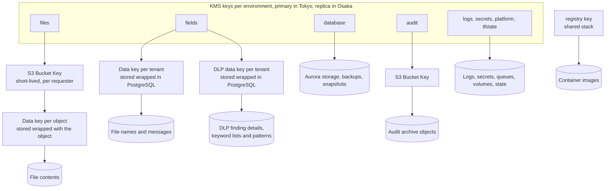

# Encryption and key management

| | |
|---|---|
| Requirements | [PRD](../prd.md), especially NFR-8, NFR-9, NFR-10, NFR-13, NFR-15, NFR-19, NFR-21 and open question 3 |
| Architecture | [architecture.md](../architecture.md), sections 2, 3, 5 and 7 |
| Related | [Data model](../design/data-model.md), [capacity and cost](../design/capacity-and-cost.md), [ADR-0003](../adr/0003-multi-tenancy-shared-schema.md); threat model ([#21](https://github.com/codewithmuh/secure-file-transfer/issues/21)), authentication and authorization ([#23](https://github.com/codewithmuh/secure-file-transfer/issues/23)), abuse and rate limits ([#24](https://github.com/codewithmuh/secure-file-transfer/issues/24)) |
| Tracking | [#22](https://github.com/codewithmuh/secure-file-transfer/issues/22), part of phase 3 ([#25](https://github.com/codewithmuh/secure-file-transfer/issues/25)); DLP data keys in [#64](https://github.com/codewithmuh/secure-file-transfer/issues/64) |

This page decides how data is encrypted in transit and at rest, which KMS keys exist and who may use them, how keys and
application secrets rotate, how deletion and teardown interact with keys, and PRD open question 3 (per-tenant keys).
Sign-in, sessions, row-level security and break-glass access belong to the authentication and authorization design;
the download mechanism and rate limits belong to the abuse design. "Decision N" refers to the phase 3 cross-cutting
decisions that all four phase 3 documents follow.

Technologies are the ones the phase 4 ADRs chose (architecture section 9). A change to one of those ADRs changes this
page in the same pull request. Nothing here has been applied to an AWS account: until Rashid provides the AWS
profile, every control is checked statically (section 9).

Decisions on this page:

- **Eight customer managed keys per environment**, one per data class, each a multi-Region key with its primary in
  Tokyo and, in staging and prod, a replica in Osaka, **plus one registry key** in the shared registry stack
  (section 4).
- **Open question 3:** shared keys per data class, plus per-tenant data keys for file names and messages, bound to the
  caller's `tenant_id`. Dedicated per-tenant KMS keys become an opt-in for tenants that require one (section 5).
- **DLP data keys:** a second per-tenant data key under the fields key, with its own encryption context, protects DLP
  finding details and the tenant's keyword lists and patterns. The scan worker may unwrap it, and only it; no new KMS
  key (section 3.3).
- **S3 objects carry no custom encryption context** (decision 4). With S3 Bucket Keys, KMS checks the bucket, not the
  object, so a `tenant_id` pair would not be enforced. `tenant_id` is used as encryption context where the service
  calls KMS itself (section 3.2).
- **TLS 1.2 or 1.3 on every hop that carries customer data**, including load balancer to pods and pods to the
  database (section 2).
- **Application HMAC keys live in Secrets Manager as keyrings** and rotate with an overlap: verification codes, email
  pseudonyms, link tokens and CSRF tokens. Sessions are random tokens stored as hashes, so there is no signing key
  (section 6).
- **Only the Terraform deploy roles change or destroy keys.** A service control policy denies changing a key policy,
  disabling a key or scheduling its deletion to everyone else, BreakGlass included, apart from the bootstrap `Admin`
  role for the tfstate keys and the key-admin role `sft-{env}-keyadmin`, which only BreakGlass may assume and which may
  only put a key policy back (decision 13, section 4.4).
- **The audit archive and its key live in a self-contained retained stack** with deletion guards. It keeps its own
  Terraform state, trail and alerting under the audit key, so nothing else has to survive teardown, for about $2.20 a
  month (section 8).

## 1. Data classification

| Class | Meaning | Rules |
|---|---|---|
| Restricted | File contents, the reason the service exists, and the text the DLP inspector extracts from them | Only in the files buckets, in a scan worker's memory as it streams a file to clamd and the DLP inspector, on the clamd and inspector pods' memory and scratch volumes while the scan runs, inside GuardDuty Malware Protection while it scans a file over 2 GB (decision 15), and in API memory while a download streams. Never in PostgreSQL, queues, caches, logs, traces or email. |
| Confidential | Personal and business data about transfers: file names, messages, email addresses, IP addresses, audit records, tenant settings | Only in the stores listed below. File names and messages are also field-encrypted (3.2). Never in object keys, work queue messages, metrics or log lines. |
| Secret | Credentials: link tokens, session tokens, CSRF tokens, API keys, invitation tokens, verification codes, HMAC keys, client secrets, the database master password | Plain text exists only in transit, in memory, or once at creation (the emailed link, the cookie, the API key response). At rest only as a hash, an HMAC, or inside Secrets Manager. Link and CSRF tokens are derived (6.2), so they are never stored. |
| Internal | Operational data with no customer content: application logs, metrics, traces, queue messages, container images, infrastructure state | Identifiers only: `tenant_id`, `request_id`, an HMAC of an email address. Application logs may also hold IP addresses. |
| Public | The web app bundle and the published OpenAPI document | TLS in transit; no encryption requirement at rest. |

| Data | Class | Where it lives | Encrypted with |
|---|---|---|---|
| File contents | Restricted | S3 files buckets (Tokyo, Osaka replica): one pair for files up to 2 GB and one for larger files, always under `tenants/{tenant_id}/` (ADR-0012); clamd scratch volumes (4 GiB per pod, ADR-0019), deleted after each scan, and scan worker memory while a file streams to clamd; GuardDuty Malware Protection, which reads the large-file bucket in its Region (decision 15); API memory while streaming | files key |
| Text the DLP inspector extracts, and the values its detectors match | Restricted | Only in the inspector's child process and its scratch volume while it inspects one file (ADR-0022); never stored, logged or returned. Findings keep counts, location hints and masked previews instead. | files key (scratch volume) |
| DLP finding details (location hints, masked previews), tenant keyword lists and patterns | Confidential | PostgreSQL `dlp_findings.detail_ct` and `dlp_detectors.definition_ct`, ciphertext only; the scan worker's and the API's memory | Per-tenant DLP data key under the fields key (3.3), inside storage encrypted with the database key |
| DLP justifications and approvers' comments | Confidential | PostgreSQL `dlp_confirmations.justification_ct`, `dlp_approval_decisions.comment_ct` | Per-tenant field data key (3.2) |
| File names, transfer and upload request messages | Confidential | PostgreSQL `files.display_name_ct`, `transfers.message_ct`, `upload_requests.message_ct`, ciphertext only; the browser after verification (FR-14) | Per-tenant data key under the fields key (3.2), inside storage encrypted with the database key |
| Email addresses of members, recipients and uploaders | Confidential, personal data | PostgreSQL, in plain text because we send mail to them and search by them (UC-4); Cognito for members; SES while sending. Logs, rate-limit counters and the suppression list hold only an HMAC (6.2). | database key; email HMAC keyring |
| Source IP addresses and user agents | Confidential, personal data | Audit records; CloudFront, WAF and load balancer logs; rate-limit counters (at most 25 hours) | database, audit, logs and platform keys |
| Tenant settings, users and roles | Confidential | PostgreSQL | database key |
| Link tokens, session tokens, API keys, invitation tokens | Secret | SHA-256 hashes in PostgreSQL (data model section 1). Link tokens are derived with the link HMAC keyring, and only their hash is stored. | database key; link HMAC keyring |
| CSRF tokens | Secret | Not stored: derived from the session token with the CSRF HMAC keyring (decision 8) | CSRF HMAC keyring |
| Verification codes | Secret | HMAC-SHA-256 in PostgreSQL (6.2) | database key; code HMAC keyring |
| Sign-in state, PKCE verifiers, nonces | Secret | Valkey, single use, 10-minute TTL (authentication and authorization design) | platform key |
| HMAC keyrings, identity provider client secrets (one per user pool), database master password, platform component secrets | Secret | Secrets Manager, replicated to Osaka; the Osaka user pool's client secret lives only in Osaka (6.1) | secrets key |
| Audit records | Confidential, integrity-critical | PostgreSQL `audit_events` (365 days); S3 audit archive with Object Lock in both Regions | database key; audit key |
| Application logs and traces | Internal (may hold IP addresses) | Log and trace stores in Tokyo (architecture 5.5) | logs key |
| CloudFront, WAF and load balancer logs, CloudTrail, VPC flow logs | Confidential (IP addresses) | S3 log buckets and CloudWatch Logs in Tokyo (NFR-21) | logs key; the retained stack's trail uses the audit key (8.4); load balancer access logs are the exception in 3.1 |
| Metrics | Internal | Prometheus volumes; no personal data in labels | platform key |
| Queue messages | Internal for the work queues; Confidential for the intake queues | SQS. Work queues carry IDs only (architecture 5.3). Intake queues carry what their source sends: sign-in events add the source IP and user agent, SES events the recipient's address. | platform key |
| Container images | Internal | ECR in the shared registry stack, replicated to Osaka (capacity 5.4) | registry key |
| Terraform state | Internal, sensitive | One state bucket per environment, holding no live secret value (6.4); the retained stack's own state bucket (8.4) | tfstate key; audit key for the retained stack |
| Web app bundle | Public | S3 behind CloudFront | SSE-S3 (3.1) |

Every store above is in Tokyo or Osaka (NFR-21). Keys can replicate only to Osaka (4.4). What lives in us-east-1 is
limited to NFR-21's list, none of it holding file contents: CloudFront, its WAF and its certificate; CloudWatch metrics
and alarms on CloudFront and the Route 53 health checks, with their SNS topic; the log delivery for the CloudFront WAF,
which writes to Tokyo; and the DNSSEC signing key (4.1).

## 2. Encryption in transit

Every hop that carries customer data uses TLS 1.2 or 1.3. On the internet, plain HTTP only ever redirects to HTTPS.

### 2.1 Edge

| Hop | Protocol and policy | Notes |
|---|---|---|
| Browser to CloudFront (web app) | HTTPS only; HTTP redirects to HTTPS. Security policy `TLSv1.2_2025`: TLS 1.2 with ECDHE and AES-GCM only, and TLS 1.3, where CloudFront also offers hybrid post-quantum key exchange. | ACM certificate in us-east-1 (a global-service exception in NFR-21); SNI only |
| CloudFront to the web bundle bucket | Origin access control: SigV4-signed requests over HTTPS | |
| Browsers and API clients to the load balancer (API) | One HTTPS listener on port 443 with `ELBSecurityPolicy-TLS13-1-2-Res-PQ-2025-09`: TLS 1.3 with hybrid post-quantum key exchange, and TLS 1.2 limited to forward-secret AEAD ciphers. This is the policy AWS recommends. The API hostname has no HTTP listener. | ACM certificates in Tokyo and Osaka |
| Browser to S3 (pre-signed upload parts) | HTTPS to the regional S3 endpoint. The bucket policy denies requests without TLS (`aws:SecureTransport`) or below TLS 1.2 (`s3:TlsVersion`). | Part URLs are SigV4-signed and valid at most 15 minutes (architecture 4.1) |
| Every response from the web app and the API | `Strict-Transport-Security: max-age=63072000; includeSubDomains`. Cookies are `Secure` with the `__Host-` prefix (API contract). | HSTS preload once the domain is chosen (open question 5) |

Certificates are ECDSA P-256 public certificates from ACM, validated through DNS in Route 53 and renewed by ACM. A CAA
record lets only Amazon's certificate authority issue certificates for the domain.

### 2.2 Inside the VPC

| Hop | How |
|---|---|
| Load balancer to API pods | HTTPS target group. Each pod serves TLS 1.2 or later with a certificate it generates at start: an ECDSA P-256 key kept in memory only, and in TLS 1.2 only ECDHE with AEAD suites (`PUBLIC_TLS=generated`, #184). The operator API's port serves TLS the same way. The load balancer doesn't validate target certificates, so this encrypts the hop without authenticating it; security groups and network policies decide who can reach the pods. It is needed because the Nitro system's automatic encryption between instances doesn't cover traffic through a load balancer. The load balancer offers TLS 1.0 and up to targets, so the pod's TLS settings enforce the 1.2 minimum. |
| Pods and nodes to AWS APIs (S3, KMS, SQS, Secrets Manager, STS, ECR, SES, EC2, EKS Auth) | HTTPS through the VPC endpoints (architecture 3.1, ADR-0021); AWS APIs require TLS 1.2. Bucket and queue policies also deny requests with `aws:SecureTransport` false. The notification worker sends email through SES's API endpoint, never through NAT. |
| Pods to Cognito, GitHub and ClamAV's database | An HTTPS `CONNECT` tunnel through the egress proxy's listener for that workload, then the NAT gateways (ADR-0021). TLS runs end to end from the pod, so the proxy sees only the name and the byte counts. |
| SES to recipients' mail servers | A configuration set with TLS policy `Require`: a message is delivered only over TLS. A mail server without TLS gets no email (section 9). |
| Pods to Aurora PostgreSQL | `rds.force_ssl = 1` and `ssl_min_protocol_version = TLSv1.2` in the cluster parameter group. Clients connect with `sslmode=verify-full` and the RDS certificate bundle. IAM database authentication (6.3) also refuses connections without TLS. |
| Pods to Valkey (rate-limit counters, sign-in state) | ElastiCache Serverless always uses TLS; clients verify the server certificate. |
| Pod to pod (metrics scrapes, traces) | Plain HTTP inside the cluster. Between m8g nodes in one VPC the Nitro hardware encrypts it, and AWS encrypts all traffic between Availability Zones. No file contents, names, messages or secrets travel pod to pod, with the one exception below, and network policies limit the paths. A service mesh would add mutual TLS; it is a moving part this design doesn't need yet. |
| Scan worker to clamd | Pod to pod inside the scan node pool: the worker streams the file's bytes to clamd with INSTREAM over plain TCP (ADR-0019). Between m8g nodes the Nitro hardware encrypts it, and the pair usually shares a node. Network policies allow ingress to clamd only from the scan workers, and both run only on the scan pool, never on the API's nodes. |
| Scan worker to DLP inspector | The same: the file's bytes, with the tenant's decrypted keyword lists and patterns, over plain TCP to the inspector beside the worker, and the findings with masked previews back (ADR-0022). The inspector accepts connections only from the scan workers and has no egress. |

Downloads stream from S3 through the API (abuse and download design, #24): S3 decrypts the object, the bytes reach
the pod over TLS through the S3 endpoint, and leave over TLS through the load balancer. The API never writes them to
disk; its filesystem is read-only (architecture section 8).

### 2.3 Tokyo to Osaka

AWS encrypts all traffic between Regions on its network at the physical layer. On top of that:

| Flow | Protection |
|---|---|
| S3 replication: files and their tags, audit archive | S3 decrypts with the Tokyo key and re-encrypts with the Osaka key named in the replication rule. S3 treats multi-Region keys as single-Region keys here. The replication role has `s3:GetObjectVersionTagging` and `s3:ReplicateTags`, so the `scan` tag reaches Osaka. Terraform state is per Region: Osaka's root modules keep their state in Osaka (ADR-0005); how Tokyo's state survives losing the Region is part of [#42](https://github.com/codewithmuh/secure-file-transfer/issues/42). |
| Aurora global database | Storage-level replication; the Osaka cluster is encrypted with the Osaka copy of the database key |
| Secrets Manager replicas | Replicated by the service; each replica is encrypted with the Osaka secrets key |
| Security-critical audit records written by the API and the operator API straight to Osaka (architecture 5.2) | HTTPS through the cross-region interface endpoint for S3 in Osaka (ADR-0021), whose policy admits only our principals and our buckets there; never through NAT |
| ECR replication | Replicated by the service; replicas are encrypted with the Osaka copy of the registry key |

## 3. Encryption at rest

### 3.1 Per store

| Store | Encryption | Key | Notes |
|---|---|---|---|
| S3 files, Tokyo and Osaka: two bucket pairs, one for files up to 2 GB and one for larger files (ADR-0012) | SSE-KMS with S3 Bucket Keys, as the bucket default | files | Both pairs have the same settings and key. The bucket policy denies any upload that names another KMS key, and any SSE-C request, so no object can be stored under a key we don't control. Versioning is on, because replication needs it. No Object Lock, because NFR-8 must be able to delete. Never in an AWS Backup plan. GuardDuty Malware Protection covers the whole large-file bucket, and its role reads only that bucket (4.4). |
| S3 audit archive, Tokyo and Osaka | SSE-KMS with S3 Bucket Keys | audit | Object Lock in compliance mode with 365-day retention in prod. Governance mode with 1-day retention in dev and staging, so they can be torn down (NFR-15). Object Lock protects the objects, not their key, so the key has its own guards (8.4). |
| S3 log buckets: CloudTrail, CloudFront, WAF, VPC flow logs, log and trace stores | SSE-KMS with S3 Bucket Keys | logs | The log delivery services write through key policy statements limited by `aws:SourceAccount` and `aws:SourceArn`. |
| S3 load balancer access logs | SSE-S3 | — | **Exception to NFR-13:** load balancer access logs support only SSE-S3. They hold IP addresses, paths with opaque IDs and user agents. Link tokens never reach them, because they travel in the URL fragment (architecture 4.2). Only the log reader role can read the bucket. |
| S3 server access logs | Not used | — | They also need SSE-S3. CloudTrail S3 data events are the "storage access logs" for NFR-15's daily match instead: for the files buckets through the environment's trail, which delivers them to the shared account's log archive under Object Lock, so a break-glass session can't erase its own record (authentication and authorization 8.3); for the prod audit archive through the retained stack's trail, under the audit key (8.4). |
| S3 web app bundle | SSE-S3 | — | Public content. A KMS key would add a CloudFront key policy to the failover path without protecting anything secret. |
| S3 Terraform state, Tokyo and Osaka | SSE-KMS with S3 Bucket Keys; versioning | tfstate | Created by the bootstrap stack with its own key, because the environment's keys are created by the state this bucket holds. The retained stack keeps its state in its own bucket under the audit key (8.4). |
| Aurora PostgreSQL: Tokyo cluster, Osaka secondary, automated backups (14-day point-in-time recovery), snapshots, Performance Insights | Aurora storage encryption, set at creation | database | Each Region's cluster uses that Region's copy of the key. An unencrypted cluster can't be encrypted in place, so CI rejects a plan that would create one (section 9). |
| File names and messages inside PostgreSQL | AES-256-GCM with per-tenant data keys | fields | Section 3.2 |
| Aurora PostgreSQL logs | CloudWatch Logs | logs | The parameter group keeps values out of the log: `log_parameter_max_length = 0` and `log_parameter_max_length_on_error = 0` (no bound values), `log_error_verbosity = terse` (no `DETAIL` lines, which print the conflicting key of a unique violation, such as an email address, or the failing row of a check constraint), `pgaudit.log_parameter = off`, and `log_statement = none` (pgaudit decides what is audited). The application sends parameterized statements, so statement text holds `$1` placeholders, not values. What can still get through, a residual risk (9.1): text a person types under break-glass, which pgaudit records on purpose, and the primary message of an input-syntax error, which quotes the bad value. A CloudWatch Logs data protection policy with the email address identifier masks any address that does get through. |
| SQS work queues, intake queues and dead-letter queues | SSE-KMS, data key reused for 5 minutes | platform | Work queue messages hold IDs only; intake messages are classified in section 1. Only the outbox relay sends to the work queues. Each intake queue has one sender: the sign-in triggers' role for sign-in events, the SES events topic for sending events, and the EventBridge delivery role for GuardDuty scan results and SES tenant pauses, through the statements in 4.4. Karpenter's interruption queue has the same delivery role as its one sender. |
| ElastiCache Serverless (Valkey) | Encryption at rest, always on | platform | Rate-limit counters and sign-in state |
| EBS: node root volumes, observability volumes | EBS encryption by default, set for the account in each Region by the data stack (`infra/modules/data-stack`) | platform | The node provisioner (Karpenter, and the EC2 Fleet and Auto Scaling service-linked roles) uses the key for each volume it launches (4.4). |
| EBS: scan node volumes | Encrypted | files | clamd's scratch holds file contents during a scan, so the scan workers and clamd run in their own node pool whose volumes use the files key. The worker deletes each scratch file when its scan ends. The separate pool also keeps hostile files off the API's nodes. |
| ECR images | KMS | registry | Repositories live in the shared registry stack (capacity 5.4), and a repository's encryption setting can't change after creation, so they can't use an environment's key, which goes away with that environment. The registry key belongs to the shared stack. Osaka replicas use its Osaka copy through a repository creation template. |
| CloudWatch Logs: EKS control plane, Aurora | KMS | logs | |
| Secrets Manager, Tokyo and Osaka | KMS | secrets | Section 6 |
| Kubernetes Secrets (etcd) | EKS envelope encryption | secrets | Only platform components use Kubernetes Secrets; the application reads Secrets Manager directly (6.4). |
| SNS topics: alarms, SES events | SSE-KMS | platform | CloudWatch alarms, SES and EventBridge publish through the statements in 4.4. The retained stack's alert topic uses the audit key (8.4). |
| Cognito user pools | Encrypted at rest by Cognito | — | Member email addresses and MFA settings; no key is configured here. The authentication and authorization design covers what Cognito holds. |

Instance memory: m8g nodes (Graviton4) encrypt memory with keys that never leave the host. That protects against
physical access to the hardware, not against a compromised process (section 9).

### 3.2 Field encryption for file names and messages

File names and messages are the metadata most likely to give away what a transfer contains ("Q3 layoffs.xlsx").
Storage encryption protects them on disk, but not from anyone who can run a query: a scoping bug, SQL injection, a
leaked database credential, or a break-glass database session. Field encryption keeps them unreadable to all of those.

1. **One data key per tenant.** Each tenant has a 256-bit data key, generated by KMS `GenerateDataKey` on the fields
   key with encryption context `{"purpose": "field-dek", "tenant_id": "<tenant>"}`. Only the wrapped key is stored, in
   `tenant_data_keys (tenant_id, key_version, wrapped_key, created_at, retired_at)` (data model).
   The ciphertext columns are `files.display_name_ct`, `transfers.message_ct` and `upload_requests.message_ct`; each
   table records `data_key_version`, a foreign key to the tenant's key version, so a version can't be deleted while a
   row uses it. There are no plaintext columns for these values.
2. **Authenticated encryption.** Each value is encrypted with AES-256-GCM, a random 96-bit nonce, and additional
   authenticated data made of `tenant_id`, table, column, row ID and key version. The stored value carries a format
   version, the key version, the nonce and the ciphertext with its tag.
3. **Decrypt with the caller's tenant.** The service layer unwraps the data key of the tenant in the **caller's scope**
   (member, API key or link session; ADR-0002), never the tenant written on the row. A row from another tenant fails
   authentication instead of decrypting. The service returns an error, counts `field_decrypt_scope_mismatch`, and pages
   as a possible isolation breach. This is the third isolation layer, after scoped data access and row-level security.
4. **Cache.** Unwrapped data keys stay in process memory for at most 15 minutes, never on disk or in logs. At design
   load that is at most about 6 million KMS requests a month (4 API pods × 500 tenants × 4 refreshes an hour), about
   $18.
5. **Only the API can unwrap.** Emails never contain file names or messages: FR-14 already keeps them out of
   recipient emails, and member notices say how many files and link to the web app. So the notification worker never
   needs this key, and neither does the operator API, which never returns names or messages.
6. **Failover.** The wrapped keys reach Osaka through Aurora replication, and the Osaka API unwraps them with the Osaka
   replica of the fields key, without calling Tokyo. This is the one place where the multi-Region property is required
   (4.2).

The cost: names and messages can't be searched or sorted in SQL. The web app sorts the at most 50 files of a transfer
itself, and audit search doesn't use them (UC-4). The module uses a standard AEAD implementation, never its own
cryptography, and a write is read back and checked before it commits.

**As built (#236, revision 0031).** `sft.service.fields` seals and opens every `*_ct` value; `sft.core.sealed` is the
stored format; `sft.runtime.kms` calls KMS.

- **Format 1:** `0x01`, the key version (4 bytes), a 96-bit random nonce, the AES-256-GCM ciphertext and tag. The
  additional authenticated data is, length-prefixed: a format tag, the purpose (`field-dek` or `dlp-dek`), the tenant,
  the table, the column, the row's ID and the key version. A detector definition is bound to the detector's ID, which
  its revisions share. Every write is decrypted again and compared before it is returned.
- **Keys.** `tenant_data_keys (tenant_id, key_version, wrapped_key, created_at, retired_at)`, one live version per
  tenant (a partial unique index). The first value sealed for a tenant makes version 1 in the same transaction (KMS
  `GenerateDataKey` with the context `{"purpose": "field-dek", "tenant_id": ...}`); a race is settled by the keys.
  Each ciphertext table's `data_key_version` is set from the value by the data layer and is a composite foreign key to
  the version, so a version a row uses can't be deleted. A transaction loads its tenant's versions once
  (`tenant_keys(session, tenant_id)`), from a per-process cache of at most 15 minutes keyed by the wrapped key's hash.
- **The caller's tenant.** The keys are always the session's scope's tenant's; asking for another tenant's is refused
  before any query. A value that doesn't open raises `FieldDecryptError` (a 500 to the caller), logs the tenant,
  column and row by ID, and counts `field_decrypt_scope_mismatch_total{purpose}`, which pages.
- **Who unwraps.** Each process installs one key holder with the purposes its role may use: the API both; the scan
  worker `dlp-dek` only; the field key job both, as the API. The notification worker and the operator API install
  none, so they can't seal or open anything.
- **The expand step and the backfill.** M2's format 0 (plain text behind a zero byte) is still read, and counted in
  `field_plaintext_reads_total{column}`, never written. The field key job (`python -m sft.workers.field_keys`, below)
  reseals every format 0 value. After it has run in an environment, a dump holds no name or message in plain text;
  the contract step that stops reading format 0, and a check that refuses it, follow once every environment shows no
  plaintext reads (follow-up, section 10).
- **The field key job** runs as the API (its service account, IAM role and `sft_api`), the only role the fields key
  lets unwrap a field data key. It finds tenants with the lookup function `field_key_tenants` (IDs only) and acts in
  each tenant's scope, a batch per transaction, each with its audit event: `backfill` reseals what isn't under the
  live version (format 0, or a retired version: the re-encryption), `rotate` makes a new version once the live one is
  a year old, `rewrap` wraps every version again with `ReEncrypt` (the API's statement now allows
  `kms:ReEncryptFrom` and `kms:ReEncryptTo`, same conditions), and `purge` deletes retired versions no row uses. The
  chart runs `rotate,backfill,purge` daily in Tokyo (the `field-keys` CronJob); runbook
  [field-keys](../runbooks/field-keys.md).
- **What stays plain (M6 combine).** #231's and #232's new text columns aren't sealed: `sso_domains.domain` is
  matched across tenants at sign-in by `lookup_sso_domain` and is unique where proven, so it must be comparable (like
  `transfer_recipients.domain`); `sso_domains.verification_token` is published in DNS by design; IdP issuers and
  provider names are configuration, read before a tenant scope exists; IdP group names in `sso_group_roles` are
  configuration, not content. `break_glass_grants.reason` and `incident_id` are platform rows with no tenant, written
  and read by the operator API, which holds no data key (above), and a grant can name several tenants. None of them is
  in `SEALED_COLUMNS`. #221's and #230's additions need no new sealed column either: a pattern's definition (RE2
  expression, context keywords) is a detector definition, sealed in `dlp_detectors.definition_ct` with the DLP data
  key exactly as a keyword list (3.3); a message's findings (`dlp_findings.transfer_id`) are counts only, with no
  `detail_ct`, so they name no key version; `dlp_pattern_stops` holds IDs and counts, and `notice_windows` kinds of
  change and times.
- **Locally** `FIELDS_KMS_KEY_ID=local` selects an in-process stand-in that wraps with AES-GCM under a public, fixed
  key, binds the context as KMS does, and refuses the purposes the process's role lacks. The chart never sets it (a
  deploy test). Running against real KMS, the scan worker's denied `field-dek` call and the Osaka unwrap are **pending
  the AWS run**.

### 3.3 DLP data keys

DLP finding details and a tenant's own detectors are as revealing as file names: a sheet called "Layoffs 2027", the
last digits of a card, a keyword list of deal names. They are encrypted like file names (3.2), with one difference:
the scan worker writes findings and reads detectors, so it needs a key it may unwrap, and it must not unwrap the field
data key.

1. **A second data key per tenant**, generated on the fields key with encryption context
   `{"purpose": "dlp-dek", "tenant_id": "<tenant>"}` and stored wrapped in `tenant_dlp_keys` (data model 2.7). The API
   or the scan worker, whichever needs it first, creates the first version.
2. **Values**: `dlp_findings.detail_ct` (location hints and masked previews) and `dlp_detectors.definition_ct`
   (keyword lists, patterns and their context keywords), AES-256-GCM with the same format and additional
   authenticated data as 3.2, and the version in `dlp_key_version`.
3. **Who unwraps.** The API, for both purposes. The scan worker for `dlp-dek` only: the key policy names it with the
   condition `kms:EncryptionContext:purpose = dlp-dek` (4.4), so it can never unwrap a field data key, and file names
   and messages stay readable only by the API. The worker decrypts detectors to send them to the inspector and
   encrypts details to store them; its database role can't select `detail_ct` (data model 4.2), so it can't read
   details back. Justifications and comments are written only by the API, under the field data key.
4. **Caller's tenant.** As in 3.2: the data key of the tenant in the caller's scope (for the worker, the message's
   tenant), never the tenant on the row.
5. **Deletion.** `detail_ct` is cleared when the file's contents are deleted (NFR-8), and a key version is deleted once
   no row uses it.

**As built (#233, revision 0032).** `tenant_dlp_keys` has the shape and rules of `tenant_data_keys`; `sft_api` reads,
makes, retires and deletes versions, `sft_scan` reads and makes them. `dlp_findings (tenant_id, dlp_key_version)` and
`dlp_detectors (tenant_id, dlp_key_version)` refer to it. The scan worker seals each finding's location hints and
masked previews (`sft.service.finding_details`) under the message's tenant's DLP key, bound to the finding's row, in
the transaction that records the scan; `sft_scan` still can't select `detail_ct`. Detector definitions are sealed the
same way when a detector is created or changed, and the field key job's backfill reseals older ones. Only the API
opens details, for the file's owner and an active approver of the transfer's approval request, and audits each such
response (`dlp_findings.details_read`). The NFR-26 canary test (`tests/test_dlp_canary.py`) runs synthetic My Numbers,
card numbers and a keyword through every DLP flow and searches the database, logs, traces, metrics, queue messages,
audit records and emails for them. In staging, a scan worker call for a `field-dek` key must be denied: **pending the
AWS run**.

## 4. Key hierarchy and multi-Region keys

### 4.1 The keys

Each environment has eight customer managed symmetric encryption keys with key material generated by KMS
(`AWS_KMS` origin). In staging and prod each one is a multi-Region key with its primary in Tokyo and one replica in
Osaka. dev runs in Tokyo only, so its keys are multi-Region keys without a replica. Aliases are per Region, so
Terraform creates the same alias in both. The shared registry stack has one more key of the same kind. One more key
protects no data: the shared account's DNSSEC key-signing key, an asymmetric key that Route 53 requires in us-east-1
(NFR-21), which only signs the DNS zone.

| Key | Alias in prod | Protects | Created by |
|---|---|---|---|
| files | `alias/sft/prod/files` | S3 files buckets; scan worker volumes | Environment stack |
| fields | `alias/sft/prod/fields` | Per-tenant data keys for file names and messages, and per-tenant DLP data keys (3.3) | Environment stack |
| database | `alias/sft/prod/database` | Aurora clusters, backups, snapshots, Performance Insights | Environment stack |
| audit | `alias/sft/prod/audit` | Audit archive buckets; the retained stack's state, trail and alert topic | Retained stack (8.4) |
| logs | `alias/sft/prod/logs` | Log buckets, CloudWatch Logs, log and trace stores | Environment stack |
| secrets | `alias/sft/prod/secrets` | Secrets Manager, Kubernetes Secrets | Environment stack |
| platform | `alias/sft/prod/platform` | SQS, SNS, Valkey, EBS | Environment stack |
| tfstate | `alias/sft/prod/tfstate` | Terraform state bucket | Bootstrap stack |
| registry | `alias/sft/shared/registry` | ECR repositories, for every environment | Shared registry stack (capacity 5.4) |

That is 16 key resources in prod and in staging (each primary and each replica is billed as a key) and 8 in dev. The
registry key adds 1 key resource while only dev exists, and 2 once ECR replicates to Osaka.



### 4.2 Why multi-Region keys

S3 replication, Aurora global databases and Secrets Manager replicas each re-encrypt with the destination Region's key,
and S3 treats a multi-Region key as a single-Region key. For those stores the multi-Region property adds nothing
functional. It earns its place for three reasons:

- **Field encryption needs it.** Wrapped data keys made in Tokyo arrive in Osaka through Aurora replication and must be
  unwrapped there while Tokyo may be unreachable. Only a multi-Region key can do that without wrapping every data key
  twice.
- **It slows down deleting the audit key.** A primary can only be deleted after its replicas are deleted, and its own
  waiting period starts then. With the 30-day minimum we require (4.4), destroying the audit key takes at least
  60 days. A replica deleted by mistake can be re-created from the primary.
- **It keeps one model.** The same key ID in both Regions, one rotation schedule that KMS keeps in sync, and one policy
  template. A key can't be made multi-Region after it is created, so this keeps application-level encryption possible
  for every class later.

It costs the same as two single-Region keys ($1 a month for each primary and each replica). The trade-off is that the
same key material exists in both Regions, so either Region's policy can decrypt the other's ciphertext. Both policies
come from one Terraform module and pass the same checks (section 9), and replication is allowed only to Osaka.

### 4.3 Who may use each key

E = encrypt (`GenerateDataKey`, `Encrypt`). D = decrypt. A = administer: every key management action (describe, put
policy, rotation on and off, on-demand rotation, tags, aliases, replicate, list and revoke grants, enable, disable,
schedule and cancel deletion), never encrypt or decrypt. G = create grants for AWS resources only
(`kms:GrantIsForAWSResource`). R = recover: describe, read the policy, list and revoke grants, enable a disabled key,
cancel a pending deletion. V = EBS volumes through EC2: grants for AWS resources, `GenerateDataKeyWithoutPlaintext`,
`Decrypt`, `DescribeKey`, `ReEncrypt*`.

| Principal | files | fields | database | audit | logs | secrets | platform | tfstate |
|---|---|---|---|---|---|---|---|---|
| API service (and the field key job, which runs as it, #236) | E D | E D, and `ReEncrypt` for the re-wrap | — | E, both Regions | — | D, own secrets | — | — |
| Operator API (decision 12) | — | — | — | E, both Regions | — | — | — | — |
| Scan worker | D, files up to 2 GB only | E D, `dlp-dek` only (3.3) | — | — | — | — | D, scan queues | — |
| Notification worker | — | — | — | — | — | D, own secrets | D, its queues | — |
| Outbox relay | — | — | — | — | — | — | E D, queues | — |
| Sign-in triggers (Cognito pre- and post-authentication) | — | — | — | — | — | — | E D, sign-in events queue | — |
| Lifecycle jobs | E D, through S3, to complete an upload left `completing` (no `s3:GetObject`) | — | — | E, both Regions (a grant's committed record) | D, CloudTrail log files only | — | — | — |
| Archive job | — | — | — | E, Tokyo | — | — | — | — |
| Recovery job (failover and restore runbooks) | — | — | — | D | — | — | — | — |
| Key rotation job | — | — | — | — | — | E D, keyrings and identity provider client secrets | — | — |
| Database bootstrap job | — | — | — | — | — | D, master password only | — | — |
| Migrations job | — | — | — | — | — | — | — | — |
| External Secrets `platform-secrets` store role (`sft-<env>-external-secrets-platform`, 6.4) | — | — | — | — | — | D, platform component secrets only | — | — |
| External Secrets `application-secrets` store role (`sft-<env>-external-secrets-app`, 6.4) | — | — | — | — | — | D, the API's `csrf-hmac`, `email-hmac` and its Region's `idp-client` only | — | — |
| S3 replication role | D Tokyo, E D Osaka | — | — | D Tokyo, E D Osaka (in prod, the retained stack's own role) | — | — | — | D Tokyo, E D Osaka |
| GuardDuty Malware Protection role (decision 15) | E D, through S3, large-file buckets only | — | — | — | — | — | — | — |
| EventBridge delivery role | — | — | — | — | — | — | E D, named queues and topics | — |
| Node provisioner: Karpenter controller, and the EC2 Fleet and Auto Scaling service-linked roles (named as principals, 4.4) | V, scan node pool | — | — | — | — | — | V, root volumes | — |
| Log and trace stores | — | — | — | — | E D | — | — | — |
| AWS service principals in the key policy | — | — | — | CloudTrail, for the retained trail (8.4) | CloudWatch Logs, CloudTrail, log delivery | — | CloudWatch alarms, SES, SNS into SQS | — |
| AWS services through grants | EBS | — | RDS | — | — | EKS | EBS, ElastiCache | — |
| Terraform deploy role | A | A | A G | A (in prod, the retained stack's own deploy role) | A | A G; E for the secrets it writes, D for the master password's read-back (6.4) | A G | E D, through S3, its state bucket only; the bootstrap `Admin` role administers the key |
| Terraform plan role (ADR-0005) | — | — | — | — | — | — | — | D and `GenerateDataKey`, through S3, its state bucket only, for the lock files it writes |
| Audit reader (investigations, time-limited) | — | — | — | D | D | — | — | — |
| BreakGlass permission set | R, D | R | R | R, D | R, D | R, D (master password) | R | R |
| Emergency IAM user (authn-authz 8.4), staging and prod | — | — | — | — | — | — | — | A, and E D through S3 for the Osaka state bucket only, on the Osaka replica: it stands in for the bootstrap `Admin` role there when a Tokyo outage takes Identity Center (#81) |
| Operators in normal operation | — | — | — | — | — | — | — | — |

- **Deletion needs no key.** Deleting object versions and aborting multipart uploads need no KMS permission, so the
  lifecycle jobs, which do the deleting (decision 1), can't read what they delete. Reconciliation (#181) also finishes
  an upload left `completing` (data model 3.1), and `CompleteMultipartUpload` on an SSE-KMS object needs the files key
  through S3; the jobs role still has no `s3:GetObject`, so the key never lets it read a file. It writes a download
  grant's committed record to the archive when the API's background write didn't confirm (data model 2.3).
- **Reading data events for the storage-access match.** The lifecycle jobs role runs NFR-15's daily match of
  CloudTrail S3 data events against audit records. The environment's trail writes them to the shared account's log
  archive, so the role may read only its own trail's prefix there and decrypt with the archive's key only through S3 and
  only for that trail's log files (`kms:EncryptionContext:aws:cloudtrail:arn` = the trail), so it can't read application
  logs or another account's events. No job copies Cognito logs: failed sign-ins reach the audit log through the sign-in
  triggers (decision 18).
- **Narrow conditions.** Each workload statement is limited by `kms:ViaService` (S3, SQS, SNS, EC2 or Secrets Manager
  in the right Region) and by encryption context: the bucket ARN for S3 (`kms:EncryptionContext:aws:s3:arn`; with
  Bucket Keys it is the bucket, not the object), `SecretARN` for Secrets Manager, `aws:sqs:arn` for queues, the trail
  ARN for CloudTrail log files, and for the fields key `purpose = field-dek` or `dlp-dek` with `tenant_id` present;
  the scan worker's statement allows only `dlp-dek`.
- **Role names** follow the authentication and authorization design: IAM roles `sft-{env}-api`, `sft-{env}-scan`,
  `sft-{env}-notify`, `sft-{env}-relay`, `sft-{env}-jobs`, `sft-{env}-archive`, `sft-{env}-migrate` and
  `sft-{env}-operator` match the PostgreSQL login roles `sft_api` to `sft_operator`. This page adds
  `sft-{env}-recovery`, `sft-{env}-key-rotation`, `sft-{env}-db-bootstrap`, `sft-{env}-s3-replication`,
  `sft-{env}-malware-protection`, `sft-{env}-events-delivery`, `sft-{env}-signin-trigger`, `sft-{env}-karpenter` and the
  bootstrap stack's key-admin role `sft-{env}-keyadmin` (4.4). The recovery role pairs with the PostgreSQL login role
  `sft_recovery`.
- **Reading for plans.** The Terraform plan role may read every key's state and policy (`DescribeKey`, `GetKeyPolicy`,
  `GetKeyRotationStatus`, `ListKeyRotations`, `ListResourceTags`) so pull request plans can refresh the keys, and
  nothing more: no use, no change (#102).
- **The recovery job** runs only from the failover and restore runbooks: in Osaka to re-apply security-critical
  changes from the archive (architecture section 7), in Tokyo after a point-in-time restore.

### 4.4 Key policy sketches

Every key policy follows these rules:

1. **Named principals only.** The policy does not give `kms:*` to the account root, so an IAM administrator can't give
   themselves Decrypt with an identity policy. The Terraform deploy role of the stack that owns the key administers it.
2. **Separation of duties.** Administrators can't use the key, and users can't administer it. Two exceptions, each
   limited to named resources: the deploy role encrypts and decrypts its Terraform state (tfstate key, and the audit
   key for the retained stack's state bucket), and it encrypts the secrets it writes (6.4).
3. **No grants to people.** `CreateGrant` is allowed only for AWS resources (`kms:GrantIsForAWSResource`), and only to
   the deploy role, the node provisioner and AWS services acting for their own resources.
4. **Osaka only.** `ReplicateKey` is allowed only with `kms:ReplicaRegion` set to `ap-northeast-3`.
5. **Only the deploy roles change or destroy keys (decision 13).** A service control policy denies
   `kms:PutKeyPolicy`, `kms:DisableKey`, `kms:ScheduleKeyDeletion` and `kms:DeleteImportedKeyMaterial` to every
   principal except the deploy roles (the retained stack's included), the bootstrap `Admin` role for the tfstate keys
   its stack creates, the staging and prod emergency users for Osaka's tfstate key, the only key policy that names
   them (#81), and the key-admin role of rule 6, which may only put a key policy; BreakGlass and every other
   role are denied. Each key policy repeats the denial of `DisableKey` and
   `ScheduleKeyDeletion` (sketch below), so it holds even if the SCP changes. In prod any deletion must use the
   longest waiting period, 30 days. In dev and staging the deploy role may use 7 days, so teardown works. SCPs need
   AWS Organizations, which IAM Identity Center needs anyway; open question 4 chose it (ADR-0006).
6. **BreakGlass recovers, it doesn't administer.** It may describe a key, list and revoke grants, enable a disabled
   key and cancel a pending deletion. A broken key policy is put back through the **key-admin role**,
   `sft-{env}-keyadmin` (ADR-0017): every key policy names it, for reading and putting the key policy and nothing
   else. It is created once in the bootstrap stack with `prevent_destroy`, only BreakGlass may assume it, and every
   use pages. KMS binds a key policy to a role's unique ID, so a deploy role that is deleted and re-created no longer
   matches its keys' policies; the key-admin role can still put a corrected policy, so re-creating a deploy role can't
   lock the keys. With one maintainer the same person holds BreakGlass and approves it, so this guards against a
   mistake or one compromised role, not against the maintainer (decision 13 accepts that risk).
7. **Changes are watched.** EventBridge rules on CloudTrail, in both Regions:
   - `PutKeyPolicy`, `DisableKey`, `DisableKeyRotation`, `ScheduleKeyDeletion`, `CancelKeyDeletion`, `RevokeGrant` or
     `ReplicateKey` by any principal other than a deploy role, and any denied attempt at one of them: page.
   - Every `AssumeRole` into the key-admin role, and every call it makes: page.
   - `ScheduleKeyDeletion`, `DisableKey` or `DisableKeyRotation` on a prod key by anyone, the deploy role included:
     page. A planned prod teardown acknowledges the page in its runbook. In dev and staging the deploy role's deletions
     during teardown are expected and only logged.
   - `CreateGrant`: an alert only when the caller isn't an expected grant creator (the deploy role, the node
     provisioner roles, AWS services acting for their own resources) or the call is denied. Every node launch creates
     grants, so alerting on every `CreateGrant` would page on each launch. A daily `ListGrants` check flags any grant
     whose grantee is neither an AWS service nor one of our roles.
   - Any change to the SCPs, from the management account.

The files key in Tokyo, as a sketch (the Osaka replica has its own policy with Osaka values):

```json
{
  "Version": "2012-10-17",
  "Statement": [
    {
      "Sid": "Administer",
      "Effect": "Allow",
      "Principal": {"AWS": "arn:aws:iam::<prod>:role/sft-bootstrap/sft-prod-terraform-deploy"},
      "Action": [
        "kms:DescribeKey", "kms:GetKeyPolicy", "kms:GetKeyRotationStatus", "kms:ListKeyRotations",
        "kms:ListResourceTags", "kms:ListGrants", "kms:PutKeyPolicy", "kms:UpdateKeyDescription",
        "kms:EnableKeyRotation", "kms:DisableKeyRotation", "kms:RotateKeyOnDemand", "kms:TagResource",
        "kms:UntagResource", "kms:CreateAlias", "kms:UpdateAlias", "kms:DeleteAlias", "kms:ReplicateKey",
        "kms:RevokeGrant", "kms:EnableKey", "kms:DisableKey", "kms:ScheduleKeyDeletion", "kms:CancelKeyDeletion"
      ],
      "Resource": "*",
      "Condition": {"StringEqualsIfExists": {"kms:ReplicaRegion": "ap-northeast-3"}}
    },
    {
      "Sid": "BreakGlassRecovers",
      "Effect": "Allow",
      "Principal": {"AWS": "<BreakGlass role ARN>"},
      "Action": [
        "kms:DescribeKey", "kms:GetKeyPolicy", "kms:GetKeyRotationStatus", "kms:ListResourceTags",
        "kms:ListGrants", "kms:RevokeGrant", "kms:EnableKey", "kms:CancelKeyDeletion"
      ],
      "Resource": "*"
    },
    {
      "Sid": "KeyAdminRepairsThePolicy",
      "Effect": "Allow",
      "Principal": {"AWS": "arn:aws:iam::<prod>:role/sft-bootstrap/sft-prod-keyadmin"},
      "Action": ["kms:GetKeyPolicy", "kms:PutKeyPolicy"],
      "Resource": "*"
    },
    {
      "Sid": "ApiReadsAndWritesFilesThroughS3",
      "Effect": "Allow",
      "Principal": {"AWS": "arn:aws:iam::<prod>:role/sft-prod-api"},
      "Action": ["kms:GenerateDataKey", "kms:Decrypt"],
      "Resource": "*",
      "Condition": {
        "StringEquals": {
          "kms:ViaService": "s3.ap-northeast-1.amazonaws.com",
          "kms:EncryptionContext:aws:s3:arn": ["arn:aws:s3:::<files bucket, Tokyo>", "arn:aws:s3:::<large-file bucket, Tokyo>"]
        }
      }
    },
    {
      "Sid": "ScanWorkerReadsSmallFilesThroughS3",
      "Effect": "Allow",
      "Principal": {"AWS": "arn:aws:iam::<prod>:role/sft-prod-scan"},
      "Action": "kms:Decrypt",
      "Resource": "*",
      "Condition": {
        "StringEquals": {
          "kms:ViaService": "s3.ap-northeast-1.amazonaws.com",
          "kms:EncryptionContext:aws:s3:arn": "arn:aws:s3:::<files bucket, Tokyo>"
        }
      }
    },
    {
      "Sid": "ReplicationReadsThroughS3",
      "Effect": "Allow",
      "Principal": {"AWS": "arn:aws:iam::<prod>:role/sft-prod-s3-replication"},
      "Action": "kms:Decrypt",
      "Resource": "*",
      "Condition": {
        "StringEquals": {
          "kms:ViaService": "s3.ap-northeast-1.amazonaws.com",
          "kms:EncryptionContext:aws:s3:arn": ["arn:aws:s3:::<files bucket, Tokyo>", "arn:aws:s3:::<large-file bucket, Tokyo>"]
        }
      }
    },
    {
      "Sid": "MalwareProtectionPlanReadsThroughS3",
      "Effect": "Allow",
      "Principal": {"AWS": "arn:aws:iam::<prod>:role/sft-prod-malware-protection"},
      "Action": ["kms:GenerateDataKey", "kms:Decrypt"],
      "Resource": "*",
      "Condition": {
        "StringEquals": {
          "kms:ViaService": "s3.ap-northeast-1.amazonaws.com",
          "kms:EncryptionContext:aws:s3:arn": "arn:aws:s3:::<large-file bucket, Tokyo>"
        }
      }
    },
    {
      "Sid": "BreakGlassReadsThroughS3",
      "Effect": "Allow",
      "Principal": {"AWS": "<BreakGlass role ARN>"},
      "Action": "kms:Decrypt",
      "Resource": "*",
      "Condition": {
        "StringEquals": {
          "kms:ViaService": "s3.ap-northeast-1.amazonaws.com",
          "kms:EncryptionContext:aws:s3:arn": ["arn:aws:s3:::<files bucket, Tokyo>", "arn:aws:s3:::<large-file bucket, Tokyo>"]
        }
      }
    },
    {
      "Sid": "NodeProvisionerUsesKeyForScanVolumes",
      "Effect": "Allow",
      "Principal": {"AWS": "arn:aws:iam::<prod>:role/sft-prod-karpenter"},
      "Action": [
        "kms:GenerateDataKeyWithoutPlaintext", "kms:Decrypt", "kms:DescribeKey", "kms:ReEncryptFrom", "kms:ReEncryptTo"
      ],
      "Resource": "*",
      "Condition": {"StringEquals": {"kms:ViaService": "ec2.ap-northeast-1.amazonaws.com"}}
    },
    {
      "Sid": "NodeProvisionerGrantsForEbsOnly",
      "Effect": "Allow",
      "Principal": {"AWS": "arn:aws:iam::<prod>:role/sft-prod-karpenter"},
      "Action": "kms:CreateGrant",
      "Resource": "*",
      "Condition": {
        "Bool": {"kms:GrantIsForAWSResource": "true"},
        "StringEquals": {"kms:ViaService": "ec2.ap-northeast-1.amazonaws.com"}
      }
    },
    {
      "Sid": "ServiceLinkedRolesUseKeyForScanVolumes",
      "Effect": "Allow",
      "Principal": {"AWS": "arn:aws:iam::<prod>:role/aws-service-role/ec2fleet.amazonaws.com/AWSServiceRoleForEC2Fleet"},
      "Action": ["kms:Encrypt", "kms:Decrypt", "kms:ReEncrypt*", "kms:GenerateDataKey*", "kms:DescribeKey"],
      "Resource": "*"
    },
    {
      "Sid": "ServiceLinkedRolesGrantForScanVolumes",
      "Effect": "Allow",
      "Principal": {"AWS": "arn:aws:iam::<prod>:role/aws-service-role/ec2fleet.amazonaws.com/AWSServiceRoleForEC2Fleet"},
      "Action": "kms:CreateGrant",
      "Resource": "*",
      "Condition": {"Bool": {"kms:GrantIsForAWSResource": "true"}}
    },
    {
      "Sid": "DenyDisableOrDeleteExceptDeployRole",
      "Effect": "Deny",
      "Principal": {"AWS": "*"},
      "Action": ["kms:DisableKey", "kms:ScheduleKeyDeletion"],
      "Resource": "*",
      "Condition": {"ArnNotEquals": {"aws:PrincipalArn": "arn:aws:iam::<prod>:role/sft-bootstrap/sft-prod-terraform-deploy"}}
    },
    {
      "Sid": "RequireThirtyDayWait",
      "Effect": "Deny",
      "Principal": {"AWS": "*"},
      "Action": "kms:ScheduleKeyDeletion",
      "Resource": "*",
      "Condition": {"NumericLessThan": {"kms:ScheduleKeyDeletionPendingWindowInDays": "30"}}
    }
  ]
}
```

The platform key carries the same administrator, BreakGlass, node provisioner and deny statements, plus these for the
services that publish into encrypted topics and queues (Tokyo values):

```json
{
  "Version": "2012-10-17",
  "Statement": [
    {
      "Sid": "CloudWatchAlarmsPublishToAlarmTopics",
      "Effect": "Allow",
      "Principal": {"Service": "cloudwatch.amazonaws.com"},
      "Action": ["kms:GenerateDataKey*", "kms:Decrypt"],
      "Resource": "*",
      "Condition": {
        "StringEquals": {"aws:SourceAccount": "<prod>"},
        "ArnLike": {"aws:SourceArn": "arn:aws:cloudwatch:ap-northeast-1:<prod>:alarm:sft-prod-*"}
      }
    },
    {
      "Sid": "SesPublishesSendingEventsToItsTopic",
      "Effect": "Allow",
      "Principal": {"Service": "ses.amazonaws.com"},
      "Action": ["kms:GenerateDataKey*", "kms:Decrypt"],
      "Resource": "*",
      "Condition": {
        "StringEquals": {
          "aws:SourceAccount": "<prod>",
          "aws:SourceArn": "arn:aws:ses:ap-northeast-1:<prod>:configuration-set/sft-prod"
        }
      }
    },
    {
      "Sid": "SnsDeliversSesEventsToTheirQueue",
      "Effect": "Allow",
      "Principal": {"Service": "sns.amazonaws.com"},
      "Action": ["kms:GenerateDataKey", "kms:Decrypt"],
      "Resource": "*",
      "Condition": {
        "StringEquals": {"aws:SourceAccount": "<prod>"},
        "ArnEquals": {"aws:SourceArn": "arn:aws:sns:ap-northeast-1:<prod>:sft-prod-apne1-ses-events"}
      }
    },
    {
      "Sid": "EventBridgeDeliversThroughItsRole",
      "Effect": "Allow",
      "Principal": {"AWS": "arn:aws:iam::<prod>:role/sft-prod-events-delivery"},
      "Action": ["kms:GenerateDataKey", "kms:Decrypt"],
      "Resource": "*",
      "Condition": {
        "StringEquals": {"kms:ViaService": ["sqs.ap-northeast-1.amazonaws.com", "sns.ap-northeast-1.amazonaws.com"]}
      }
    }
  ]
}
```

- **SES sending events** go from the configuration set to the `sft-{env}-{region-short}-ses-events` topic, then to the
  queue the notification worker reads (abuse and rate limits 7.3). The topic and the queue both use the platform key.
- **EventBridge rules** (GuardDuty scan results, SES tenant pauses and Karpenter's interruption events into queues,
  security alerts into alarm topics) deliver through their own execution role, `sft-{env}-events-delivery`, whose
  trust policy pins `aws:SourceAccount` and the rule ARNs. AWS doesn't support `aws:SourceAccount` or `aws:SourceArn`
  in a key policy statement for EventBridge delivering to an encrypted SNS topic, so a bare `events.amazonaws.com`
  statement would trust any rule; naming a role keeps the key policy specific.

As built ([#102](https://github.com/codewithmuh/secure-file-transfer/issues/102), `infra/modules/kms-keys`), the
policies follow these sketches with one change of form: **roles are matched by `aws:PrincipalArn` through the account
principal**, never named as the principal. KMS refuses a policy that names a role that doesn't exist yet, and the
workload roles arrive with the cluster layer, after the data layer that makes the keys. The account principal with an
exact ARN condition still gives nothing to anyone else, because there is no `kms:*` for the account (rule 1), and
each role also needs its own IAM policy. A role deleted and re-created keeps matching, so the key-admin role (rule 6)
is needed only for a broken policy. The same build adds the principals the cluster layer needs (#103): Karpenter
and the EBS CSI driver's role for root volumes, Karpenter reading its interruption queue, and the EKS cluster role for
etcd through a grant.

**Service-linked roles are the exception: they are named as principals.** The Auto Scaling role (the system node
group, platform key) and the EC2 Fleet role (Karpenter's launches, platform and files keys) create the EBS volumes,
and a service-linked role has no IAM policy that could allow KMS and can't be given one, so an account principal with
an `aws:PrincipalArn` condition would never let it in. Each key names them directly with the statements AWS documents
for EBS with a customer managed key: `Encrypt`, `Decrypt`, `ReEncrypt*`, `GenerateDataKey*` and `DescribeKey`, and
`CreateGrant` only with `kms:GrantIsForAWSResource`. Because KMS refuses a policy that names a role that doesn't exist,
Tokyo's data stack creates both service-linked roles (`aws_iam_service_linked_role`) before the keys, and Osaka's runs
after it. The wait statement is `RequireTheDeletionWait`: 30 days in prod,
7 in dev and staging, so they can be torn down (rule 5, 8.3).

How the other keys differ:

| Key | Differences from the files key |
|---|---|
| fields | Two users calling KMS directly (no `kms:ViaService`). The API's statement requires `kms:EncryptionContext:purpose` to be `field-dek` or `dlp-dek`; the scan worker's statement allows `kms:GenerateDataKey` and `kms:Decrypt` only with `dlp-dek` (3.3). Both require a `tenant_id` key in the context (`kms:EncryptionContextKeys`). BreakGlass gets no Decrypt here and can't add it, because the SCP stops it changing the key policy. It could still reach names and messages by exec into an API pod, whose role can unwrap data keys; that exec raises an alert from the Kubernetes audit log (decision 13, 9.1). |
| database | No workload principals. RDS uses the key through grants that the deploy role creates for the cluster (`kms:ViaService` = RDS, `kms:GrantIsForAWSResource`). |
| audit | Writers (archive job, API, operator API) get `kms:GenerateDataKey` only; readers (recovery job, audit reader, BreakGlass) get `kms:Decrypt`. All through S3, limited to the archive bucket ARN. In prod the key and its policy live in the retained stack and are administered by that stack's own deploy role (8.4). The same key protects the retained stack's state bucket (its deploy role, through S3, that bucket only), its trail (`cloudtrail.amazonaws.com` with `aws:SourceArn` = that trail and the `aws:cloudtrail:arn` context) and its alert topic (its own EventBridge delivery role, through SNS). |
| logs | Service principals (`logs.<region>.amazonaws.com`, `cloudtrail.amazonaws.com`, `delivery.logs.amazonaws.com`), each limited by `aws:SourceAccount` and its own encryption context (`aws:logs:arn`, `aws:cloudtrail:arn`), plus the log and trace store roles through S3, and the lifecycle jobs role (Decrypt through S3 for CloudTrail log files only, 4.3). |
| secrets | Each workload may Decrypt only through Secrets Manager and only for its own secrets (`kms:EncryptionContext:SecretARN`). The writers in 6.4: the key rotation job encrypts and decrypts for the keyrings and the identity provider client secrets; the deploy role encrypts (`GenerateDataKey`, and `Encrypt` for the master password's Osaka replica) for the master password and the platform component secrets, and may decrypt only Secrets Manager's key-access check (`kms:EncryptionContext:SecretVersionId` = `RequestToValidateKeyAccess`), which runs when a secret is created, and the master password (`kms:EncryptionContext:SecretARN`), for its read-back at apply (6.3). EKS uses the key for etcd through a grant the deploy role creates. |
| platform | Producers and consumers through SQS (`aws:sqs:arn`): the relay, the workers, the sign-in triggers and the EventBridge delivery role. The service statements above for SNS. The node provisioner for EBS root volumes, as in the files key. ElastiCache through grants. |
| tfstate | The deploy role encrypts and decrypts through S3 for the state bucket only; the plan role decrypts and generates data keys the same way, for its lock files; the bootstrap `Admin` role administers the key and uses it for the bootstrap stack's own state, and on Osaka's replica so does the account's emergency user, by its exact ARN (authn-authz 8.4, #81); the replication role as for the files key. AWS Config's service-linked role may `DescribeKey` and `GetKeyRotationStatus` for its rules (9.2), matched by `aws:PrincipalArn` through the account principal, because the role doesn't exist yet when the bootstrap creates the key. The other keys need the same statement once Config runs. |
| registry (shared stack) | Administered by the shared stack's deploy role, which also creates the repositories (`CreateGrant` for AWS resources and `DescribeKey`; `RetireGrant` in its IAM policy for deletions). ECR encrypts pushed layers and decrypts pulled ones through the grants it creates for each repository. The environments' node roles may only `kms:Decrypt` through ECR (`kms:ViaService` = ECR, `kms:EncryptionContext:aws:ecr:arn` = our repositories), so no environment can encrypt with or administer the key. The key lives until the shared stack is destroyed after the last environment (capacity 5.4), with the 30-day wait. |

## 5. Open question 3: per-tenant keys

The question: one KMS key per tenant, or shared keys with per-tenant encryption context?

What per-tenant keys would and wouldn't buy:

- **They don't separate tenants from the service.** The API has to serve every tenant, so its role must be able to use
  every tenant's key. A compromised API role reads every tenant under either design. Protection against the service's
  own bugs comes from scoped data access, row-level security and the tenant-bound field encryption in 3.2.
- **They do give** per-tenant key policies, KMS usage per tenant in CloudTrail, a way to freeze one tenant at once by
  disabling its key, tenant crypto-shredding (8.2), and the basis for keys held by the customer.

Aurora storage stays under one shared key in every option, because a cluster has a single key.

| Option | Security benefit | Operational cost | KMS requests at design load | Key cost in prod | Quota and limit impact |
|---|---|---|---|---|---|
| 1. Shared key per data class (the floor) | Encryption at rest, a key policy per workload, CloudTrail per key. No cryptographic separation between tenants. | Lowest: eight keys per environment, all in Terraform. | About 3 M a month with Bucket Keys (capacity A21), about $9 | 16 keys: $16 a month, up to $48 after two yearly rotations | None |
| **2. Option 1 plus per-tenant data keys for file names and messages** (recommended) | Adds per-tenant binding for the most sensitive metadata. A scoping bug, SQL injection or a database-only reader can't read another tenant's names and messages. File contents stay under the shared key. | One small crypto module, one table, a key cache and tests (3.2). | Option 1 plus at most about 6 M a month for unwrapping, about $18 more | Same as option 1 | Negligible: well below the 20,000 requests a second shared quota in Tokyo and 10,000 in Osaka |
| 3. A KMS key per tenant for files and fields, every tenant | The benefits in the list above, for every tenant. | A key per tenant in both Regions at provisioning, so either the operator API gets `CreateKey`, `PutKeyPolicy` and `ReplicateKey` (a privileged path inside a running service), or provisioning a tenant becomes a Terraform change. S3 replication needs one rule per tenant, because the replica key is set per rule. The bucket default can name only one key, so every upload must name its tenant's key, and a bucket policy can't check the match for 500 tenants. | More, because each tenant key needs its own Bucket Keys, but never more than the rate without Bucket Keys: at most about 12 M a month, about $35 | 500 tenants × 2 Regions = 1,000 keys: about $1,000 a month, $2,000 after the first rotation, $3,000 after the second. Prod idle costs $3,567 a month (capacity section 1). | 1,000 of the 100,000 keys allowed per Region. A replication configuration holds at most 1,000 rules, which caps a bucket pair at about 1,000 tenants. |
| 4. Dedicated key per tenant, opt-in (later): a key we hold, or one in the tenant's own AWS account | Option 3 for the tenants that ask. A key held by the customer lets them cut off the service's access to their data. | Option 3's mechanics for a few tenants: a Terraform change and one replication rule per tenant. | Small | $2 a month per tenant, up to $6 after two rotations | Negligible |

**Recommendation: option 2 for v1, with option 4 as the path for tenants that need a dedicated key.**

- Option 2 closes the gap that matters for a shared-schema design (ADR-0003): metadata leaking across tenants through
  a bug, at about $18 a month and no new moving part.
- Option 3 costs $1,000 to $3,000 a month, adds either a privileged runtime path or a Terraform change per tenant, and
  hits the replication rule limit, without stronger isolation from the service's own roles. Large SaaS teams usually
  sell dedicated keys to the tenants that require them rather than give one to every small tenant.
- **Moving to option 4 needs no data migration.** Object keys already start with `tenants/{tenant_id}/` (data model
  4.2). For a tenant that moves to a dedicated key: Terraform creates the key pair and, for both files bucket pairs, a
  replication rule for that prefix with the tenant's Osaka key; the key policy gives the same uses as the files key to
  the API, the scan worker, the replication role and GuardDuty Malware Protection's role on the large-file bucket; the
  API names the tenant's key on every new upload; the tenant's field data keys
  are re-wrapped with `ReEncrypt`. Existing objects stay under the shared key until the data lifecycle deletes them,
  at most 97 days later (90 days of retention plus 7 days for deletion). No copy job is needed.
- **Revisit when:** a tenant contract requires a dedicated or customer-held key; tenant offboarding needs
  cryptographic proof of deletion; or the tenant mix changes, as in ADR-0003's revisit triggers.

A phase 4 ADR records this decision.

## 6. Application-level secrets

### 6.1 Inventory

| Secret | Contents | Read by | Written by | Rotation |
|---|---|---|---|---|
| `sft/{env}/app/code-hmac` | Keyring of 256-bit HMAC-SHA-256 keys for verification codes | Notification worker (computes the HMAC when it creates a code), API (verifies) | Key rotation job | Every 90 days; the old key verifies for 24 hours |
| `sft/{env}/app/email-hmac` | Keyring for pseudonymous email IDs in logs, rate-limit keys and the suppression list | API, notification worker | Key rotation job | Every year; overlaps in 6.5 |
| `sft/{env}/app/link-hmac` | Keyring `K_link` for deriving link tokens (decision 10, data model 2.2) | Notification worker only: it derives each token and stores its hash. The API looks up the SHA-256 of a presented token and needs no key. | Key rotation job | Every 90 days; an old version stays loaded at least 14 days |
| `sft/{env}/app/csrf-hmac` | Keyring `K_csrf` for deriving CSRF tokens from session tokens (decision 8) | API | Key rotation job | Every 90 days; the old key verifies for 24 hours |
| `sft/{env}/app/idp-client/ap-northeast-1` | App client ID and secret of the Tokyo user pool, for the authorization-code flow, as JSON with `client_id` and `client_secret` | API in Tokyo | Key rotation job | Every year; Cognito allows two active client secrets, so the switch has no gap |
| `sft/{env}/app/idp-client/ap-northeast-3` | App client ID and secret of the Osaka standby pool (staging and prod; authentication and authorization 2.6). It lives only in Osaka, so it stays writable while Tokyo is down. | API in Osaka | Key rotation job, through the Osaka endpoint | Every year, like the Tokyo client |
| `sft/{env}/db/master` | Aurora master user password | The database bootstrap job, once per environment, to create the login roles; then BreakGlass only, apart from the deploy role's read-back at apply (6.3) | Terraform deploy role, with write-only arguments (6.3) | After every use and every 90 days |
| `sft/{env}/platform/*`, for example the Grafana admin password | Per component | Platform components, through External Secrets and Kubernetes Secrets | Terraform deploy role, with write-only arguments | Per component |

All live in Secrets Manager in Tokyo, encrypted with the secrets key, and are replicated to Osaka, where each replica is
encrypted with the Osaka secrets key. The exception is the Osaka pool's client secret, which only the Osaka API uses.

What is deliberately not a secret here:

- **Workload database passwords.** Workloads use IAM database authentication (6.3); no static password exists.
- **A session signing key.** Member and link session cookies are 256-bit random tokens stored as SHA-256 hashes. CSRF
  tokens are derived from the session token with `K_csrf` (6.2), so nothing is stored for them, and sign-in state
  lives server-side in Valkey (authentication and authorization design). Nothing is signed, so there is no signing key
  to rotate, and revoking a session is a row update.
- **A pepper for API keys, session tokens and invitation tokens.** They carry 256 bits of randomness and are stored as
  SHA-256 (data model section 1). A pepper adds nothing at that entropy, and rotating it would invalidate every key.
  Link tokens are different: they are derived with `K_link`, so that a retried email sends the same link (6.2).
- **Download signing keys.** Downloads stream through the API, so there are no CloudFront key groups.
- **Long-lived AWS credentials.** Pods get role credentials from EKS workload identity; GitHub Actions uses OIDC. The
  notification worker calls the SES API with its role, so there are no SMTP credentials. The sign-in triggers send
  events to a queue with their role and hold no secret.

### 6.2 How the HMAC keys are used

- **Verification codes:** `code_hmac = HMAC-SHA-256(key, "code/v1/" + code_id + "/" + code)`. Including the row ID
  means an HMAC can only match its own row, and the prefix keeps each key to one purpose. The row records which key was
  used, in `verification_codes.hmac_key_id`. A copy of the database alone can't be used to brute-force codes (data
  model section 1).
- **Email pseudonyms:** `"e" + key_id + ":" + base64url(HMAC-SHA-256(key, "email/v1/" + email_normalized))`, truncated
  to 128 bits. This is pseudonymization, not anonymization: anyone holding the key can test guesses, so it is treated as
  a secret like any other. Each `email_suppressions` row records the key ID it was made with, in `hmac_key_id` (6.5).
- **Link tokens:** `HMAC-SHA-256(K_link, "link/v1/" + subject_id + "/" + link_issued_at)` (decision 10). The row
  records the key version in `link_key_id` and stores only the SHA-256 of the token. A copy of the database alone can't
  produce a token; with `K_link` as well it could produce every live link (6.5).
- **CSRF tokens:** `HMAC-SHA-256(K_csrf, raw session token)` (decision 8), one per session, returned by `GET /me` and
  `GET /session`. The token carries its key ID, so the API knows which key to check it with.
- **API keys** start with a fixed, environment-specific prefix, `sft_dev_`, `sft_stg_` or `sft_prd_` (authentication
  and authorization 5.1), so a gitleaks rule and a GitHub secret scanning custom pattern can find leaked keys.

### 6.3 Database credentials

- Each workload connects as its own PostgreSQL login role (`sft_api`, `sft_scan`, `sft_notify`, `sft_relay`,
  `sft_jobs`, `sft_archive`, `sft_migrate`, `sft_operator`) with IAM database authentication. The pod's role signs a
  15-minute connection token locally; IAM authentication requires TLS. As built (#184, `sft.data.iam_auth`): a token
  for each new connection, reused for at most 10 minutes so it always has 5 left, for Aurora and, the same way, for
  each workload's Valkey user (ADR-0014).
- Aurora can manage the master password in Secrets Manager, but AWS doesn't support that for clusters in an Aurora
  global database. So the deploy role sets it with Terraform write-only arguments, and the secret is the password's
  one source. A new ephemeral random password goes into the secret's `secret_string_wo`. The cluster's
  `master_password_wo` then gets the value read back from that secret version, never from the generator. If an apply
  stops between the two, the next apply reads the same version and sends the cluster the same password, so the two
  can't drift apart (infra/modules/aurora). The password never reaches the plan or the state.
- The read-back happens only at apply, by the deploy role. Its secret ID is unknown until apply, so Terraform defers the
  read, and the plan role, which runs on pull requests, never reads the value. Rotating means raising the write-only
  version in a reviewed change; the runbook does that after every use and every 90 days.
- The database bootstrap job (`sft-{env}-db-bootstrap`) reads the master password once per environment to create the
  login roles. After that only BreakGlass reads it, apart from the deploy role's read-back during data-layer applies.
  Every other read raises an alert (authentication and authorization 8.3).

### 6.4 How workloads read and write secrets

- The application reads its secrets from Secrets Manager through the VPC endpoint at start and every 5 minutes, and
  keeps them only in memory. Not through environment variables or Kubernetes Secrets: that keeps them out of etcd and
  lets the application hold several keyring versions at once.
- **As built (#184).** The API and the notification worker read their keyrings from Secrets Manager themselves, as
  their own roles: each keyring setting names its secret (`CSRF_KEYRING=secretsmanager:sft/<env>/app/csrf-hmac`), the
  process reads it at start and refuses to start without a well-formed keyring, and reads it again every 5 minutes,
  swapping in a new version whole (`sft.runtime.secrets`). A failed read or a malformed version keeps the loaded one,
  logs the keyring's name and counts `sft_keyring_refresh_failures_total`. So a rotation step reaches every pod within
  one interval, without a restart, and the three-interval wait in 6.5 covers a missed read. Locally and in tests the
  setting holds the keyring itself. The API's role reads `csrf-hmac`, `email-hmac` and `code-hmac`, the notification
  worker's `link-hmac`, `code-hmac` and `email-hmac`, and nothing else does. Only the Region's `idp-client` still comes
  through External Secrets: the cluster-bootstrap stack's `application-secrets` store, which only the `sft` namespace
  may use, reads it as its own role, `sft-<env>-external-secrets-app`, which may read exactly those ARNs, into the
  Secret `api-secrets` (EKS encrypts it in etcd with the secrets key, #103), read at start. A client secret rotation
  adds a second secret before removing the old one (6.5), so a restart within the overlap is enough. The
  `platform-secrets` store, for `argocd`, `monitoring` and `grafana`, reads as `sft-<env>-external-secrets-platform`,
  which may read only `sft/{env}/platform/*`. The controller's own Pod Identity role reads no secret: it may only
  assume those two roles, each of which trusts only it, and the workload boundary allows no other `sts:AssumeRole`.
  So an ExternalSecret can't cross from one store's secrets to the other's, whatever key it names. Not built yet: a
  pod that meets an unknown key ID refreshing at once (6.5); it waits for the next interval, which the staged step
  makes safe.
- Each role can read only its own secrets: `secretsmanager:GetSecretValue` on named ARNs, and Decrypt limited by
  `kms:EncryptionContext:SecretARN`.
- In Osaka the same names resolve to the replicas. Replicas are read-only, and the key rotation job runs only in Tokyo.
  If a failover outlasts a rotation overlap, the runbook promotes the replicas to standalone secrets (phase 6).
- **Identity provider client secrets at failover.** The Osaka API reads `idp-client/ap-northeast-3`, the Osaka pool's
  own client, never the Tokyo one. Before member sign-in moves to Osaka, the failover runbook checks with
  `ListUserPoolClientSecrets` that the stored secret is still live on the Osaka client, and rotates it from Osaka if it
  isn't. That secret lives only in Osaka, so this works while Tokyo is down.
- **Who writes which secret, and with what permission:**
  - The **key rotation job** (Tokyo only) writes the four keyrings and both identity provider client secrets:
    `secretsmanager:PutSecretValue` and `GetSecretValue` on exactly those six ARNs, and `GenerateDataKey` and `Decrypt`
    on the secrets key through Secrets Manager for those ARNs, in both Regions so that replication can re-encrypt. For
    the client secrets it may also call `cognito-idp:AddUserPoolClientSecret`, `ListUserPoolClientSecrets` and
    `DeleteUserPoolClientSecret` on the two app clients only. It writes the first version of every keyring.
  - The **Terraform deploy role** creates every secret, without a value, and writes the values of the master password
    and the platform component secrets, only through write-only arguments: `PutSecretValue` on those ARNs and
    `GenerateDataKey` for them, plus Decrypt for Secrets Manager's key-access check (4.4). Its only `GetSecretValue`,
    and its only other Decrypt, is on the master password, for the read-back at apply (6.3). It has `Encrypt` for the
    master password's Osaka replica, because Secrets Manager calls `Encrypt` with the caller's credentials when it
    replicates a secret.
  - The master password's resource policy enforces this. It denies `GetSecretValue` to everyone but the bootstrap job,
    BreakGlass and the deploy role. It denies every change to everyone but the deploy role: the value, rotation,
    staging labels, tags, the policy itself, replication, promoting the Osaka replica, and deletion. Without the policy
    and replication actions, a principal with broad Secrets Manager rights could drop the policy, or promote the replica
    out from under it, and then read the value.
  - Nobody else writes a secret.
- **The key rotation job, as built (#185).** `sft.workers.key_rotation`, an hourly CronJob in Tokyo with the role
  `sft-<env>-key-rotation`. Terraform creates the six secrets without a value (infra `modules/app-secrets`), so the
  job's first run writes every first version, and the API and notification worker pods start only after it. Each run
  takes at most one step of 6.5 per keyring, and for each app client adds a client secret once the stored one is a year
  old or no longer live, deleting the older one 15 minutes later in Tokyo and a day later in Osaka, whose pods it
  can't restart. A keyring step needs nothing more: the pods read their keyrings every 5 minutes (#184), so each has
  loaded a staged key well before the job activates it. Only the API's user pool client still reaches a pod at start,
  through `api-secrets`, so after a new client secret in Tokyo the job has External Secrets sync `api-secrets` and
  restarts the `api` Deployment. For that it is the one pod with a Kubernetes token: projected, for 10 minutes, with a
  Role that may only get and annotate that ExternalSecret and patch that Deployment, by name. It never retires an
  `email-hmac` key: only the database knows when no suppression row uses it, and the job has no database role, so
  that stays an operator's step.
- **State holds no live secret value.** Terraform writes values only through write-only arguments. When it creates a
  Cognito app client, Cognito generates a first client secret that does land in state; the key rotation job's first run
  replaces it before the API uses the client, so state only ever keeps a dead value.

### 6.5 Rotation with overlap

Each HMAC secret holds a keyring: a JSON list of keys, each with an ID, a state, a creation time and the key. The key
rotation job is a scheduled job built from the same image, with its own role that may only write the secrets in 6.4.
The `email-hmac` keyring's active key also carries `activated_at`, when it became active, because its rate-limit
overlap counts from that moment. The API reads a keyring at startup and refuses to start with a malformed one: an ID
in the wrong shape, an unknown state, a key under 256 bits, or not exactly one active key.

1. **Stage:** add a new key in state `staged`. Pods load it but don't use it.
2. **Activate:** after 15 minutes (three refresh intervals), mark it `active`. The old key becomes `verify`, with a
   time to retire.
3. **Retire:** remove the old key after the overlap, and only once nothing still needs it (for email-hmac, no
   suppression row uses it).

Because a key is loaded everywhere before anyone uses it, no pod produces a value another pod can't check. A pod that
meets an unknown key ID refreshes once, then fails closed.

| Secret | Period | Overlap | Why |
|---|---|---|---|
| code-hmac | 90 days | 24 hours | Codes live at most 10 minutes (NFR-14); the margin covers a stuck rotation. |
| email-hmac | 1 year | 25 hours for rate limits; 90 days for log searches; for suppressions, until no row uses the key | Rate-limit counters live up to 25 hours (the daily caps, abuse and rate limits 4.2). For 25 hours after the switch, each per-address limit adds the old pseudonym's count to the new one's, so a rotation never resets a limit. Logs are kept 90 days. Suppressions live much longer: a lookup computes the address's pseudonym under every key that still has suppression rows (about one a year), and a match under an old key re-keys that row to the active key, because the service has the address at that moment. A key leaves the keyring only when no row uses it. |
| link-hmac | 90 days | At least 14 days | Live links don't depend on the key, because the API looks up the stored hash. The old version stays so that a notify message retried from a dead-letter queue, which can wait 14 days, rebuilds the same link (data model 2.2). |
| csrf-hmac | 90 days | 24 hours | The longest session, a link session, lasts 24 hours. The API accepts a token made with the active or the previous key. When a token is refused, the web app fetches a new one from `GET /me` or `GET /session` once. |
| idp-client, each user pool | 1 year | Minutes | Add a second client secret with `AddUserPoolClientSecret` (Cognito allows two), write it, wait for the API to load it, delete the old one. Each pool's client rotates on its own. |

On suspected exposure the job rotates at once, with no overlap:

- **code-hmac:** open codes stop working, and recipients request a new one.
- **email-hmac:** the exposed key stops producing pseudonyms at once. It stays loaded only to match and re-key
  suppressions, so no bounced or complaining address is mailed again. Pseudonyms in older logs stay linkable by
  whoever has the old key; that is accepted.
- **link-hmac:** with the key, plus `subject_id` and `link_issued_at` from the database, an attacker could build every
  live link. The exposed version is retired, and every live link derived with it is issued again: clearing
  `link_issued_at` and `link_token_hash` makes the notification worker email a new link, and old links get `404`. The
  emails go through the outbox at the SES sending rate, so at design load this can take hours, and tenant admins are
  told. A link alone still grants nothing without the code sent to the recipient's mailbox (FR-14), so the response is
  a mass re-send, not an outage.
- **csrf-hmac:** web apps fetch new tokens. The key alone is useless without a session token, which is the credential
  itself.
- **idp-client:** a new client secret is added and the exposed one deleted at once; sign-ins in progress fail once and
  are retried.

Rotation runs as a scheduled job rather than a Secrets Manager rotation function, so its logic stays in the
application image and its tests. An alarm fires if a keyring's active key is older than its period plus 7 days
(section 9).

## 7. Rotation policy

### 7.1 KMS keys

| Aspect | Policy |
|---|---|
| Schedule | Automatic rotation on every key, every 365 days. For multi-Region keys it is set on the primary; KMS copies the new material to the replica before using it. |
| What rotation does | New encryptions use new key material. Old material stays, so older ciphertext still decrypts. The key ID, ARN, aliases and policy don't change, and nothing stops working. |
| What it doesn't do | It re-encrypts nothing: S3 objects, Aurora storage, Secrets Manager versions and wrapped field data keys stay under the material they were made with. It doesn't rotate data keys, and it doesn't help if a role or a data key is compromised: for those, fix the policy and replace the affected data. |
| Cost | The first and second rotation each add $1 a month per key, then it is capped. Prod: $16 a month, $32 after a year, $48 after two. |
| Rehearsal | One on-demand rotation (`RotateKeyOnDemand`, which only the deploy role may call) of each key in staging, then check that old data still reads. |

KMS key material never leaves KMS, so "the key leaked" means "a policy let the wrong principal use it". The response
is to fix the policy and review CloudTrail. Replacing a key with a new one is rare: moving a tenant to a dedicated key,
or a key policy we no longer trust. What replacing means per store:

| Data | Moving to a new key |
|---|---|
| S3 files | New uploads use the new key; old objects are deleted by the lifecycle within 97 days. No copy job. |
| S3 audit archive | New objects use the new key; old objects keep the old key until their retention ends. Object Lock prevents rewriting them anyway. |
| Aurora | Snapshot, restore to a new cluster with the new key, switch over in a maintenance window. |
| Field data keys | `ReEncrypt` each wrapped key: a few hundred calls. |
| Secrets | Change the secret's key and write a new version. |
| Container images | A repository's key can't change: create new repositories under the new key and push the images again. |
| Queues, volumes, caches, logs | Recreate, or let the data age out. |

### 7.2 Application secrets and data keys

| Item | Rotation | Notes |
|---|---|---|
| Per-tenant field data keys | A new version per tenant every year; new writes use it. Older versions decrypt until the purge job has removed every row that uses them. | On suspected exposure: a new version and a job that re-encrypts that tenant's rows. |
| Per-tenant DLP data keys | The same, yearly | Finding details live only until their file is deleted, so old versions empty out within 97 days; detector definitions are re-encrypted with the next revision |
| HMAC keyrings (code, email, link, CSRF), identity provider client secrets | Section 6.5 | |
| Database master password | After every use and every 90 days | A reviewed change raises the write-only version (6.3) |
| Workload database tokens | Every 15 minutes, automatically | IAM database authentication |
| Tenant API keys | The tenant rotates them: create a new key, switch, revoke the old one. Proposed maximum expiry: 1 year. | Only hashes are stored, so nothing rotates server-side. |
| Link tokens | Not rotated; issued again on unlock (decision 10) or when `K_link` may have leaked (6.5) | |
| Sessions, codes, invitation tokens | Not rotated; they expire (codes at most 10 minutes, sessions at most 24 hours) | |
| TLS certificates | ACM renews public certificates; pods generate their backend certificate at each start. | Expiry checked (section 9) |
| RDS certificate authority | The cluster's CA and the clients' bundle are updated before the CA expires. | Tracked in the operations runbooks (phase 6) |

## 8. Deletion and crypto-shredding

### 8.1 Deleting a file (NFR-8)

- **The data key goes with the object.** S3 stores each object version's data key, wrapped, with the version. Deleting
  every version in both Regions removes the data and the only copies of its data keys. The KMS keys stay; nothing is
  shredded by key.
- **Versions and replicas.** The deletion job deletes every version in Tokyo and in Osaka, because replication doesn't
  copy deletions of specific versions (architecture 4.5). Lifecycle rules expire noncurrent versions after 7 days as a
  backstop.
- **A late replica.** A replica that lands in Osaka after the job has deleted there becomes an orphan. The daily
  reconciliation compares both Regions and deletes orphans older than 24 hours, so it is gone within 2 days.
- **No other copies.** The files buckets are in no AWS Backup plan and have no Object Lock. Scan scratch files are
  deleted after each scan, and their volumes disappear with the nodes. GuardDuty Malware Protection reads an object to
  scan it and keeps no copy. The API never writes file bytes to disk.
- **Names and messages.** Their rows leave the live database on the data lifecycle schedule. The encrypted copies in
  database backups age out within the 14-day restore window, which the PRD's data lifecycle table allows.

### 8.2 Would per-tenant keys allow crypto-shredding a tenant?

Yes, in principle: deleting a tenant's KMS key makes every copy of its files unreadable, in Tokyo, in Osaka and in any
leftover version, and with it the tenant's field data keys, so also its names and messages in database backups.

The limits:

- A key can't be deleted in less than 7 days (KMS may take up to 24 hours more). For a multi-Region key the replica
  must be deleted before the primary's waiting period starts, so at least 14 days. Crypto-shredding can't be NFR-8's
  mechanism; it would be a backstop.
- Services keep working data keys for a while after a key is disabled (S3 Bucket Keys, attached volumes), until they
  next call KMS.
- The PRD doesn't require tenant offboarding in v1.

With the chosen design, offboarding a tenant means running the deletion job over `tenants/{tenant_id}/` in both
Regions and deleting the tenant's rows and field data keys. Names and messages become unreadable in the live database
at once, and backups age out within 14 days.

### 8.3 KMS key deletion

- KMS requires a waiting period of 7 to 30 days before it deletes a key; the default is 30. During the wait the key
  can't be used, isn't billed, and the deletion can be cancelled. An alarm fires on any attempt to use a key that is
  pending deletion.
- Prod keys require the 30-day wait (4.4). dev and staging allow 7 days, so they can be torn down.
- Tearing down prod schedules deletion of every prod key except the audit key. The deploy role does it, through the
  reviewed teardown change behind the prod environment approval, with the 30-day wait; the page that any prod key
  deletion raises (4.4) is expected and acknowledged in the runbook. That costs nothing and leaves 30 days to cancel.

### 8.4 What survives teardown, and how it is protected

NFR-19 keeps the prod audit archive (both Regions) and the key that encrypts it (primary and replica) until the
archive's retention ends, in the prod account, which stays open (ADR-0006). They live in a separate **retained
stack**: its own Terraform root module, which no environment `destroy` touches, and which depends on nothing that
teardown removes (decision 19). From the day prod is created it holds:

| Resource | Why it is in the retained stack |
|---|---|
| The archive buckets in Tokyo and Osaka, their replication rule and replication role | The records themselves |
| The audit key, primary and replica, and its policy | It encrypts the records and everything below |
| Its own Terraform state bucket, encrypted with the audit key | The environment's state bucket and the tfstate key are destroyed at teardown. The stack starts with local state, creates the key and the bucket, then moves its state into the bucket. |
| Its own deploy role and the OIDC trust it uses | The environment's deploy role is destroyed too, and a key whose only administrator is gone can't be changed or scheduled for deletion. |
| A trail for the archive buckets' data events and, from teardown, management events, writing to a small bucket under the audit key | EventBridge sees CloudTrail events only while a trail is logging. While prod runs, the organization trail (ADR-0006) logs the account's management events, the free copy, and EventBridge sees them from it; this trail adds management events at teardown, so it doesn't bill a second copy while prod runs (capacity A37). It is needed because the organization trail ends with the shared account. |
| EventBridge rules in both Regions, an alert topic encrypted with the audit key, and the delivery role between them | The alerts below keep working after teardown |
| The NFR-19 budget alarm at $7, emailing directly. The teardown apply creates it; a budget made earlier filters on the `retention = audit-archive` tag, so it never counts prod's spend and can't fire while prod runs (capacity 7.3) | Needs no topic or key |

| Guard | What it stops |
|---|---|
| Separate root module and state; environment stacks refer to the archive only by ARN; `prevent_destroy` on the buckets and the key | An environment `terraform destroy` reaching the archive |
| CI fails a plan that deletes or replaces any resource tagged `retention = audit-archive`, and plans the retained stack with no environment or bootstrap stack present | A refactor that moves them by accident, or a hidden dependency on something teardown removes |
| Object Lock in compliance mode, 365 days | Deleting or overwriting records, even by the root user; a bucket that still holds objects can't be deleted either |
| SCP and key policy (decision 13): `DisableKey` and `ScheduleKeyDeletion` only for the retained stack's deploy role, with the 30-day wait; `PutKeyPolicy` for it and for `Admin`, because the stack's first apply runs with `Admin` from local state (ADR-0005), and while prod runs also for the key-admin role (4.4) | Disabling or deleting the key, which would make the locked objects unreadable |
| Multi-Region key: replica first, then primary | Destroying the key takes at least 60 days; a deleted replica can be re-created from the primary |
| SCP, on the prod OU (ADR-0006): changes to the archive buckets' policy, lifecycle rules and Object Lock settings only by the retained stack's deploy role | BreakGlass and every other role in the prod account |
| EventBridge alerts on those calls against the retained resources, and on any SCP change | A change nobody notices |

Teardown, in order:

1. Apply the retained stack with the environment's principals removed from the audit key policy and the bucket
   policies. KMS refuses a key policy that names a role that no longer exists, so leaving them in would block every
   later change to the key. The same apply turns the audit key's rotation off (`DisableKeyRotation`): no new records
   are written, so rotating would add cost without protecting anything new. It also turns on management events in
   the retained trail, before the organization trail can end with the shared account, and creates the $7 budget.
2. Destroy the environment, then its bootstrap stack. Its last apply lifts `prevent_destroy` on the key-admin role,
   which step 1 removed from the audit key policy.
3. Check the next bill (NFR-19).

After teardown:

| Item | Planned: prod ran under a year, mostly idle | Worst case: a year or more at design load |
|---|---:|---:|
| Audit key: primary in Tokyo and replica in Osaka, rotation off from teardown | $2.00 (2 keys × $1) | $4.00 (2 keys × $2, after one rotation) |
| Archive storage at teardown, S3 Standard in both Regions; it falls as retention ends | $0.05 (under 1 GB each) | $1.85 (37 GB each, capacity section 3.4) |
| The retained trail, state bucket and alert topic: management events (the first copy is free), S3 and KMS requests for log delivery, SNS within its free tier | about $0.15 (estimate) | about $0.15 (estimate) |
| The shared account's log archive (the organization trail's bucket, 90-day Object Lock), for up to 90 days after the final teardown (ADR-0006) | a few cents | a few cents |
| **Total, against NFR-19's ≤ $7** | **about $2.20: inside** | **about $6.00: inside** |

- **Both cases fit with the yearly rotation kept**, so 7.1 needs no exception for the audit key. Two years or more
  add a second rotation ($3 a key): about $6.20 at idle, still inside. At design load that would be about $8.00, but
  the operating budget rules it out (capacity 7.4).
- **AWS Config doesn't run after teardown.** It belongs to the environment; the EventBridge alerts above replace its
  `kms-cmk-not-scheduled-for-deletion` rule.
- **Reading the archive** needs the audit reader permission set, through IAM Identity Center with MFA. Permission sets
  are managed at the organization level, not in the environment stack.
- **When retention ends,** each archive bucket's own lifecycle rule, in Tokyo and Osaka, deletes each object a day
  after its retention expires (NFR-9). Then the retained stack's
  deploy role schedules the key for deletion with the 30-day wait, and the retained stack is destroyed.

dev and staging keep their archive in the environment stack with a 1-day governance-mode lock and 7-day key deletion,
so they tear down completely.

## 9. Residual risks and checks

### 9.1 Residual risks

| Risk | Why it remains | Mitigation or acceptance |
|---|---|---|
| The API role can read every tenant's files | The service serves every tenant; per-tenant keys wouldn't change this (section 5) | Short-lived workload credentials; CloudTrail S3 data events; an alarm on unusual read volume per role; NFR-15's daily match flags any read without an audit record |
| The deploy roles can rewrite key policies | Whoever may call `PutKeyPolicy` can grant themselves use | Only the deploy roles may (reviewed Terraform from `main`, prod behind an environment approval), plus the key-admin role, which only BreakGlass may assume and whose every use pages (4.4); the SCP denies everyone else, BreakGlass included (decision 13); an alert on any other attempt; CI checks every key policy. Someone with the management account can lift the SCP; with one maintainer that is the same person, which decision 13 accepts. |
| BreakGlass can reach file names and messages through an API pod | It has no Decrypt on the fields key and can't add it, but exec into an API pod acts as the pod's role, which unwraps data keys | The exec raises an alert from the Kubernetes audit log (decision 13); the after-action review compares what was done with the approved scope. Accepted. |
| AWS runs the HSMs, and S3 decrypts on our behalf | No external key store; end-to-end encryption is a non-goal (PRD section 8) | Accepted |
| The scan worker can unwrap every tenant's DLP data key | It writes findings and reads the detectors of any tenant whose files it scans | Only for `dlp-dek`, never the field data key; no column grant to read finding details back; it already sees the files it scans. Accepted. |
| Plain text in memory: file bytes while streaming and scanning, data keys, HMAC keys | Processing needs plain text | Graviton memory encryption against physical access; non-root, read-only filesystem, minimal image; scan workers on their own nodes; data keys cached at most 15 minutes |
| GuardDuty Malware Protection reads files over 2 GB | ClamAV can't scan them (decision 15) | An AWS service in the bucket's Region, reading through its own role limited to the large-file bucket; it keeps no copy. ADR-0019 records it. |
| Load balancer access logs use SSE-S3, an exception to NFR-13 | The load balancer supports only SSE-S3 for access logs | Recorded exception; only the log reader role can read the bucket; no tokens or names in the logs |
| No per-object KMS check on S3 | S3 Bucket Keys authorize per bucket-level key (decision 4) | Tenant scoping for objects comes from the key prefix, IAM and the service layer; every object read is logged by CloudTrail data events |
| Aurora logs can still hold a value | pgaudit records what a person types under break-glass, by design; an input-syntax error message quotes the bad value | Terse error verbosity and no parameter logging (3.1); the API validates input before it reaches SQL; data protection masking of email addresses on the log groups; the logs key and access control. Low. |
| Email pseudonyms can be reversed by guessing | Email addresses have little entropy | The key is a secret; logs are access-controlled |
| Old email HMAC keys stay loaded while suppression rows use them | Suppressions outlive the key period | Rows are re-keyed on every match; the keys stay secrets; accepted |
| A leaked `K_link` could build every live link | Link tokens are derived | A link alone needs the emailed code to open anything; the response re-issues every live link (6.5) |
| The Osaka pool's client secret is stale at failover | It rotates separately from Tokyo's | The rotation job checks both clients; the failover runbook checks it and can rotate it from Osaka (6.4); every drill signs in through the Osaka pool |
| No tenant crypto-shredding | Keys are shared | Deletion jobs and backup ageing (8.2); dedicated keys as an opt-in later (section 5) |
| Links and codes sit in recipients' mailboxes | Mail providers store messages | SES TLS policy `Require`; codes expire within 10 minutes; a link alone grants nothing (FR-14). Mail servers without TLS receive nothing, a deliverability cost we accept. |
| A bug in field encryption makes names unreadable | New code | Property tests, a read-back check on write, and no wrapped key or KMS key is deleted while rows use it |
| The audit archive depends on one AWS account staying open and paid (NFR-19) | A reference service with one maintainer | A $7 budget alarm in the retained stack; the retained stack plans without any other stack (8.4); the teardown runbook |

### 9.2 Checks

Until an AWS account exists, only the CI checks run. The AWS Config rules are written as code and start with the first
apply. CI checks run on the Terraform plan as policy-as-code; the tool is chosen with the infrastructure ADR.

| Control | AWS Config managed rules | CI policy checks and tests |
|---|---|---|
| Keys rotate yearly and aren't pending deletion | `cmk-backing-key-rotation-enabled`, `kms-cmk-not-scheduled-for-deletion` | Every key is multi-Region with rotation on every 365 days; replicas only in `ap-northeast-3` |
| Key policies are least privilege | `kms-key-policy-no-public-access`, `iam-customer-policy-blocked-kms-actions`, `iam-inline-policy-blocked-kms-actions` | No `kms:*` for the account root; no administrator with Encrypt or Decrypt outside the exceptions in 4.4; every service principal statement has `aws:SourceAccount` and `aws:SourceArn`; the deletion denial and, in prod, the 30-day condition present; the SCP present. Staging tests: a test role whose IAM policy allows `kms:*` is denied `PutKeyPolicy`, `DisableKey` and `ScheduleKeyDeletion` on a staging key, and the alert fires; BreakGlass is denied `PutKeyPolicy` but can cancel a pending deletion; the deploy role schedules deletion of a throwaway staging key with the 7-day wait and cancels it, which is logged without a page. The prod-only rules (the 30-day wait, the page on any prod key deletion) are checked on the plan and on the alert rules. |
| S3 encrypted with the right key | `s3-default-encryption-kms` (with the allowed key ARNs), `s3-bucket-server-side-encryption-enabled` | Integration test: an upload naming another key, or using SSE-C, is denied |
| S3 only over TLS 1.2+ | `s3-bucket-ssl-requests-only` | The `s3:TlsVersion` denial is present in every bucket policy |
| Versioning, replication, Object Lock | `s3-bucket-versioning-enabled`, `s3-bucket-replication-enabled`, `s3-bucket-default-lock-enabled` (audit buckets) | Files buckets have no Object Lock; audit buckets use compliance mode in prod |
| Aurora encrypted, IAM authentication, TLS, no values in logs | `rds-cluster-encrypted-at-rest`, `aurora-global-database-encryption-at-rest`, `rds-snapshot-encrypted`, `rds-cluster-iam-authentication-enabled` | `rds.force_ssl`, `ssl_min_protocol_version`, `log_error_verbosity = terse`, `pgaudit.log_parameter = off` and the parameter length settings present; integration tests: a connection without TLS is refused, and a unique violation on an email column leaves no address in the log |
| EBS, Kubernetes Secrets, images, logs, alarm topics | `ec2-ebs-encryption-by-default`, `encrypted-volumes`, `eks-secrets-encrypted`, `ecr-repository-cmk-encryption-enabled`, `cloudwatch-log-group-encrypted`, `sns-encrypted-kms` | Scan node pool volumes name the files key; every repository names the registry key. Staging test: a node launch in each pool succeeds and raises no `CreateGrant` alert. |
| Queues and Valkey use the platform key | No managed rule for SQS | Every queue names the platform key; the Valkey cache names the platform key. Staging test: an alarm, an SES mailbox simulator bounce and an EventBridge test event each reach their topic or queue. |
| CloudTrail | `multi-region-cloudtrail-enabled`, `cloud-trail-encryption-enabled`, `cloud-trail-log-file-validation-enabled`, `cloudtrail-s3-dataevents-enabled` | Data events on for the files and audit buckets; the lifecycle jobs role can decrypt CloudTrail log files and not application logs |
| Secrets | `secretsmanager-using-cmk`, `secretsmanager-secret-unused` | An alarm when a keyring's active key is older than its period plus 7 days; no IAM policy outside 6.4 allows `PutSecretValue`. Tests: codes issued before a rotation verify during the overlap and fail after it; a notify message retried after a link-hmac switch rebuilds the same link; a CSRF token from before a csrf-hmac rotation works during the overlap and fails after it; an email-hmac rotation resets no per-address limit and drops no suppression. |
| TLS at the edge | `elbv2-predefined-security-policy-ssl-check` (with the policy name), `elb-tls-https-listeners-only`, `elbv2-targetgroup-protocol-encrypted`, `cloudfront-viewer-policy-https`, `cloudfront-security-policy-check`, `cloudfront-no-deprecated-ssl-protocols`, `cloudfront-traffic-to-origin-encrypted`, `cloudfront-s3-origin-access-control-enabled`, `acm-certificate-expiration-check` | The synthetic probe (NFR-1) also checks that TLS 1.0 and 1.1 are refused and that certificates have more than 30 days left |
| Field encryption bound to the caller's tenant | — | The isolation suite (NFR-12) injects another tenant's row into a result and expects a decrypt failure and the alert; the same for DLP finding details and detectors. In staging, the scan worker's role is denied a `field-dek` decrypt and allowed a `dlp-dek` one. The failover drill reads names in Osaka with Tokyo KMS blocked, and signs a member in through the Osaka pool's client. |
| Retained resources | `kms-cmk-not-scheduled-for-deletion`, while the environment runs | No environment plan changes a resource tagged `retention = audit-archive`; the retained stack plans with no environment or bootstrap stack present, and its state bucket, trail and alert topic name the audit key. The teardown drill (NFR-19) checks that the audit reader can still read an archived record, that a test change to the archive raises the alert, and that the next bill shows only the retained stack. |
| Residency | — | Keys replicate only to Osaka; the Region guard in NFR-21 covers KMS |

## 10. Follow-ups in other documents: status

Applied in [#26](https://github.com/codewithmuh/secure-file-transfer/issues/26) unless marked otherwise:

- **Data model, done.** Ciphertext columns `files.display_name_ct`, `transfers.message_ct` and
  `upload_requests.message_ct`, each table with `data_key_version`, and `tenant_data_keys`; `hmac_key_id` on
  `verification_codes` and `email_suppressions`.
- **Capacity and cost, done.** 8 keys per Region; the registry key in the shared stack (capacity 5.4); up to 6 M more
  KMS requests a month for field data keys; CloudTrail S3 data events; the after-teardown cost in 8.4 (capacity 7.4).
- **Architecture, done.** Load balancer to pods over HTTPS; the scan workers' own node pool; no custom encryption
  context on S3 objects; the retained stack and the teardown order; the registry key; EventBridge delivering through an
  execution role; the large-file bucket pair (ADR-0012, ADR-0019).
- **PRD, done.** NFR-13 records the load balancer access log exception; NFR-19 allows the retained stack at ≤ $7 a
  month with the audit key's yearly rotation kept (8.4).
- **Threat model, done** in the phase 3 review (#27–#30): T-36, T-73 and T-61 say what this page says.
- **Authentication and authorization, done.** The names this page uses agree: API key prefixes `sft_dev_`, `sft_stg_`
  and `sft_prd_`; `csrf-hmac` and `link-hmac`; one client secret per user pool; `sft-{env}-operator`; BreakGlass
  reaching names only through an alerted exec into an API pod. Its 8.1 list of who may read with the files key now
  includes the S3 replication and GuardDuty roles.
- **Abuse and rate limits, done.** Per-address counters count both pseudonyms for 25 hours after an email-hmac
  switch, and suppression lookups check every key that still has rows (6.5). A scan over its tenant's cap is re-sent
  as a new message through the outbox (decision 16), so the relay stays the only sender to the work queues; the
  intake queues each have one named sender (threat model T-50).
- **Phase 4 ADRs.** ADR-0017 records open question 3 (section 5); ADR-0019 confirms GuardDuty Malware Protection for
  files over 2 GB and its role; ADR-0006 confirms AWS Organizations, on which the SCP in 4.4 depends, and keeps the
  retained stack in the prod account.

- **Phase 4 review fixes** ([#41](https://github.com/codewithmuh/secure-file-transfer/issues/41)): egress through VPC
  endpoints and the proxy (2.2, 2.3, ADR-0021); clamd in its own pods (2.2, ADR-0019); the key-admin role (4.4,
  ADR-0017); data events in the shared log archive (3.1); the retained budget created at teardown (8.4).

- **DLP, [#64](https://github.com/codewithmuh/secure-file-transfer/issues/64).** Per-tenant DLP data keys under the
  fields key (3.3), the scan worker's `dlp-dek` statement (4.3, 4.4), the inspector hop (2.2) and the classification
  rows (section 1). The data model has `tenant_dlp_keys` and the ciphertext columns (2.7); capacity A30 counts the
  extra KMS requests.

- **Field encryption, [#236](https://github.com/codewithmuh/secure-file-transfer/issues/236), and DLP-8,
  [#233](https://github.com/codewithmuh/secure-file-transfer/issues/233).** Built as 3.2 and 3.3 say. Open: the
  contract step that stops reading format 0 values once the backfill has run everywhere.

Left for later: every check in 9.2 that needs an AWS account waits for the AWS profile, and the on-demand rotation
rehearsal (7.1) runs in the first staging build.
