# Threat model

> Keep this page current: a pull request that changes a trust boundary updates it in the same pull request (1.5).

| | |
|---|---|
| Requirements | [PRD](prd.md) |
| Architecture | [architecture.md](architecture.md), [data model][DM], [API contract][API], [capacity and cost][CAP] |
| Security design | [Encryption and keys][KEYS], [authentication and authorization][AUTH], [abuse and rate limits][ABUSE] |
| Tracking | [#21](https://github.com/codewithmuh/secure-file-transfer/issues/21), part of phase 3 ([#25](https://github.com/codewithmuh/secure-file-transfer/issues/25)) |
| Last reviewed | 2026-11-03 |

This is the STRIDE threat model for secure-file-transfer v1: what an attacker wants, where the trust boundaries are,
how each element and flow can be attacked, what stops it, and what risk is left. The other three phase 3 documents hold
the detailed controls; this page names each control and points to where it is specified. Nothing is built yet, so
every mitigation is a planned control until the test or check in section 6 proves it.

## 1. Scope and method

### 1.1 Scope

In scope:

- The service as designed in the [architecture][ARCH]: the web app, the API service, the outbox relay and workers,
  PostgreSQL, S3, SQS, the rate-limit counters, KMS and Secrets Manager, SES, Cognito, the edge (Route 53, CloudFront,
  WAF, load balancer) and the Osaka pilot light.
- The delivery pipeline: the GitHub repository, GitHub Actions, the container registry, Terraform and Argo CD.
- People and access: members, tenant admins, recipients, uploaders, tenant automation, platform operators, and the AWS
  accounts.
- dev and staging as well as prod. They hold no real customer data, but they share the pipeline and the people, so they
  can be a stepping stone to prod.

Out of scope, treated as untrusted input or as someone else's responsibility:

- Tenants' identity providers, recipients' mailboxes and everyone's devices. The model covers what an attacker who
  controls them can do to us, not how they are secured.
- The infrastructure of AWS and GitHub themselves (the shared responsibility model).

The service makes no server-side request to a URL that a user supplies. Adding one, such as webhooks, adds a trust
boundary and needs a review of this page.

### 1.2 Method

- **STRIDE per element** of the data-flow diagram (section 3) and **per flow** for the key flows in [ARCH] 4.1 to 4.5.
  Section 4 has one table per element or flow.
- **Categories:** Spoofing (pretending to be someone else), Tampering (changing data or code), Repudiation (denying an
  action, or acting without a record), Disclosure (information disclosure), DoS (denial of service, including cost
  exhaustion) and Elevation (elevation of privilege). Each threat carries its main category.
- **IDs** (T-01, T-02, …) are stable. They are never reused or renumbered. A threat that no longer applies stays in its
  table, marked retired, with the reason. Accepted risks are R-01, R-02, ….
- **Mitigations** name the requirement (FR-, NFR- in the [PRD](prd.md)), the design section, the ADR or the phase 3
  document they rely on. Links use the short names in 1.6.

### 1.3 Rating scale

Likelihood and impact rate the threat as if no mitigation were in place. Residual risk rates what is left after the
mitigations, assuming each works as designed and passes its check in section 6.

| Rating | Likelihood | Impact |
|---|---|---|
| High | A known, cheap attack on a surface reachable from the internet, or a common bug class. Expect it. | File contents or another tenant's data disclosed; malware delivered; audit records lost or altered; control of an AWS account or the delivery pipeline; the service down for every tenant beyond the RTO (NFR-11). |
| Medium | Needs a precondition an attacker can plausibly get: a stolen credential, an insider position, a specific bug. | Metadata of one tenant or one transfer disclosed or altered; an SLO breach or a bounded outage; spend past a budget alarm (NFR-20). |
| Low | Needs several independent failures, privileged access, or a skilled attacker with a specific target. | One user inconvenienced; no data disclosed; recovered quickly. |

| Residual | Meaning |
|---|---|
| Low | Acceptable as it is. |
| Medium | Accepted explicitly in section 5, with an owner and a review date. |
| High | Not acceptable. The element it belongs to doesn't ship until the risk is lower. |

A Low residual risk that departs from a PRD requirement, or that depends on a decision not yet made, is also listed in
section 5 or section 7, so the gap stays visible.

### 1.4 Design baseline

The model assumes these phase 3 proposals, which all four security documents share. Phase 4 ADRs confirm or replace
them, and a change updates the threats that depend on it.

| Area | Proposal | Detail in |
|---|---|---|
| Member sign-in | One Amazon Cognito user pool per environment, mandatory MFA, tenant SSO by SAML or OIDC federation. After an authorization-code flow with PKCE, the API issues its own server-side session cookie. | [AUTH] |
| Keys | One customer-managed, multi-region KMS key per data class per environment: files, database, audit archive, logs, secrets. S3 SSE-KMS with an encryption context that includes `tenant_id`. Per-tenant keys optional later (open question 3). | [KEYS] |
| Downloads | Streamed through the API service with HTTP Range support, bound to the session, with revocation re-checked during the stream. This answers open question 8. | [ABUSE] AB-11, [AUTH], [ARCH] 4.2 |
| Database isolation | PostgreSQL row-level security as a second layer behind scoped data access. | [AUTH], [DM] 4.2 |
| Rate limits | Counters in a small ElastiCache for Valkey cluster, plus WAF rate-based rules. | [ABUSE] |
| Operator access to AWS | IAM Identity Center with MFA. Break-glass is a separate, time-limited role whose use raises an alert. | [AUTH] |

### 1.5 Review

The model is reviewed:

- **In every pull request that changes a trust boundary:** a new external integration, data store, queue, caller type,
  credential or public operation; a change to how tokens, codes, sessions or keys are issued or checked; a new IAM
  role, trust policy, region or account. The pull request updates the affected rows and lists the threat IDs it touches
  in its description.
- **At the end of each vertical slice** (phase 5), comparing the mitigations with what was built and with the checks in
  section 6.
- **After every security incident, penetration-test finding and DR drill.**
- **In full every 6 months and before prod opens,** including every accepted risk in section 5.

### 1.6 Short names used in the tables

| Name | Document |
|---|---|
| [ARCH] | [architecture.md](architecture.md), by section number |
| [DM] | [data model](design/data-model.md), by section number |
| [API] | [API contract](api/README.md), by section number |
| [CAP] | [capacity and cost](design/capacity-and-cost.md), by section number |
| [KEYS] | [encryption and key management](security/encryption-and-keys.md) |
| [AUTH] | [authentication and authorization](security/authn-authz.md) |
| [ABUSE] | [abuse and rate limits](security/abuse-and-rate-limits.md) |
| [ADR-0002], [ADR-0003] | API framework; multi-tenancy with a shared schema |

## 2. Assets

| ID | Asset | Where it lives | What an attacker gains | Property |
|---|---|---|---|---|
| A-01 | File contents | S3 files buckets in Tokyo and Osaka; API pods while streaming; the scan worker's scratch disk while scanning | The confidential data itself: contracts, payroll, drawings | Confidentiality, integrity |
| A-02 | File names, messages, recipient lists | PostgreSQL (`files.display_name`, `transfers.message`, `transfer_recipients`) | Who exchanges what with whom, often sensitive on its own | Confidentiality |
| A-03 | Email addresses | PostgreSQL, Cognito, SES, recipients' mail servers | Phishing targets; personal data | Confidentiality |
| A-04 | Link tokens | The emailed link, in the URL fragment; a SHA-256 hash in PostgreSQL | The first of two steps to a recipient's files | Confidentiality |
| A-05 | Verification codes | The email; an HMAC in PostgreSQL, keyed from Secrets Manager | With the token, a verified session | Confidentiality |
| A-06 | Sessions | `__Host-` cookies in browsers; hashes in PostgreSQL | Acting as a member, admin, recipient or uploader | Confidentiality, integrity |
| A-07 | Member credentials, MFA factors, SSO trust | Cognito; tenant identity providers; `tenants.idp_issuer` | Lasting access to a tenant | Confidentiality, integrity |
| A-08 | API keys | Tenant automation; a SHA-256 hash in PostgreSQL | Tenant-wide automation within the key's scopes | Confidentiality |
| A-09 | Operator access and the break-glass role | IAM Identity Center; operator tokens | Platform-wide control | Integrity |
| A-10 | Audit trail | `audit_events`; the Object Lock archive in both regions | Hiding an attack, or denying an action | Integrity, availability |
| A-11 | Security state: revocations, expiry, download counts, lockouts, roles, tenant policy | PostgreSQL; security-critical records in the archive | Reopening access the company closed | Integrity |
| A-12 | Encryption keys and runtime secrets | KMS; Secrets Manager; Kubernetes secrets | Decrypting data at rest; acting as the service | Confidentiality, integrity |
| A-13 | Availability of sending, verification and download | The whole service, including email | Disruption or extortion | Availability |
| A-14 | Email sending reputation and domain | SES identities, DKIM keys, DNS records | Phishing that passes as ours, or our mail blocked | Integrity, availability |
| A-15 | Delivery pipeline | GitHub repository and Actions, OIDC roles, registry, signing identity, deploy config, Terraform state | Running attacker code in prod | Integrity |
| A-16 | AWS accounts | Organizations, IAM, CloudTrail, Config | Everything above at once | All |
| A-17 | AWS spend | Budgets and the bill | An outage by cost exhaustion | Availability |
| A-18 | Data residency | Customer data kept in Tokyo and Osaka (NFR-21) | A broken residency promise | Compliance |
| A-19 | Logs, traces and metrics | Loki, Tempo, Prometheus, S3 log buckets | IP addresses, tenant IDs, and any secret logged by mistake | Confidentiality |

## 3. Trust boundaries and data flow

```mermaid
flowchart TB
    subgraph internet["Internet, untrusted"]
        member(["Member or admin<br/>browser"])
        external(["Recipient or uploader<br/>browser"])
        automation(["Tenant automation<br/>API key"])
        tenantidp["Tenant identity provider"]
        mailbox(["Invited person's mailbox"])
    end
    subgraph globaledge["AWS global edge"]
        cdn["CloudFront + WAF<br/>web app bundle only"]
    end
    subgraph tokyo["Tokyo ap-northeast-1"]
        alb["Load balancer + WAF"]
        cognito["Cognito user pool"]
        ses["SES"]
        subgraph cluster["TB-2 Kubernetes, private subnets"]
            api["API service"]
            relay["Outbox relay"]
            notify["Notification worker"]
            jobs["Lifecycle jobs"]
            subgraph sandbox["TB-6 Scan sandbox"]
                scan["Scan worker + engine"]
            end
        end
        subgraph stores["TB-3 and TB-4 Data stores, all tenants"]
            pg[("PostgreSQL<br/>row-level security")]
            files[("S3 files")]
            archive[("S3 audit archive<br/>Object Lock")]
            queues[["SQS + DLQs"]]
            counters[("Valkey counters")]
            keys["KMS + Secrets Manager"]
        end
    end
    subgraph osaka["Osaka ap-northeast-3, pilot light"]
        replicas[("Replicas: PostgreSQL,<br/>S3 files, audit archive")]
    end
    subgraph delivery["Delivery pipeline"]
        github["GitHub repository + Actions"]
        registry[("Container registry")]
        argocd["Argo CD"]
    end
    subgraph people["Platform operators"]
        operator(["Operator"])
        identity["IAM Identity Center<br/>break-glass role"]
    end

    member -->|"TB-1 load app"| cdn
    external -->|"TB-1 load app"| cdn
    member -->|"TB-1 API calls, session cookie"| alb
    external -->|"TB-1 token, code, link session"| alb
    automation -->|"TB-1 API key"| alb
    member -->|"TB-1 sign-in, MFA"| cognito
    cognito -.->|"TB-8 SAML or OIDC"| tenantidp
    member -.->|"TB-5 upload parts, pre-signed"| files
    external -.->|"TB-5 upload parts, pre-signed"| files
    alb -->|"TB-2"| api
    api -->|"code exchange"| cognito
    api --> pg
    api --> files
    api --> archive
    api --> counters
    api --> keys
    relay --> pg
    relay --> queues
    queues --> scan
    queues --> notify
    scan --> files
    scan --> pg
    notify --> pg
    notify --> ses
    ses -->|"TB-7 links, codes, notices"| mailbox
    jobs --> pg
    jobs --> files
    jobs --> archive
    stores -.->|"TB-9 replication"| replicas
    api -.->|"TB-9 security-critical records"| replicas
    github -->|"signed images"| registry
    argocd -->|"pulls deploy config"| github
    argocd -->|"TB-10 deploys"| cluster
    cluster -->|"pulls images by digest"| registry
    github -->|"TB-10 Terraform via OIDC"| tokyo
    operator --> identity
    identity -->|"TB-11 AWS access"| tokyo
    operator -->|"TB-11 operator API, internal path"| api
```

| ID | Boundary | What crosses it | Main controls |
|---|---|---|---|
| TB-1 | Internet to the edge and the load balancer | Every request from browsers and tenant automation | TLS 1.2+, WAF managed and rate-based rules, Shield Standard, HSTS, strict CSP |
| TB-2 | Load balancer to the API pods | Public and authenticated API calls | Only `/v1/*` is routed; caller resolution and a permission check on every route ([ADR-0002]); client IP from our own load balancer only |
| TB-3 | Workloads to data stores and AWS services | Queries, objects, messages, key operations, secrets | One IAM role per workload, bucket and key policies, security groups, network policies, VPC endpoints |
| TB-4 | Tenant to tenant inside the shared stores | Nothing, except the credential lookup | Scoped data access, composite foreign keys, row-level security, tenant-prefixed object keys, encryption context ([ADR-0003]) |
| TB-5 | Browser straight to S3 | Upload parts | Pre-signed URL per part, exact length, ≤ 15 minutes, write-only ([API] 7) |
| TB-6 | Scan engine to untrusted file content | Attacker-controlled bytes that the engine parses | Engine runs without credentials, with resource limits and no inbound access except from the worker |
| TB-7 | Service to the email provider and mailboxes | Links, codes, notices | SPF, DKIM, DMARC; TLS to receiving servers; no file names or messages in email |
| TB-8 | Cognito to tenant identity providers | SAML assertions, OIDC tokens | Issuer pinned per tenant; subject unique per issuer ([DM] 2.1) |
| TB-9 | Tokyo to Osaka | Database and object replication, security-critical records | Multi-region KMS keys, the same Terraform in both regions, IAM |
| TB-10 | Delivery pipeline to AWS and the cluster | Images, Terraform changes, deploy config | OIDC trust pinned to the repository and environment, signed images, the `main` ruleset, manual prod approval |
| TB-11 | Operators to AWS and the operator API | Human access | Identity Center with MFA, no file access in normal roles, break-glass alerting |

## 4. Threats

Each table covers one element or flow. Columns: likelihood and impact without mitigation, then the mitigation, then
the residual risk (1.3).

| Element or flow | Section |
|---|---|
| Web app, edge, load balancer, API surface | 4.1 |
| Cognito, member sessions | 4.2 |
| Flow: verify and download, part 1 ([ARCH] 4.2) | 4.3 |
| Flow: verify and download, part 2: the byte stream | 4.4 |
| Flows: send and request files ([ARCH] 4.1, 4.3); S3 files; scan worker | 4.5 |
| PostgreSQL and the tenant boundary (TB-4) | 4.6 |
| Flows: revoke, expiry and deletion ([ARCH] 4.4, 4.5) | 4.7 |
| Audit trail and archive | 4.8 |
| Outbox relay, SQS, workers, telemetry | 4.9 |
| Tenant automation (API keys) | 4.10 |
| SES and email | 4.11 |
| KMS and Secrets Manager | 4.12 |
| Operators and break-glass | 4.13 |
| Delivery pipeline | 4.14 |
| AWS accounts | 4.15 |
| Osaka and disaster recovery | 4.16 |
| Whole service: denial of service and cost | 4.17 |
| Whole service: data residency and privacy | 4.18 |

### 4.1 Web app, edge and API surface (TB-1, TB-2)

| ID | STRIDE | Threat | Likelihood | Impact | Mitigation | Residual |
|---|---|---|---|---|---|---|
| T-01 | Spoofing | DNS hijack, an expired domain, or a dangling DNS record (subdomain takeover) lets an attacker serve a fake web app on our domain. Page script can read the link token from the URL fragment, so a fake app collects tokens and codes. | Medium | High | The hosted zone and every record are managed by Terraform, and a CI check fails any record whose target isn't a resource in Terraform state. Registrar lock and auto-renew on the domain, DNSSEC signing, CAA records that allow only ACM to issue certificates. The domain waits for open question 5. | Low |
| T-02 | Tampering | Script injected into the web app, through a tampered bundle, a third-party script or XSS, reads tokens, codes, file names and the CSRF token, and acts in the user's session. | Medium | High | The bundle bucket is private, reached only through CloudFront origin access control, and written only by the release pipeline's role; the same versioned bundle moves from dev to prod (NFR-18). No third-party scripts, fonts or analytics. A strict Content-Security-Policy: `script-src 'self'`, no inline script, `connect-src` limited to the API origin and the S3 upload endpoint, `frame-ancestors 'none'`. React escaping, and a lint rule against raw HTML from user data. | Low |
| T-03 | Disclosure | Traffic between a browser and the edge is intercepted or downgraded, or a cookie is sent over plain HTTP. | Low | High | TLS 1.2+ only on CloudFront and the load balancer (NFR-13). HSTS with `includeSubDomains` and preload; plain HTTP only redirects. Every cookie uses the `__Host-` prefix with `Secure` ([API] 2). | Low |
| T-04 | Spoofing | A client sends its own `X-Forwarded-For` to dodge per-IP limits or to plant a false source IP in audit records (FR-27). | High | Medium | The API takes the client IP only from the entry our load balancer appends, and trusts only the load balancer's addresses ([ADR-0002]). The load balancer appends to the header rather than passing the client's on. A test sends a forged header and checks the recorded IP. | Low |
| T-05 | Disclosure | Internal endpoints are reachable from the internet: `/metrics`, `/docs`, the OpenAPI document, Argo CD, Grafana or the operator API. | Medium | Medium | The public load balancer forwards only `/v1/*` to the API, minus operator operations (T-66). `/metrics` is on a port outside the target group ([ARCH] 8). Interactive docs are off in deployed environments ([ADR-0002]). Argo CD and Grafana have no public ingress. The synthetic probe checks from outside that each one is unreachable. | Low |
| T-06 | Tampering | Injection or mass assignment: SQL built from input, or extra JSON fields that set `tenant_id`, an owner, a state or a role. | Medium | High | SQLAlchemy with bound parameters only; a lint rule fails SQL built from strings. Request models reject unknown fields (`additionalProperties: false` in the contract, `extra="forbid"` in Pydantic). Tenant, owner and state never come from the request body. | Low |

### 4.2 Member sign-in and sessions (Cognito, TB-8)

| ID | STRIDE | Threat | Likelihood | Impact | Mitigation | Residual |
|---|---|---|---|---|---|---|
| T-07 | Spoofing | Credential stuffing, password spraying or phishing against members and admins. | High | High | Cognito with mandatory MFA (FR-25). ≤ 10 failed sign-ins per account per 15 minutes (NFR-14), plus WAF rules per IP ([ABUSE] AB-8). Tenant admins must use phishing-resistant WebAuthn (passkeys); members are offered it. SSO tenants enforce MFA in their own identity provider. Cognito's compromised-credential and adaptive checks if [AUTH] picks the feature plan that has them. | Medium: members on TOTP can be phished in real time. Accepted, R-01. |
| T-08 | Spoofing | Identity confusion in tenant SSO: tenant A's identity provider asserts a subject or email that matches a user in tenant B; a federated identity is linked to an existing account by email; a tenant registers an issuer another tenant uses; a sign-in redirect goes to an attacker's site. | Medium | High | Users are unique on `(idp_issuer, idp_subject)`, and sign-in accepts only the issuer configured for the user's tenant ([DM] 2.1). Accounts are never linked or looked up by an email claim. One Cognito identity provider per tenant, mapped to one tenant; `tenants.idp_issuer` is unique and changes only through an audited action with step-up MFA. Callback and sign-out URLs are an exact allowlist; the return path after sign-in must be relative. The isolation suite signs in through a second tenant's identity provider ([DM] 4.2). | Low |
| T-09 | Spoofing | A forged or replayed SAML assertion or ID token, or a stolen authorization code. | Low | High | Cognito validates federation assertions, so the API never parses SAML. The API exchanges the code itself with PKCE, checks `state` and `nonce`, and validates the Cognito tokens (signature, issuer, audience, token use, expiry) before it creates its own session. Browsers never hold Cognito tokens ([AUTH]). | Low |
| T-10 | Spoofing | Account recovery or setup is abused: a password reset by email followed by a new MFA enrolment, or an invitation accepted by someone other than the invitee. | Medium | High | A password reset never removes MFA. An MFA reset needs a tenant admin, is audited and notifies the member. Invitations are single use, bound to the invited address, expire, and require MFA enrolment before first use ([AUTH]). | Low |
| T-11 | Spoofing | A member's session cookie is stolen from a device, a proxy log or through XSS. | Medium | High | Server-side sessions in PostgreSQL; the cookie holds a random ID of ≥ 128 bits, stored as a hash; `__Host-`, `HttpOnly`, `Secure`, `SameSite=Lax` ([API] 2). Idle and absolute timeouts ([AUTH]). Step-up MFA for API key creation, role, policy and SSO changes, and audit export. Deactivating a member closes their sessions in the same transaction, as a security-critical record ([ARCH] 5.2). CSP limits XSS (T-02). | Low |
| T-12 | Tampering | Cross-site request forgery or clickjacking makes a signed-in member revoke, extend, unlock or invite. | Medium | Medium | `X-CSRF-Token` tied to the session on every unsafe method, plus an `Origin` check ([API] 2). `SameSite=Lax` for members, `Strict` for link sessions. CORS allows only the web app's origin. JSON bodies only, so a cross-site form can't post. No state change on `GET`. `frame-ancestors 'none'`. | Low |
| T-13 | Elevation | A member gets admin rights, or acts on another member's transfers, inside the tenant. | Medium | Medium | Every operation declares `x-permission`, which the service layer checks ([ADR-0002], [API] 2); a lint rule fails a route with neither a permission nor `public`. Another member's item returns 404. The last admin can't be demoted (`last_admin`). Role changes are audited and need step-up MFA. The authorization matrix covers every role, operation and ownership case. | Low |

### 4.3 Links, verification and link sessions (flow [ARCH] 4.2)

| ID | STRIDE | Threat | Likelihood | Impact | Mitigation | Residual |
|---|---|---|---|---|---|---|
| T-14 | Disclosure | A link token leaks through proxy, CDN or load balancer logs, browser history, `Referer` headers, or email security scanners that open links. | High | Medium | The token rides in the URL fragment and is posted in the request body, never in a path or query ([ARCH] 4.2, [API] 7). `Referrer-Policy: no-referrer`. A token alone returns nothing about the transfer (FR-14); it still needs a code sent to the invited address. Tokens are stored only as SHA-256 hashes. | Low |
| T-15 | Spoofing | Brute force of link tokens, verification codes or session IDs. | High | High | Tokens and session IDs carry ≥ 128 bits from a secure random source (NFR-14). Codes have 6 digits, live ≤ 10 minutes and allow 5 attempts; only the newest code can match; attempts are taken by one conditional update and compared in constant time ([DM] 2.4). After 20 failures the recipient is locked out, so someone holding the token gets at most 20 guesses: a 1 in 50,000 chance. ≤ 60 link-step requests per IP per minute. Verification fails closed if the counters are down ([ARCH] 6, [ABUSE] AB-1, AB-2). | Low |
| T-16 | Spoofing | Someone who can read the invited mailbox verifies and downloads: a forwarding rule, a shared or compromised mailbox, or a recipient who forwards both link and code. | Medium | High | By design, verification proves control of the mailbox at that moment (FR-14), and nothing more. Expiry (FR-3), per-file download limits (FR-4), revocation (FR-20), per-recipient status (FR-7) and the first-download notice (FR-8) bound the damage. Every verification and download records IP address and user agent (FR-27). | Medium: the mailbox is the only factor for external people. Accepted, R-02. |
| T-17 | Disclosure | A member sends to the wrong address (a typo, autocomplete, a lookalike domain), and the wrong person verifies, because they control that mailbox. | High | High | Tenant policy for allowed and blocked recipient domains (FR-24), compared on lowercase, IDNA-normalized domains. Revocation at any time (FR-20). Per-recipient status shows whether the wrong person verified or downloaded (FR-7). Recommended for the web app: ask the sender to confirm a recipient domain they haven't used before (section 7). | Medium: a valid but wrong address looks like a right one. Accepted, R-03. |
| T-18 | DoS | Someone holding a leaked link fails 20 times on purpose to lock the real recipient out. | Medium | Low | The member and tenant admins are told. The member unlocks the recipient, which resets the count, or revokes and re-sends ([DM] 2.4). PRD section 11 accepts this risk. | Low |
| T-19 | DoS | Code requests flood a recipient's inbox, or use up email quota and reputation. | Medium | Medium | A code request needs a valid link token. ≤ 5 codes per address per hour and per-IP limits (NFR-14). A WAF challenge on the link steps once an IP passes a threshold; the web app's WAF integration lets real browsers pass silently ([ABUSE] 3.2, AB-3). | Low |
| T-20 | Elevation | A link session reaches beyond its item: a recipient of transfer X reads files of transfer Y in the same tenant, or an uploader session downloads. | Medium | High | A link session has resource scope: one transfer recipient or one upload request, and only its files ([ADR-0002], [DM] 4.2). Every file ID is checked against that scope. Uploader sessions get `403 permission_denied` on downloads ([API]). The isolation suite and the authorization matrix cover resource scope. | Low |
| T-21 | Spoofing | A link session cookie is stolen, or a session ID is fixed before verification. | Low | High | The session is created only at successful verification, with a fresh random ID, so there is nothing to fix in advance. `__Host-`, `HttpOnly`, `Secure`, `SameSite=Strict`, ≤ 24 hours (FR-15, NFR-14). Revocation closes it in the same transaction ([DM] 2.4). The recipient can end it (`endLinkSession`). | Low |

### 4.4 Downloads: the byte stream

| ID | STRIDE | Threat | Likelihood | Impact | Mitigation | Residual |
|---|---|---|---|---|---|---|
| T-22 | Spoofing | A forwarded or leaked download URL works for someone who never verified: the bearer-URL problem in PRD section 11. | High | High | Bytes stream through the API, and every request, including each Range request, carries the session cookie and is checked (1.4). `DownloadAccess.url` holds no credential ([API] 7). The API never issues pre-signed `GET` URLs for file objects, and the files bucket policy allows reads only by the API and scan worker roles ([KEYS]). | Low |
| T-23 | Tampering | A recipient gets around the download limit with parallel grant requests, endless Range requests under one grant, or by reusing `resume_grant_id` (FR-4, FR-6). | Medium | Medium | A grant is counted once, by one conditional update in the same transaction as its audit record ([DM] 2.3). It is bound to one session and one file and ends with the session. Resuming within a grant isn't counted again, but the bytes served under one grant are capped at three times the file size, which covers two restarts by browsers that can't resume; past that, the next request needs a new, counted grant ([ABUSE] AB-11). | Low |
| T-24 | Disclosure | A file that isn't shareable (uploading, scanning, infected, scan-failed, or unscannable under a block policy) is downloaded by guessing or reusing its ID. | Medium | High | The grant and every Range request check the file's state and the tenant policy (FR-16, FR-17); infected files never download, for anyone. As a second layer, the scan worker tags each object with its result, and the API role may read an object only when that tag is `clean` or `unscannable` (an IAM `s3:ExistingObjectTag` condition, [KEYS]). | Low |
| T-25 | Tampering | A downloaded file attacks the person who opens it: an HTML or SVG file rendered inline runs script on the API origin, or a right-to-left override in the name hides an executable's extension. | Medium | High | Downloads are sent with `Content-Disposition: attachment` and an RFC 6266 encoded name, `Content-Type: application/octet-stream`, `X-Content-Type-Options: nosniff` and `Content-Security-Policy: sandbox`. Display names lose control and bidirectional-override characters at upload, and are never used in object keys ([DM] 1). | Low |
| T-26 | DoS | Many slow or long streams tie up the API pods (slow readers, thousands of Range requests), which hurts API latency for everyone (NFR-2). | Medium | Medium | Caps on concurrent streams per session, per IP, per tenant and per pod, and a minimum-throughput timeout that closes slow readers ([ABUSE] 2.2, AB-11). Streams run on asyncio with bounded concurrency per pod, and the API scales out (NFR-16). [CAP] 4.1 sizes for about 15 concurrent downloads at the peak hour, so the caps leave room. | Low |

### 4.5 Uploads and scanning (flows [ARCH] 4.1 and 4.3)

| ID | STRIDE | Threat | Likelihood | Impact | Mitigation | Residual |
|---|---|---|---|---|---|---|
| T-27 | Tampering | Malware reaches a recipient, or a member through an upload request. | High | High | Every file is scanned before it can become shareable, and only shareable files download ([DM] 3.1). Infected files are quarantined for good (FR-17). A scan that keeps failing ends in `scan_failed`, never clean (FR-19). An alert fires when the engine's signatures are more than 24 hours old. The scan engine ADR (open question 2) picks the engine. | Medium: signature scanning misses new and targeted malware. Accepted, R-04. |
| T-28 | DoS | Decompression bombs, deeply nested archives or very large files exhaust a scan worker's CPU, memory or disk and stall the queue. | High | Medium | Engine limits on scan size, file size, recursion depth and file count; going past one makes the file `unscannable`, not clean (for the candidate ClamAV, `AlertExceedsMax`). A timeout per scan; memory and ephemeral-storage limits per pod. Separate pools for small and large files ([CAP] 4.1), so one bomb can't hold up small files ([ABUSE] AB-6). | Low |
| T-29 | Tampering | Scan evasion: an encrypted archive or document, a polyglot, or a file past the engine's limits is reported clean although it was never fully inspected. | Medium | High | Anything the engine couldn't fully inspect is `unscannable` and blocked by default (FR-18). The scan worker maps every "limit exceeded" and "encrypted" result to unscannable (ClamAV `AlertEncrypted`). If a tenant allows unscannable files, the person downloading sees a warning (FR-18). The scan test corpus covers each case (section 6, [ABUSE] AB-6). | Low |
| T-30 | Elevation | A crafted file exploits a parser bug in the scan engine and takes over the scan worker, its IAM role and its database access. | Medium | High | The engine runs without credentials: either in a container with no service account token and no route to the credential endpoint, or in a separate pod with no IAM role, fed by the worker over a local stream. Non-root, read-only root filesystem, no capabilities, seccomp `RuntimeDefault`, and a network policy that lets only the worker reach it. The worker's role can only read file objects and set their tags ([ARCH] 3.1). The engine image is patched weekly and scanned by Trivy. | Low, once the scan engine ADR confirms the engine runs without credentials (section 7). |
| T-31 | Tampering | An upload sends more bytes or parts than declared, sends parts after a revocation, or completes a file larger than FR-2 allows. | Medium | Medium | Part URLs are issued only for the parts the declared size needs, each signed with its exact `Content-Length`, valid ≤ 15 minutes and write-only ([ARCH] 4.1, [API] 7). Completion is server-side: under a row lock it checks the real size against the declared size and the limits, and deletes the object on a mismatch. Parts sent after a revocation are never assembled; the reconciliation job removes orphans and abandoned uploads ([ARCH] 4.5). | Low |
| T-32 | Tampering | A file's object is replaced after its scan, so different bytes are served as clean. | Low | High | No upload URL is issued for a file after its upload completes. Versioning is on: the scan result records the object's version ID and SHA-256, and downloads read exactly that version, so a later version is never served ([DM] 2.3). | Low |

### 4.6 Tenant isolation (PostgreSQL and storage, TB-4)

| ID | STRIDE | Threat | Likelihood | Impact | Mitigation | Residual |
|---|---|---|---|---|---|---|
| T-33 | Disclosure | A member, API key or link session reaches another tenant's data by passing its IDs (IDOR), the most likely isolation bug. | High | High | Every query has an explicit scope, and there is no unscoped query method ([ADR-0002], [DM] 4.2). Composite foreign keys with `tenant_id` stop cross-tenant references in the database. Row-level security is the second layer (T-35). Another tenant's item returns 404. Workers use the same scoped service layer. The isolation suite tries every endpoint and data-access function with another tenant's IDs, tokens and keys on every pull request (NFR-12). | Low |
| T-34 | Disclosure | The credential lookup, the one cross-tenant read, returns more than the owner, or is called from code outside authentication. | Medium | High | It maps a credential hash or an identity provider subject to `(tenant_id, subject)` only, as a narrow `SECURITY DEFINER` function ([DM] 4.2). Its input is a hash of a secret of ≥ 128 bits, so it can't be used to probe. A static check fails the build if anything outside the authentication module calls it. | Low |
| T-35 | Elevation | Row-level security is bypassed: the app connects as the table owner or a `BYPASSRLS` role, the tenant setting survives into another request on a pooled connection, or a query runs with no setting. | Medium | High | The app role owns no tables and has no `BYPASSRLS`; tables use `FORCE ROW LEVEL SECURITY`. The tenant is set per transaction with `set_config('app.tenant_id', …, true)`, which a pooled connection can't carry over. Policies return no rows when the setting is missing. System jobs use their own role ([DM] 4.2, [AUTH]). | Low |
| T-36 | Disclosure | Tenant data crosses over outside the tables: object keys, rate-limit keys, idempotency replays, logs, metric labels, audit search or export. | Medium | High | Object keys start with `tenants/{tenant_id}/`, and the KMS encryption context includes `tenant_id`, so a mismatched decrypt fails ([KEYS]). Idempotency keys are scoped to the caller ([DM] 2.5). Rate-limit keys use an HMAC of the email address ([DM] 1). Audit search and export run in tenant scope. The isolation suite covers search, export and idempotent replays. | Low |

### 4.7 Revocation, expiry and deletion (flows [ARCH] 4.4 and 4.5)

| ID | STRIDE | Threat | Likelihood | Impact | Mitigation | Residual |
|---|---|---|---|---|---|---|
| T-37 | Tampering | A download grant or an upload completion that started just before a revocation commits after it. | Medium | Medium | Grants, completions and the revocation all lock the transfer or request row and re-check its state, so whichever commits second sees the first ([ARCH] 4.1, 4.4). New requests fail ≤ 5 seconds after revocation (NFR-6). | Low |
| T-38 | Tampering | A download that is already streaming keeps going after revocation, expiry or lockout. | Medium | Medium | The stream re-checks the transfer's state, the session's `revoked_at` and `expires_at` at least every 30 seconds and stops, so it ends ≤ 60 seconds after revocation (NFR-6). Each new Range request is checked at once. | Low |
| T-39 | Repudiation | A member believes a transfer is revoked when the revocation failed, or a revocation is acknowledged and then lost. | Low | High | The API answers "revoked" only after the change is committed and its record is in both regions' audit archive ([ARCH] 4.4); otherwise it returns 503 and the web app says the revocation didn't happen. Revocation is safe to retry ([API] 5). | Low |
| T-40 | Disclosure | An expired transfer or request still works because the expiry job is behind. | Medium | Medium | Every call compares `expires_at` with the current time (FR-21, [ARCH] 4.2); the job only records expiry for deletion. | Low |
| T-41 | Disclosure | File contents outlive their deletion trigger: in the Osaka replica, in older object versions, on a scan worker's scratch disk, or in a backup (NFR-8). | Medium | Medium | The deletion job deletes every version in both regions; lifecycle rules expire noncurrent versions after 7 days; the daily reconciliation job reports leftovers ([ARCH] 4.5). Scan scratch space is an ephemeral volume emptied after each file. File contents are never in database backups ([DM] 6). | Low |

### 4.8 Audit trail and archive

| ID | STRIDE | Threat | Likelihood | Impact | Mitigation | Residual |
|---|---|---|---|---|---|---|
| T-42 | Repudiation | Someone denies an action, or a record lacks who, when or from where. | Medium | Medium | Every action in FR-27 writes its audit record in the same transaction as the change, with actor, tenant, target, time, source IP from the trusted header (T-04), user agent and request ID ([ARCH] 5.2, [DM] 2.5). | Low |
| T-43 | Tampering | Audit rows or archive objects are changed or deleted to hide an action, by a compromised app role, an operator or an AWS administrator. | Medium | High | The app role can only insert audit rows; only a separate retention role drops partitions past 365 days. In prod the archive uses S3 Object Lock in compliance mode, so nobody, the account root included, can delete a record before its retention ends (NFR-15); dev and staging use a short lock. Each archive batch records its transaction range and the previous batch's SHA-256, so a missing or altered batch shows. A daily job matches storage access logs against audit records (NFR-15). | Low |
| T-44 | Repudiation | A slow transaction commits after the archive job has moved past it, so its audit rows are never archived. | Medium | Medium | The archive job works by transaction ID, up to the oldest transaction still running (`pg_snapshot_xmin`), so no committed row is skipped ([DM] 2.5). A test holds a transaction open across an archive run. | Low |
| T-45 | Repudiation | An action happens without its audit record: the write fails, a partition is missing, or the archive falls behind. | Medium | High | The audit row is in the same transaction, so no record means no change; downloads fail closed (NFR-15). A `DEFAULT` partition catches rows for a missing month, with an alert ([DM] 6). An alert fires when the archive lags its 60-second target. | Low |
| T-46 | Repudiation | Audit records are lost in a regional failover or a point-in-time restore. | Low | High | The archive job runs at least every minute and the archive replicates to Osaka; security-critical records go straight to both regions ([ARCH] 5.2). After a restore, the runbook re-imports archived audit rows newer than the restore point, then re-applies security-critical changes ([ARCH] 6). | Low: ordinary records inside the database replication lag, normally seconds, go with the Tokyo region. Listed as R-05, because NFR-15 says no failover removes records. |
| T-47 | Disclosure | Audit search or export pulls personal data in bulk (email and IP addresses), or filter values leak through URLs. | Medium | Medium | Search and export are `POST`, with filters in the body ([API] 7). Both are audited themselves (FR-27). Exports stop at 1,000,000 events and need step-up MFA (T-11). Tenant admins only. | Low |
| T-48 | Tampering | Attacker-controlled text (user agent, file name, message) forges log lines or injects formulas into a CSV export. | Medium | Medium | JSON logs escape every value; file names and messages are never logged ([ARCH] 5.5); user agents are truncated and stored as data. The CSV export prefixes a cell that starts with `=`, `+`, `-`, `@`, a tab or a carriage return with `'` (the OWASP rule for CSV injection). | Low |

### 4.9 Workers, queues and telemetry

| ID | STRIDE | Threat | Likelihood | Impact | Mitigation | Residual |
|---|---|---|---|---|---|---|
| T-49 | Disclosure | Secrets end up in logs, traces, queue messages or error reports: link tokens, codes, session IDs, API keys, pre-signed URLs, `Authorization` and `Cookie` headers. | High | High | Messages carry IDs only, never tokens or codes ([ARCH] 5.3). Logging never records bodies, cookies, `Authorization` or query strings, and trace attributes come from an allowlist. API keys have a fixed prefix, so a redaction filter and secret scanners can find them. A canary test sends known secrets through every flow and fails if any shows up in logs, spans or messages (section 6). | Low |
| T-50 | Tampering | A forged or replayed queue message makes a worker mark a file clean, send a link to the wrong place, or repeat work. | Low | High | Workers take only IDs from a message and re-read state from PostgreSQL; a scan message starts a scan and never carries a result. Every consumer records the message IDs it processed and skips duplicates ([ARCH] 5.3). Queue policies allow `SendMessage` only from the outbox relay's role. Queues are encrypted with KMS. | Low |
| T-51 | Elevation | A compromised pod uses its IAM role, or another workload's, to delete files, read the audit archive or fetch secrets. | Medium | High | One IAM role per workload with only what it needs; only lifecycle jobs can delete ([ARCH] 3.1). Bucket and key policies name the allowed roles ([KEYS]). IMDSv2 with a hop limit of 1, so pods can't reach the node's role. Kubernetes network policies deny by default. Each secret is readable only by its workload's service account. | Low |
| T-52 | Elevation | A container escape or a compromised node. | Low | High | Pods run non-root, read-only and with no capabilities ([ARCH] 8), enforced by Pod Security Admission at `restricted`. Nodes use a minimal, patched image and are replaced on a schedule; no SSH. GuardDuty runtime monitoring on the cluster. | Low |
| T-53 | Disclosure | Code running in a compromised pod sends data out through the NAT gateways. | Medium | High | Network policies limit each workload's egress to the VPC endpoints and the few hosts it needs (SES for the notification worker). Route 53 Resolver DNS Firewall resolves only allowlisted domains. AWS Network Firewall with a domain allowlist on the NAT path closes direct-IP egress (recommended, section 7). VPC flow logs and GuardDuty flag unusual traffic. | Low, once Network Firewall is in place; until then, direct-IP egress stays open (section 7). |

### 4.10 Tenant automation (API keys)

| ID | STRIDE | Threat | Likelihood | Impact | Mitigation | Residual |
|---|---|---|---|---|---|---|
| T-54 | Spoofing | A leaked API key (in a customer's repository or CI logs) is used to read the audit log, create upload requests or send transfers from the tenant. | Medium | Medium | Keys are shown once and stored as hashes. They expire after 90 days by default, at most 365 ([API] 10), are limited by scopes, and can never download file contents ([API] 2). The fixed prefix lets secret scanners find them. Every use is audited and `last_used_at` is visible. Per-tenant rate limits ([ABUSE] AB-9) and the recipient domain policy (FR-24) still apply. | Low |
| T-55 | Elevation | An API key acts outside its scopes, or reaches link-session or member-only operations. | Medium | Medium | The service layer checks the key's scopes against the operation's `x-permission`. The authorization matrix includes every scope. | Low |

### 4.11 Email (SES, TB-7)

| ID | STRIDE | Threat | Likelihood | Impact | Mitigation | Residual |
|---|---|---|---|---|---|---|
| T-56 | Spoofing | Someone sends email that claims to come from our domain, to phish recipients with fake "you have files" messages. | High | High | SPF, DKIM in both SES regions, and DMARC at `p=reject`, with a custom MAIL FROM domain so SPF aligns (PRD section 10). Our emails never ask for a password and link only to our own domain. | Medium: lookalike domains and display-name tricks are outside our control. Accepted, R-06. |
| T-57 | Tampering | A member's message, a display name or a tenant name turns our email into a phishing tool, with injected HTML, links or headers. | Medium | High | Emails come from fixed templates. User text is escaped plain text, never turned into a link, and ≤ 2,000 characters ([API] 10). The only link in an email is ours. Mail goes through the SES API with structured fields, so no header is built from user input. | Low |
| T-58 | DoS | A compromised account or API key uses the service to send mass email. The SES account's reputation drops until SES pauses sending, which stops verification for every tenant (NFR-7). | Medium | High | Per-tenant quotas on recipients and emails per hour ([ABUSE] AB-4). Bounced and complaining addresses are suppressed. Alarms on bounce and complaint rates well below SES's review thresholds. A tenant's sending is paused automatically past a bounce or complaint threshold, by SES or by the notification worker, with an operator alert ([ABUSE] 7.3). | Medium: one tenant can still hurt the shared reputation before it is suspended. Accepted, R-07. |
| T-59 | Disclosure | Email is read in transit or at a mail provider, or the email itself shows what is being shared. | Medium | Medium | Emails carry no file names, message text or sizes; the recipient sees them only after verifying (FR-14). The SES configuration set requires TLS to the receiving server (section 7). The token and the code are useless after they expire. | Low |

### 4.12 Keys and secrets (KMS, Secrets Manager)

| ID | STRIDE | Threat | Likelihood | Impact | Mitigation | Residual |
|---|---|---|---|---|---|---|
| T-60 | Disclosure | Data at rest is copied out: a public bucket, a shared database snapshot, a backup copied to another account. | Medium | High | Customer-managed KMS keys per data class, with key policies that name the allowed roles ([KEYS]). S3 Block Public Access at the account level. Bucket policies deny requests without TLS or without the right KMS key. SCPs deny sharing snapshots outside the organization. AWS Config rules flag public or unencrypted resources. | Low |
| T-61 | DoS | A KMS key is disabled, scheduled for deletion or has its policy changed, which makes files or the audit archive unreadable. | Low | High | SCPs allow `ScheduleKeyDeletion`, `DisableKey` and `PutKeyPolicy` only to the Terraform and break-glass roles. A 30-day deletion window. Alerts on those events in both regions ([KEYS]). The audit archive's key outlives the environment (NFR-19). | Low |
| T-62 | Disclosure | Runtime secrets leak: committed to git, baked into an image, readable as Kubernetes secrets, or stored in Terraform state. The code HMAC key together with a database copy would allow offline guessing of live codes. | Medium | High | gitleaks in pre-commit and CI; Trivy secret scanning of the repository and images. Secrets live only in Secrets Manager (NFR-13) and reach only the pods that need them; Kubernetes secrets are envelope-encrypted with KMS. Database credentials rotate, or IAM database authentication replaces them ([KEYS]). The HMAC key is never in the database or its backups, and codes expire ≤ 10 minutes after they are created. | Low |

### 4.13 Operators, insiders and break-glass (TB-11)

| ID | STRIDE | Threat | Likelihood | Impact | Mitigation | Residual |
|---|---|---|---|---|---|---|
| T-63 | Disclosure | An operator reads file contents, file names or messages during normal operation (FR-35), directly or by `kubectl exec` into a pod that holds a workload's role. | Medium | High | Normal operator roles have no `s3:GetObject` on file objects and no `kms:Decrypt` with the files key ([KEYS]). No standing access to tenant tables. Kubernetes RBAC denies `exec`, `attach` and `port-forward` into workload namespaces outside break-glass. Operators work through the operator API and dashboards ([AUTH]). | Low |
| T-64 | Elevation | Break-glass is used without a reason, or quietly. | Low | High | A separate role, assumed only with MFA, for at most 1 hour. Every use raises an alert on a channel the operator can't silence, and is audited (FR-27, FR-35). Each use needs an incident or ticket reference and a review afterwards ([AUTH]). A quarterly drill checks that the alert fires. | Low |
| T-65 | Repudiation | An operator changes tenant data with SQL (unlocks a recipient, edits a policy) and leaves no audit record. | Low | High | No standing write access to prod databases. Changes go through the operator API, which writes audit records. Database sessions under break-glass are recorded by the database's audit log (pgaudit). | Low |
| T-66 | Spoofing | An operator token is stolen, or the operator API is reachable from the internet. | Low | High | Operator tokens are short-lived and come from an Identity Center session with MFA. The operator API isn't routed through the public load balancer ([AUTH], section 7). | Low |
| T-67 | Tampering | One maintainer is developer, reviewer, releaser and operator, so no second person checks a change or an access. | Medium | High | Every change goes through a pull request with CI and a recorded code review ([CONTRIBUTING]). Promotion to prod is a separate, logged approval. Break-glass alerts and audit records make every action visible afterwards. | Medium: separation of duties isn't possible with one person. Accepted, R-08. |

### 4.14 Supply chain and delivery pipeline (TB-10)

| ID | STRIDE | Threat | Likelihood | Impact | Mitigation | Residual |
|---|---|---|---|---|---|---|
| T-68 | Tampering | A malicious or hijacked dependency (Python, npm, a base image) runs in the service or in the build. | Medium | High | Lockfiles with hashes. Dependabot weekly and grouped, with a cooldown before it proposes a brand-new version. Trivy scans the repository and images in CI; no critical or high finding in a released image (NFR-13). An SBOM per release. New direct dependencies are reviewed in the pull request. npm installs in CI run with install scripts off. | Medium: a compromised release can land before any advisory exists. Accepted, R-09. |
| T-69 | Tampering | A compromised or retargeted GitHub Action, or a workflow injection (fork code run with repository rights, untrusted event text in a `run:` step), runs with the repository's permissions. | Medium | High | Actions pinned to commit SHAs and updated by Dependabot. Least-privilege `permissions` per job; `persist-credentials: false`. actionlint in CI, plus a workflow security linter for unpinned actions, dangerous triggers and template injection. No `pull_request_target`. Fork pull requests get no secrets and no OIDC token. | Low |
| T-70 | Tampering | An unsigned or tampered image is deployed, through a mutable tag or a write to the registry. | Low | High | Images are built once, signed keylessly with cosign by the release workflow, and deployed by digest (NFR-18). An admission policy in the cluster rejects any image not signed by this repository's release workflow. Registry tags are immutable. | Low |
| T-71 | Elevation | The AWS OIDC trust is too broad, so any repository, branch or pull request can assume a deploy role. | Medium | High | Each role's trust policy pins the audience to `sts.amazonaws.com` and the subject to this repository and a GitHub environment (for example `repo:codewithmuh/secure-file-transfer:environment:prod`); prod needs the environment's manual approval. Pull requests get a separate read-only role for plans. No long-lived AWS keys anywhere. The Terraform role can't change its own trust policy. A policy check in CI fails a wildcard subject. | Low |
| T-72 | Tampering | A malicious change reaches prod through a stolen GitHub session, the admin bypass on `main`, or Argo CD syncing something nobody reviewed. | Medium | High | The `protect-main` ruleset with required checks; the admin bypass exists only for Release PRs and goes away with [#6]. The maintainer's GitHub account uses passkeys or a hardware key. Argo CD syncs only the deploy config on `main`; Argo CD projects limit namespaces and cluster-wide resources; prod promotion needs a manual approval ([ARCH] 3.3). | Medium: one person can still push a harmful change through. Covered by R-08. |
| T-73 | Tampering | Terraform state is altered or read; it holds resource details and can hold secrets. | Low | High | An S3 backend with versioning, SSE-KMS and locking, readable only by the Terraform roles, replicated to Osaka ([ARCH] 3.2). Secrets are created in Secrets Manager, not Terraform (for example Aurora's managed master password), so they never land in state. | Low |

### 4.15 AWS accounts and infrastructure

| ID | STRIDE | Threat | Likelihood | Impact | Mitigation | Residual |
|---|---|---|---|---|---|---|
| T-74 | Elevation | An AWS account is taken over through root credentials, a long-lived access key or an over-privileged role. | Low | High | AWS Organizations with one account per environment (recommended for open question 4). Root has hardware MFA and no access keys, and any root sign-in raises an alert. No IAM users: people sign in through Identity Center with MFA. SCPs deny leaving the organization, using other regions (NFR-21) and turning off security services. | Low |
| T-75 | Repudiation | An attacker with AWS access turns off CloudTrail, GuardDuty or Config to hide what they do. | Low | High | SCPs deny stopping or deleting them. An organization trail writes to a log bucket with Object Lock in a separate account. Any change to them raises an alert. | Low |
| T-76 | Tampering | A manual or drifted change opens a bucket or a security group, or turns encryption off. | Medium | High | Terraform owns every resource. Trivy's misconfiguration scan checks Terraform in every pull request. A scheduled read-only plan reports drift. AWS Config rules in both regions check public buckets, encryption, open security groups and CloudTrail. | Low |

### 4.16 Disaster recovery and Osaka (TB-9)

| ID | STRIDE | Threat | Likelihood | Impact | Mitigation | Residual |
|---|---|---|---|---|---|---|
| T-77 | Tampering | After a failover or a restore, a revocation, lockout, deactivation or download count that the promoted copy never received reopens access ([ARCH] 7, NFR-10). | Medium | High | Security-critical changes reach both regions' archive before the API answers ([ARCH] 4.2, 4.4). The failover and restore runbooks re-apply them before any worker starts or DNS moves ([ARCH] 7). Every DR drill revokes, locks and downloads just before the cut-over and checks each one in Osaka. | Low |
| T-78 | Tampering | Split brain or an induced failover: Tokyo comes back while Osaka is primary and both accept writes, or a forced health-check failure moves traffic to a region with no compute. | Low | High | Failover is an operator's decision ([ARCH] 6), so health checks never move API traffic on their own. The runbook fences Tokyo first (workloads scaled to zero, the old writer detached from the global database) before Osaka is promoted and DNS moves. | Low |
| T-79 | Elevation | The Osaka pilot light falls behind Tokyo's security setup: older WAF rules, missing alarms, different key policies, stale images. | Medium | Medium | Both regions come from the same Terraform modules. AWS Config rules and drift plans run in both. Images replicate by digest. Drills run in staging first ([ARCH] 3.3). | Low |
| T-80 | DoS | After a Tokyo failover, members can't sign in, because a Cognito user pool lives in one region. Until Tokyo returns they can't send or revoke. Recipients are unaffected. | Low | High | Existing member sessions survive, because they are server-side in PostgreSQL. [AUTH] designs member sign-in in Osaka, for example a standby pool that federates SSO tenants, plus an emergency revocation path through the operator API at a tenant admin's request. The DR drill includes a member sign-in in Osaka. | Medium until [AUTH] decides. Accepted for now, R-10. |
| T-81 | DoS | An outage of S3 in Osaka alone stops downloads and revocations in Tokyo, because security-critical records must reach both regions first (fail closed). | Low | High | Alarms on the cross-region write; retries with backoff within the request's time budget; the runbook covers an Osaka-only outage. A degraded mode is proposed in section 7. | Medium: Tokyo's availability depends on Osaka for these calls. Accepted, R-11. |

### 4.17 Denial of service and cost

| ID | STRIDE | Threat | Likelihood | Impact | Mitigation | Residual |
|---|---|---|---|---|---|---|
| T-82 | DoS | Network or application-layer floods against the edge, the link steps or the API. | High | High | Shield Standard, on by default, for CloudFront, Route 53 and the load balancer. WAF managed rule groups (common rules, known bad inputs, IP reputation) and rate-based rules per IP ([ABUSE] AB-10). Per-tenant limits (NFR-14). The API scales out to a set maximum (NFR-16). | Medium: a large, widely spread attack can stay under per-IP rules, and Shield Advanced isn't planned. Accepted, R-12. |
| T-83 | DoS | Cost exhaustion: repeated downloads of large files (internet egress), maximum-size uploads (storage and replication), forced scans of 5 GB files, or code emails. A transfer with no download limit allows unlimited egress. | Medium | Medium | Uploads need a member, an API key or a verified uploader. Per-tenant daily quotas on bytes uploaded and granted for download, a cap of 100 GB of granted bytes per recipient per day that also covers transfers with no download limit, a storage quota per tenant, and stream concurrency caps ([ABUSE] 2.2, AB-5). AWS Budgets alarms at 50, 80 and 100 % (NFR-20) and cost anomaly detection. Usage metrics per tenant. | Low |
| T-84 | DoS | One tenant's load (large uploads, many scans, many requests) delays every other tenant, the noisy neighbour in [ADR-0003]. | Medium | Medium | ≤ 1,000 API requests per tenant per minute (NFR-14). Per-tenant caps on concurrent scans, on top of SQS fair queues keyed by tenant, and on upload bytes ([ABUSE] 6.4). Scan pools scale on queue age ([CAP] 4.1). | Low |
| T-85 | DoS | The rate-limit store fails, evicts counters, or fills with keys an attacker generates, so limits stop working or block everyone. | Medium | Medium | Sign-in and verification fail closed ([ARCH] 6). WAF rules per IP work without the store. Counters have TTLs, and keys come only from identifiers we create or validate (IP, account, tenant, HMAC of the email address). Valkey uses TLS and authentication. Other calls fall back to a per-pod local limiter ([ABUSE]). Security state that must survive a failover (code attempts, lockouts, download counts, grant byte use) lives in PostgreSQL, not in the counters. | Low |

### 4.18 Data residency and privacy

| ID | STRIDE | Threat | Likelihood | Impact | Mitigation | Residual |
|---|---|---|---|---|---|---|
| T-86 | Disclosure | Customer data is stored or cached outside Japan: a resource in another region, file bytes cached at a CDN edge abroad, or CloudFront and WAF logs written outside Tokyo (NFR-21). | Medium | Medium | SCPs deny regions other than Tokyo and Osaka, except the global services NFR-21 exempts. File bytes stream from the load balancer in Tokyo and never pass through CloudFront, which serves only the web app bundle. CloudFront and WAF logs go to S3 in Tokyo ([ARCH] 5.5). AWS Config checks every region for resources. | Low |
| T-87 | Disclosure | Email to a recipient abroad takes their address, the sender's name, the tenant's name, the link and the code to mail servers outside Japan. | High | Low | By design an email holds no file names, message text or contents (T-59), and the link and code expire. | Low: departs from a strict reading of NFR-21. Listed as R-13. |
| T-88 | Disclosure | Logs and telemetry hold more personal data than they need, or for longer: IP addresses, email addresses, user agents. | Medium | Medium | Logs carry an HMAC of the email address, never the address, and no file names or messages ([DM] 1, [ARCH] 5.5). Logs are kept 90 days (PRD data lifecycle), encrypted with the logs KMS key, and readable only by operators. | Low |

## 5. Accepted residual risks

Each risk is accepted for v1 as a reference service with no real customer data. Each review asks whether the reason
still holds.

| ID | Threats | Risk that remains | Why it is accepted | Owner | Review by | Revisit early if |
|---|---|---|---|---|---|---|
| R-01 | T-07 | Members who use TOTP rather than a passkey can be phished in real time. | Admins, who can change policy and export the audit log, must use WebAuthn. Requiring it of every member would lock out people without a passkey-capable device. | Rashid | 2027-05-03 | Most members already have passkeys, or a phishing incident affects a member. |
| R-02 | T-16 | Control of the invited mailbox is the only factor for external people, so a compromised or forwarded mailbox gets the files. | The PRD defines verification as proof of mailbox control (FR-14), and external people have no accounts (PRD section 3). Expiry, limits, revocation, status and notices bound the damage. | Rashid | 2027-05-03 | A tenant asks for a second factor for recipients, or an incident involves a forwarded mailbox. |
| R-03 | T-17 | A transfer sent to a wrong but real address reaches the wrong person. | Only the sender can know the right address. Domain policy and revocation limit the damage; a new-domain confirmation in the web app is proposed (section 7). | Rashid | 2027-05-03 | The product metrics show revocations soon after sending, a sign of misaddressing. |
| R-04 | T-27 | Signature scanning misses new and targeted malware. | Behavioural analysis and content inspection beyond malware are v1 non-goals (PRD section 8). Unscannable files are blocked by default. | Rashid | 2027-05-03 | The scan engine ADR (open question 2) finds an affordable engine with better detection, or a missed sample is reported. |
| R-05 | T-46 | Ordinary audit records written within the database replication lag (normally seconds) are lost if the Tokyo region is lost. | Writing every audit record to both regions would put a cross-region call on every request. Security-critical records already get it. NFR-15's wording should match (section 7). | Rashid | 2027-05-03 | The first regional drill measures a lag of more than a few seconds. |
| R-06 | T-56 | Phishing from lookalike domains or with a forged display name imitates our emails. | We control only our own domain. SPF, DKIM and DMARC at `p=reject` stop exact spoofing. | Rashid | 2027-05-03 | A lookalike campaign is seen, or the domain (open question 5) is chosen and lookalikes can be registered defensively. |
| R-07 | T-58 | One abusive tenant can damage the shared SES reputation before automatic suspension stops it. | Per-tenant sending accounts or dedicated IPs cost more than a reference service with no customers justifies. | Rashid | 2027-05-03 | Bounce or complaint rates approach SES's review thresholds. |
| R-08 | T-67, T-72 | With one maintainer there is no separation of duties: the same person writes, reviews, releases and operates. | The project has one maintainer. Pull requests, CI, logged prod approvals, break-glass alerts and audit records keep every action visible. | Rashid | 2027-05-03 | A second maintainer joins: then add required approvals and split operator roles. |
| R-09 | T-68 | A compromised dependency release can land before any advisory exists. | Lockfiles with hashes, the Dependabot cooldown, review of new dependencies, scans and SBOMs reduce the window. Nobody can close it fully. | Rashid | 2027-05-03 | A compromise affects a dependency we use. |
| R-10 | T-80 | Members can't sign in after a Tokyo failover until [AUTH] designs sign-in in Osaka. | Temporary: the design is part of phase 3. Recipients and existing member sessions keep working. | Rashid | 2026-12-01 | [AUTH] merges; this risk then closes or is restated. |
| R-11 | T-81 | An Osaka-only S3 outage stops downloads and revocations in Tokyo. | NFR-10 requires that security-critical changes are never lost in a failover, which the two-region write guarantees. A degraded mode is proposed (section 7). | Rashid | 2027-05-03 | An Osaka outage is seen, or section 7 point 2 is decided. |
| R-12 | T-82 | A large distributed application-layer attack can exceed per-IP rules. | Shield Advanced needs a one-year subscription, which doesn't fit an environment torn down after its operating period (NFR-19). | Rashid | 2027-05-03 | An attack exceeds what WAF rules absorb, or the operating period grows past a year. |
| R-13 | T-87 | Emails to recipients abroad carry their address, the sender's and tenant's names, the link and the code outside Japan. | Email has to reach the recipient's mail server wherever it is. No file names, messages or contents leave. | Rashid | 2027-05-03 | NFR-21 is revised, or a tenant asks for a residency statement that covers email. |

## 6. Security tests and checks

Each mitigation group has an automated test, a CI check or a drill that proves it. The isolation suite and the
authorization matrix are required CI checks from the first data-access code onwards (PRD section 9).

| Mitigation group | Test, check or drill | Runs | Threats |
|---|---|---|---|
| API input | Contract tests that unknown fields are rejected and that tenant, owner and state can't be set from a request; a lint rule against SQL built from strings | Every pull request | T-06 |
| Tenant isolation | Isolation suite: every endpoint and data-access function with a second tenant's IDs, tokens, keys and identity provider, expecting 404 or no rows (NFR-12); covers link-session resource scope, audit search, export and idempotent replays | Every pull request; nightly against staging | T-08, T-20, T-33, T-36 |
| Row-level security and credential lookup | A query without a scope returns no rows; the app role owns no tables and has no `BYPASSRLS`; the tenant setting doesn't outlive its transaction; a static check that only the authentication module calls the credential lookup | Every pull request | T-34, T-35 |
| Authorization | Authorization matrix: every role, API key scope, recipient and uploader session against every operation, owned and not owned; the lint rule for `x-permission` and `public` ([API] 11) | Every pull request | T-13, T-20, T-54, T-55 |
| Sign-in and sessions | Cookie attributes; new session ID at sign-in and verification; idle and absolute timeouts; sessions closed on deactivation and revocation; CSRF token and `Origin` checks; step-up on sensitive actions; issuer pinning per tenant; token validation; Cognito settings for recovery and callback URLs | Every pull request; sign-in flows against Cognito in staging | T-07, T-08, T-09, T-10, T-11, T-12, T-21 |
| Verification and rate limits | One test per NFR-14 limit: attempts per code, newest code only, lockout at 20 and unlock, codes per address per hour, per-IP and per-tenant limits; verification fails closed with the counters stopped | Every pull request, with a Valkey container; load test in staging | T-15, T-18, T-19, T-84, T-85 |
| Recipient controls | Domain policy with case and IDNA variants (FR-24); first-download notice (FR-8); per-recipient status (FR-7) | Every pull request | T-16, T-17 |
| Revocation | NFR-6 test: revoke during an active download and an active upload; new requests fail ≤ 5 s, the stream stops ≤ 60 s, late parts are never assembled; expired links refused before the job runs; revocation returns 503 when the Osaka write fails | Every pull request; nightly in staging | T-37, T-38, T-39, T-40 |
| Downloads | No session, no bytes; a forwarded `url` fails; parallel grants can't pass the limit; resume within a grant isn't counted and stops at the byte cap; non-shareable files refused; in staging, the API role can't read an object tagged infected or untagged; download headers (`attachment`, `nosniff`, `sandbox`); stream concurrency caps | Every pull request; staging | T-22, T-23, T-24, T-25, T-26 |
| Uploads | Oversize part, extra part, size mismatch, completion after revocation, part URL lifetime; download reads the scanned version | Every pull request | T-31, T-32 |
| Scanning | Corpus: EICAR plain and nested, encrypted archive and document (unscannable), decompression bomb (unscannable within limits, pod not killed), file over the limits, engine down (`scan_failed` after retries); signature-age alarm; the engine has no credentials | Every pull request, with an engine container; staging | T-27, T-28, T-29, T-30 |
| Audit | A download fails when its audit write fails (NFR-15); the app role can't update or delete audit rows; archiving with a transaction held open; the batch hash chain verifies; Object Lock mode and retention; export limit and CSV escaping; daily matching of storage access logs to audit records | Every pull request; daily job | T-42, T-43, T-44, T-45, T-47, T-48 |
| Secrets and personal data in telemetry | Canary test: a known token, code, session ID, API key and email address go through every flow; it fails if any appears in logs, spans or queue messages | Every pull request | T-49, T-50, T-88 |
| Secret scanning | gitleaks in pre-commit and CI; Trivy's secret scanner on the repository and images | Every commit and pull request | T-62 |
| Dependencies and images | Trivy vulnerability scans, failing on critical or high; Dependabot with a cooldown; SBOM and cosign signature per release; the admission policy rejects unsigned images | Every pull request, release and deploy | T-68, T-70 |
| Workflows and OIDC | actionlint and a workflow security linter (pinned SHAs, no dangerous triggers, no template injection); a Terraform policy check that each OIDC trust pins audience and subject; the `main` ruleset is checked against the expected settings | Every pull request | T-67, T-69, T-71, T-72 |
| Workload isolation | Pod Security Admission at `restricted`; in staging, a pod tries a forbidden network destination and a forbidden AWS action and both fail; IAM policies checked for wildcards | Every pull request (manifests and Terraform); staging | T-30, T-51, T-52, T-53 |
| Infrastructure and accounts | Trivy misconfiguration scan of Terraform; a scheduled read-only plan for drift; AWS Config rules (public buckets, encryption at rest, open security groups, CloudTrail and GuardDuty on, region guard); alarms on root sign-in, KMS key deletion and security-service changes; state bucket policy | Every pull request; continuous in each account | T-60, T-61, T-73, T-74, T-75, T-76, T-79, T-86 |
| Edge and headers | The synthetic probe checks from the internet that `/metrics`, the docs, Argo CD, Grafana and the operator API are unreachable, and that TLS, HSTS, CSP, `frame-ancestors` and `Referrer-Policy` are set; a CI check that every DNS record points at a resource in Terraform state; the forged `X-Forwarded-For` test | Every 5 minutes (probe); every pull request | T-01, T-02, T-03, T-04, T-05, T-14, T-66 |
| Email | A daily check of the SPF, DKIM and DMARC records for both regions; alarms on bounce and complaint rates; a template test that no file name or message text appears in an email; per-tenant sending quotas | Daily; every pull request | T-56, T-57, T-58, T-59, T-87 |
| Abuse and cost | Load test with WAF rate rules and per-tenant quotas in staging; byte caps and stream concurrency caps; AWS Budgets and cost anomaly alarms | Each load test; continuous | T-26, T-82, T-83, T-84 |
| Operator access | Break-glass drill: assume the role and check the alert fires and the audit record exists; review of Identity Center permission sets; an RBAC test that normal operator roles can't `exec` into workload pods or read file objects; pgaudit on during break-glass | Quarterly | T-63, T-64, T-65, T-66 |
| DR failover drill | Revoke, lock, deactivate and download just before the cut-over and check each holds in Osaka; Tokyo fenced before promotion; member sign-in in Osaka; email sent from Osaka; measured RTO and RPO (NFR-10, NFR-11) | Each regional drill (phase 6) | T-46, T-77, T-78, T-79, T-80, T-81 |
| Restore drill | Point-in-time restore; archived audit rows re-imported; security-critical changes re-applied; restored metadata for deleted files marked deleted | Each restore drill | T-41, T-46, T-77 |
| Deletion | Daily reconciliation of metadata against storage in both regions (NFR-8) | Daily | T-41 |
| Security review | OWASP ASVS 5.0 Level 2 checklist (NFR-13) and a penetration test of the public surface | Before prod opens; then yearly | All |

## 7. Open points for review

| # | Point | Proposal | Decide in |
|---|---|---|---|
| 1 | Member sign-in after a Tokyo failover (T-80, R-10) | A Cognito user pool lives in one region. [AUTH] chooses between a standby pool in Osaka (SSO tenants federate to both; password users re-enrol MFA), an emergency revocation path through the operator API, or both. | Phase 3, [AUTH] |
| 2 | The two-region write couples Tokyo to Osaka (T-81, R-11) | When Osaka is unreachable, commit security-critical changes in Tokyo, queue the Osaka writes in Tokyo, and replay them when Osaka returns. A failover is blocked while that queue isn't empty. Losing both regions at once is the only case that loses a change. | Phase 3, then the storage ADR |
| 3 | NFR-15 and replication lag (T-46, R-05) | Change NFR-15 to say that no failover removes **archived** records, and that records in the database replication lag can be lost with the region. | A PRD change |
| 4 | Scan engine isolation (T-30) | The engine runs with no credentials: a separate pod with no IAM role, or a container with no service account token and no route to the credential endpoint. | Scan engine ADR (open question 2) |
| 5 | Re-scanning live files (T-27, R-04) | Re-scan files that are still downloadable when their scan is more than 7 days old, so new signatures catch them. [CAP] adds the cost. | Scan engine ADR |
| 6 | Download contract (T-22, T-23) | [ABUSE] AB-11 bounds a grant at three times the file size. The API contract drops the `signed_cookie` method, adds the content operation for the stream, and documents the byte budget on `resume_grant_id`. | API contract, after phase 3 |
| 7 | Egress filtering (T-53) | AWS Network Firewall with a domain allowlist on the NAT path, plus Route 53 Resolver DNS Firewall. [CAP] adds the cost. | Network ADR |
| 8 | TLS to receiving mail servers (T-59) | The SES configuration set requires TLS. Measure in staging how often delivery fails because of it. | Email ADR |
| 9 | Path to the operator API (T-05, T-66) | Not routed through the public load balancer; reached through an internal load balancer, only from an operator session. | [AUTH] |
| 10 | Admin bypass on `main` (T-72) | Close [#6] before prod opens. | [#6] |
| 11 | Byte quotas (T-83) | Per-tenant daily quotas on bytes uploaded and downloaded, and a byte cap per recipient, including transfers with no download limit. | [ABUSE] |
| 12 | Misaddressed transfers (T-17, R-03) | The web app asks the sender to confirm a recipient domain they haven't sent to before. | A PRD change (a Should requirement) |

[ARCH]: architecture.md
[DM]: design/data-model.md
[API]: api/README.md
[CAP]: design/capacity-and-cost.md
[KEYS]: security/encryption-and-keys.md
[AUTH]: security/authn-authz.md
[ABUSE]: security/abuse-and-rate-limits.md
[ADR-0002]: adr/0002-api-framework.md
[ADR-0003]: adr/0003-multi-tenancy-shared-schema.md
[CONTRIBUTING]: ../CONTRIBUTING.md
[#6]: https://github.com/codewithmuh/secure-file-transfer/issues/6
