# Threat model

> Keep this page current: a pull request that changes a trust boundary updates it in the same pull request (1.5).

| | |
|---|---|
| Requirements | [PRD](prd.md) |
| Architecture | [architecture.md](architecture.md), [data model][DM], [API contract][API], [capacity and cost][CAP] |
| Security design | [Encryption and keys][KEYS], [authentication and authorization][AUTH], [abuse and rate limits][ABUSE] |
| Tracking | [#21](https://github.com/codewithmuh/secure-file-transfer/issues/21), part of phase 3 ([#25](https://github.com/codewithmuh/secure-file-transfer/issues/25)) |
| Last reviewed | 2026-11-04: data loss prevention ([#64](https://github.com/codewithmuh/secure-file-transfer/issues/64)) |

This is the STRIDE threat model for secure-file-transfer v1: what an attacker wants, where the trust boundaries are,
how each element and flow can be attacked, what stops it, and what risk is left. The other three phase 3 documents hold
the detailed controls; this page names each control and points to where it is specified. Nothing is built yet, so
every mitigation is a planned control until the test or check in section 6 proves it.

## 1. Scope and method

### 1.1 Scope

In scope:

- The service as designed in the [architecture][ARCH]: the web app, the API service, the outbox relay and workers,
  PostgreSQL, S3, SQS, the rate-limit counters, KMS and Secrets Manager, SES, Cognito, the edge (Route 53, CloudFront,
  WAF, load balancer) and the Osaka pilot light.
- The delivery pipeline: the GitHub repository, GitHub Actions, the container registry, Terraform and Argo CD.
- People and access: members, tenant admins, recipients, uploaders, tenant automation, platform operators, and the AWS
  accounts.
- dev and staging as well as prod. They hold no real customer data, but they share the pipeline and the people, so they
  can be a stepping stone to prod.

Out of scope, treated as untrusted input or as someone else's responsibility:

- Tenants' identity providers, recipients' mailboxes and everyone's devices. The model covers what an attacker who
  controls them can do to us, not how they are secured.
- The infrastructure of AWS and GitHub themselves (the shared responsibility model).

The service makes no server-side request to a URL that a user supplies. Adding one, such as webhooks, adds a trust
boundary and needs a review of this page.

### 1.2 Method

- **STRIDE per element** of the data-flow diagram (section 3) and **per flow** for the key flows in [ARCH] 4.1 to 4.5.
  Section 4 has one table per element or flow.
- **Categories:** Spoofing (pretending to be someone else), Tampering (changing data or code), Repudiation (denying an
  action, or acting without a record), Disclosure (information disclosure), DoS (denial of service, including cost
  exhaustion) and Elevation (elevation of privilege). Each threat carries its main category.
- **IDs** (T-01, T-02, …) are stable. They are never reused or renumbered. A threat that no longer applies stays in its
  table, marked retired, with the reason. Accepted risks are R-01, R-02, ….
- **Mitigations** name the requirement (FR-, NFR- in the [PRD](prd.md)), the design section, the ADR or the phase 3
  document they rely on. Links use the short names in 1.6.

### 1.3 Rating scale

Likelihood and impact rate the threat as if no mitigation were in place. Residual risk rates what is left after the
mitigations, assuming each works as designed and passes its check in section 6.

| Rating | Likelihood | Impact |
|---|---|---|
| High | A known, cheap attack on a surface reachable from the internet, or a common bug class. Expect it. | File contents or another tenant's data disclosed; malware delivered; audit records lost or altered; control of an AWS account or the delivery pipeline; the service down for every tenant beyond the RTO (NFR-11). |
| Medium | Needs a precondition an attacker can plausibly get: a stolen credential, an insider position, a specific bug. | Metadata of one tenant or one transfer disclosed or altered; an SLO breach or a bounded outage; spend past a budget alarm (NFR-20). |
| Low | Needs several independent failures, privileged access, or a skilled attacker with a specific target. | One user inconvenienced; no data disclosed; recovered quickly. |

| Residual | Meaning |
|---|---|
| Low | Acceptable as it is. |
| Medium | Accepted explicitly in section 5, with an owner and a review date. |
| High | Not acceptable. The element it belongs to doesn't ship until the risk is lower. |

A Low residual risk that departs from a PRD requirement, or that depends on a decision not yet made, is also listed in
section 5 or section 7, so the gap stays visible.

### 1.4 Design baseline

The model assumes these phase 3 proposals, which all four security documents share. Phase 4 ADRs confirm or replace
them, and a change updates the threats that depend on it.

| Area | Proposal | Detail in |
|---|---|---|
| Member sign-in | One Amazon Cognito user pool per environment, mandatory MFA, tenant SSO by SAML or OIDC federation. After an authorization-code flow with PKCE, the API issues its own server-side session cookie. | [AUTH] |
| Keys | One customer-managed, multi-region KMS key per data class per environment (files, fields, database, audit archive, logs, secrets and more). S3 uses SSE-KMS with S3 Bucket Keys and no custom encryption context, so KMS doesn't separate one tenant's objects from another's; that is the job of scoped data access, IAM and tests. Per-tenant data keys, wrapped by the fields key with `tenant_id` in the encryption context, encrypt file names and messages in PostgreSQL. Dedicated per-tenant KMS keys are a later opt-in (open question 3). | [KEYS] |
| Link tokens | Derived, not stored: `HMAC-SHA-256(K_link, "link/v1/" + subject_id + "/" + link_issued_at)`, with `K_link` a versioned keyring in Secrets Manager that only the notification worker reads. PostgreSQL holds the SHA-256 of the token. Unlocking a recipient issues a new link. | [DM] 2.2, [KEYS] |
| Downloads | Streamed through the API service with HTTP Range support, with revocation re-checked during the stream. A grant belongs to the link session that created it; the content request is a browser navigation, authorised by the grant ID in its path and a link-session cookie that holds that session. This answers open question 8. | [ABUSE] AB-11, [AUTH], [ARCH] 4.2 |
| File objects | Only the lifecycle jobs delete objects. The API may read the bytes of an object only when the scan worker has tagged it clean or allowed-unscannable, and reads any object's size with `s3:GetObjectAttributes`. ClamAV scans files up to 2 GB; files over 2 GB go to a second files bucket pair that GuardDuty Malware Protection for S3 covers whole (ADR-0019). | [KEYS], [CAP] 3.3 |
| Database isolation | PostgreSQL row-level security as a second layer behind scoped data access. | [AUTH], [DM] 4.2 |
| Rate limits | Counters in ElastiCache Serverless for Valkey, one cache per environment and region, plus WAF rate-based rules. Cognito pre- and post-authentication triggers count failed sign-ins and record them in the audit log. | [ABUSE] |
| DLP | Our own detectors, run in the scan pass by a DLP inspector: its own pods beside the scan workers, with no credentials and no network out, and a fresh process per file. Findings keep counts, location hints and masked previews, never values. A tenant's rules allow, warn, require approval or block before anything is sent. | [ADR-0022](adr/0022-dlp-inspection-engine.md), [DLP], [ARCH] 4.6 |
| Operator access | IAM Identity Center with MFA. The operator API runs as its own Deployment in the `sft-operator` namespace, on no load balancer; operators reach it by port-forward. Break-glass is a separate, time-limited role whose use raises an alert. | [AUTH] |

### 1.5 Review

The model is reviewed:

- **In every pull request that changes a trust boundary:** a new external integration, data store, queue, caller type,
  credential or public operation; a change to how tokens, codes, sessions or keys are issued or checked; a new IAM
  role, trust policy, region or account. The pull request updates the affected rows and lists the threat IDs it touches
  in its description.
- **At the end of each vertical slice** (phase 5), comparing the mitigations with what was built and with the checks in
  section 6.
- **After every security incident, penetration-test finding and DR drill.**
- **In full every 6 months and before prod opens,** including every accepted risk in section 5.

### 1.6 Short names used in the tables

| Name | Document |
|---|---|
| [ARCH] | [architecture.md](architecture.md), by section number |
| [DM] | [data model](design/data-model.md), by section number |
| [API] | [API contract](api/README.md), by section number |
| [CAP] | [capacity and cost](design/capacity-and-cost.md), by section number |
| [KEYS] | [encryption and key management](security/encryption-and-keys.md) |
| [AUTH] | [authentication and authorization](security/authn-authz.md) |
| [ABUSE] | [abuse and rate limits](security/abuse-and-rate-limits.md) |
| [DLP] | [DLP detectors and text extraction](design/dlp-detectors.md), by section number |
| [ADR-0002], [ADR-0003] | API framework; multi-tenancy with a shared schema |

## 2. Assets

| ID | Asset | Where it lives | What an attacker gains | Property |
|---|---|---|---|---|
| A-01 | File contents | S3 files buckets in Tokyo and Osaka; API pods while streaming; a scan worker's memory, and its clamd and DLP inspector pods' memory and scratch disks, while scanning | The confidential data itself: contracts, payroll, drawings | Confidentiality, integrity |
| A-02 | File names, messages, recipient lists | PostgreSQL (`files.display_name_ct`, `transfers.message_ct`, `upload_requests.message_ct`, encrypted with per-tenant data keys; `transfer_recipients`) | Who exchanges what with whom, often sensitive on its own | Confidentiality |
| A-03 | Email addresses | PostgreSQL, Cognito, SES, recipients' mail servers | Phishing targets; personal data | Confidentiality |
| A-04 | Link tokens | The emailed link, in the URL fragment; a SHA-256 hash in PostgreSQL. Each token is derived with `K_link` (A-20) and can be rebuilt from it. | The first of two steps to a recipient's files | Confidentiality |
| A-05 | Verification codes | The email; an HMAC in PostgreSQL, keyed from Secrets Manager | With the token, a verified session | Confidentiality |
| A-06 | Sessions | `__Host-` cookies in browsers; hashes in PostgreSQL | Acting as a member, admin, recipient or uploader | Confidentiality, integrity |
| A-07 | Member credentials, MFA factors, SSO trust | Cognito, in Tokyo and the Osaka standby pool; tenant identity providers; `idp_connections` and `user_identities` | Lasting access to a tenant | Confidentiality, integrity |
| A-08 | API keys | Tenant automation; a SHA-256 hash in PostgreSQL | Tenant-wide automation within the key's scopes | Confidentiality |
| A-09 | Operator access and the break-glass role | IAM Identity Center; operator tokens | Platform-wide control | Integrity |
| A-10 | Audit trail | `audit_events`; the Object Lock archive in both regions | Hiding an attack, or denying an action | Integrity, availability |
| A-11 | Security state: revocations, expiry, download counts, lockouts, roles, tenant policy | PostgreSQL; security-critical records in the archive | Reopening access the company closed | Integrity |
| A-12 | Encryption keys and runtime secrets | KMS; Secrets Manager; Kubernetes secrets | Decrypting data at rest; acting as the service | Confidentiality, integrity |
| A-13 | Availability of sending, verification and download | The whole service, including email | Disruption or extortion | Availability |
| A-14 | Email sending reputation and domain | SES identities, DKIM keys, DNS records | Phishing that passes as ours, or our mail blocked | Integrity, availability |
| A-15 | Delivery pipeline | GitHub repository and Actions, OIDC roles, registry, signing identity, deploy config, Terraform state | Running attacker code in prod | Integrity |
| A-16 | AWS accounts | Organizations, IAM, CloudTrail, Config | Everything above at once | All |
| A-17 | AWS spend | Budgets and the bill | An outage by cost exhaustion | Availability |
| A-18 | Data residency | Customer data kept in Tokyo and Osaka (NFR-21) | A broken residency promise | Compliance |
| A-19 | Logs, traces and metrics | Loki, Tempo, Prometheus, S3 log buckets | IP addresses, tenant IDs, and any secret logged by mistake | Confidentiality |
| A-20 | Link-token key `K_link` | The `sft/{env}/app/link-hmac` keyring in Secrets Manager, replicated to Osaka; the notification worker's memory | With a copy of the database (subject IDs and `link_issued_at`), every live link token, rebuilt offline. Each still needs the code sent to the invited address (T-15). | Confidentiality |
| A-21 | DLP findings and policy | PostgreSQL: finding counts, and location hints and masked previews encrypted with the tenant's DLP data key; keyword lists and patterns under the same key; the API's and the scan worker's memory | Where a tenant's personal data sits and what it watches for: project and deal names in keyword lists | Confidentiality, integrity |

## 3. Trust boundaries and data flow

```mermaid
flowchart TB
    subgraph internet["Internet, untrusted"]
        member(["Member or admin<br/>browser"])
        external(["Recipient or uploader<br/>browser"])
        automation(["Tenant automation<br/>API key"])
        tenantidp["Tenant identity provider"]
        mailbox(["Invited person's mailbox"])
    end
    subgraph globaledge["AWS global edge"]
        cdn["CloudFront + WAF<br/>web app bundle only"]
    end
    subgraph tokyo["Tokyo ap-northeast-1"]
        alb["Load balancer + WAF"]
        cognito["Cognito user pool"]
        triggers["Cognito pre- and post-<br/>authentication triggers"]
        ses["SES"]
        guardduty["GuardDuty Malware Protection<br/>files over 2 GB"]
        nat["NAT gateways<br/>reached only by the proxy"]
        endpoints["VPC endpoints<br/>organization-scoped policies"]
        subgraph cluster["TB-2 Kubernetes, private subnets"]
            api["API service"]
            relay["Outbox relay"]
            notify["Notification worker"]
            jobs["Lifecycle jobs"]
            opapi["Operator API<br/>sft-operator namespace"]
            proxy["Egress proxy<br/>system nodes, one allowlist per workload"]
            scan["Scan worker<br/>files up to 2 GB"]
            subgraph sandbox["TB-6 Scan sandbox"]
                engine["clamd, own pods<br/>no credentials"]
                inspector["DLP inspector, own pods<br/>no credentials, no network out"]
            end
        end
        subgraph stores["TB-3 and TB-4 Data stores, all tenants"]
            pg[("PostgreSQL<br/>row-level security")]
            files[("S3 files")]
            archive[("S3 audit archive<br/>Object Lock")]
            queues[["SQS + DLQs"]]
            counters[("Valkey counters")]
            keys["KMS + Secrets Manager"]
        end
    end
    subgraph osaka["Osaka ap-northeast-3, pilot light"]
        replicas[("Replicas: PostgreSQL,<br/>S3 files, audit archive")]
        standby["Cognito standby pool"]
    end
    subgraph delivery["Delivery pipeline"]
        github["GitHub repository + Actions"]
        registry[("Container registry")]
        argocd["Argo CD"]
    end
    subgraph people["Platform operators"]
        operator(["Operator"])
        identity["IAM Identity Center<br/>break-glass role"]
    end

    member -->|"TB-1 load app"| cdn
    external -->|"TB-1 load app"| cdn
    member -->|"TB-1 API calls, session cookie"| alb
    external -->|"TB-1 token, code, link session"| alb
    automation -->|"TB-1 API key"| alb
    member -->|"TB-1 sign-in, MFA"| cognito
    cognito -.->|"TB-8 SAML or OIDC"| tenantidp
    standby -.->|"TB-8 SAML or OIDC, after a failover"| tenantidp
    cognito --> triggers
    triggers -->|"sign-in attempts"| counters
    triggers -->|"sign-in audit events"| queues
    member -.->|"TB-5 upload parts, pre-signed"| files
    external -.->|"TB-5 upload parts, pre-signed"| files
    alb -->|"TB-2"| api
    api --> pg
    api -->|"complete, read size, read tagged objects"| files
    api --> archive
    api --> counters
    api --> keys
    relay --> pg
    relay --> queues
    queues --> scan
    queues --> notify
    scan -->|"read untagged, read and set tags"| files
    scan -->|"TB-6 stream file bytes"| engine
    scan -->|"TB-6 stream file bytes, tenant detectors"| inspector
    scan -->|"scan leases"| counters
    scan --> pg
    guardduty -->|"read, tag"| files
    guardduty -.->|"result events"| queues
    ses -.->|"sending events, through SNS"| queues
    notify --> pg
    notify -->|"per-address caps"| counters
    jobs --> pg
    jobs -->|"the only deletes"| files
    jobs --> archive
    opapi --> pg
    api -->|"TB-3 code exchange"| proxy
    notify -->|"TB-3 Cognito admin calls"| proxy
    proxy --> nat
    nat -->|"token endpoint, admin API"| cognito
    notify -->|"TB-3 send email"| endpoints
    endpoints --> ses
    api -->|"TB-3 security-critical writes"| endpoints
    endpoints -.->|"TB-9 security-critical records, cross-region S3 endpoint"| replicas
    ses -->|"TB-7 links, codes, notices"| mailbox
    stores -.->|"TB-9 replication"| replicas
    github -->|"signed images"| registry
    argocd -->|"pulls deploy config"| github
    argocd -->|"TB-10 deploys"| cluster
    cluster -->|"pulls images by digest"| registry
    github -->|"TB-10 Terraform via OIDC"| tokyo
    operator --> identity
    identity -->|"TB-11 AWS access"| tokyo
    operator -->|"TB-11 port-forward, operator token"| opapi
```

The diagram shows the flows that matter for trust. Traffic from pods to S3, SQS, KMS, Secrets Manager, STS, ECR, SES,
EC2 and EKS Auth goes through VPC endpoints, and the writes to S3 in Osaka through the cross-region S3 endpoint
([ADR-0021](adr/0021-network-design-and-egress.md)). Everything else leaves the VPC only through the egress proxy's
listener for that workload and the NAT gateways behind it; no pod reaches NAT directly (T-53). Argo CD reaches
GitHub, and the signature mirror ClamAV's database, the same way. The notification worker reaches Cognito only for the
admin calls that create and reset local members ([AUTH] 2.5).

| ID | Boundary | What crosses it | Main controls |
|---|---|---|---|
| TB-1 | Internet to the edge and the load balancer | Every request from browsers and tenant automation | TLS 1.2+, WAF managed and rate-based rules, Shield Standard, HSTS, strict CSP |
| TB-2 | Load balancer to the API pods | Public and authenticated API calls | Only `/v1/*` is routed, and no health endpoint is public: the load balancer checks `/readyz` on a port the public listener doesn't route to ([ARCH] 8); caller resolution and a permission check on every route ([ADR-0002]); client IP from our own load balancer only |
| TB-3 | Workloads to data stores, AWS services and the egress proxy | Queries, objects, messages, key operations, secrets; SES calls and writes to Osaka through VPC endpoints; Cognito's token endpoint and admin API through the egress proxy and NAT | One IAM role per workload, bucket and key policies, security groups, default-deny network policies, VPC endpoints whose policies admit only our organization's principals and our buckets, one proxy allowlist per workload, DNS Firewall (T-53) |
| TB-4 | Tenant to tenant inside the shared stores | Nothing, except the credential lookup | Scoped data access, composite foreign keys, row-level security, tenant-prefixed object keys built from the file row, per-tenant data keys for file names and messages ([ADR-0003], [KEYS]). KMS doesn't separate tenants' objects (T-36). |
| TB-5 | Browser straight to S3 | Upload parts | Pre-signed URL per part, exact length, ≤ 15 minutes, write-only ([API] 7) |
| TB-6 | Scan engines to untrusted file content | Attacker-controlled bytes that clamd and the DLP inspector parse | clamd runs in its own pods, without a service account token or AWS identity, with resource limits and 4 GiB of scratch, ingress only from the scan workers and egress only to the signature mirror. The DLP inspector runs the same way with no egress at all, and parses each file in a fresh child process under seccomp and resource limits (ADR-0022). Files over 2,000,000,000 bytes are parsed by GuardDuty Malware Protection, inside AWS, not by our pods. |
| TB-7 | Service to the email provider and mailboxes | Links, codes, notices | SPF, DKIM, DMARC; TLS to receiving servers; no file names or messages in email |
| TB-8 | Cognito (Tokyo pool and Osaka standby pool) to tenant identity providers | SAML assertions, OIDC tokens | One connection per tenant provider; identities unique per connection, `(idp_connection_id, subject)`; never found by issuer or email ([DM] 2.1) |
| TB-9 | Tokyo to Osaka | Database and object replication, object tags included; security-critical records written by the API through the cross-region S3 endpoint | Multi-region KMS keys, the same Terraform in both regions, IAM, an endpoint policy that admits only our buckets there, TLS |
| TB-10 | Delivery pipeline to AWS and the cluster | Images, Terraform changes, deploy config | OIDC trust pinned to the repository: plan roles to pull requests, apply roles to a GitHub environment that accepts deployments from `main` only; signed images; the `main` ruleset; the promotion gate and manual prod approval |
| TB-11 | Operators to AWS and the operator API | Human access | Identity Center with MFA; no file access in normal roles; the operator API in its own namespace, reached only by port-forward; break-glass alerting |

## 4. Threats

Each table covers one element or flow. Columns: likelihood and impact without mitigation, then the mitigation, then
the residual risk (1.3).

| Element or flow | Section |
|---|---|
| Web app, edge, load balancer, API surface | 4.1 |
| Cognito, member sessions | 4.2 |
| Flow: verify and download, part 1 ([ARCH] 4.2) | 4.3 |
| Flow: verify and download, part 2: the byte stream | 4.4 |
| Flows: send and request files ([ARCH] 4.1, 4.3); S3 files; scan worker | 4.5 |
| PostgreSQL and the tenant boundary (TB-4) | 4.6 |
| Flows: revoke, expiry and deletion ([ARCH] 4.4, 4.5) | 4.7 |
| Audit trail and archive | 4.8 |
| Outbox relay, SQS, workers, telemetry | 4.9 |
| Tenant automation (API keys) | 4.10 |
| SES and email | 4.11 |
| KMS and Secrets Manager | 4.12 |
| Operators and break-glass | 4.13 |
| Delivery pipeline | 4.14 |
| AWS accounts | 4.15 |
| Osaka and disaster recovery | 4.16 |
| Whole service: denial of service and cost | 4.17 |
| Whole service: data residency and privacy | 4.18 |
| Data loss prevention: inspection, decisions and approvals ([ARCH] 4.6) | 4.19 |

### 4.1 Web app, edge and API surface (TB-1, TB-2)

| ID | STRIDE | Threat | Likelihood | Impact | Mitigation | Residual |
|---|---|---|---|---|---|---|
| T-01 | Spoofing | DNS hijack, an expired domain, or a dangling DNS record (subdomain takeover) lets an attacker serve a fake web app on our domain. Page script can read the link token from the URL fragment, so a fake app collects tokens and codes. | Medium | High | One public zone, `sft.<domain>`, in the shared account, delegated once from the maintainer's domain (open question 5); dev, staging and prod write their records into it through a role limited to their names, and no environment has a zone of its own, so no delegation ever points at a torn-down zone ([ADR-0021](adr/0021-network-design-and-egress.md)). Every record is managed by Terraform, and a CI check fails any record whose target isn't a resource in Terraform state. The final teardown removes the parent's delegation before the zone. Registrar lock and auto-renew on the domain, DNSSEC signing, CAA records that allow only ACM to issue certificates. | Low |
| T-02 | Tampering | Script injected into the web app, through a tampered bundle, a third-party script or XSS, reads tokens, codes, file names and the CSRF token, and acts in the user's session. | Medium | High | The bundle bucket is private, reached only through CloudFront origin access control, and written only by the release pipeline's role; the same versioned bundle moves from dev to prod (NFR-18). No third-party scripts, fonts or analytics on any page, the WAF JavaScript SDK included: WAF challenges apply only to page navigations served through CloudFront, never to API calls (T-19). On recipient and uploader pages the web app removes the link token from the URL (`history.replaceState`) before any other code runs. A strict Content-Security-Policy: `script-src 'self'`, no inline script, `connect-src 'self' https://api.<domain> <S3 upload origins>` (ADR-0008), `frame-ancestors 'none'`. React escaping, and a lint rule against raw HTML from user data. | Low |
| T-03 | Disclosure | Traffic between a browser and the edge is intercepted or downgraded, or a cookie is sent over plain HTTP. | Low | High | TLS 1.2+ only on CloudFront and the load balancer (NFR-13). HSTS with `includeSubDomains` and preload; plain HTTP only redirects. Every cookie uses the `__Host-` prefix with `Secure` ([API] 2). | Low |
| T-04 | Spoofing | A client sends its own `X-Forwarded-For` to dodge per-IP limits or to plant a false source IP in audit records (FR-27). | High | Medium | The API takes the client IP only from the entry our load balancer appends, and trusts only the load balancer's addresses ([ADR-0002]). The load balancer appends to the header rather than passing the client's on. A test sends a forged header and checks the recorded IP. | Low |
| T-05 | Disclosure | Internal endpoints are reachable from the internet: `/metrics`, `/docs`, the OpenAPI document, Argo CD, Grafana or the operator API. | Medium | Medium | The public load balancer forwards only `/v1/*` to the API pods, which don't serve operator operations: those run in the operator API's own Deployment, on no load balancer (T-66). `/metrics` is on a port outside the target group ([ARCH] 8). Interactive docs are off in deployed environments ([ADR-0002]). Argo CD and Grafana have no public ingress. The synthetic probe checks from outside that each one is unreachable. | Low |
| T-06 | Tampering | Injection or mass assignment: SQL built from input, or extra JSON fields that set `tenant_id`, an owner, a state or a role. | Medium | High | SQLAlchemy with bound parameters only; a lint rule fails SQL built from strings. Request models reject unknown fields (`additionalProperties: false` in the contract, `extra="forbid"` in Pydantic). Tenant, owner and state never come from the request body. | Low |

### 4.2 Member sign-in and sessions (Cognito, TB-8)

| ID | STRIDE | Threat | Likelihood | Impact | Mitigation | Residual |
|---|---|---|---|---|---|---|
| T-07 | Spoofing | Credential stuffing, password spraying or phishing against members and admins. | High | High | Cognito with mandatory MFA (FR-25) and threat protection: compromised-credential and adaptive checks ([AUTH] 2.3). ≤ 10 failed sign-ins per account per 15 minutes, enforced by the pre-authentication trigger (NFR-14, T-89), plus WAF rules per IP ([ABUSE] AB-8). A local tenant admin's session holds the admin role only when it was signed in with a passkey: the API reads the ID token's `amr` claim, and admin-only operations from any other session get `403 passkey_required`. Revocations stay open to every session, because they are safety actions ([AUTH] 3.3). The rule is a switch, turned on in staging and prod only once a staging test shows the pools issue `amr`; if they don't by launch, the rule stays off and an ADR records it. SSO admins and members rely on their identity provider's MFA, which the tenant admin confirms in an audited step. Members are offered passkeys. | Medium: members on TOTP can be phished in real time, and so can local admins while the passkey switch is off. Accepted, R-01. |
| T-08 | Spoofing | Identity confusion in tenant SSO: tenant A's identity provider asserts a subject or email that matches a user in tenant B; a federated identity is bound to an existing account by its email claim; a tenant's provider reuses another tenant's issuer string; a sign-in redirect goes to an attacker's site. | Medium | High | Each tenant provider is its own `idp_connections` row and its own Cognito identity provider, mapped to one tenant. Identities are unique on `(idp_connection_id, subject)` in `user_identities` ([DM] 2.1). Sign-in finds the connection from how the sign-in arrived (the pool that issued the token and the provider it names), never from an issuer string: issuers are recorded but not unique, because they repeat across tenants. Our sign-in page names the provider, so no email domain routes a sign-in to a tenant's provider. A tenant's connection signs in only users of that tenant. An SSO identity is bound to an invited user only through the invitation link's one-time binding, never by matching an email claim ([AUTH] 2.4, 2.5). Connections are set up through the operator API and audited in the tenant's log. Callback and sign-out URLs are an exact allowlist; the return path after sign-in must be relative. The isolation suite signs in through a second tenant's identity provider, including one with a copied issuer ([DM] 4.2). | Low |
| T-09 | Spoofing | A forged or replayed SAML assertion or ID token, or a stolen authorization code. | Low | High | Cognito validates federation assertions, so the API never parses SAML. The API exchanges the code itself with PKCE, checks `state` and `nonce`, and validates the Cognito tokens (signature, issuer, audience, token use, expiry) before it creates its own session. Browsers never hold Cognito tokens ([AUTH]). | Low |
| T-10 | Spoofing | Account recovery or setup is abused: a password reset by email followed by a new MFA enrolment, or an invitation accepted by someone other than the invitee. | Medium | High | A password reset never removes MFA. An MFA reset needs a tenant admin, is audited and notifies the member. Invitations are single use, bound to the invited address, expire, and require MFA enrolment before first use ([AUTH]). | Low |
| T-11 | Spoofing | A member's session cookie is stolen from a device, a proxy log or through XSS. | Medium | High | Server-side sessions in PostgreSQL; the cookie holds a 256-bit random token, stored as a hash; `__Host-`, `HttpOnly`, `Secure`, `SameSite=Strict` ([AUTH] 3.1). Idle and absolute timeouts. Step-up, a sign-in within the last 15 minutes, for API key creation, invitations, role and policy changes, deactivation, sign-in resets and audit export ([AUTH] 3.3), so a stolen session older than that gets `401 reauthentication_required` there. Deactivating a member closes their sessions in the same transaction, as a security-critical record ([ARCH] 5.2). CSP limits XSS (T-02). | Low |
| T-12 | Tampering | Cross-site request forgery or clickjacking makes a signed-in member revoke, extend, unlock or invite. | Medium | Medium | `X-CSRF-Token` on every unsafe method, plus an `Origin` check ([AUTH] 3.4). The token is derived, not stored: `HMAC-SHA-256(K_csrf, raw session token)`, one per member session and one per link session, returned by `GET /me`, `GET /session` and on session creation. `SameSite=Strict` on the member and link session cookies, so a cross-site request carries no session at all. CORS allows only the web app's origin. JSON bodies only, so a cross-site form can't post. No state change on `GET`. `frame-ancestors 'none'`. | Low |
| T-13 | Elevation | A member gets admin rights, or acts on another member's transfers, inside the tenant. | Medium | Medium | Every operation declares `x-permission`, which the service layer checks ([ADR-0002], [API] 2); a lint rule fails a route with neither a permission nor `public`. Another member's item returns 404. The last admin can't be demoted (`last_admin`). Role changes are audited, need step-up (a sign-in within 15 minutes) and, from a local admin, a passkey session (T-07). The authorization matrix covers every role, operation and ownership case. | Low |
| T-89 | Repudiation | The Cognito sign-in triggers fail or are bypassed: failed sign-ins go uncounted or unaudited, or a tampered trigger lets sign-ins through or writes false audit records. | Medium | Medium | The pre-authentication trigger counts every attempt and denies sign-in when it can't reach the counter store, so it fails closed; the post-authentication trigger records each success ([ABUSE] 2.3). Attempts and successes reach the audit log within 60 s (NFR-15, FR-27). The triggers are small functions in the VPC with their own IAM role, which reaches only the counter store and the SQS queue that carries sign-in events to the audit log; their code and configuration come from Terraform through the pipeline (TB-10). Alarms on trigger errors and throttles. | Low |

### 4.3 Links, verification and link sessions (flow [ARCH] 4.2)

| ID | STRIDE | Threat | Likelihood | Impact | Mitigation | Residual |
|---|---|---|---|---|---|---|
| T-14 | Disclosure | A link token leaks through proxy, CDN or load balancer logs, browser history, `Referer` headers, or email security scanners that open links. | High | Medium | The token rides in the URL fragment and is posted in the request body, never in a path or query ([ARCH] 4.2, [API] 7). The web app removes it from the URL before anything else runs (T-02). `Referrer-Policy: no-referrer`. A token alone returns nothing about the transfer (FR-14); it still needs a code sent to the invited address. PostgreSQL holds only each token's SHA-256; rebuilding a token needs `K_link` (T-62). | Low |
| T-15 | Spoofing | Brute force of link tokens, verification codes or session IDs. | High | High | A link token is an HMAC-SHA-256 output under the 256-bit `K_link` ([DM] 2.2), so guessing one is as hard as guessing the key, well past NFR-14's 128 bits; the key's own protection is T-62. Session IDs carry 256 bits from a secure random source (NFR-14). Codes have 6 digits, live ≤ 10 minutes and allow 5 attempts; only the newest code can match; attempts are taken by one conditional update and compared in constant time ([DM] 2.4). After 20 failures the recipient is locked out, so someone holding the token gets at most 20 guesses: a 1 in 50,000 chance. Unlocking issues a new link to the invited address, so the old token gets no further guesses (T-18). ≤ 60 link-step requests per IP per minute. Verification fails closed if the counters are down ([ARCH] 6, [ABUSE] AB-1, AB-2). | Low |
| T-16 | Spoofing | Someone who can read the invited mailbox verifies and downloads: a forwarding rule, a shared or compromised mailbox, or a recipient who forwards both link and code. | Medium | High | By design, verification proves control of the mailbox at that moment (FR-14), and nothing more. Expiry (FR-3), per-file download limits (FR-4), revocation (FR-20), per-recipient status (FR-7) and the first-download notice (FR-8) bound the damage. Every verification and download records IP address and user agent (FR-27). | Medium: the mailbox is the only factor for external people. Accepted, R-02. |
| T-17 | Disclosure | A member sends to the wrong address (a typo, autocomplete, a lookalike domain), and the wrong person verifies, because they control that mailbox. | High | High | Tenant policy for allowed and blocked recipient domains (FR-24), compared on lowercase, IDNA-normalized domains. Revocation at any time (FR-20). Per-recipient status shows whether the wrong person verified or downloaded (FR-7). Trusted domains, and rules for transfers with an untrusted recipient (FR-45). A recipient domain the tenant hasn't sent to in 365 days asks the sender to confirm, in the default policy (FR-46). | Medium: a valid but wrong address looks like a right one. Accepted, R-03. |
| T-18 | DoS | Someone holding a leaked link fails 20 times on purpose to lock the real recipient out. | Medium | Low | The member and tenant admins are told. The member unlocks the recipient, which resets the count and clears both `link_token_hash` and `link_issued_at`, so the notification worker emails a new link and the leaked one stops working; or the member revokes and re-sends ([DM] 2.2, 2.4). PRD section 11 accepts this risk. | Low |
| T-19 | DoS | Code requests flood a recipient's inbox, or use up email quota and reputation. | Medium | Medium | A code request needs a valid link token. ≤ 5 codes per address per hour (NFR-14), 50 a day per address across tenants and 20 a day per link issuance, plus per-IP limits and WAF rate-based Block rules on the link-step API calls ([ABUSE] AB-3). Above 30 recipient or uploader page loads per IP in 5 minutes, CloudFront's web ACL serves a WAF challenge on the page navigation; API calls are never challenged, so recipient pages need no WAF JavaScript (T-02, [ABUSE] 3.2). | Low |
| T-20 | Elevation | A link session reaches beyond its item: a recipient of transfer X reads files of transfer Y in the same tenant, a browser holding several link sessions uses one session's rights in another's request, or an uploader session downloads. | Medium | High | A link session has resource scope: one transfer recipient or one upload request, and only its files ([ADR-0002], [DM] 4.2). A browser holds up to 10 link sessions in one cookie; each API call names one with `X-Link-Session` and is scoped to that session alone, and a download content request is served only when the cookie holds the session its grant belongs to (T-22). Every file ID is checked against that scope. Uploader sessions get `403 permission_denied` on downloads ([API]). The isolation suite and the authorization matrix cover resource scope, with two sessions in one cookie. | Low |
| T-21 | Spoofing | A link session cookie is stolen, or a session ID is fixed before verification. | Low | High | The session is created only at successful verification, with a fresh random ID, so there is nothing to fix in advance. `__Host-`, `HttpOnly`, `Secure`, `SameSite=Strict`, ≤ 24 hours (FR-15, NFR-14). Verifying a second link adds a session to the cookie and never ends the first. Revocation closes the transfer's sessions in the same transaction ([DM] 2.4). The recipient can end a session (`endLinkSession`). | Low |

### 4.4 Downloads: the byte stream

| ID | STRIDE | Threat | Likelihood | Impact | Mitigation | Residual |
|---|---|---|---|---|---|---|
| T-22 | Spoofing | A forwarded or leaked download URL works for someone who never verified: the bearer-URL problem in PRD section 11. | High | High | Bytes stream through the API (1.4). The content request is a browser navigation, which can't send `X-Link-Session`, so it is authorised by the grant ID in its path plus the `__Host-sft_link` cookie, which must hold the session the grant belongs to; each Range request is checked the same way ([ABUSE] 5). `DownloadAccess.url` holds no credential ([API] 7). The API never issues pre-signed `GET` URLs for file objects. The files bucket policies allow reads only by the API role (tagged objects only, T-24), the scan worker (files up to 2 GB), the S3 replication role, the GuardDuty Malware Protection role (the large-file bucket only) and break-glass. The lifecycle jobs delete without reading. GuardDuty's role can be assumed only by its service principal for our account, and it needs the files key to decrypt ([KEYS]). | Low |
| T-23 | Tampering | A recipient gets around the download limit with parallel grant requests, endless Range requests under one grant, or by reusing `resume_grant_id` (FR-4, FR-6). | Medium | Medium | A grant is written to both regions' archive, then counted once, by one conditional update in the same transaction as its audit record ([DM] 2.3). It belongs to the link session that created it and to one file, lives ≤ 24 hours and never past that session, the transfer's expiry or a revocation, and allows 20 content requests, three times the file size in bytes (two restarts by browsers that can't resume) and one active stream. `resume_grant_id` works only inside that session; a re-verified recipient, with a new session, needs a new, counted grant ([ABUSE] AB-11, 5.4). | Low |
| T-24 | Disclosure | A file that isn't shareable (uploading, scanning, infected, scan-failed, or unscannable under a block policy) is downloaded by guessing or reusing its ID. | Medium | High | The grant and every Range request check the file's state and the tenant policy (FR-16, FR-17); infected files never download, for anyone. As a second layer, the API role may call `s3:GetObject` only on objects the scan worker has tagged `scan=clean` or `scan=unscannable_allowed` (an IAM `s3:ExistingObjectTag` condition). Upload completion reads the size with `s3:GetObjectAttributes`, a separate permission that returns no content, so completion works before any tag exists ([KEYS]). Only the scan worker can set the `scan` tag: the API role has no `s3:PutObjectTagging`, so no upload it starts can carry a tag. The tag can't follow a later change to the tenant's unscannable policy; the first layer does. | Low |
| T-25 | Tampering | A downloaded file attacks the person who opens it: an HTML or SVG file rendered inline runs script on the API origin, or a right-to-left override in the name hides an executable's extension. | Medium | High | Downloads are sent with `Content-Disposition: attachment` and an RFC 6266 encoded name, `Content-Type: application/octet-stream`, `X-Content-Type-Options: nosniff` and `Content-Security-Policy: sandbox`. Display names lose control and bidirectional-override characters at upload, and are never used in object keys ([DM] 1). | Low |
| T-26 | DoS | Many slow or long streams tie up the API pods (slow readers, thousands of Range requests), which hurts API latency for everyone (NFR-2). | Medium | Medium | Caps on concurrent streams per session, per IP, per tenant and per pod, and a minimum-throughput timeout that closes slow readers ([ABUSE] 2.2, AB-11). Streams run on asyncio with bounded concurrency per pod, and the API scales out (NFR-16). [CAP] 4.1 sizes for about 15 concurrent downloads at the peak hour, so the caps leave room. | Low |

### 4.5 Uploads and scanning (flows [ARCH] 4.1 and 4.3)

| ID | STRIDE | Threat | Likelihood | Impact | Mitigation | Residual |
|---|---|---|---|---|---|---|
| T-27 | Tampering | Malware reaches a recipient, or a member through an upload request. | High | High | Every file is scanned before it can become shareable, and only shareable files download ([DM] 3.1). Infected files are quarantined for good (FR-17). A scan that keeps failing ends in `scan_failed`, never clean (FR-19). An alert fires when the engine's signatures are more than 24 hours old. ADR-0019 picks the engines: ClamAV up to 2 GB, GuardDuty Malware Protection above. | Medium: signature scanning misses new and targeted malware. Accepted, R-04. |
| T-28 | DoS | Decompression bombs, deeply nested archives or very large files exhaust a scan worker's CPU, memory or disk and stall the queue. | High | Medium | Engine limits on scan size, file size, recursion depth and file count; going past one makes the file `unscannable`, not clean (for ClamAV, `AlertExceedsMax`). A timeout per scan; memory limits and a 4 GiB ephemeral-storage limit on each clamd pod. Separate pools for small and large files ([CAP] 4.1), so one bomb can't hold up small files ([ABUSE] AB-6). Files over 2,000,000,000 bytes, which ClamAV can't scan, never reach the scan workers: GuardDuty Malware Protection scans them inside AWS ([CAP] 3.3). | Low |
| T-29 | Tampering | Scan evasion: an encrypted archive or document, a polyglot, or a file past the engine's limits is reported clean although it was never fully inspected. | Medium | High | Anything the engine couldn't fully inspect is `unscannable` and blocked by default (FR-18). The scan worker maps every "limit exceeded" and "encrypted" result to unscannable (ClamAV `AlertEncrypted`), and every GuardDuty result other than "no threats found" to infected, unscannable, or a retry that ends in `scan_failed`, never to clean. If a tenant allows unscannable files, the person downloading sees a warning (FR-18). The scan test corpus covers each case for both engines (section 6, [ABUSE] AB-6). | Low |
| T-30 | Elevation | A crafted file exploits a parser bug in the scan engine and takes over the scan worker, its IAM role and its database access. | Medium | High | clamd runs as its own Deployment, in pods separate from the scan workers, with no service account token, no AWS identity and no database access; the worker streams each file's bytes to it (INSTREAM) (ADR-0019). Non-root, read-only root filesystem, no capabilities, seccomp `RuntimeDefault`. Its own network policy allows ingress only from the scan workers and egress only to the signature mirror, so a compromised engine reaches neither the worker's AWS endpoints nor the database, and holds nothing to authenticate with. The worker's role can only read untagged objects and read and set their tags ([KEYS]). The engine image is patched weekly and scanned by Trivy. Files over 2,000,000,000 bytes are parsed by GuardDuty, inside AWS, not by our engine. | Low |
| T-31 | Tampering | An upload sends more bytes or parts than declared, sends parts after a revocation, or completes a file larger than FR-2 allows. | Medium | Medium | Part URLs are issued only for the parts the declared size needs, each signed with its exact `Content-Length`, valid ≤ 15 minutes and write-only ([ARCH] 4.1, [API] 7). Completion is server-side and runs in three phases ([ARCH] 4.1, [ABUSE] 6.3): a short locked transaction re-checks the transfer or request's state and limits and marks the file `completing`; `CompleteMultipartUpload` and `s3:GetObjectAttributes` run with no lock held; a second locked transaction re-checks the state and the real size before the file can move to `scanning`. A failed check before assembly assembles nothing; a revocation during assembly, or a size mismatch, marks the file `rejected` at the second check, so a revoked transfer never gets a scannable file. The API role can't delete objects (T-51): the deletion and reconciliation jobs remove rejected objects, orphans and abandoned uploads ([ARCH] 4.5). | Low |
| T-32 | Tampering | A file's object is replaced after its scan, so different bytes are served as clean. | Low | High | No upload URL is issued for a file after its upload completes. Versioning is on: the scan result records the object's version ID and SHA-256, and downloads read exactly that version, so a later version is never served ([DM] 2.3). | Low |

### 4.6 Tenant isolation (PostgreSQL and storage, TB-4)

| ID | STRIDE | Threat | Likelihood | Impact | Mitigation | Residual |
|---|---|---|---|---|---|---|
| T-33 | Disclosure | A member, API key or link session reaches another tenant's data by passing its IDs (IDOR), the most likely isolation bug. | High | High | Every query has an explicit scope, and there is no unscoped query method ([ADR-0002], [DM] 4.2). Composite foreign keys with `tenant_id` stop cross-tenant references in the database. Row-level security is the second layer (T-35). Another tenant's item returns 404. Workers use the same scoped service layer. The isolation suite tries every endpoint and data-access function with another tenant's IDs, tokens and keys on every pull request (NFR-12). | Low |
| T-34 | Disclosure | The credential lookup, the one cross-tenant read, returns more than the owner, or is called from code outside authentication. | Medium | High | It maps a credential hash or an identity provider subject to `(tenant_id, subject)` only, as a narrow `SECURITY DEFINER` function ([DM] 4.2). Its input is a hash of a secret of ≥ 128 bits, so it can't be used to probe. A static check fails the build if anything outside the authentication module calls it. | Low |
| T-35 | Elevation | Row-level security is bypassed: the app connects as the table owner or a `BYPASSRLS` role, the tenant setting survives into another request on a pooled connection, or a query runs with no setting. | Medium | High | No application role owns a table or has `BYPASSRLS`, so row-level security applies to every one of them. It is enabled, not forced: only the owner, `sft_owner`, skips it, and only reviewed migrations reach that role, through `SET ROLE` in their own migration job, because data migrations must see every tenant (ADR-0020). The tenant is set per transaction with `set_config('app.tenant_id', …, true)`, which a pooled connection can't carry over. Policies return no rows when the setting is missing. System jobs use their own role ([DM] 4.2, [AUTH]). | Low |
| T-36 | Disclosure | Tenant data crosses over outside the tables: object keys, rate-limit keys, idempotency replays, logs, metric labels, audit search or export. | Medium | High | Object keys start with `tenants/{tenant_id}/` and are built from the file row, which scoped data access and row-level security have already checked, never from request input. KMS adds no tenant separation for objects: with S3 Bucket Keys the encryption context is the bucket, not the tenant, and one API role serves every tenant ([KEYS]). So for file contents the protection is the scoped lookup that yields the key, row-level security behind it, and the isolation suite. File names and messages are also encrypted with per-tenant data keys bound to `tenant_id` ([KEYS]). Idempotency keys are scoped to the caller ([DM] 2.5). Rate-limit keys use an HMAC of the email address ([DM] 1). Audit search and export run in tenant scope. The isolation suite covers object reads, search, export and idempotent replays. | Low. For file contents it rests on the data-access layers, not on KMS. |

### 4.7 Revocation, expiry and deletion (flows [ARCH] 4.4 and 4.5)

| ID | STRIDE | Threat | Likelihood | Impact | Mitigation | Residual |
|---|---|---|---|---|---|---|
| T-37 | Tampering | A download grant or an upload completion that started just before a revocation commits after it. | Medium | Medium | Grants, completions and the revocation all lock the transfer or request row and re-check its state, so whichever commits second sees the first ([ARCH] 4.1, 4.4). A completion re-checks under the lock both before and after `CompleteMultipartUpload`, so a revocation that lands in between rejects the file (T-31). New requests fail ≤ 5 seconds after revocation (NFR-6). | Low |
| T-38 | Tampering | A download that is already streaming keeps going after revocation, expiry or lockout. | Medium | Medium | The stream re-checks the transfer's state, the session's `revoked_at` and `expires_at` every 30 seconds and stops, so a running download stops within 60 seconds of a revocation (NFR-6). Each new Range request is checked at once. | Low |
| T-39 | Repudiation | A member is told a revocation failed when it took effect, or believes a transfer is revoked when it isn't, or a revocation is acknowledged and then lost in a failover. | Low | High | Revocation commits first, in one transaction that closes the transfer's sessions and writes its audit record, so it takes effect in Tokyo at once (NFR-6); the API then writes the record to both regions' archive and answers "revoked" ([ARCH] 4.4). If the archive write fails, the API answers 503, which here means "revoked, not yet confirmed in the archive": the web app shows the transfer as revoked with confirmation pending, never as a failed revocation, and retries, which is safe ([API] 5). Only the loss of Tokyo inside that window and inside the database replication lag, normally under a second, can lose the revocation; the member then still sees it pending and can repeat it in Osaka. | Low |
| T-40 | Disclosure | An expired transfer or request still works because the expiry job is behind. | Medium | Medium | Every call compares `expires_at` with the current time (FR-21, [ARCH] 4.2); the job only records expiry for deletion. | Low |
| T-41 | Disclosure | File contents outlive their deletion trigger: in the Osaka replica, in older object versions, on a clamd pod's scratch disk, or in a backup (NFR-8). | Medium | Medium | The deletion job deletes every version in both regions; lifecycle rules expire noncurrent versions after 7 days; the daily reconciliation job reports leftovers ([ARCH] 4.5). Scan scratch space is an ephemeral volume emptied after each file. File contents are never in database backups ([DM] 6). | Low |

### 4.8 Audit trail and archive

| ID | STRIDE | Threat | Likelihood | Impact | Mitigation | Residual |
|---|---|---|---|---|---|---|
| T-42 | Repudiation | Someone denies an action, or a record lacks who, when or from where. | Medium | Medium | Every action in FR-27 writes its audit record in the same transaction as the change, with actor, tenant, target, time, source IP from the trusted header (T-04), user agent and request ID ([ARCH] 5.2, [DM] 2.5). Every API key call is audited individually. Sign-in attempts and successes in Cognito reach the audit log within 60 s through the pre- and post-authentication triggers (NFR-15, T-89). | Low |
| T-43 | Tampering | Audit rows or archive objects are changed or deleted to hide an action, by a compromised app role, an operator or an AWS administrator. | Medium | High | The app role can only insert audit rows; only a separate retention role drops partitions past 365 days. In prod the archive uses S3 Object Lock in compliance mode, so nobody, the account root included, can delete a record before its retention ends (NFR-15); dev and staging use a short lock. Each archive batch records its transaction range and the previous batch's SHA-256, so a missing or altered batch shows. A daily job matches storage access logs against audit records (NFR-15). | Low |
| T-44 | Repudiation | A slow transaction commits after the archive job has moved past it, so its audit rows are never archived. | Medium | Medium | The archive job works by transaction ID, up to the oldest transaction still running (`pg_snapshot_xmin`), so no committed row is skipped ([DM] 2.5). A test holds a transaction open across an archive run. | Low |
| T-45 | Repudiation | An action happens without its audit record: the write fails, a partition is missing, or the archive falls behind. | Medium | High | The audit row is in the same transaction, so no record means no change; downloads fail closed (NFR-15). A `DEFAULT` partition catches rows for a missing month, with an alert ([DM] 6). An alert fires when the archive lags its 60-second target. | Low |
| T-46 | Repudiation | Audit records are lost in a regional failover or a point-in-time restore. | Low | High | The archive job runs at least every minute and the archive replicates to Osaka; security-critical records go straight to both regions ([ARCH] 5.2). After a restore, the runbook re-imports archived audit rows newer than the restore point, then re-applies security-critical changes ([ARCH] 6). | Low: ordinary records inside the database replication lag, normally seconds, go with the Tokyo region. Listed as R-05; NFR-15 now states this limit. |
| T-47 | Disclosure | Audit search or export pulls personal data in bulk (email and IP addresses), or filter values leak through URLs. | Medium | Medium | Search and export are `POST`, with filters in the body ([API] 7), and each one is audited individually (FR-27). Only tenant admins, or API keys with `audit:read`, may use them. An admin's export needs step-up, a sign-in within 15 minutes (T-11), and stops at 1,000,000 events. An API key may export once an hour, at most 100,000 events each time, and the tenant's admins are emailed when a key exports for the first time ([AUTH] 3.3, 5.3). Each tenant gets at most 10 exports an hour, one at a time ([ABUSE] 2.2). | Medium: a leaked `audit:read` key can keep exporting within its limit until it is revoked or expires. Accepted, R-14. |
| T-48 | Tampering | Attacker-controlled text (user agent, file name, message) forges log lines or injects formulas into a CSV export. | Medium | Medium | JSON logs escape every value; file names and messages are never logged ([ARCH] 5.5); user agents are truncated and stored as data. The CSV export prefixes a cell that starts with `=`, `+`, `-`, `@`, a tab or a carriage return with `'` (the OWASP rule for CSV injection). | Low |

### 4.9 Workers, queues and telemetry

| ID | STRIDE | Threat | Likelihood | Impact | Mitigation | Residual |
|---|---|---|---|---|---|---|
| T-49 | Disclosure | Secrets end up in logs, traces, queue messages or error reports: link tokens, codes, session IDs, API keys, pre-signed URLs, `Authorization` and `Cookie` headers. | High | High | Messages carry IDs only, never tokens or codes ([ARCH] 5.3). Logging never records bodies, cookies, `Authorization` or query strings, and trace attributes come from an allowlist. API keys have a fixed prefix, so a redaction filter and secret scanners can find them. A canary test sends known secrets through every flow and fails if any shows up in logs, spans or messages (section 6). | Low |
| T-50 | Tampering | A forged or replayed queue message makes a worker mark a file clean, send a link to the wrong place, or repeat work. | Low | High | Workers take only IDs from a message and re-read state from PostgreSQL; a scan message starts a scan and never carries a result. GuardDuty's result events are only a prompt: the scan worker reads the result from the object's GuardDuty tag itself before it records anything. Every consumer records the message IDs it processed and skips duplicates ([ARCH] 5.3). The work queues (scan and notify) accept `SendMessage` only from the outbox relay's role. A deferred scan is re-sent through the outbox as a new, delayed message, so the relay stays their only sender ([ABUSE] 6.4). Three intake queues have one sender each, named in the queue policy: the sign-in events queue, the Cognito triggers' role (`sft-{env}-signin-trigger`); the SES events queue, the `sft-{env}-ses-events` SNS topic, limited by `aws:SourceArn`; and the queues for GuardDuty results and SES tenant pauses, EventBridge through its delivery role (`sft-{env}-events-delivery`), whose trust policy pins our rule ARNs ([KEYS] 4.4). The notification worker takes sign-in audit events as the triggers sent them, so for that queue the sender restriction is the control (T-89). Queues are encrypted with KMS. | Low |
| T-51 | Elevation | A compromised pod uses its IAM role, or another workload's, to delete files, read the audit archive or fetch secrets. | Medium | High | One IAM role per workload with only what it needs ([ARCH] 3.1). Only the lifecycle jobs can delete objects: the API role has no `s3:DeleteObject*`, only `s3:AbortMultipartUpload` for unfinished uploads, and the scan worker can only read untagged objects and set tags ([KEYS]). Bucket and key policies name the allowed roles. IMDSv2 with a hop limit of 1, so pods can't reach the node's role. Kubernetes network policies deny by default. Each secret is readable only by its workload's service account. A compromised API pod still has the API's own reach, every tenant's shareable files and the database through its role; T-52 and T-53 bound what it can do with them. | Low |
| T-52 | Elevation | A container escape or a compromised node. | Low | High | Pods run non-root, read-only and with no capabilities ([ARCH] 8), enforced by Pod Security Admission at `restricted`. Nodes use a minimal, patched image and are replaced on a schedule; no SSH. GuardDuty runtime monitoring on the cluster. | Low |
| T-53 | Disclosure | Code running in a compromised pod sends data out: through the NAT gateways, or through a VPC endpoint to a bucket or account that isn't ours. | Medium | High | [ADR-0021](adr/0021-network-design-and-egress.md), [ARCH] 3.1. **Endpoints:** SES's API, S3 in Osaka, EC2 and EKS Auth join S3, SQS, KMS, Secrets Manager, STS and ECR as VPC endpoints, so sending, the security-critical writes to Osaka and the nodes need no internet path. Interface endpoint policies admit only principals in our organization (`aws:PrincipalOrgID`) and, where supported, resources in our accounts; the S3 endpoints only our buckets, plus, for the gateway endpoint, the AWS-owned bucket that serves ECR image layers; the ECR endpoints and the S3 gateway endpoint also the AWS-owned EKS and Bottlerocket registry accounts for ap-northeast-1 and ap-northeast-3. Another account's credentials or buckets fail at the endpoint. **Proxy:** every other outbound connection goes through the allowlisting egress proxy, with one listener and list per workload: Cognito for the API and the notification worker, GitHub for Argo CD, ClamAV's database for the signature mirror, AWS APIs with no endpoint for the platform controllers. The proxy resolves each name itself, so a pod can't name an allowed host and connect elsewhere. **Network:** default-deny network policies allow each pod only CoreDNS, its proxy listener, the endpoint subnets on 443 and the data-store ports it needs; pods that use S3 may reach 443 outside the VPC, which the node security groups narrow to S3's prefix list. No pod reaches NAT directly; only the `system` nodes, where the proxy runs, have a route to it. Route 53 Resolver DNS Firewall answers only allowed names and fails closed, which also stops DNS tunnelling. Key and bucket policies are the backstop ([KEYS]). VPC flow logs, the proxy's per-workload byte logs and GuardDuty flag unusual traffic. What stays open: the proxy can't see inside TLS, so the shared names a workload must reach, Cognito's API and GitHub, still reach another customer's resources there; host processes on the `system` nodes, such as the Systems Manager agent, bypass the proxy. | Low: the proxy allows only named destinations per workload. Accepted for the remaining shared names and the `system` node host processes, R-15. |

### 4.10 Tenant automation (API keys)

| ID | STRIDE | Threat | Likelihood | Impact | Mitigation | Residual |
|---|---|---|---|---|---|---|
| T-54 | Spoofing | A leaked API key (in a customer's repository or CI logs) is used to read the audit log, create upload requests or send transfers from the tenant. | Medium | Medium | Keys are shown once and stored as hashes. They expire after 90 days by default, at most 365 ([API] 10), are limited by scopes, and can never download file contents ([API] 2). The fixed prefix lets secret scanners find them. Every call is audited individually and `last_used_at` is visible. Per-key and per-tenant rate limits ([ABUSE] AB-9) and the recipient domain policy (FR-24) still apply. Bulk audit export by a leaked key is T-47. | Low |
| T-55 | Elevation | An API key acts outside its scopes, or reaches link-session or member-only operations. | Medium | Medium | The service layer checks the key's scopes against the operation's `x-permission`. The authorization matrix includes every scope. | Low |

### 4.11 Email (SES, TB-7)

| ID | STRIDE | Threat | Likelihood | Impact | Mitigation | Residual |
|---|---|---|---|---|---|---|
| T-56 | Spoofing | Someone sends email that claims to come from our domain, to phish recipients with fake "you have files" messages. | High | High | SPF, DKIM in both SES regions, and DMARC at `p=reject`, with a custom MAIL FROM domain so SPF aligns (PRD section 10). Our emails never ask for a password and link only to our own domain. | Medium: lookalike domains and display-name tricks are outside our control. Accepted, R-06. |
| T-57 | Tampering | A display name or a tenant name turns our email into a phishing tool, with injected HTML, links or headers. Messages can't, because they never appear in email. | Medium | High | Emails come from fixed templates and carry no message text or file names (T-59). The only user-controlled text in an email is the sender's display name and the tenant's name, both short, escaped plain text, never turned into a link. The only link in an email is ours. Mail goes through the SES API with structured fields, so no header is built from user input. | Low |
| T-58 | DoS | A compromised account or API key uses the service to send mass email. The SES account's reputation drops until SES pauses sending, which stops verification for every tenant (NFR-7). | Medium | High | Per-tenant quotas on recipients and emails per hour ([ABUSE] AB-4). Bounced and complaining addresses are suppressed per tenant: a hard bounce for 90 days, a complaint until a tenant admin clears it ([ABUSE] 7.4); SES's account-level suppression list is off, so one tenant's suppressions never block another's. Alarms on bounce and complaint rates well below SES's review thresholds. A tenant's sending is paused automatically past a bounce or complaint threshold, by SES or by the notification worker, with an operator alert ([ABUSE] 7.3). | Medium: one tenant can still hurt the shared reputation before it is suspended. Accepted, R-07. |
| T-59 | Disclosure | Email is read in transit or at a mail provider, or the email itself shows what is being shared. | Medium | Medium | Emails carry no file names, message text or sizes; the recipient sees them only after verifying (FR-14). The SES configuration set requires TLS to the receiving server (section 7). The token and the code are useless after they expire. | Low |

### 4.12 Keys and secrets (KMS, Secrets Manager)

| ID | STRIDE | Threat | Likelihood | Impact | Mitigation | Residual |
|---|---|---|---|---|---|---|
| T-60 | Disclosure | Data at rest is copied out: a public bucket, a shared database snapshot, a backup copied to another account. | Medium | High | Customer-managed KMS keys per data class, with key policies that name the allowed roles ([KEYS]). S3 Block Public Access at the account level. Bucket policies deny requests without TLS, and deny any request that names a KMS key other than ours or uses SSE-C. Those conditions match only when an encryption header is present, so pre-signed part uploads, which carry none and inherit the bucket's default SSE-KMS, still work. SCPs deny sharing snapshots outside the organization. AWS Config rules flag public or unencrypted resources. | Low |
| T-61 | DoS | A KMS key is disabled, scheduled for deletion or has its policy changed, which makes files or the audit archive unreadable. | Low | High | An SCP denies `kms:PutKeyPolicy`, `kms:DisableKey`, `kms:ScheduleKeyDeletion` and `kms:DeleteImportedKeyMaterial` to every principal except the Terraform deploy roles, break-glass included, and each key policy repeats the deny on disabling and deletion ([KEYS]). Break-glass can only recover a key: enable it, cancel a pending deletion, revoke a grant. A 30-day deletion window in prod. Disabling or scheduling deletion of a prod key pages, even when the deploy role does it. The audit archive and its key live in a small retained stack, with its own Terraform state and alerting, that outlives the environment (NFR-19). | Low |
| T-62 | Disclosure | Runtime secrets leak: committed to git, baked into an image, readable as Kubernetes secrets, or stored in Terraform state. Two HMAC keys are worth more with a copy of the database: the code key allows offline guessing of live codes, and `K_link` (A-20) rebuilds every live link token from the subject IDs and issue times. | Medium | High | gitleaks in pre-commit and CI; Trivy secret scanning of the repository and images. Secrets live only in Secrets Manager (NFR-13) and reach only the pods that need them; Kubernetes secrets are envelope-encrypted with KMS. Workloads use IAM database authentication ([KEYS]). The HMAC keys are never in the database, its backups or logs. Codes expire ≤ 10 minutes after they are created. `K_link` (`sft/{env}/app/link-hmac`) is read only by the notification worker; the API verifies a link by its hash and never holds the key. If `K_link` may have leaked, the keyring is rotated at once with no overlap and every live link is issued again: `link_issued_at` and `link_token_hash` are cleared for every live recipient and upload request, the worker emails new links, and old links return 404 ([KEYS], [DM] 2.2). A rebuilt token still needs the code sent to the invited address (T-15). | Low |

### 4.13 Operators, insiders and break-glass (TB-11)

| ID | STRIDE | Threat | Likelihood | Impact | Mitigation | Residual |
|---|---|---|---|---|---|---|
| T-63 | Disclosure | An operator reads file contents, file names or messages during normal operation (FR-35), directly or through a pod that holds a workload's role: `kubectl exec`, attach, port-forward or a patched workload. | Medium | High | Normal operator roles have no `s3:GetObject` on file objects and no `kms:Decrypt` with the files or fields keys ([KEYS]). No standing access to tenant tables. Kubernetes RBAC: normal operators can't exec, attach, port-forward or patch workloads in application namespaces. The `Operator` permission set may port-forward only in the `sft-operator` namespace, to the operator API, which runs with its own IAM role and database login and never returns names, messages or contents, and in the `grafana` namespace, which holds no role that can read files (ADR-0009). Argo CD gives `ReadOnly` and `Operator` read-only roles; restarts and changes go through Git only, and nobody syncs or changes an Application by hand. Exec into an application pod during break-glass raises an alert from the Kubernetes audit log ([AUTH] 8). | Low |
| T-64 | Elevation | Break-glass is used without a reason, or quietly. | Low | High | A separate role, assumed only with MFA, for at most 1 hour. Every use raises an alert on a channel the operator can't silence. The record of a grant is the IAM Identity Center assignment plus CloudTrail; the record written through the operator API (`recordBreakGlassGrant`) is best effort and reconciled afterwards, so break-glass still works when the API or the database is down (FR-27, FR-35). Exec into an application pod raises its own alert from the Kubernetes audit log. Each use needs an incident or ticket reference and a review afterwards ([AUTH] 8.3). A quarterly drill checks that the alerts fire. With one maintainer there is no second approver. | Low: the missing second approver is covered by R-08. |
| T-65 | Repudiation | An operator changes tenant data with SQL (unlocks a recipient, edits a policy) and leaves no audit record. | Low | High | No standing write access to prod databases. Changes go through the operator API, which writes audit records. Database sessions under break-glass are recorded by the database's audit log (pgaudit). | Low |
| T-66 | Spoofing | An operator token is stolen, or the operator API is reachable from the internet. | Low | High | The operator API runs as its own Deployment in the `sft-operator` namespace, exposed on no load balancer; operators reach it only by `kubectl port-forward`, which needs the `Operator` permission set. Operator tokens last 15 minutes and come from an Identity Center session with MFA, through a signed STS request ([AUTH] 8.2). | Low |
| T-67 | Tampering | One maintainer is developer, reviewer, releaser and operator, so no second person checks a change or an access. | Medium | High | Every change goes through a pull request with CI and a recorded code review ([CONTRIBUTING]). Promotion to prod is a separate, logged approval. Break-glass alerts and audit records make every action visible afterwards. | Medium: separation of duties isn't possible with one person. Accepted, R-08. |

### 4.14 Supply chain and delivery pipeline (TB-10)

| ID | STRIDE | Threat | Likelihood | Impact | Mitigation | Residual |
|---|---|---|---|---|---|---|
| T-68 | Tampering | A malicious or hijacked dependency (Python, npm, a base image) runs in the service or in the build. | Medium | High | Lockfiles with hashes. Dependabot weekly and grouped, with a cooldown before it proposes a brand-new version. Trivy scans the repository and images in CI; no critical or high finding in a released image (NFR-13). An SBOM per release. New direct dependencies are reviewed in the pull request. npm installs in CI run with install scripts off. | Medium: a compromised release can land before any advisory exists. Accepted, R-09. |
| T-69 | Tampering | A compromised or retargeted GitHub Action, or a workflow injection (fork code run with repository rights, untrusted event text in a `run:` step), runs with the repository's permissions. | Medium | High | Actions pinned to commit SHAs and updated by Dependabot. Least-privilege `permissions` per job; `persist-credentials: false`. actionlint in CI, plus a workflow security linter for unpinned actions, dangerous triggers and template injection. No `pull_request_target`. Fork pull requests get no secrets and no OIDC token. | Low |
| T-70 | Tampering | An unsigned or tampered image is deployed, through a mutable tag, a write to the registry, or a third-party image (Argo CD, External Secrets, Karpenter, monitoring, CoreDNS, clamd). | Low | High | Our images are built once on `main`, scanned, signed keylessly with cosign by the build workflow, and deployed by digest (NFR-18). Third-party images are mirrored to our registry, pinned by digest in Git, with their vendor signatures verified where the vendor publishes one. The admission policy accepts an image only by digest and only with our signature or an allow-listed vendor identity; everything else is rejected. Registry tags are immutable. A vendor image with no published signature rests on the review of its pinned digest. | Low |
| T-71 | Elevation | The AWS OIDC trust is too broad, so any repository, branch or pull request can assume a deploy role. | Medium | High | Each role's trust policy pins the audience to `sts.amazonaws.com` and the subject to this repository. Plan roles trust only `repo:codewithmuh/secure-file-transfer:pull_request`; apply roles trust only `repo:codewithmuh/secure-file-transfer:environment:<env>`, and each GitHub environment accepts deployments from `main` only, so no pull request job can get an apply subject; prod also needs the environment's manual approval. The plan role can't write state. No long-lived AWS keys anywhere. An SCP denies changes to IAM roles, trust policies, policies and OIDC providers to everyone but the deploy roles, break-glass and `Admin` included, and the bootstrap roles under `/sft-bootstrap/`, the deploy roles among them, only `Admin` may change, so no deploy role can widen its own trust (ADR-0006). A policy check in CI fails a wildcard subject. | Low |
| T-72 | Tampering | A malicious change reaches prod through a stolen GitHub session, the admin bypass on `main`, or Argo CD syncing something nobody reviewed. | Medium | High | The `protect-main` ruleset with required checks; the admin bypass exists only for Release PRs and goes away with [#6]. The maintainer's GitHub account uses passkeys or a hardware key. Argo CD syncs only the deploy config on `main`; Argo CD projects limit namespaces and cluster-wide resources; prod promotion needs a manual approval ([ARCH] 3.3). | Medium: one person can still push a harmful change through. Covered by R-08. |
| T-73 | Tampering | Terraform state is altered or read; it holds resource details and can hold secrets. | Low | High | An S3 backend with versioning, SSE-KMS and locking, readable only by the Terraform roles, one bucket per account and region, Osaka's states in Osaka ([ARCH] 3.2). Only the bootstrap admins may change the bucket's policy, versioning, lifecycle, encryption, replication or public access, or delete it: the bucket policy denies it to everyone else, `BreakGlass` included, and SCP 3 repeats it (#81). In a Tokyo outage the account's emergency user is Osaka's bootstrap admin, by its exact ARN (authn-authz 8.4). `check.sh` fails any Terraform override file, which could swap a root's backend unseen; how Tokyo's state survives losing the region is part of [#42]. Secrets don't land in state: the database master password is written to Secrets Manager through Terraform write-only arguments, because Aurora can't manage it for a global database ([KEYS] 6). | Low |

### 4.15 AWS accounts and infrastructure

| ID | STRIDE | Threat | Likelihood | Impact | Mitigation | Residual |
|---|---|---|---|---|---|---|
| T-74 | Elevation | An AWS account is taken over through root credentials, a long-lived access key or an over-privileged role. | Low | High | AWS Organizations with one account per environment and a shared account (open question 4, decided). Root has hardware MFA and no access keys, and any root sign-in raises an alert. No IAM users but one emergency user per member account, with a security key, an offline password and no access keys, for when Identity Center can't be reached (authn-authz 8.4); only `Admin` may create or change IAM users (SCP 4). People sign in through Identity Center with MFA. SCPs deny leaving the organization, using other regions (NFR-21) and turning off security services. | Low |
| T-75 | Repudiation | An attacker with AWS access turns off CloudTrail, GuardDuty or Config to hide what they do. | Low | High | SCPs deny stopping or deleting them. An organization trail writes to a log bucket with Object Lock in a separate account. Any change to them raises an alert. | Low |
| T-76 | Tampering | A manual or drifted change opens a bucket or a security group, or turns encryption off. | Medium | High | Terraform owns every resource. Trivy's misconfiguration scan checks Terraform in every pull request. A scheduled read-only plan reports drift. AWS Config rules in both regions check public buckets, encryption, open security groups and CloudTrail. | Low |

### 4.16 Disaster recovery and Osaka (TB-9)

| ID | STRIDE | Threat | Likelihood | Impact | Mitigation | Residual |
|---|---|---|---|---|---|---|
| T-77 | Tampering | After a failover or a restore, a revocation, lockout, deactivation or download count that the promoted copy never received reopens access ([ARCH] 7, NFR-10). | Medium | High | Security-critical changes ([ARCH] 5.2) reach both regions' archive before the API confirms them: a download grant's intent record before it is counted and its committed record after, every other change right after it commits (T-39). The failover and restore runbooks re-apply them with the `sft_recovery` role before any worker starts or DNS moves, taking only grants that have a committed record or a database row ([ARCH] 7). Every DR drill revokes, locks and downloads just before the cut-over and checks each one in Osaka. Residual: a grant whose committed record and row haven't reached Osaka when Tokyo is lost (normally under a second) is lost, allowing one extra download; the other failover and restore gaps are tracked in [#42](https://github.com/codewithmuh/secure-file-transfer/issues/42). | Low |
| T-78 | Tampering | Split brain or an induced failover: Tokyo comes back while Osaka is primary and both accept writes, or a forced health-check failure moves traffic to a region with no compute. | Low | High | Failover is an operator's decision ([ARCH] 6), so health checks never move API traffic on their own. Promotion assumes Tokyo may come back, and fencing doesn't need Tokyo to answer: before Osaka is promoted, the runbook scales Tokyo's Argo CD applications to zero in Git, the desired state, so a returning Tokyo cluster converges to no workloads. The detached Tokyo database is never reattached as a writer; its rows are reconciled into Osaka, not trusted. DNS points at Osaka, so users don't reach Tokyo. What remains is the short window in which returning Tokyo pods run before Argo CD applies the zero scale, against the detached database. | Low |
| T-79 | Elevation | The Osaka pilot light falls behind Tokyo's security setup: older WAF rules, missing alarms, different key policies, stale images. | Medium | Medium | Both regions come from the same Terraform modules. AWS Config rules and drift plans run in both. Images replicate by digest. Drills run in staging first ([ARCH] 3.3). | Low |
| T-80 | DoS | After a Tokyo failover, members can't sign in, because a Cognito user pool lives in one region and its credentials can't be exported. Until they can, they can't send or revoke. Recipients are unaffected. | Low | High | Existing member sessions survive, because they are server-side in PostgreSQL. A standby pool in Osaka comes from the same Terraform; every SSO provider exists in both pools and each tenant's identity provider trusts both, so SSO members sign in normally. Local members re-enrol: the failover runbook creates them in the Osaka pool and emails each an invitation to set a new password and MFA factor ([AUTH] 2.6). API keys and link sessions don't depend on Cognito. The DR drill signs in through the standby pool and times local re-enrolment. | Low: local members sign in again once they re-enrol; the risk in that step is T-90, accepted as R-10. |
| T-81 | DoS | An outage of S3 in Osaka alone, or of the cross-region S3 endpoint that reaches it, hurts Tokyo, because security-critical records must reach both regions' archive. | Low | High | Downloads fail closed: a new grant's intent record is written to both archives before it is counted, so Tokyo answers 503 and counts nothing while Osaka is unreachable; streams under existing grants continue. The other security-critical changes ([ARCH] 5.2) commit first and take effect in Tokyo at once; their 503 means "done, not yet confirmed in the archive", and retries complete them when Osaka returns (T-39). Sign-in, sending and uploads don't wait on Osaka. Alarms on the cross-region write; retries with backoff within the request's time budget; the runbook covers an Osaka-only outage. A degraded mode for grants is a disaster-recovery gap tracked in [#42](https://github.com/codewithmuh/secure-file-transfer/issues/42) (section 7). | Medium: new downloads in Tokyo depend on Osaka. Accepted, R-11. |
| T-90 | Spoofing | Account takeover during re-enrolment after a failover: someone who controls or reads a local member's mailbox (a forwarding rule, a shared or compromised mailbox) uses the re-enrolment email to set their own password and MFA factor in the Osaka pool, and signs in as that member, an admin included. | Medium | High | Re-enrolment emails go out only when an operator declares a failover. Each invitation is single use, bound to the member, expires, and requires a new MFA factor, the same assurance as the first invitation ([AUTH] 2.5, 2.6). Tenant admins are told, and every re-enrolment is audited, so a member who finds their invitation already used reports it and an admin resets their sign-in. SSO members, existing sessions, recipients and API keys don't re-enrol. | Medium: during a failover, control of the mailbox is enough to take over a local account. Accepted, R-10. |

### 4.17 Denial of service and cost

| ID | STRIDE | Threat | Likelihood | Impact | Mitigation | Residual |
|---|---|---|---|---|---|---|
| T-82 | DoS | Network or application-layer floods against the edge, the link steps or the API. | High | High | Shield Standard, on by default, for CloudFront, Route 53 and the load balancer. WAF managed rule groups (common rules, known bad inputs, IP reputation) and rate-based rules per IP ([ABUSE] AB-10). Per-tenant limits (NFR-14). The API scales out to a set maximum (NFR-16). | Medium: a large, widely spread attack can stay under per-IP rules, and Shield Advanced isn't planned. Accepted, R-12. |
| T-83 | DoS | Cost exhaustion: repeated downloads of large files (internet egress), maximum-size uploads (storage and replication), forced scans of 5 GB files, or code emails. A transfer with no download limit allows unlimited egress. | Medium | Medium | Uploads need a member, an API key or a verified uploader. Per-tenant daily quotas on bytes uploaded and granted for download, a cap of 25 GB of granted bytes per recipient per day that also covers transfers with no download limit, a storage quota per tenant, and stream concurrency caps ([ABUSE] 2.2, AB-5). AWS Budgets alarms at 50, 80 and 100 % (NFR-20) and cost anomaly detection. Usage metrics per tenant. | Low |
| T-84 | DoS | One tenant's load (large uploads, many scans, many requests) delays every other tenant, the noisy neighbour in [ADR-0003]. | Medium | Medium | ≤ 1,000 API requests per tenant per minute (NFR-14). Per-tenant caps on concurrent scans, on top of SQS fair queues keyed by tenant, and on upload bytes ([ABUSE] 6.4). A scan held back by its tenant's cap is re-sent as a new, delayed message, never returned by changing its visibility, so the receive count can't push a healthy file to the dead-letter queue and `scan_failed`. Scan pools scale on queue age ([CAP] 4.1). | Low |
| T-85 | DoS | The rate-limit store fails, evicts counters, or fills with keys an attacker generates, so limits stop working or block everyone. | Medium | Medium | Sign-in and verification fail closed ([ARCH] 6). WAF rules per IP work without the store. Counters have TTLs, and keys come only from identifiers we create or validate (IP, account, tenant, HMAC of the email address). Valkey uses TLS and IAM authentication and sits in isolated subnets, reachable only from the API, the sign-in triggers, the scan worker (scan leases) and the notification worker (per-address caps across tenants) ([ABUSE] 4.2). Other calls fall back to a per-pod local limiter ([ABUSE]). Security state that must survive a failover (code attempts, lockouts, download counts, grant byte use) lives in PostgreSQL, not in the counters. | Low |

### 4.18 Data residency and privacy

| ID | STRIDE | Threat | Likelihood | Impact | Mitigation | Residual |
|---|---|---|---|---|---|---|
| T-86 | Disclosure | Customer data is stored or cached outside Japan: a resource in another region, file bytes cached at a CDN edge abroad, or CloudFront and WAF logs written outside Tokyo (NFR-21). | Medium | Medium | SCPs deny regions other than Tokyo and Osaka, except the global services and the us-east-1 resources NFR-21 lists, none of which holds file contents ([ARCH] 5.5). File bytes stream from the load balancer in Tokyo and never pass through CloudFront, which serves only the web app bundle. CloudFront and WAF logs go to S3 in Tokyo ([ARCH] 5.5). AWS Config checks every region for resources. | Low |
| T-87 | Disclosure | Email to a recipient abroad takes their address, the sender's name, the tenant's name, the link and the code to mail servers outside Japan. | High | Low | By design an email holds no file names, message text or contents (T-59), and the link and code expire. | Low: departs from a strict reading of NFR-21. Listed as R-13. |
| T-88 | Disclosure | Logs and telemetry hold more personal data than they need, or for longer: IP addresses, email addresses, user agents. | Medium | Medium | Logs carry an HMAC of the email address, never the address, and no file names or messages ([DM] 1, [ARCH] 5.5). Logs are kept 90 days (PRD data lifecycle), encrypted with the logs KMS key, and readable only by operators. | Low |

### 4.19 Data loss prevention (flow [ARCH] 4.6, ADR-0022)

| ID | STRIDE | Threat | Likelihood | Impact | Mitigation | Residual |
|---|---|---|---|---|---|---|
| T-91 | Elevation | A crafted PDF, Office file or archive exploits a bug in a parser (PDFium, libxml2, zlib or our extraction code) and runs code in the DLP inspector. | Medium | High | The inspector runs in its own pods with no service account token, no AWS identity, no database or counter store access and no egress at all, not even DNS; ingress only from the scan workers (ADR-0022). Non-root, read-only root filesystem, no capabilities, seccomp `RuntimeDefault`, on the scan node pool. Each file is parsed in a fresh child process with resource limits and a seccomp filter that refuses new sockets, `execve` and `ptrace`; the parent never parses, and scratch is deleted after each file. XML with DTDs and entities off; PDFium built without JavaScript or XFA. Dependencies pinned, scanned and patched weekly; the extraction entry points fuzzed nightly. | Low |
| T-92 | Tampering | A file that exploits a parser makes the inspector report no findings for itself, or tries to change the result of other files. | Low | Medium | A fresh child per file, so an exploit reaches only its own file's result; the parent that answers the scan worker never parses. The worker checks every answer against a strict schema and treats anything malformed as an engine error: retried, then `failed`, which blocks the file (FR-47). A crash or a timeout is a failure, never "no findings". | Medium: a sender who can craft such a file can hide that file's content. Accepted, R-16. |
| T-93 | DoS | Decompression bombs, deeply nested archives, XML entity expansion, PDFs with huge page counts or text, or slow paths in a parser exhaust the inspector's CPU, memory or disk and stall the scan queue. | High | Medium | Limits per file (ADR-0022): 3 levels of nesting, 10,000 members, 4 GiB decompressed and 100:1 per member, 256 MiB of text, 5,000 pages, 10 minutes of CPU and 15 of wall-clock time, 2 GiB of memory, 4 GiB of scratch. Past a limit the file is `partial` with `limit_exceeded`, never "no findings", and rules decide (FR-47). XML entities and DTDs off. The scan pools, per-tenant caps and fair queues keep one tenant's bomb from holding up others, as for clamd ([ABUSE] 6.4). A fixture per limit in the corpus (section 6). | Low |
| T-94 | Tampering | DLP evasion by encryption: a password-protected zip, PDF or Office file carries the data past inspection. | High | High | Encrypted content is `not_inspected` or `partial` with the reason `encrypted`, never treated as having no findings (FR-47). The default policy warns on it, and a tenant can require approval or block it for untrusted recipients. The malware scan treats it as unscannable too (FR-18). | Medium: an encrypted file can hold anything, so the policy, not the content, decides. Accepted, R-16. |
| T-95 | Tampering | DLP evasion by splitting: data spread over many files, transfers, days or senders so that each stays under a rule's threshold. | Medium | Medium | Counts add up over a transfer's files and its message (FR-48), and optionally over the sender's last 24 hours (FR-49). The default policy uses a threshold of 1 for My Numbers, cards and credentials ([DLP] 6). Reports show decisions by sender and recipient domain over time (FR-55). | Medium: splitting over days or senders still passes. Accepted, R-16. |
| T-96 | Tampering | DLP evasion by disguise: a renamed extension, a wrong declared type, a polyglot, an unusual encoding, full-width digits, or separators and line breaks inside an identifier or a keyword. | Medium | Medium | The type comes from the bytes, never the name or the declared type ([DLP] 1). Text is decoded from UTF-8, UTF-16, CP932, EUC-JP and ISO-2022-JP and normalised with NFKC; dashes and spaces inside numbers, and line breaks between Japanese characters, are handled ([DLP] 3). Undecodable text is `unsupported_type`, which rules see. The corpus covers each variant (NFR-25). | Low for the forms listed. Encodings no detector reads, such as base64 inside text, are part of R-16. |
| T-97 | Disclosure | Sensitive data in images: a photo or screenshot of a spreadsheet, a scanned PDF, an image inside a document; or data no v1 detector looks for, such as names and postal addresses. | High | Medium | Image files are `unsupported_type`, and PDFs without a text layer `no_text` (FR-47); a tenant can warn on them or require approval. The PRD's non-goals state the gaps. | Medium: images of text pass any rule that doesn't act on those reasons. Accepted, R-17. |
| T-98 | Disclosure | Findings leak data themselves: masked previews, location hints (sheet names, archive member paths) or counts reach someone who shouldn't see them, or are read from the database. | Medium | Medium | No matched value is ever stored (FR-53, NFR-26). Previews keep at most the last 4 characters, and nothing of a My Number or a secret ([DLP] 7). Hints and previews are encrypted with the tenant's DLP data key ([KEYS] 3.3) and deleted with the file's contents. Only the file's owner and its transfer's approvers see them; admins and API keys see counts ([AUTH] 6.3). Every view of details is audited. The scan worker can write details but not read them ([DM] 4.2). | Low |
| T-99 | Disclosure | Extracted text or matched values end up in logs, traces, metrics, crash dumps, error messages or queue messages. | Medium | High | The inspector writes nothing but its result, whose schema has no free text. Parser exceptions are reduced to an error class inside the child. Core dumps are off. Trace attributes come from an allowlist, and metrics carry detector IDs and counts. The canary test runs synthetic identifiers through every DLP flow and fails if a value appears anywhere (NFR-26, section 6). | Low |
| T-100 | Elevation | An approver approves their own transfer: directly, through an API key they own, or by sending from a second account. | Medium | High | Under the transfer's row lock the service refuses an approver who is the transfer's `created_by`, which for an API key's transfer is the key's owner (`403 self_approval_forbidden`). API keys can't confirm or approve ([AUTH] 5.3). An email address holds one sign-in per tenant ([AUTH] 2.5), and only a tenant admin with step-up invites members or names approvers; both are audited and emailed to the tenant's admins. | Low |
| T-101 | Elevation | Collusion or rubber-stamping: a sender and an approver agree to release data, or an approver approves everything unread. | Medium | High | Two-approver rules for the most sensitive data (FR-44). The sender's justification and the approver's comment are recorded, and every decision is audited with the approver and the session. Reports show each approver's approvals, rejections and time to decide (FR-55). Approvers can't download contents, so an approver gets nothing the recipients don't. | Medium: two people who agree can release a transfer. Accepted, R-18. |
| T-102 | Tampering | Policy tampering: an admin turns on monitor mode, deletes a rule, lowers a threshold or adds a trusted domain to send something, then puts it back. | Medium | High | Admin rights need a passkey or SSO sign-in, and DLP policy writes need step-up ([AUTH] 3.3). Every change raises the policy version, is audited with what changed, and is emailed to every tenant admin (FR-54). Each decision records the policy version it applied, and rules are revisions that are never edited in place ([DM] 2.7), so a report shows the change next to the transfer it let through. | Low: a tenant admin is trusted to set policy; in a tenant with one admin nobody else gets the email, but the audit log keeps it. |
| T-103 | DoS | A tenant's pattern or keyword list makes every inspection of the tenant's files slow: catastrophic backtracking, a huge alternation, thousands of terms. | Medium | Medium | Patterns use RE2, which runs in linear time and has no backreferences; at most 512 characters and 20 patterns, at most 1,000 terms a list; compiled with a memory budget and timed against a 1 MiB test text when saved ([DLP] 5). The per-file CPU and time limits cover detectors too, and an inspection that hits them is `partial`. | Low |
| T-104 | DoS | Approval flooding: a sender requests approval over and over, or many at once, to bury approvers in requests and email. | Low | Low | At most 3 approval requests per transfer, one pending at a time ([DM] 2.7); rate limits on confirmations; approval emails to one approver coalesced past 20 an hour ([ABUSE] 7.1). | Low |
| T-105 | Disclosure | The DLP policy leaks: keyword lists hold project names, deal names or people's names. | Medium | Medium | Definitions are encrypted with the tenant's DLP data key and never logged; audit records name a detector, never its terms; only tenant admins read the policy; members see only the names of the rules that matched their own transfers; API keys can't read it. | Low |
| T-106 | Repudiation | A sender denies confirming a warning, or an approver denies approving. | Low | Medium | Each confirmation and decision is audited with the person, the session, the source IP and user agent and the decision it acted on; approving needs a sign-in in the last 15 minutes (FR-54, [AUTH] 3.3). | Low |
| T-107 | Elevation | The scan worker's new rights (unwrapping DLP data keys, reading rules and keyword lists, deciding transfers) widen what a compromised scan worker can do. | Low | Medium | The key policy lets it decrypt only with `purpose = dlp-dek` ([KEYS] 4.3), never the field data keys that protect file names and messages. It reads the keyword lists of the tenants whose files it scans, as it already reads those files; it can't read finding details back ([DM] 4.2). Its decisions go through the same service functions and audit as the API's. | Low |

## 5. Accepted residual risks

Each risk is accepted for v1 as a reference service with no real customer data. Each review asks whether the reason
still holds.

| ID | Threats | Risk that remains | Why it is accepted | Owner | Review by | Revisit early if |
|---|---|---|---|---|---|---|
| R-01 | T-07 | Members who use TOTP rather than a passkey can be phished in real time; so can local admins if the pools don't issue `amr` by launch and the passkey rule stays off. | Once the switch is on, a local admin's admin rights need a passkey session. Requiring passkeys of every member would lock out people without a passkey-capable device. Cognito's threat protection and the sign-in limits blunt automated attacks. | Rashid | 2027-05-03 | Most members already have passkeys, a phishing incident affects a member, or the staging test shows the pools don't issue `amr`. |
| R-02 | T-16 | Control of the invited mailbox is the only factor for external people, so a compromised or forwarded mailbox gets the files. | The PRD defines verification as proof of mailbox control (FR-14), and external people have no accounts (PRD section 3). Expiry, limits, revocation, status and notices bound the damage. | Rashid | 2027-05-03 | A tenant asks for a second factor for recipients, or an incident involves a forwarded mailbox. |
| R-03 | T-17 | A transfer sent to a wrong but real address reaches the wrong person. | Only the sender can know the right address. Domain policy, trusted domains, the new-domain rule of FR-46, which asks the sender to confirm an unfamiliar domain in the default policy, and revocation limit the damage. | Rashid | 2027-05-03 | The product metrics show revocations soon after sending, a sign of misaddressing. |
| R-04 | T-27 | Signature scanning misses new and targeted malware. | FR-16 asks for a malware scan before download, which scanning engines provide; neither the PRD nor the capacity baseline includes sandbox detonation (behavioural analysis), and DLP inspection (FR-36) looks for sensitive data, not malicious behaviour. ClamAV up to 2 GB and GuardDuty Malware Protection above are both scanning engines, not sandboxes. Unscannable files are blocked by default (FR-18). | Rashid | 2027-05-03 | An affordable engine with better detection appears (ADR-0019's revisit triggers), or a missed sample is reported. |
| R-05 | T-46 | Ordinary audit records written within the database replication lag (normally seconds) are lost if the Tokyo region is lost. | Writing every audit record to both regions would put a cross-region call on every request. Security-critical records already get it. NFR-15 now says so. | Rashid | 2027-05-03 | The first regional drill measures a lag of more than a few seconds. |
| R-06 | T-56 | Phishing from lookalike domains or with a forged display name imitates our emails. | We control only our own domain. SPF, DKIM and DMARC at `p=reject` stop exact spoofing. | Rashid | 2027-05-03 | A lookalike campaign is seen, or the domain (open question 5) is chosen and lookalikes can be registered defensively. |
| R-07 | T-58 | One abusive tenant can damage the shared SES reputation before automatic suspension stops it. | Per-tenant sending accounts or dedicated IPs cost more than a reference service with no customers justifies. | Rashid | 2027-05-03 | Bounce or complaint rates approach SES's review thresholds. |
| R-08 | T-64, T-67, T-72 | With one maintainer there is no separation of duties: the same person writes, reviews, releases and operates, and approves their own break-glass. | The project has one maintainer. Pull requests, CI, logged prod approvals, break-glass alerts and audit records keep every action visible. | Rashid | 2027-05-03 | A second maintainer joins: then add required approvals, a second break-glass approver and split operator roles. |
| R-09 | T-68 | A compromised dependency release can land before any advisory exists. | Lockfiles with hashes, the Dependabot cooldown, review of new dependencies, scans and SBOMs reduce the window. Nobody can close it fully. | Rashid | 2027-05-03 | A compromise affects a dependency we use. |
| R-10 | T-80, T-90 | After a Tokyo failover, local members sign in only after re-enrolling by email, and until they do, control of their mailbox is enough to take over their account. | Cognito can't export password hashes, TOTP secrets or passkeys, and NFR-11 needs sign-in back within an hour. Re-enrolment is single use, audited and announced to admins; SSO members, existing sessions, recipients and API keys are unaffected. | Rashid | 2027-05-03 | The first regional drill shows re-enrolment can't meet NFR-11, a tenant needs stronger assurance for re-enrolment, or Cognito can replicate a pool to Osaka. |
| R-11 | T-81 | An Osaka-only outage stops new downloads in Tokyo, and leaves the other security-critical changes ([ARCH] 5.2) unconfirmed in the archive until Osaka returns. | NFR-10 requires that confirmed security-critical changes can be re-applied after a failover, which the two-region write provides. Revocations still take effect at once. A degraded mode for grants is a disaster-recovery gap tracked in [#42] (section 7). | Rashid | 2027-05-03 | An Osaka outage is seen, or section 7 point 2 is decided. |
| R-12 | T-82 | A large distributed application-layer attack can exceed per-IP rules. | Shield Advanced needs a one-year subscription, which doesn't fit an environment torn down after its operating period (NFR-19). | Rashid | 2027-05-03 | An attack exceeds what WAF rules absorb, or the operating period grows past a year. |
| R-13 | T-87 | Emails to recipients abroad carry their address, the sender's and tenant's names, the link and the code outside Japan. | Email has to reach the recipient's mail server wherever it is. No file names, messages or contents leave. | Rashid | 2027-05-03 | NFR-21 is revised, or a tenant asks for a residency statement that covers email. |
| R-14 | T-47 | A leaked API key with `audit:read` can export the tenant's audit log, with email and IP addresses, up to 100,000 events an hour until it is revoked or expires. | FR-32 asks for automated audit export. Keys are scoped and expire, every export is audited, admins are emailed on a key's first export, and the per-key limit bounds the volume. | Rashid | 2027-05-03 | A key's export is abused, or tenants ask for IP allowlists on keys. |
| R-15 | T-53 | Code running in a compromised pod can still reach the shared destinations its workload is allowed through the egress proxy, Cognito's API and GitHub, and reach another customer's resources there; host processes on the `system` nodes, such as the Systems Manager agent, bypass the proxy. | Per-workload allowlists in the egress proxy, VPC endpoints with organization-scoped policies for everything else ([ADR-0021](adr/0021-network-design-and-egress.md)), Bottlerocket's minimal host on the `system` nodes, detection by flow logs, the proxy's per-workload byte logs and GuardDuty. | Rashid | 2027-05-03 | A workload needs a new outbound destination, or GuardDuty or the proxy logs report unusual egress. |
| R-16 | T-92, T-94, T-95, T-96 | A sender who means to can get data past DLP: encryption the policy allows, splitting over days or senders, an encoding no detector reads, or a crafted file that falsifies its own result. | DLP in v1 is a control against mistakes and casual misuse, and a decision on record; no content inspection stops a determined insider. Encrypted and uninspectable files get a reason that rules act on, and every transfer is audited (PRD non-goals). | Rashid | 2027-05-04 | A tenant needs DLP as a control against insiders, or reports show a pattern of evasion. |
| R-17 | T-97 | DLP doesn't see data in images, scanned PDFs, legacy Office files or other formats v1 doesn't read, nor names and postal addresses. | OCR and named-entity models cost a lot of CPU and accuracy work, and the PRD leaves them out of v1. Each such file carries its reason, so rules can act on it. | Rashid | 2027-05-04 | A tenant asks for OCR, or the share of `no_text` and `unsupported_type` files in sent transfers is high. |
| R-18 | T-101 | A sender and an approver who agree can release a transfer. | Approval is a second person's decision on record, not a guarantee. Two-approver rules, reports per approver and the audit trail make it visible. | Rashid | 2027-05-04 | A tenant asks for approvers outside the sender's team, or reports show an approver who approves everything. |

## 6. Security tests and checks

Each mitigation group has an automated test, a CI check or a drill that proves it. The isolation suite and the
authorization matrix are required CI checks from the first data-access code onwards (PRD section 9).

| Mitigation group | Test, check or drill | Runs | Threats |
|---|---|---|---|
| API input | Contract tests that unknown fields are rejected and that tenant, owner and state can't be set from a request; a lint rule against SQL built from strings | Every pull request | T-06 |
| Tenant isolation | Isolation suite: every endpoint and data-access function with a second tenant's IDs, tokens, keys and identity provider, expecting 404 or no rows (NFR-12); covers object reads, link-session resource scope with two sessions in one cookie, audit search, export and idempotent replays | Every pull request; nightly against staging | T-08, T-20, T-33, T-36 |
| Row-level security and credential lookup | A query without a scope returns no rows; the app role owns no tables and has no `BYPASSRLS`; the tenant setting doesn't outlive its transaction; a static check that only the authentication module calls the credential lookup | Every pull request | T-34, T-35 |
| Authorization | Authorization matrix: every role, API key scope, recipient and uploader session against every operation, owned and not owned; the lint rule for `x-permission` and `public` ([API] 11) | Every pull request | T-13, T-20, T-54, T-55 |
| Sign-in and sessions | Cookie attributes (`SameSite=Strict` on member and link sessions); new session ID at sign-in and verification; idle and absolute timeouts; sessions closed on deactivation and revocation; derived CSRF token and `Origin` checks; step-up on API key creation, invitations, role, policy and sign-in changes and audit export; a local admin without a passkey session gets `403 passkey_required` on admin-only operations but can still revoke, and a staging test that the pools issue `amr`; identities found per connection, never by issuer or email, with a copied issuer; SSO binding only through the invitation link; token validation; Cognito settings for recovery and callback URLs | Every pull request; sign-in flows against Cognito in staging | T-07, T-08, T-09, T-10, T-11, T-12, T-21 |
| Verification and rate limits | One test per NFR-14 limit: attempts per code, newest code only, lockout at 20, and unlock, after which the old link returns 404 and a new one is sent; codes per address per hour, per day and per link issuance; per-IP and per-tenant limits; verification fails closed with the counters stopped; the pre-authentication trigger denies the 11th attempt and denies sign-in with the counters stopped, and both triggers write their audit events | Every pull request, with a Valkey container; load test in staging | T-15, T-18, T-19, T-84, T-85, T-89 |
| Recipient controls | Domain policy with case and IDNA variants (FR-24), checked again at send; trusted domains with subdomains and the new-domain rule (FR-45, FR-46); first-download notice (FR-8); per-recipient status (FR-7) | Every pull request | T-16, T-17 |
| DLP inspection | The corpus per format, encoding, reason and limit (NFR-24, NFR-25); a decompression bomb and an XML entity bomb end `partial` within the limits with the pod alive; the inspector's child process can't open a socket or exec; in staging, an inspector pod has no token mounted and can't resolve a name or reach any address; a malformed answer from a stubbed inspector is a failed attempt, and the last one blocks the file; nightly fuzzing of the extraction entry points | Every pull request; nightly; staging | T-91, T-92, T-93, T-96, T-103 |
| DLP decisions and approvals | The strictest action wins; counts add up over files and the message; untrusted scope; monitor mode never holds; a policy change leaves an existing decision alone; no self-approval, including through an API key's transfer; API keys can't confirm or approve; two-approver rules need two different approvers; expiry returns the transfer to its sender; a fourth request is refused; every confirmation, decision and policy change is audited, and policy changes are emailed | Every pull request | T-94, T-95, T-100, T-101, T-102, T-104, T-106 |
| DLP findings privacy | The canary test with synthetic values for every built-in detector through every DLP flow: no value in the database, logs, spans, metrics, queue messages, audit records or emails; details only for the owner and approvers; details gone after the file's deletion; the scan worker's role can't select `detail_ct` or decrypt a field data key | Every pull request | T-98, T-99, T-105, T-107 |
| Revocation | NFR-6 test: revoke during an active download and an active upload; new requests fail ≤ 5 s, the stream stops ≤ 60 s, late parts are never assembled; expired links refused before the job runs; with the Osaka write failing, a revocation still takes effect in Tokyo and answers 503, the web app shows it as revoked and pending, and a retry completes it | Every pull request; nightly in staging | T-37, T-38, T-39, T-40 |
| Downloads | No session, no bytes; a forwarded `url` fails; a content request whose cookie doesn't hold the grant's session fails; parallel grants can't pass the limit; resume within a grant isn't counted, works only in the grant's session and stops at the byte, request and time caps; with the Osaka write failing, a grant answers 503 and counts nothing; non-shareable files refused; in staging, the API role can't `GetObject` an untagged or infected object but can read its size with `GetObjectAttributes`, and can't set a tag; download headers (`attachment`, `nosniff`, `sandbox`); stream concurrency caps | Every pull request; staging | T-22, T-23, T-24, T-25, T-26, T-81 |
| Uploads | Oversize part, extra part, size mismatch (file `rejected`, object removed by the deletion job), completion after revocation (file `rejected`, `CompleteMultipartUpload` never called, the deletion job aborts the multipart upload), a revocation between the completion's two locked checks (file `rejected`), parallel completions that don't wait on each other's S3 calls, part URL lifetime; download reads the scanned version; in staging, the API role can't delete an object | Every pull request; staging | T-31, T-32, T-51 |
| Scanning | Corpus: EICAR plain and nested, encrypted archive and document (unscannable), decompression bomb (unscannable within limits, pod not killed), file over the limits, engine down (`scan_failed` after retries); a file over 2,000,000,000 bytes scanned by GuardDuty, with each GuardDuty result mapped (only "no threats found" becomes clean), and the `scan` tag write keeping GuardDuty's own tags; signature-age alarm; in staging, a clamd pod has no service account token or AWS credentials and can reach nothing but the signature mirror | Every pull request, with an engine container; staging for GuardDuty | T-27, T-28, T-29, T-30 |
| Audit | A download fails when its audit write fails (NFR-15); the app role can't update or delete audit rows; archiving with a transaction held open; the batch hash chain verifies; Object Lock mode and retention; export limits (step-up for admins; one export an hour and 100,000 events for a key; admins emailed on a key's first export) and CSV escaping; every API key call audited; daily matching of storage access logs to audit records | Every pull request; daily job | T-42, T-43, T-44, T-45, T-47, T-48 |
| Secrets and personal data in telemetry | Canary test: a known token, code, session ID, API key and email address go through every flow; it fails if any appears in logs, spans or queue messages | Every pull request | T-49, T-88 |
| Queues and workers | In staging, every principal but each queue's named sender is denied `SendMessage`: the outbox relay on the work queues, the trigger role on the sign-in events queue, the SES events topic on its queue, and the EventBridge delivery role on the GuardDuty and SES pause queues; a forged scan message for a file that isn't `scanning`, a message that carries a result field, and a forged GuardDuty result event each change nothing, because the worker re-reads state and the object's tag; a replayed message ID is skipped | Every pull request; staging | T-50 |
| Secrets | gitleaks in pre-commit and CI; Trivy's secret scanner on the repository and images; a staging drill that rotates `link-hmac` as for a leak, re-issues every live link and checks that old links return 404 | Every commit and pull request; the drill yearly in staging | T-62 |
| Dependencies and images | Trivy vulnerability scans, failing on critical or high; Dependabot with a cooldown; SBOM and cosign signature per release; the admission policy rejects an unsigned image, an image by tag, and a third-party image that isn't the pinned mirror digest with our signature or an allow-listed vendor identity | Every pull request, release and deploy | T-68, T-70 |
| Workflows and OIDC | actionlint and a workflow security linter (pinned SHAs, no dangerous triggers, no template injection); a Terraform policy check that each OIDC trust pins audience and subject, plan roles to `pull_request` and apply roles to an environment; the `main` ruleset and each GitHub environment's `main`-only deployment rule are checked against the expected settings | Every pull request | T-67, T-69, T-71, T-72 |
| Workload isolation | Pod Security Admission at `restricted`; in staging, an application pod tries a direct address, a name outside its proxy allowlist, another workload's proxy listener, a name outside the DNS Firewall allowlist, another account's bucket through each S3 endpoint, and a forbidden AWS action, and each fails; IAM policies checked for wildcards and for any delete permission outside the lifecycle jobs | Every pull request (manifests and Terraform); staging | T-30, T-51, T-52, T-53 |
| Infrastructure and accounts | Trivy misconfiguration scan of Terraform; a scheduled read-only plan for drift; AWS Config rules (public buckets, encryption at rest, open security groups, CloudTrail and GuardDuty on, region guard); alarms on root sign-in, KMS key deletion and security-service changes; state bucket policy | Every pull request; continuous in each account | T-60, T-61, T-73, T-74, T-75, T-76, T-79, T-86 |
| Edge and headers | The synthetic probe checks from the internet that `/metrics`, the docs, Argo CD, Grafana and the operator API are unreachable, and that TLS, HSTS, CSP, `frame-ancestors` and `Referrer-Policy` are set; a CI check that every DNS record points at a resource in Terraform state; the forged `X-Forwarded-For` test | Every 5 minutes (probe); every pull request | T-01, T-02, T-03, T-04, T-05, T-14, T-66 |
| Email | A daily check of the SPF, DKIM and DMARC records for both regions; alarms on bounce and complaint rates; a template test that no file name or message text appears in an email; per-tenant sending quotas | Daily; every pull request | T-56, T-57, T-58, T-59, T-87 |
| Abuse and cost | Load test with WAF rate rules and per-tenant quotas in staging; byte caps and stream concurrency caps; AWS Budgets and cost anomaly alarms | Each load test; continuous | T-26, T-82, T-83, T-84 |
| Operator access | Break-glass drill: assume the role and check the alerts fire, including the Kubernetes audit alert on exec, and that the Identity Center assignment and CloudTrail record it; review of Identity Center permission sets; an RBAC test that normal operator roles can't exec, attach, port-forward or patch in application namespaces and can port-forward only in `sft-operator` and the `grafana` namespace, can't change an Argo CD Application, and can't read file objects; pgaudit on during break-glass | Quarterly | T-63, T-64, T-65, T-66 |
| DR failover drill | Revoke, lock, deactivate, reset a sign-in and download just before the cut-over and check each holds in Osaka, with only committed grants re-applied; Tokyo's Argo CD applications set to zero in Git before promotion, and a returning Tokyo cluster checked to converge to zero; SSO sign-in through the standby pool, and local re-enrolment timed and audited; email sent from Osaka; measured RTO and RPO (NFR-10, NFR-11) | Each regional drill (phase 6) | T-46, T-77, T-78, T-79, T-80, T-81, T-90 |
| Restore drill | Point-in-time restore; archived audit rows re-imported; security-critical changes re-applied; restored metadata for deleted files marked deleted | Each restore drill | T-41, T-46, T-77 |
| Deletion | Daily reconciliation of metadata against storage in both regions (NFR-8) | Daily | T-41 |
| Security review | OWASP ASVS 5.0 Level 2 checklist (NFR-13) and a penetration test of the public surface | Before prod opens; then yearly | All |

## 7. Open points for review: status

Items marked done were applied in [#26]; the others stay open where the last column says, and why.

| # | Point | Status |
|---|---|---|
| 1 | Re-enrolment of local members after a Tokyo failover (T-80, T-90, R-10) | Done in part: NFR-11 now states re-enrolment by email ([AUTH] 2.6). Open: narrowing T-90 (send re-enrolment only when a failover is expected to outlast a few hours, admins first, and let a tenant admin hold it for their tenant). Decide in [AUTH] before the first regional drill, phase 6. |
| 2 | The two-region write couples Tokyo's downloads to Osaka (T-81, R-11) | Done in part: the PRD's risk table records it, and grants now write an intent record before the count and a committed record after it ([ARCH] 4.2). Open: a degraded mode for grants during an Osaka-only outage, a disaster-recovery gap tracked in [#42] with the phase 6 runbooks and drills. |
| 3 | NFR-15 and replication lag (T-46, R-05) | Done: NFR-15 says records within the replication lag can be lost in a regional failover, and security-critical records can't. |
| 4 | Scan engine isolation and the large-file path (T-28, T-30) | Done: ADR-0019. clamd runs in its own pods with no credentials, ingress only from the scan workers and egress only to the signature mirror; files over 2,000,000,000 bytes go to a second files bucket pair that GuardDuty covers whole. |
| 5 | Re-scanning live files (T-27, R-04) | Open: re-scan still-downloadable files whose scan is older than 7 days. ADR-0019 doesn't decide it, and [CAP] doesn't price it; the scan workers' load would grow by up to half for upload-request files kept 30 days. Revisit at the R-04 review. |
| 6 | Download contract (T-22, T-23) | Done: the API contract streams only, with the content operations exempt from `X-Link-Session` and the grant budget on `resume_grant_id` ([ABUSE] 5). |
| 7 | Egress filtering (T-53, R-15) | Decided in [ADR-0021](adr/0021-network-design-and-egress.md): VPC endpoints with organization-scoped policies and an allowlisting egress proxy instead of AWS Network Firewall. |
| 8 | TLS to receiving mail servers (T-59) | Decided in ADR-0015: the configuration set requires TLS. Open: staging measures how often delivery fails because of it. |
| 9 | Path to the operator API (T-05, T-66) | Done: its own Deployment in `sft-operator`, on no load balancer, reached by port-forward ([AUTH] 8, ADR-0004). |
| 10 | Admin bypass on `main` (T-72) | Open: close [#6] before prod opens. |
| 11 | Byte quotas (T-83) | Done: per-tenant daily quotas on bytes uploaded and granted, and 25 GB a day per recipient ([ABUSE] 2.2, NFR-14). |
| 12 | Misaddressed transfers (T-17, R-03) | Done in [#64]: the new-domain condition is FR-46, a Should requirement, and the default DLP policy warns on it ([DLP] 6). |
| 13 | Phase 2 documents that still said otherwise | Done: architecture 3.1, 4.1, 4.4, 6 and 7; data model 2.4 (unlocking issues a new link); the API contract (`SameSite=Strict`, derived CSRF tokens, the content operations, step-up and key limits on export, `passkey_required`). |
| 14 | What a DLP approver sees (T-101, FR-43) | Open: approvers decide from findings, masked previews, file names and the justification, never contents. The maintainer confirms it, or a later issue adds a reviewed, audited view of the file. |
| 15 | DLP gaps (R-16, R-17) | Open: OCR, names and addresses, and the formats v1 doesn't read are later issues; revisit at the R-17 review. |

[ARCH]: architecture.md
[DM]: design/data-model.md
[API]: api/README.md
[CAP]: design/capacity-and-cost.md
[KEYS]: security/encryption-and-keys.md
[AUTH]: security/authn-authz.md
[ABUSE]: security/abuse-and-rate-limits.md
[ADR-0002]: adr/0002-api-framework.md
[ADR-0003]: adr/0003-multi-tenancy-shared-schema.md
[DLP]: design/dlp-detectors.md
[CONTRIBUTING]: ../CONTRIBUTING.md
[#6]: https://github.com/codewithmuh/secure-file-transfer/issues/6
[#26]: https://github.com/codewithmuh/secure-file-transfer/issues/26
[#42]: https://github.com/codewithmuh/secure-file-transfer/issues/42
[#64]: https://github.com/codewithmuh/secure-file-transfer/issues/64
